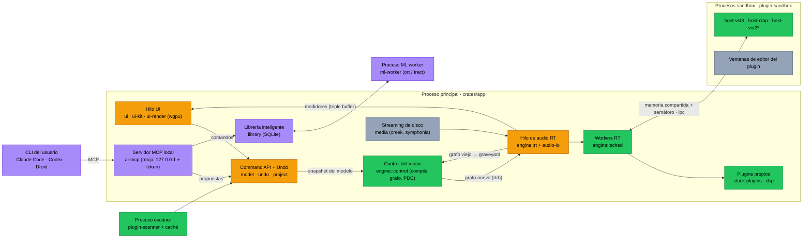
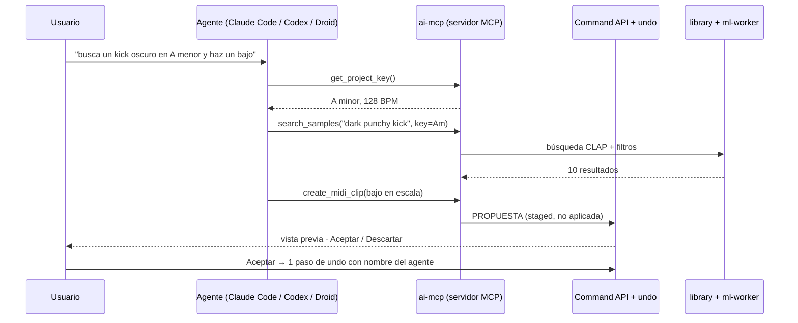
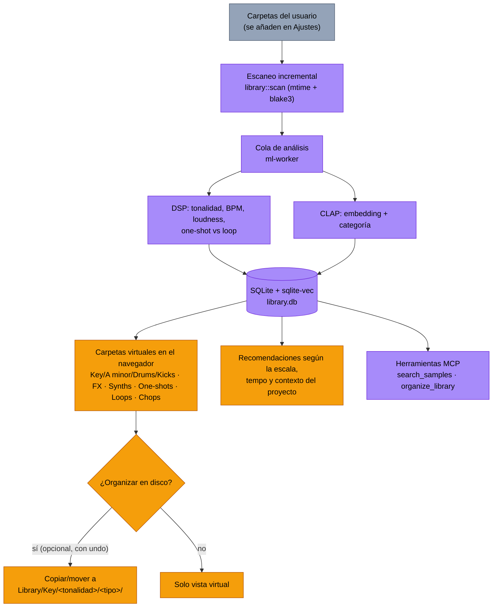

# AI-Track — Plan maestro del DAW

> DAW de música electrónica escrito 100 % en Rust, con interfaz por GPU, para **macOS y Windows**, que aloja **VST3, CLAP y VST2**, trae plugins propios y tiene IA integrada (BYO-subscription + ML local).
>
> Fecha: 2026-11-11 · Basado en 6 investigaciones en [`docs/research/`](docs/research/).

| # | Informe | Tema |
|---|---|---|
| 01 | [repos vibez + Lemon-Studio](docs/research/01-repos-vibez-lemon.md) | Arquitectura de referencia (GPL-3, solo ideas) |
| 02 | [repos futureboard + Pro-Wave](docs/research/02-repos-futureboard-prowave.md) | futureboard es MIT → módulos reutilizables |
| 03 | [Workflow y UX de DAWs](docs/research/03-daw-workflow-ux.md) | Ableton, FL Studio, Logic Pro, Pro Tools |
| 04 | [Plugins y DSP](docs/research/04-plugins-dsp-fabfilter-waves.md) | FabFilter, Waves, algoritmos, suite propia |
| 05 | [Stack técnico Rust](docs/research/05-rust-tech-stack.md) | UI GPU, audio, hosting, empaquetado, riesgos |
| 06 | [Integración de IA](docs/research/06-ai-integration.md) | MCP, suscripciones, ML local, librería inteligente |

---

## 1. Principios de diseño (no negociables)

1. **Command API en el centro.** Toda edición del proyecto es un comando serializable. Undo/redo, scripting, tests, autoguardado y los agentes de IA son clientes de la misma API. (Es lo que hizo posible que Gopher de FL Studio 2026 *actúe*; ver 03.)
2. **Hilo de audio sagrado.** Cero asignaciones, cero locks, cero strings, cero syscalls bloqueantes en el callback. Se verifica con un test (`assert_no_alloc`) en CI. Lo retirado vuelve a otro hilo para liberarse (patrón *graveyard*).
3. **Procesamiento por bloques con SIMD** y eventos con *offset* de muestra (automatización precisa a la muestra). Nunca muestra a muestra (defecto de futureboard y Pro-Wave).
4. **Plugins de terceros fuera de proceso** (sandbox estilo Bitwig) para que un crash no tumbe el DAW. Los plugins propios corren nativos en el grafo.
5. **Recursos mínimos.** UI que solo redibuja cuando algo cambia (sin tick permanente), un único backend GPU por SO (Metal en macOS, DX12 en Windows), modelos de IA descargados bajo demanda, perfil `release` con LTO + `codegen-units=1` + `strip`.
   - Objetivos (a validar en el prototipo): ejecutable 15–25 MB, instalador ≤ 20 MB, RAM en reposo ≤ 150 MB, frame UI < 4 ms con 200 pistas / 10 000 clips / 100 000 notas.
6. **Licencias limpias.** El producto no hereda GPL. `cargo-deny` bloquea GPL/LGPL/AGPL en CI (ver §9).
7. **Tempo map y compases desde el día 1**, I/O multicanal (no solo estéreo) desde el día 1.

---

## 2. Producto: el workflow unificado

Qué tomamos de cada DAW (detalle y los 13 conflictos resueltos en 03):

| De | Tomamos |
|---|---|
| **Ableton Live** | Interfaz general: Session View (clips lanzables) + Arrangement View sobre los **mismos** clips, Device View abajo, **Racks** (Instrument/Audio/Drum/MIDI) con cadenas y **16 macros con variaciones**, envolventes de clip, follow actions, warp, conciencia de escala global |
| **FL Studio** | **Piano Roll** (ghost notes, escala resaltada, chop/arp/strum/randomize/LFO, slides/portamento, propiedades por nota, stamp de acordes), **step sequencer** (dentro del Drum Rack), generadores/instrumentos, Patterns multipista opcionales |
| **Logic Pro** | **Lógica de mezcla**: channel strip, aux/bus, Track Stacks (Group = suma, Folder = organiza), **VCA**, Smart Controls (= vista de las macros), asistente de mastering, Chord Track |
| **Pro Tools** | I/O Setup con buses con nombre, modos de edición Slip/Grid/Shuffle/Spot (solo en Arrangement), playlists/comping, clip gain, freeze/commit, bounce offline |

### Modelo de datos unificado

```
Project
├─ TempoMap / TimeSignatureMap / Scale(global, opcional por clip)
├─ SourcePool        ── NoteSource | AudioSource  (contenido reutilizable)
├─ Tracks[]          ── Instrument | Audio | Group | Folder | Return | VCA | Main
│   ├─ SessionSlots[] ── ClipInstance → Source (enlazado o único)
│   ├─ Lanes/Playlists ─ ClipInstance[] en el Arrangement (tomas para comping)
│   ├─ DeviceChain   ── Device | Rack{ chains[], macros[16], variations[] }
│   └─ Automation    ── pista (absoluta) | envolvente de clip (absoluta o modulación relativa)
├─ Mixer             ── routing, sends, buses con nombre (I/O Setup)
└─ Patterns[]        ── opcional, multipista (estilo FL) → se aplanan a clips
```

### Ventana principal (borrador)

```
┌──────────────────────────────────────────────────────────────────────────────┐
│ Transporte · BPM · Compás · Escala: A minor · CPU · [✦ Asistente IA]          │
├────────────┬─────────────────────────────────────────────────┬───────────────┤
│ Navegador  │  Session View  ⇄  Arrangement View  (Tab)       │ Panel IA      │
│ ─ Librería │  pistas × escenas  |  timeline con lanes         │ chat/propues- │
│   inteligente (Key/Tipo/BPM)   |  automatización inline      │ tas · aceptar │
│ ─ Plugins  │                                                 │ / descartar   │
│ ─ Proyecto │                                                 │               │
├────────────┴─────────────────────────────────────────────────┴───────────────┤
│ Panel inferior (conmutable): Device View/Racks │ Piano Roll │ Step Seq │ Mixer │
└──────────────────────────────────────────────────────────────────────────────┘
```

---

## 3. Arquitectura de procesos e hilos



**Leyenda:** 🟧 nuevo, diseño propio · 🟩 nuevo, inspirado o reutilizado de futureboard-studio (MIT) · 🟪 capa de IA nueva · ⬜ dependencia externa / SO. *`host-vst2` solo tras la decisión legal (§9).

---

## 4. Stack tecnológico

| Área | Elección | Por qué / alternativas |
|---|---|---|
| Ventanas | `winit` 0.30 + `raw-window-handle` | Embeber editores de plugin (HWND/NSView) |
| Render GPU | `wgpu` 30 (solo Metal y DX12) + renderer propio (quads SDF, paths, atlas de glifos); `vello` opcional para vectores | Un solo stack GPU; el mismo toolkit sirve a las UI de nuestros plugins |
| Toolkit UI | **Propio y fino**: `taffy` (layout), `parley`/`swash` (texto), `accesskit` (accesibilidad); `egui` para herramientas internas | Alternativa evaluada en F0: **GPUI** (lo usa futureboard; rápido, pero pre-1.0, sin accesibilidad y sin uso probado dentro de ventanas de plugin) |
| Audio I/O | `cpal` 0.18 + `wasapi` (exclusivo) + ASIO (licencia propietaria gratuita) + CoreAudio | FFI propia para MMCSS "Pro Audio" (Win) y audio workgroups (macOS) |
| Motor | Propio: grafo compilado fuera del hilo RT, `rtrb` + `basedrop`, scheduler multinúcleo determinista, PDC, tempo map con rampas | Referencias: futureboard (`parallel.rs`, `graveyard.rs`, tempo map, planner de PDC) |
| Hosting | `vst3` 0.3 (MIT/Apache), `clack-host` 0.2, VST2 con cabecera clean-room BSD-3 tras *feature flag*; AU en fase 2 | **No** `vst3-sys` (GPLv3), **no** VeSTige/FST (GPL) |
| MIDI | `midir`, `wmidi`, `midly` (SMF), MPE; Windows MIDI Services | MIDI en vivo directo al hilo RT, nunca vía UI |
| Medios | `symphonia` (MPL-2.0), `hound`, `rubato`, `signalsmith-stretch` (MIT), `creek` | **No** Rubber Band (GPL) |
| Proyecto | `serde` con formato versionado + migraciones; contenedor SQLite con medios verificados por hash (idea de vibez) | Autoguardado incremental |
| DSP propio | `wide` (SIMD), `realfft`, núcleo independiente del formato | Exportar como CLAP primero, luego VST3 |
| IA | `rmcp` 3.9 (MCP), `ort` (ONNX Runtime, en proceso aparte), `tract` (modelos pequeños), `rusqlite` + `sqlite-vec` | Ver §6 |
| Distribución | Velopack o `cargo-packager`; firma + notarización en macOS (con entitlement `disable-library-validation`), NSIS + Azure Artifact Signing en Windows | `crash-handler` + `minidumper` |

### Workspace de Cargo

```
ai-track/
├─ Cargo.toml · deny.toml · xtask/          # perfiles, política de licencias, empaquetado
└─ crates/
   ├─ app/            bin "aitrack": composición y arranque
   ├─ model/ time/ undo/ project/           # modelo puro, tempo map, comandos, formato
   ├─ engine/ dsp/ stock-plugins/           # motor, primitivas DSP, plugins propios
   ├─ audio-io/ midi-io/                    # E/S con prioridades RT del SO
   ├─ plugin-api/ host-clap/ host-vst3/ host-vst2/ host-au/
   ├─ ipc/ plugin-sandbox/ plugin-scanner/  # aislamiento de plugins
   ├─ media/                                # decode, stretch, picos, streaming
   ├─ ui-render/ ui-kit/ ui/                # renderer wgpu, toolkit, vistas
   ├─ library/                              # librería inteligente (SQLite, carpetas virtuales)
   ├─ ml-worker/                            # bin aparte: inferencia ONNX
   ├─ ai-mcp/ ai-agents/                    # servidor MCP, adaptadores CLI/API-key
   ├─ platform/ crash/ test-utils/
```

Reglas de capas: `engine` no depende de `ui`; `model` no hace E/S; `ui` → `ui-kit` → `ui-render`; todo lo une `app`.

---

## 5. Plugins propios (suite v1)

Diseños **originales** inspirados en técnicas publicadas; nada de marcas, nombres ni aspecto visual de FabFilter/Waves (ver 04 §no-copiar). UX inspirada en la idea de que *la pantalla es el control*: bandas arrastrables sobre el espectro, panel flotante junto a la banda, modulación por drag & drop, UI vectorial redimensionable.

| Plugin | Algoritmo base | Latencia | Meta CPU* |
|---|---|---|---|
| EQ 8 bandas (dinámico, M/S, modo lineal) | Biquads matched (Vicanek) / SVF TPT (Simper); lineal por FFT particionada | 0 (natural) | ≤ 0,3 % |
| Compresor (varios estilos, sidechain, lookahead) | Giannoulis/Massberg/Reiss | 0–lookahead | ≤ 0,5 % |
| Limitador true-peak | Lookahead + mínimo deslizante, TP 4× (ITU-R BS.1770-5) | 48–240 muestras | ≤ 1 % |
| Saturador multibanda | ADAA + oversampling IIR polifásico, crossover LR4 | baja | ≤ 1,5 % |
| Reverb | FDN con decaimiento por frecuencia + placa Dattorro | 0 | ≤ 2 % |
| Delay, Filtro, Gate, Transient, Chorus/Phaser, Utility, Analizador | Estándar documentado en 04 | 0 | ≤ 0,5 % |
| Sampler + Drum Sampler (con step sequencer) | Streaming + interpolación sinc | 0 | — |
| Sintetizador wavetable/VA, 16 voces | PolyBLEP + wavetables band-limited por octava, filtros ZDF | 0 | ≤ 3 % |

\*Un núcleo, 48 kHz estéreo; son metas de diseño, se validan con benchmarks en M1 y Zen.

Framework de exportación: prototipo de 2 semanas con **clack** vs **truce** (nih-plug está en mantenimiento; `nice-plug` aún poco probado en macOS). El DSP no depende del framework.

---

## 6. Capa de IA

### 6.1 "Trae tu propia IA" (cumpliendo los términos de cada proveedor)

| Proveedor | Vía permitida | Lo que **no** podemos hacer |
|---|---|---|
| **Claude** | El usuario usa su **Claude Code** sin modificar (con su plan) y lo conecta al MCP del DAW, o el DAW lanza `claude -p` como subproceso. O bien API key propia | Ofrecer login de Claude.ai dentro de la app ni tocar sus tokens |
| **Codex / OpenAI** | `CODEX_API_KEY` del usuario; "Sign in with ChatGPT" solo si OpenAI aprueba la app (formulario) | Usar el login de ChatGPT vía app-server en un producto comercial |
| **Factory Droid** | Modo headless con `FACTORY_API_KEY` del usuario | — (revisar ToS antes de publicar) |
| **Devin** | API en la nube con token; solo tareas asíncronas | No llega al MCP local |

**Arquitectura:** el DAW expone un **servidor MCP local** (`rmcp`) con herramientas como `search_samples`, `get_project_key`, `create_midi_clip`, `add_device`, `set_param`, `organize_library`. Cualquier agente se conecta; el DAW nunca maneja credenciales de suscripción.



**Seguridad:** las ediciones del agente son *propuestas* que se aplican como un solo paso de undo; operaciones destructivas siempre piden confirmación (lo impone el DAW, no el agente); MCP solo en `127.0.0.1` con token; nombres y metadatos de samples van al modelo como datos, nunca como instrucciones; nada de IA en el hilo de audio.

### 6.2 ML local (sin suscripción)

| Función | Modelo / método | Licencia |
|---|---|---|
| Tonalidad y escala | Chroma + plantillas (Krumhansl), raíz para one-shots | propio |
| BPM de loops | Duración + onsets + nombre del archivo | propio |
| Clasificación (FX, Drums→Kick/Snare/Hat/Clap/Perc, Synth, Bass, Vocal, One-shot vs Loop, Chop) | Embeddings **CLAP** (~34 MB cuantizado) + clasificador ligero | verificar pesos |
| Búsqueda por texto / similitud | CLAP + índice plano o `sqlite-vec` | — |
| Audio → MIDI | **basic-pitch** (Spotify) | Apache-2.0 |
| Acordes, generación de MIDI en escala | Motor de teoría basado en reglas (+ modelos pequeños después) | propio |
| Separación de stems | HTDemucs: **bloqueado** hasta aclarar licencia de pesos o tener modelo propio | ⚠️ |

Bloqueados por licencia: Essentia (AGPL) y sus modelos (no comerciales), ADTOF, YourMT3, `bliss-audio`, `aubio` (GPL).

### 6.3 Librería inteligente



---

## 7. Hoja de ruta por fases

Cada fase termina con un criterio de salida verificable. Las duraciones dependen del tamaño del equipo y no se estiman aquí.

| Fase | Alcance | Criterio de salida |
|---|---|---|
| **F0 · Prototipos de riesgo** | (a) toolkit UI propio vs GPUI con 10 000 clips; (b) motor mínimo + `cpal` + MMCSS/workgroups; (c) cargar un VST3 y un CLAP en sandbox con editor embebido en ambos SO; (d) clack vs truce con Utility + EQ; (e) medir tamaño de binario | Decisiones de UI y framework de plugins tomadas con números; latencia de sandbox medida a 64 muestras |
| **F1 · Núcleo** | `model`, `time`, `undo`, `project`, Command API, motor por bloques con PDC y automatización precisa, transporte, export offline | Proyecto de prueba se renderiza bit-exact; test de cero asignaciones en verde |
| **F2 · MVP de producción** | Arrangement, Session básica, Piano Roll con escala y ghost notes, Drum Rack con step sequencer, cadena de dispositivos, mixer con sends, hosting VST3 + CLAP, sampler + synth propios, warp, clip gain, bounce | Se puede producir un track completo de principio a fin |
| **F3 · Profundidad** | Racks con macros y variaciones, envolventes de clip, follow actions, herramientas completas del Piano Roll, Folder/VCA, comping, freeze, suite completa de efectos | Paridad de workflow con las referencias en lo esencial |
| **F4 · Librería inteligente** | Escaneo, análisis DSP, CLAP, carpetas virtuales por Key/Tipo, organización en disco con undo | 10 000 samples analizados sin afectar al audio |
| **F5 · IA conectada** | Servidor MCP, modo API key, adaptadores headless (Claude Code, Droid, Codex), propuestas con aceptar/descartar | Un agente crea un bajo en escala y se deshace en 1 paso |
| **F6 · IA musical** | Audio→MIDI, detección de acordes, Chord Track, motor de teoría para generar MIDI | — |
| **F7 · Extra** | VST2 (si se aprueba), AU, stems (si la licencia se resuelve), asistente de mezcla/mastering, MPE, Ableton Link | — |

**Distribución desde F2:** CI con builds firmados para macOS (universal) y Windows, `cargo-deny`, tests golden de audio, fuzzing del host de plugins.

---

## 8. Qué reutilizamos de las referencias

| Repo | Licencia | Uso |
|---|---|---|
| **futureboard-studio** | MIT | **Código reutilizable con atribución:** cabecera VST2 clean-room, puente de memoria compartida (`audio_bridge.rs`, `rt_handoff.rs`), aislamiento del escáner + BD de plugins, `parallel.rs`, `graveyard.rs`, tempo map, planner de PDC, arnés de test de asignaciones, oversampler, reverb, crossover, wavetable/filtros, convolver, medidor de loudness. **No:** wrappers `vstplugins/*` (bindings GPL), pesos de drumsilencer (dataset no comercial), `SphereAudioPlugins`. |
| **vibez** | GPL-3 | Solo ideas: colas separadas para transporte, verificación de PDC con plugins de prueba, proyecto en SQLite con medios por hash |
| **Lemon-Studio** | GPL-3 | Solo ideas: plano de control con niveles read/propose/edit para IA, plugins de serie duales, pool multinúcleo determinista |
| **Pro-Wave** | GPL-3 | Solo ideas: cola de retorno con créditos, `IAudioClient3`, un solo backend GPU |

Errores a **no** repetir: `Mutex` sobre plugins o parámetros, reconstruir el motor en cada edición, tick de UI permanente, procesamiento muestra a muestra, MIDI vía hilo de UI, latencia de sandbox acumulada por plugin, dos stacks GPU, archivos de 24 000 líneas.

---

## 9. Riesgos principales

| # | Riesgo | Mitigación |
|---|---|---|
| 1 | **VST2**: Steinberg no da licencias desde 2018 | Cabecera clean-room BSD-3, solo en el sandbox, *feature flag*, sin usar el nombre "VST", **opinión legal escrita antes de publicar** |
| 2 | Contaminación GPL (vst3-sys, ASIO GPL, Rubber Band, FFTW…) | `cargo-deny` en CI; sustitutos listados en 05 |
| 3 | Coste de construir el toolkit UI propio | Prototipo F0 contra GPUI; `egui` para herramientas internas |
| 4 | Latencia/overhead del sandbox a buffers pequeños | Handoff en el mismo ciclo por memoria compartida + semáforo; agrupar plugins por proceso; opción "en proceso" |
| 5 | Compatibilidad con plugins comerciales | Matriz de pruebas con los 50 plugins más usados; lista negra persistente |
| 6 | Términos de uso de suscripciones de IA | Solo vías oficiales (§6.1); nunca manejar credenciales de suscripción |
| 7 | Licencias de pesos de modelos | Tabla de licencias por modelo; stems bloqueados hasta resolverse |
| 8 | Crates clave con un solo mantenedor (`vst3`, `clack-host`, `basedrop`, `wasapi`, `creek`) | Fijar versiones, estar listos para hacer fork |
| 9 | Firma/notarización en macOS bloquea plugins | Entitlement `disable-library-validation` desde el primer build firmado |
| 10 | Marcas y trade dress (FabFilter, Waves, SSL, Ableton…) | Nombres y diseño visual propios; revisión antes de publicar |

---

## 10. Decisiones tomadas (2026-11-11)

1. **Licencia: MIT, código abierto.** Seguimos sin poder copiar código GPL (vibez, Lemon-Studio, Pro-Wave): obligaría a relicenciar todo como GPL. futureboard-studio (MIT) sí se adapta con atribución en `NOTICE`.
2. **Interfaz: GPUI**, el mismo `gpui-pre` 0.3.9 parcheado que usa monoBOT (copiado en `vendor/`, Apache-2.0), con su mismo enfoque de tema, `motion` (curvas y duraciones compartidas) e iconos Hugeicons (MIT). Sustituye al toolkit propio de §4.
3. **Formatos: solo VST3 y CLAP.** Sin VST2 ni AU por ahora.
4. **IA desde el inicio:** audio→MIDI (basic-pitch, Apache-2.0) y separación de stems (Demucs ONNX). Los pesos de stems se descargan bajo demanda desde su origen, con aviso de licencia, en vez de redistribuirlos.
5. **Banco de sonidos incluido:** samples y presets gratuitos de EDM, pop, reggaetón, etc. Solo se empaquetan los packs con licencia que permita redistribuir (CC0, CC-BY o permiso explícito), descargados y verificados con `cargo xtask soundbank`. Los packs gratis que prohíben redistribución se ofrecen como enlaces en un "Content Hub" para que el usuario los descargue él mismo.
6. **Nombre:** AI-Track (provisional).
