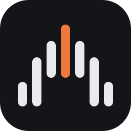
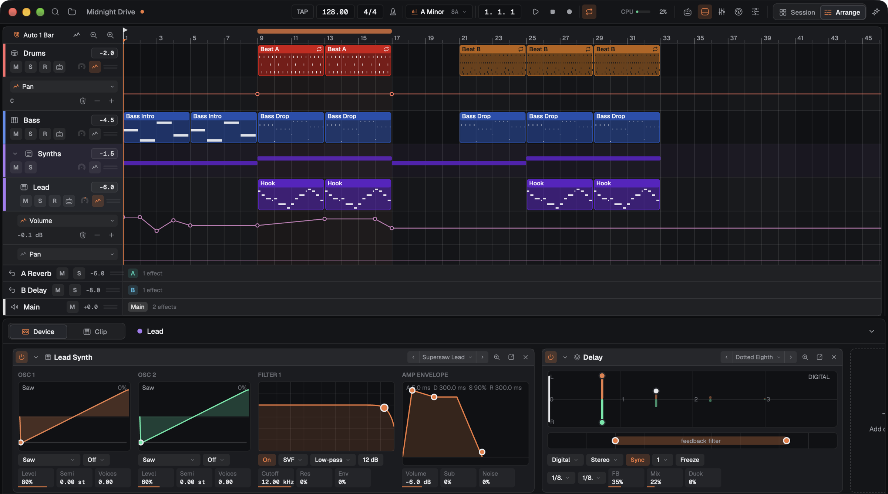
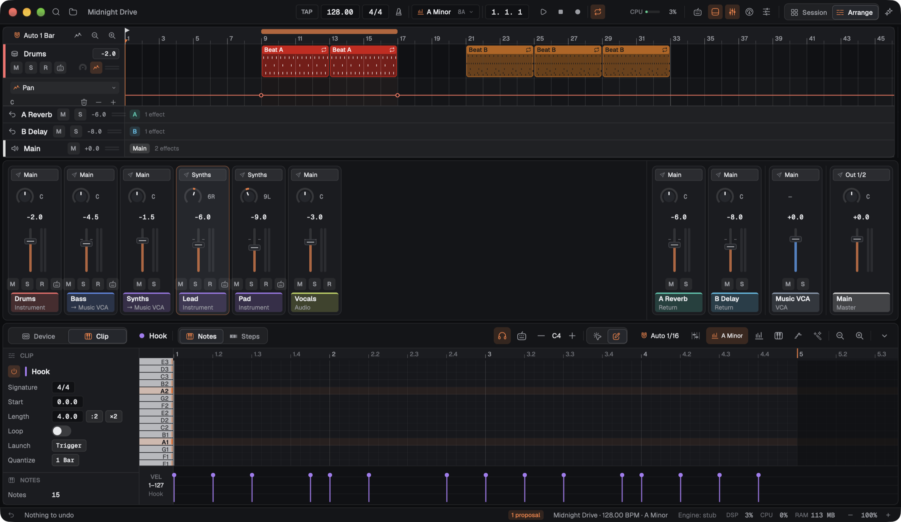
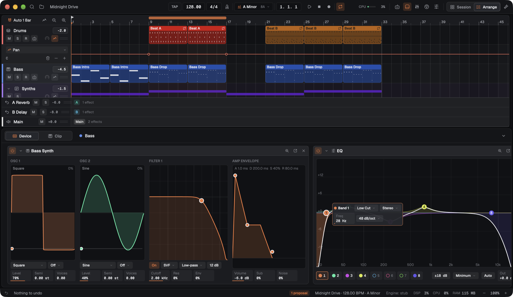
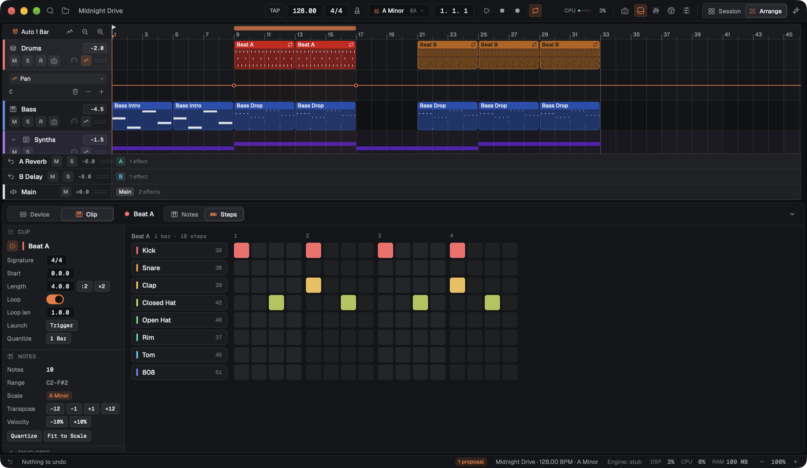
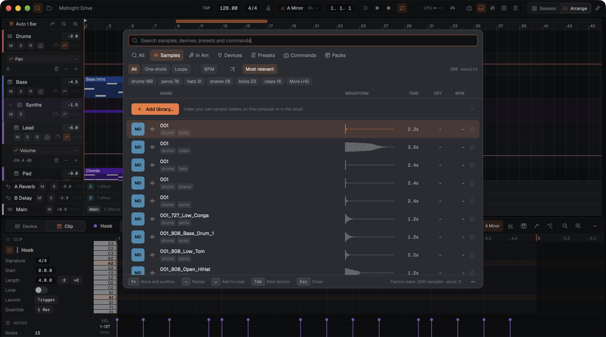
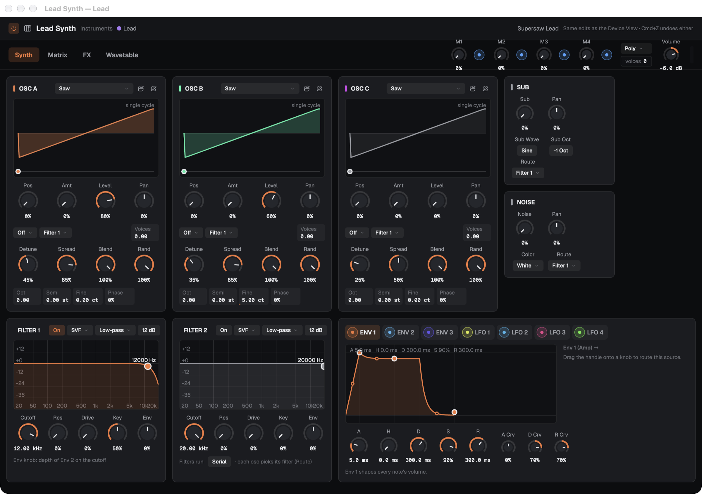
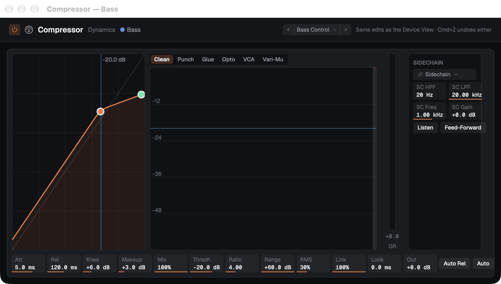
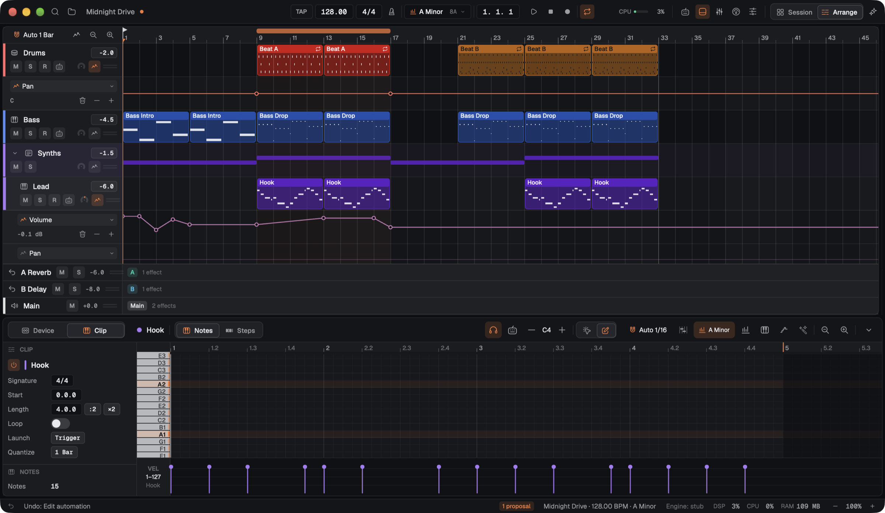

<p align="center">
  
</p>

<h1 align="center">AI-Track</h1>

<p align="center">
  A digital audio workstation for electronic music, written in Rust.<br>
  GPU-rendered interface, a command-based project model, hosted VST3/CLAP plugins and a stock device suite.
</p>

<p align="center">
  
  
  
  
</p>

<p align="center">
  
</p>

AI-Track is an early-stage project. The core editing, audio engine, plugin hosting and a good part of the stock devices work today, but expect rough edges. The master plan lives in [`PLAN.md`](PLAN.md) and the research behind it in [`docs/research/`](docs/research/).

## Design principles

- **Every edit is a `Command`.** The UI, scripts and AI agents change a project only through the Command API in `aitrack-model`. Undo/redo records the inverse of each command, and a batch of commands can be staged as a reviewable proposal before it is applied.
- **A protected audio thread.** The engine compiles the project into a graph off the real-time thread. Nothing allocates, locks or does I/O inside `Processor::process` or the audio callback, and retired objects are freed elsewhere.
- **Sample-accurate events.** Processing is block-based, with events (notes, parameters, automation) carrying a sample offset inside the block.
- **Plugins out of process.** Third-party plugins are scanned out of process and can run in a sandbox process so a crash does not take the session down. Stock devices run natively in the graph.
- **Clean licensing.** MIT code, no GPL/LGPL/AGPL dependencies (enforced with `cargo-deny`, see [`deny.toml`](deny.toml)).

## Features

The list below only covers what is implemented in the repository today.

**Editing and workflow**
- Arrangement view with tracks, groups, audio and MIDI clips, return tracks, a main bus and an early session (clip launching) view.
- Piano roll with scale awareness, a drum step sequencer, and a mixer with sends, sidechain routing and VCA tracks.
- Automation lanes for built-in and hosted-plugin parameters, with sample-accurate breakpoints in the engine.
- Tempo map, time signatures and a project key; audio clips with warping and sample editing.
- Device racks with parallel chains, undo/redo across every edit, export of mixdowns or stems to WAV or MP3.
- Command palette (Cmd/Ctrl+K) for samples, devices, presets, commands and packs.

**Stock devices** (`crates/stock`, each with factory presets)
- Instruments: Wavetable Synth, Vault (analog, FM and keys engines), Acid 303, Kick 808, Sampler (with SFZ support), Drum Sampler.
- Effects: EQ, Compressor, Limiter, Saturator, Tape, Amp, Console, Clipper, Multiband, Mid/Side, Reverb, Delay, Filter, Gate, Transient Shaper, Chorus, Shaper, Utility.
- Analysis: Analyzer (spectrum, loudness) and Drum Extractor.

**Plugin hosting** (`crates/host`)
- VST3 and CLAP, on macOS and Windows. No VST2, no AU.
- Incremental scanner with a cache and a blocklist, native editor windows, an optional out-of-process sandbox.

**Sample library** (`crates/library`)
- SQLite index of your own sample folders (including cloud-synced folders), with full-text search, background scanning and a file watcher.
- Automatic key, BPM, loop/one-shot and category analysis; a downloadable factory sound bank (see below).
- An opt-in Splice preview integration lives in `crates/splice`. It uses an unofficial web API; see [`NOTICE`](NOTICE).

**Local audio analysis and ML** (`crates/ai`)
- Key, BPM and chord detection, monophonic and drum audio-to-MIDI, and the Drum Extractor pipeline, all in plain DSP.
- Stem separation and a neural audio-to-MIDI model run through ONNX. Models are downloaded on demand and never bundled.
- The assistant panel can use a coding-agent CLI you have installed and signed in to (Claude Code or Codex) as a child process; AI-Track never handles credentials. For now the agent answers in text, with the project as context. See [Roadmap](#roadmap).

## Screenshots

<table>
  <tr>
    <td></td>
    <td></td>
  </tr>
  <tr>
    <td align="center">Mixer</td>
    <td align="center">Device view</td>
  </tr>
  <tr>
    <td></td>
    <td></td>
  </tr>
  <tr>
    <td align="center">Step sequencer</td>
    <td align="center">Sample browser (Cmd/Ctrl+K)</td>
  </tr>
  <tr>
    <td></td>
    <td></td>
  </tr>
  <tr>
    <td align="center">Wavetable Synth editor window</td>
    <td align="center">Compressor editor window</td>
  </tr>
</table>

<p align="center">
  <br>
  Automation lanes
</p>

The screenshots show the bundled demo project ("Midnight Drive") running on macOS.

## Install

Download the installer for your system from the [latest release](https://github.com/crhistian-cornejo/AI-Track/releases/latest):

- **macOS 13+** (Apple Silicon and Intel): `AI-Track-<version>-macos-universal.dmg`. Open it and drag AI-Track to Applications.
- **Windows 10/11 (x64)**: `AI-Track-<version>-windows-x86_64-setup.exe` (per-user, no administrator rights), or the `-portable.zip`.

`SHA256SUMS.txt` lists the checksums of every file. Installed copies check for new versions by themselves.

Early builds are not signed with an Apple or Windows certificate yet, so the system warns the first time:

- **macOS** ("cannot be opened because the developer cannot be verified"): right-click AI-Track in Applications, choose **Open**, then **Open** again. Or run `xattr -dr com.apple.quarantine /Applications/AI-Track.app`.
- **Windows** ("Windows protected your PC"): choose **More info**, then **Run anyway**.

## Building

**Requirements**

- Rust 1.90 or newer (edition 2024), installed with [rustup](https://rustup.rs).
- macOS: Xcode command line tools (the interface renders with Metal).
- Windows: the MSVC build tools (the interface renders with DirectX 12).
- GPUI is vendored in `vendor/gpui-pre*` and pinned; do not update it.

**Build and run**

```sh
git clone https://github.com/crhistian-cornejo/AI-Track
cd AI-Track
cargo run -p aitrack-app --release
```

The binary is named `aitrack`. A few environment variables are useful during development:

| Variable | Effect |
|---|---|
| `AITRACK_DEMO=1` | Start with the demo project instead of an empty one. |
| `AITRACK_STUBS=1` | Use a stub engine and plugin catalog (no audio device needed). |
| `AITRACK_CONFIG_DIR=<dir>` | Use a separate configuration directory. |

**Sound bank**

The factory sound bank is not stored in git. Download the redistributable packs listed in [`content/soundbank/manifest.toml`](content/soundbank/manifest.toml), verify them and index them with:

```sh
cargo xtask soundbank
```

Each pack keeps its own license next to it; credits are in [`content/soundbank/ATTRIBUTION.md`](content/soundbank/ATTRIBUTION.md).

**Checks**

```sh
cargo check --workspace
cargo test -p <crate>
cargo clippy -p <crate>
```

The repository is formatted by hand; please do not run `cargo fmt` over it.

## Repository layout

| Path | Purpose |
|---|---|
| [`crates/model`](crates/model) | Pure project model, tempo map, scales, the Command API, undo and proposals. No I/O, no GPUI. |
| [`crates/dsp`](crates/dsp) | The `Processor` trait, audio buffers, events, parameters and DSP primitives. |
| [`crates/stock`](crates/stock) | Built-in instruments and effects and their factory presets. |
| [`crates/engine`](crates/engine) | Real-time engine: compiled graph, transport, audio and MIDI I/O. |
| [`crates/host`](crates/host) | VST3 and CLAP hosting, scanner, cache and sandbox. |
| [`crates/library`](crates/library) | Smart sample library, sound bank and cloud-folder handling. |
| [`crates/ai`](crates/ai) | Audio analysis, audio-to-MIDI, stems and the ONNX model manager. |
| [`crates/splice`](crates/splice) | Opt-in Splice preview search for the command palette. |
| [`crates/app`](crates/app) | The `aitrack` binary: the GPUI interface that draws state and issues commands. |
| [`xtask`](xtask) | Project tasks, including `cargo xtask soundbank`. |
| `vendor/` | Pinned and patched GPUI. |
| [`docs/`](docs) | Research reports and the list of pending work. |

## Platforms

macOS and Windows. Development and testing happen mostly on macOS; the Windows build compiles but has had far less hands-on testing. There is no Linux target.

## Roadmap

The full plan is in [`PLAN.md`](PLAN.md) and the current list of open items in [`docs/PENDING.md`](docs/PENDING.md). Notable items that are not finished:

- An MCP server so external agents can drive the Command API directly (today the assistant only answers in text).
- Audio recording to disk, track freeze/flatten and take comping.
- Semantic (embedding-based) sample search.
- Streaming of very large sample sets, explicit SIMD in hot loops and configurable sandbox grouping.
- More testing on real hardware and on Windows.

## Contributing

Issues and pull requests are welcome. Read [`CLAUDE.md`](CLAUDE.md) for the project rules (Command API for every edit, no allocation on the audio thread, theme tokens for all colors, tests next to the code).

## License

AI-Track is released under the [MIT License](LICENSE). Third-party work it includes or learns from is listed in [`NOTICE`](NOTICE). The audio packs in the sound bank have their own licenses.
