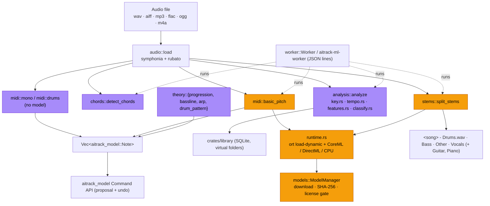

# aitrack-ai

Audio analysis and local machine learning for AI-Track: key / BPM / category
analysis for the smart sample library, audio-to-MIDI, stem separation, chord
detection and rule-based music theory. Nothing here runs on the audio thread.



Legend: purple = pure DSP (instant, no download); orange = ONNX models downloaded on demand.

## Public API

| Function | What it does |
|---|---|
| `analyze(path) -> Result<SampleAnalysis>` | Decode and analyse: duration, rate, channels, `bpm: Option<(bpm, conf)>`, `bars`, `key: Option<(Scale, conf)>`, top-3 key candidates, `root_note` (one-shots), `is_loop`, `category` / `subcategory` / confidence, `loudness` (LUFS-I, peak, RMS), `features`. Serde-serialisable. Folder names count as hints (`Kicks/001.wav`). |
| `analyze_audio(&AudioData, name)` | Same on decoded audio. |
| `detect_key(samples, sr) -> Option<KeyEstimate>` | Major/minor key, confidence, top 3, chroma. |
| `detect_bpm(samples, sr)` / `tempo::detect_bpm_with(.., &BpmOptions)` | Tempo with confidence, source (signal / duration / filename) and loop length in bars. |
| `tempo::bpm_from_filename("Loop_124bpm.wav")` | "124bpm", "BPM 95", "_128_"; ignores 808/909. |
| `ModelManager::{new, with_dir, list, entry, ensure, ensure_cancellable, accept_license, is_accepted, installed, remove}` | Model catalogue and downloads. |
| `extract_midi(path, &MidiOptions, progress) -> Result<Vec<Note>>` | Audio → MIDI with `MidiEngine::{BasicPitch, Monophonic, Drums}`; options: onset / frame threshold, min length, quantise grid, snap to scale, note range, pitch bends → `Note::fine_pitch`, tempo. `midi::extract_midi_with` takes a manager and a `CancelToken`. |
| `split_stems(path, out_dir, &StemOptions, progress, &cancel) -> Result<Vec<PathBuf>>` | Demucs stems as WAV. |
| `detect_chords(samples, sr, &ChordOptions) -> Vec<ChordSegment>`, `chords::chords_per_bar(..)` | Chord symbols per beat segment / per bar for the Chord Track. |
| `theory::{parse_roman, progression, bassline, arp, drum_pattern, ProgressionPreset, BassStyle, ArpPattern, DrumStyle}` | Rule-based generation in a `Scale`, returning `Note`s (local ids 1..n). |
| `worker::{Worker, Job, JobOutput, run_job, serve, ProcessWorker}` | Thread pool and the `aitrack-ml-worker` process protocol. |

Notes returned by this crate carry local ids (`NoteId(1..=n)`); insert them through
`aitrack_model` commands, which allocate project ids.

## Models

Nothing is bundled. Models are downloaded into `%APPDATA%\AI-Track\models`
(Windows) or `~/Library/Application Support/AI-Track/models` (macOS), override
with `AITRACK_MODELS_DIR`. Every file has a pinned SHA-256 and is verified after
download; downloads resume from `<file>.part`. TLS uses the OS trust store
(works behind corporate proxies).

| id | File | Size | License | Source |
|---|---|---|---|---|
| `basic-pitch` | `nmp.onnx` (basic-pitch v0.4.0) | 230 444 B | Apache-2.0 | `raw.githubusercontent.com/spotify/basic-pitch/v0.4.0/basic_pitch/saved_models/icassp_2022/nmp.onnx`, sha256 `2c3c1d14…a0ec` |
| `htdemucs` | `htdemucs.onnx` | 316 446 953 B | **unclear** (code MIT; repo tagged MIT; weights described by the authors as research-only) | `huggingface.co/StemSplitio/htdemucs-onnx` @ `d54ed9eb…`, sha256 `68d0bf16…5e74` |
| `htdemucs-6s` | `htdemucs_6s.onnx` | ~258 MB | **unclear** (same) | `huggingface.co/StemSplitio/htdemucs-6s-onnx` @ `49df9b69…`, sha256 `48f8e849…779a` |
| `onnxruntime` | ONNX Runtime 1.31.1 (Windows x64 / arm64 CPU; macOS arm64 with CoreML) | 82.9 / 85.9 / 36.9 MB archives | MIT | official GitHub release of microsoft/onnxruntime |
| `onnxruntime-directml` | Microsoft.ML.OnnxRuntime.DirectML 1.24.4 + Microsoft.AI.DirectML 1.15.4 (Windows x64) | 12.5 + 202 MB packages (36 MB installed) | MIT / Microsoft DirectML license | nuget.org |

Demucs entries have `requires_acceptance: true` and a `notice`: `ensure` returns
`Error::LicenseNotAccepted` until the UI shows the notice and calls
`accept_license(id)`.

### ONNX Runtime

`ort` 2.0.0-rc.15 with `load-dynamic`: the app links nothing at build time. On
first ML use `runtime::ensure_loaded` installs the platform's runtime and loads
it (`AITRACK_ORT_DYLIB` overrides the path). Only the API-17 baseline is
enabled, so any runtime ≥ 1.17 loads (DirectML builds stopped at 1.24 on NuGet).
Execution providers: CoreML (macOS), DirectML (Windows, with the DirectML
runtime), always followed by CPU. `AITRACK_ORT_THREADS` sets intra-op threads.
Intel Macs have no official 1.31 build: the ML features report
`UnsupportedPlatform` there.

### Demucs ONNX contract

The expected file is the StemSplit export of `htdemucs` (opset 17, STFT/iSTFT
rewritten as convolutions inside the graph):

* input `mix`: `float32[1, 2, 343980]` (7.8 s, 44.1 kHz stereo, −1..1)
* output `stems`: `float32[1, S, 2, 343980]`, S = 4 `[drums, bass, other, vocals]` or 6 `[…, guitar, piano]`

The segment length and S are read from the model's declared shapes when static.
Any export with that I/O works (e.g. your own `demucs-onnx export htdemucs`).

### Stem output

Always WAV: 24-bit integer by default (`WavFormat::Float32` optional), at the
source's sample rate, resampled from 44.1 kHz with rubato's sinc resampler.
Every stem is exactly as long as the input and sample-aligned. Files are named
`<song> - Drums.wav`, `<song> - Bass.wav`, `<song> - Other.wav`,
`<song> - Vocals.wav` (+ `Guitar`, `Piano`). Segments overlap by 25 % with
linear cross-fades; `shifts > 1` averages time-shifted passes like Demucs.

## basic-pitch implementation

Pre-processing and note creation follow the reference (`basic_pitch/inference.py`,
`note_creation.py`, v0.4.0): 22 050 Hz mono, 43 844-sample windows with 30
overlapping frames (hop 36 164), half-overlap trimming, per-window time-offset
correction, onset peak picking (`argrelmax`), energy-tracked note ends
(tolerance 11 frames), inferred onsets, the melodia trick, frequency limits and
the Gaussian pitch-bend search. Defaults: onset 0.5, frame 0.3, minimum 127.7 ms.

## Accuracy notes

* Key: tested on synthetic triads, progressions and scales (C major, A minor).
  Relative major/minor confusion is the common failure on real music; check
  `key_candidates`.
* BPM: click tracks at 90 / 128 / 174 BPM within ±0.6 BPM; loops cut to whole
  bars snap to the exact tempo. Half/double ambiguity is resolved toward 70–180.
* Category: filename keywords (English, Spanish, Portuguese, French, Italian,
  German) are reliable; the feature fallback is heuristic. A CLAP-based classifier
  is planned.
* basic-pitch on a synthetic arpeggio: exact notes; sustained chords can add faint
  harmonic "ghost" notes (raise `frame_threshold` or limit the range).

## Tests

```
cargo test -p aitrack-ai                       # synthetic-signal tests, no network
cargo test -p aitrack-ai -- --ignored          # downloads basic-pitch, ONNX Runtime, HT-Demucs
```

Network tests cache downloads in `%TEMP%/aitrack-test-models` (or `AITRACK_MODELS_DIR`).
