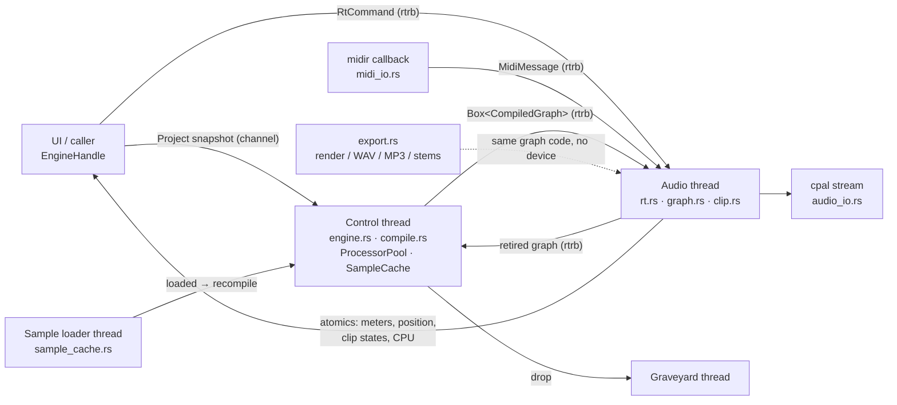

# aitrack-engine

Real-time audio engine of AI-Track: graph compiler, transport, Session
View clip launching, audio and MIDI I/O, offline render and export.

## Architecture



* **Compile off the RT thread.** `compile()` turns a `Project` into a
  `CompiledGraph`: tracks in topological order (cycles rejected), routing
  (Main, Groups summing children, Returns via sends, Folder/VCA carry no
  audio, VCA scales members), solo/mute, device chains with racks (parallel
  chains summed, drum-rack routing by note, macros applied to mapped
  params), automation lanes, clips, and PDC delays on every edge so all
  paths align at the output.
* **Swap without blocking.** The graph goes to the audio thread through an
  `rtrb` queue. The audio thread installs it only if the retire queue has
  room, moves runtime state over (active notes, Session playback, fader
  smoothers, PDC delay contents) and sends the old graph back; the control
  thread forwards it to the graveyard thread, which drops it.
* **Processors survive edits.** `ProcessorPool` keeps one `Arc<SharedProcessor>`
  per `DeviceId`; a recompile reuses it while the device kind is unchanged
  and only re-sends changed parameters. Plugin state is never rebuilt on edit.
* **The audio thread never allocates, locks or does I/O**
  (`tests::audio_thread_never_allocates`, with a counting global allocator,
  covers playback, graph swaps, launches, MIDI and transport changes).

Processing per track and segment (segments split at loop wraps, launches,
count-in end): clip player → device chain (sub-blocked every 32 samples
when device params/macros are automated) → pre-fader sends → volume/pan
(equal power, centre = unity) / mute / VCA, ramped every 32 samples →
post-fader sends → meter → PDC delay → destination. Automation is evaluated
at the musical time of the signal (shifted by the accumulated latency).

## Public API

```rust
pub trait ProcessorFactory: Send + Sync {
    fn create(&self, device: &aitrack_model::Device, sample_rate: f64, max_frames: usize)
        -> Option<Box<dyn aitrack_dsp::Processor>>;
}
pub struct FactoryStack;          // tries several factories in order
pub mod fallback;                 // test.synth / test.gain / test.latency (feature `test-nodes`)

impl Engine {
    pub fn new(config: EngineConfig, factory: Arc<dyn ProcessorFactory>)
        -> Result<(EngineHandle, Option<AudioProcessor>), EngineError>;
}
// EngineConfig { audio: Option<AudioConfig> (None = headless), headless_sample_rate,
//                max_block, midi_inputs, count_in_bars }

impl EngineHandle {
    // project
    fn update_project(&self, &Project);  fn update_project_arc(&self, Arc<Project>);  fn flush(&self);
    // transport
    fn play(&self); fn stop(&self); fn pause(&self); fn seek(&self, Tick);
    fn set_loop(&self, Option<(Tick, Tick)>); fn set_metronome(&self, bool); fn toggle_metronome(&self) -> bool;
    fn set_count_in(&self, bars: u32); fn set_recording(&self, bool);
    // Session View
    fn launch_clip(&self, TrackId, SceneId); fn launch_scene(&self, SceneId); fn stop_track(&self, TrackId);
    fn stop_all_clips(&self); fn back_to_arrangement(&self); fn set_global_quantize(&self, Quantize);
    fn clip_states(&self) -> Vec<ClipSlotStatus>;   // Stopped / Queued / Playing / StopQueued + progress
    // MIDI
    fn set_midi_target(&self, Option<TrackId>); fn send_midi(&self, MidiMessage) -> bool;
    fn midi_inputs(&self) -> Vec<MidiPortInfo>; fn open_midi_input(&self, &str) -> Result<..>; fn close_midi_input(&self, &str);
    // outputs (lock-free reads of atomics)
    fn position_ticks(&self) -> f64; fn is_playing(&self) -> bool;
    fn meters(&self, TrackId) -> Option<MeterReading>; fn master_meter(&self) -> MeterReading;
    fn cpu_load(&self) -> (f32, f32); fn xruns(&self) -> u64;
    fn latency(&self) -> u32; fn track_latencies(&self) -> Vec<(TrackId, u32)>;
    fn last_error(&self) -> Option<String>; fn warnings(&self) -> Vec<String>;
    // devices
    fn hosts(&self) -> Vec<String>; fn devices(&self) -> Vec<AudioDeviceInfo>;
    fn set_device(&self, Option<AudioConfig>) -> Result<Option<ActiveAudio>, EngineError>;
    fn active_audio(&self) -> Option<ActiveAudio>; fn audio_config(&self) -> Option<AudioConfig>;
}

impl AudioProcessor {   // headless driving (tests, custom backends)
    fn process_interleaved(&mut self, &mut [f32], channels: usize);
    fn process_planar(&mut self, &mut AudioBuffer);
}

// offline
pub fn render_offline(project, factory: &dyn ProcessorFactory, range_ticks: (Tick, Tick),
                      sample_rate: f64, block: usize) -> Result<AudioBuffer, EngineError>;
pub fn render(project, factory, &RenderOptions, stems: &[TrackId], progress) -> Result<Rendered, EngineError>;
pub fn export_wav(project, factory, path, &RenderOptions, WavFormat, progress);
pub fn export_mp3(project, factory, path, &RenderOptions, &Mp3Tags, &Lame, progress);
pub fn export_stems(project, factory, dir, &RenderOptions, tracks: &[TrackId], WavFormat, progress) -> Result<Vec<PathBuf>, _>;
pub fn write_wav(path, &AudioBuffer, sample_rate: u32, WavFormat);
```

### Audio settings

`AudioConfig` (serde, every field optional) selects host/driver, output and
input device (by id, then by name), output/input channel pair, sample rate
(44.1–192 kHz, whatever the device reports) and buffer size (32–4096,
clamped to the device range). Anything that disappeared falls back (default
device, device default rate, clamped buffer, channels 1–2) and the fallbacks
are listed in `ActiveAudio::notes`. A lost device is reopened automatically
(preferred device first, then the default one). The engine mixes in `f32`
at the device rate; audio files are resampled with rubato's 256-tap sinc.

* **ASIO**: feature `asio` (off by default). Build only against the ASIO SDK
  under Steinberg's free **proprietary** licence, never the GPLv3 option.
* **WASAPI exclusive**: accepted in the config but cpal opens shared streams
  only; the engine falls back to shared and says so. A `wasapi`-crate backend
  is the planned fix.
* **Thread priority**: MMCSS "Pro Audio" (critical) on the first callback on
  Windows. macOS: CoreAudio's IO thread is already real-time; joining the
  device's audio workgroup is a TODO for when worker threads exist.

### Export

* WAV 16-bit (TPDF dither ±1 LSB, optional first-order noise shaping),
  24-bit, 32-bit float. Dither is only ever applied at 16-bit.
* Export rate 44.1/48 kHz or higher; resampled with the sinc resampler when
  it differs from the session rate (length = ⌈frames·to/from⌉).
* MP3: always 320 kbps CBR, joint stereo, LAME quality 2, ID3v2.3 tag
  (title, artist, BPM, key). LAME (LGPL) is **loaded at runtime** with
  `libloading` (`Lame::load`), never linked; the app downloads or locates
  `libmp3lame` like the ONNX runtime and ships LAME's licence and a source
  link with it. Without the library, MP3 export returns a clear error.
* Stems: always WAV, one file per selected track/group/return, captured
  post-fader in the same render, PDC-aligned with the mix, same length
  (tail included).
* Options: range (song / loop / selection), tail seconds, peak normalize
  (one shared gain for stems), progress callback returning `false` to cancel.

### Normalised automation values

| target | mapping |
|---|---|
| Volume, Send | `v·76 − 70` dB (`0` = silence, `≈0.921` = 0 dB, `1` = +6 dB) |
| Pan | `2v − 1` |
| Mute, DeviceEnabled | `v ≥ 0.5` |
| DeviceParam, Macro | as is |
| Tempo (on Main) | `20 + v·280` BPM, folded into the tempo map as ramps |

## Not done yet

* Parallel worker pool (tracks are processed on the audio thread in
  topological order; the graph is ready for level-based scheduling).
* Clip envelopes, MIDI racks, launch modes Gate/Repeat (behave as Trigger),
  scene tempo, recording to disk, disk streaming (`creek`), pitch-preserving
  warp (hook: `AudioClipData::source_frame`), WASAPI exclusive, macOS
  workgroups, nested VCAs.

## Tests

`cargo test -p aitrack-engine`: golden renders (note timing, tempo ramps,
loop wrap, clip loops, automation ramps, device-param automation, PDC with a
known-latency node, rack chain alignment), routing (cycles, invalid routes,
groups, returns, solo/mute/VCA), Session (launch quantize, stop, follow
actions, states), live MIDI, metronome, count-in, processor reuse, audio
clips with gain and repitch warp, export (bit depths, dither only at
16-bit, resampled length, stems alignment, normalize, cancel), and the
zero-allocation test. `examples/play_demo.rs` plays a short demo on the
default device (`-- --quiet` mutes it, `-- --list` lists devices).
