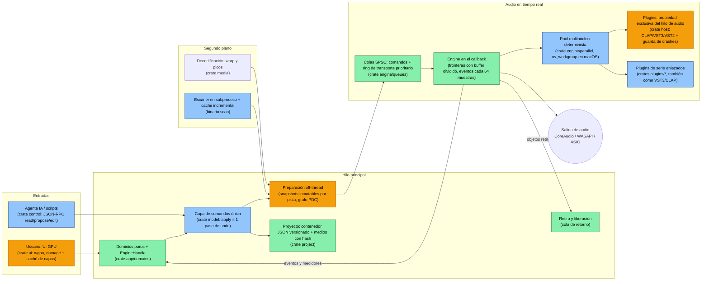

# Investigación 01: vibez y Lemon Studio como referencias de arquitectura

Fecha: 2026-11-11
Alcance: lectura estática de dos DAW open-source escritos en Rust, clonados en `reference/vibez` y `reference/Lemon-Studio`. No se compiló ni ejecutó nada de ellos.

**Aviso de licencia.** Ambos proyectos son GPL-3.0-or-later. Nuestro DAW solo toma ideas y arquitectura de ellos; no copia código. Este documento describe diseños con fragmentos mínimos o sin ellos, y cualquier implementación nuestra debe escribirse desde cero a partir de las especificaciones públicas (CLAP, VST3, la documentación de las APIs del sistema).

Convención de citas: las rutas son relativas a la raíz de cada repo. `vibez:` significa `reference/vibez/` y `lemon:` significa `reference/Lemon-Studio/`.

Ambos clones son superficiales (un solo commit visible): vibez en `ef6fc46` (2026-11-10) y Lemon en `415eaf2` (2026-11-09). No hay historial para medir la velocidad de desarrollo.

---

## 0. Resumen ejecutivo

| Eje | vibez (v0.6.6, alfa) | Lemon Studio (v0.0.1, pre-alfa) |
|---|---|---|
| Tamaño | unos 139 k líneas de Rust, 10 crates | unos 327 k líneas de Rust, 17 crates, 29 crates de plugins y 13 herramientas |
| Inspiración | Ableton/MPC: Perform (Sections/Clips), Arrange, Mix | Clon de FL Studio: channel rack, playlist, patrones, importa `.flp` |
| UI | iced 0.13 (wgpu, retained/Elm), canvas con caché | **Renderizado por CPU**: winit + softbuffer + tiny-skia, modo inmediato con *damage rects* |
| Hilo de audio | El engine corre **dentro del callback** de cpal; un solo hilo | Un **hilo feeder** renderiza por adelantado a una cola lock-free; el callback solo copia; pool multinúcleo |
| UI↔audio | `rtrb` SPSC (comandos y eventos) más un ring aparte para transporte | Reconstrucción del `Engine` completo por edición (swap bajo `Mutex`), con `LiveEdit` para niveles |
| Plugins | VST3 (crate `vst3` 0.3) y CLAP (`clap-sys` 0.5). **Sin VST2** | CLAP, VST3 (`vst3-sys`), **VST2 clean-room**, y plugins nativos de FL (experimental) |
| Escaneo | Subproceso `vibez-plugin-scan` con timeout | Subproceso `--scan-plugin`, 4 en paralelo, caché incremental |
| Crash de plugin | Solo `catch_unwind` (no atrapa segfaults) | Guarda en C: SEH en Windows y señales en Unix, en proceso |
| PDC | Muy completo: plan de compensación por grafo, con oráculos de muestra | Sí: *pads* por ruta y automatización retrasada para el audio tardío |
| Tempo | **Tempo único**, sin automatización de tempo ni compases | Reloj de ticks con cambios de tempo; compás fijo de 4 tiempos en el arranger |
| Proyecto | JSON dentro de un contenedor SQLite (`.vzp`) con medios embebidos y SHA-256 | Flujo de eventos FLP sin pérdida más el chunk propio `LMex` (`.lemon`) |
| IA | Nada | **Plano de control JSON-RPC** pensado para asistentes de IA (read/propose/edit) |
| Tests | Unos 3 000 `#[test]` | Unos 2 640 `#[test]` (96 `#[ignore]`, que necesitan dispositivo de audio) |

Conclusión rápida: vibez es la mejor referencia para la **disciplina de tiempo real** (cero asignaciones en el callback, retiro de objetos hacia la UI, tests que miden asignaciones, PDC verificado por oráculos). Lemon es la mejor referencia para el **producto** (flujo de patrones de música electrónica, plugins de serie que también se distribuyen como VST3/CLAP, VST2, multinúcleo, plano de control para IA). Ninguno cumple nuestro requisito de UI por GPU con CPU mínima en reposo: vibez usa wgpu vía iced pero refresca a 60 fps siempre, y Lemon pinta por CPU.

---

## 1. vibez

### 1.1 Layout del workspace y dependencias

Raíz: `vibez:Cargo.toml` (workspace, edición 2021, versión 0.6.6). El binario `vibez` (`vibez:src/main.rs`) es un envoltorio fino sobre `vibez-ui`, y existe un segundo binario, `vibez-plugin-scan` (`vibez:src/bin/vibez-plugin-scan.rs`, `vibez:crates/vibez-plugin-host/src/bin/vibez-plugin-scan.rs`).

| Crate | Función (según `vibez:docs/ARCHITECTURE.md` y el código) |
|---|---|
| `vibez-core` | Tipos compartidos: pistas, clips, MIDI, IDs, automatización, routing, tempo y detección de onsets (`vibez:crates/vibez-core/src/*.rs`) |
| `vibez-engine` | Engine de tiempo real: mezclador, transporte, PDC, render offline (unos 150 archivos, la mayoría tests) |
| `vibez-audio-io` | E/S con cpal, prioridad RT, MIDI in, decodificación de archivos (`vibez:crates/vibez-audio-io/src/`) |
| `vibez-dsp` | Efectos de serie y time-stretch (`vibez:crates/vibez-dsp/src/`) |
| `vibez-instruments` | Sintetizador sustractivo, wavetable, FM, sampler y drum rack (`vibez:crates/vibez-instruments/src/`) |
| `vibez-plugin-host` | Hosting de VST3 y CLAP, escaneo en sandbox, ventanas de editor (`vibez:crates/vibez-plugin-host/src/`) |
| `vibez-plugin-host/tests/fixtures` | Plugins de prueba propios (CLAP y VST3) para tests de routing y latencia |
| `vibez-project` | Formato de proyecto: JSON y contenedor SQLite (`vibez:crates/vibez-project/src/project_format_v1.rs`) |
| `vibez-dropbox` | Navegador de samples remoto en Dropbox (reqwest y tokio) |
| `vibez-ui` | App iced: dominios, widgets, servicios y ventanas de plugin |

La dirección de dependencias está documentada y es estricta: core no depende de ninguna crate de vibez, el engine depende de dsp e instruments, y solo `vibez-ui` depende de iced (`vibez:CODING_STANDARDS.md` §2).

Dependencias clave (`vibez:Cargo.toml` y los `Cargo.toml` de cada crate):

| Área | Crate y versión |
|---|---|
| UI | `iced 0.13` (features `advanced`, `canvas`, `lazy`, `tokio`; renderer por defecto wgpu con fallback tiny-skia), `rfd 0.15` |
| Audio I/O | `cpal 0.16` (feature `asio` en Windows), `audio_thread_priority 0.32` |
| Colas lock-free | `rtrb 0.3` |
| Decodificación y resampling | `symphonia 0.5`, `rubato 0.16` |
| DSP | `rustfft 6.4`, `signalsmith-stretch 0.1.3` (C++ vía bindgen) |
| MIDI | `midir 0.10` |
| Plugins | `vst3 0.3`, `clap-sys 0.5`, `libloading 0.8`, `core-foundation 0.10` (macOS) |
| Ventanas nativas | `windows-sys 0.59`, `objc2 0.6` y `objc2-app-kit 0.3`, `x11rb 0.13` |
| Serialización | `serde 1`, `serde_json 1`, `rusqlite 0.32` (bundled), `sha2 0.10` |
| Red | `reqwest 0.12` (rustls), `tokio 1` (Dropbox y comprobación de actualizaciones) |
| ML | Ninguna |

No hay `[profile.release]` ajustado (sin LTO, `strip` ni `codegen-units`) en `vibez:Cargo.toml`.

### 1.2 Arquitectura del engine de audio

**Modelo de hilos.** Dos mundos conectados por colas lock-free: el hilo de UI (iced) y el callback de cpal, donde vive `AudioEngine` (`vibez:docs/ARCHITECTURE.md` "The big picture"; `vibez:crates/vibez-engine/src/engine.rs`). Todo lo lento (decodificación, `dlopen` de plugins, escaneo, red) va a hilos de fondo o a subprocesos. El render es de un solo hilo, sin pool de trabajadores: la búsqueda de `rayon` o `thread::spawn` en `vibez-engine/src` solo aparece en tests.

**Ciclo por callback** (`AudioEngine::process_block`, `vibez:crates/vibez-engine/src/engine.rs` aprox. l. 379-640): drenar comandos, aplicar las fronteras musicales pendientes, poner el buffer a cero, ejecutar `process_multitrack`, aplicar la transición de compensación, sumar el bus de audición (post-master y fuera del grafo del proyecto), avanzar el transporte y emitir eventos de posición, medidores y espectro.

**Comunicación UI↔audio.**
- `EngineCommand` por un ring `rtrb` y `EngineEvent` de vuelta; la UI drena eventos a 60 fps (`vibez:docs/ARCHITECTURE.md`; `vibez:crates/vibez-core/src/constants.rs`, `RING_BUFFER_CAPACITY = 1024`).
- **Ring de transporte separado** (`vibez:crates/vibez-engine/src/transport_ring.rs`, capacidad 64): Play, Stop y Seek adelantan a las ediciones de contenido encoladas (`transport_may_overtake`), de modo que una reconstrucción con miles de comandos no retrasa el Play.
- **Coalescencia de arrastres**: con el ring lleno, un comando del mismo tipo y del mismo clip que está esperando se sobrescribe en vez de encolarse otro (`vibez:docs/ARCHITECTURE.md` "The audio engine").
- **Objetos preconstruidos**: el emisor construye dispositivos, canales y clips (`PreparedClipInsertion`) y los manda por puntero; las colecciones se reservan con capacidad fija (`DEVICE_CHAIN_CAPACITY`, `CHANNEL_CAPACITY`) y la UI se niega a pasar de ella (`vibez:docs/PATTERNS.md` §2).
- **Retiro de recursos** (*retirement*): lo que el callback deja de usar no se libera ahí. Vuelve a la UI como `EngineEvent::Dispose*` mediante un pool de 32 ranuras con `AtomicBool` y `UnsafeCell` (`vibez:crates/vibez-engine/src/retirement.rs`, `RETIREMENT_CAPACITY = 32`; `vibez:crates/vibez-engine/src/retirement_queue.rs`).
- **Cambio de dispositivo**: el engine vive en `Arc<Mutex<Option<AudioEngine>>>` y el callback hace `try_lock`, así que si coinciden brevemente el stream que se retira y el nuevo, el callback nunca se bloquea (`vibez:crates/vibez-audio-io/src/audio_stream.rs` l. 214-221; `vibez:crates/vibez-audio-io/src/audio_stream/callback.rs` l. 146). Es un mutex sin contención en estado estable, no un canal de datos.
- **Allocation tests**: `vibez:crates/vibez-engine/src/engine_command_allocation_tests.rs` mide cada comando, y la lista de comandos que todavía asignan memoria "solo puede encogerse" (`vibez:docs/PATTERNS.md` §2).

**Grafo de audio.** `vibez-core::routing` describe nodos y aristas (fuente, efecto, after-effects, fader, sends, sidechain) (`vibez:crates/vibez-core/src/routing.rs`). Fuera del hilo de audio se prepara un plan con buffers por etapa, y en el callback se ejecuta "sin búsquedas en el grafo ni asignaciones" (`vibez:crates/vibez-engine/src/engine_graph.rs`). Los bloques mayores que `routing.max_frames` se trocean (misma función, l. 41-60). La capacidad preparada es de 4 096 frames y el render offline usa bloques de 512 (`vibez:docs/PDC.md` "Storage and graph limits").

**Buffers.** Por defecto 512 frames (`vibez:crates/vibez-audio-io/src/audio_stream.rs` l. 183, `buffer_size: Some(512)`), configurable con `BufferSize::Fixed`. El proceso es **intercalado** (`&mut [f32]` más `channels`) en el trait `AudioEffect` (`vibez:crates/vibez-dsp/src/effect.rs` l. 69).

**Automatización.** Puntos por beat con curva exponencial por segmento (`vibez:crates/vibez-core/src/automation.rs`); se evalúa en la frontera de cada bloque de render (`vibez:crates/vibez-engine/src/mixer/channel_strip.rs`, `apply_automation(beat)`), y los bloques se subdividen en intervalos de 64 muestras o menos para rampas de control (`vibez:docs/PDC.md`, "Effect control ramps use intervals of at most 64 samples"). Mute escalonado con rampa antichasquidos de 64 frames (`vibez:crates/vibez-engine/src/mixer.rs`, `MUTE_RAMP_FRAMES`). Las fronteras musicales (lanzamientos, mute cuantizado, bucles) dividen el buffer en la muestra exacta (`vibez:CODING_STANDARDS.md` §3).

**PDC.** Es el subsistema más elaborado. Hay un plan de compensación sobre el grafo compartido entre playback y bounce, con límites explícitos que rechazan informes absurdos en vez de recortarlos (`vibez:crates/vibez-engine/src/compensation.rs`, `MAX_DEVICE_LATENCY = 1<<20`). Incluye bypass que conserva la latencia, crossfade de 64 muestras al cambiar de plan y el modo *Reduced Latency Monitoring* para la pista monitorizada (`vibez:docs/PDC.md`). Está validado con plugins propios de latencia controlada (137 y 521 frames) y con controles negativos (`vibez:docs/PDC.md` "Validation commands"; `vibez:crates/vibez-plugin-host/tests/fixtures/`).

**Transporte y tempo.** `TempoMap` es solo `{ bpm, sample_rate }` (`vibez:crates/vibez-core/src/time.rs` l. 92-95). **No hay automatización de tempo ni compases**: `AutomationTarget` no tiene `Tempo` (`vibez:crates/vibez-core/src/automation.rs` l. 41-66). Hay dos dominios de reloj, el cursor de Arrange y un reloj monotónico de Perform (`vibez:docs/ARCHITECTURE.md`; `vibez:crates/vibez-engine/src/engine_clock.rs`). El swing está modelado sobre la MPC2000XL a 96 PPQN.

**Prioridad RT.** Usa la crate `audio_thread_priority`; en Linux además captura SIGXCPU para no morir por `RLIMIT_RTTIME` (`vibez:crates/vibez-audio-io/src/realtime.rs`).

### 1.3 Hosting de plugins

- **Formatos**: VST3 y CLAP, sin VST2 (`vibez:crates/vibez-plugin-host/src/format.rs`; `vibez:README.md`).
- **Bindings**: la crate `vst3 0.3` aporta los tipos, pero buena parte de la ABI está escrita a mano: vtables propias de `IParameterChanges` e `IEventList` (`vibez:crates/vibez-plugin-host/src/vst3_host/abi.rs`) y la conversión de TUID a disposición COM en Windows (`vibez:crates/vibez-plugin-host/src/lib.rs`, `vst3_tuid`). CLAP usa `clap-sys 0.5` (`vibez:crates/vibez-plugin-host/src/clap_host/`).
- **Escaneo en sandbox**: un subproceso por archivo de plugin, con stdout/stderr drenados en hilos para evitar deadlocks, timeout y detección de muerte por señal; la salida es JSON (`vibez:crates/vibez-plugin-host/src/scanner.rs` l. 100-200). Si falta el binario auxiliar, escanea dentro del proceso con un aviso. La caché vive en `~/.config/vibez/plugins.json` con `cache_revision` (`vibez:crates/vibez-plugin-host/src/settings.rs`). VST3 lee `getClassInfo2` para separar instrumentos de efectos.
- **Carga en dos fases**: `dlopen` y fábrica en un hilo de fondo, e inicialización en el hilo de UI, porque los plugins JUCE atan su message loop al hilo que los inicializa (`vibez:docs/ARCHITECTURE.md` "Plugins").
- **Ejecución**: en proceso. El wrapper hace `catch_unwind` alrededor de `process` (`vibez:crates/vibez-plugin-host/src/wrappers/effect.rs`), lo que **no protege de segfaults** del plugin.
- **Notas con offset de muestra**: VST3 recibe un `IEventList` ordenado por `sampleOffset` (`vibez:crates/vibez-plugin-host/src/vst3_host/abi.rs` l. 353-371).
- **Parámetros**: la cola de VST3 tiene un solo punto por parámetro y por llamada (`lpq_point_count` devuelve 1, `vibez:crates/vibez-plugin-host/src/vst3_host/abi.rs` l. 170). La precisión depende de la subdivisión en bloques de 64 muestras o menos.
- **Ventanas de editor**: ventanas top-level por plataforma (`vibez:crates/vibez-ui/src/plugin_window/{win32,macos,x11}.rs`), con negociación de tamaño mediante `adjust_size` (CLAP) y `checkSizeConstraint` (VST3) y cierre diferido. No se acoplan dentro de la ventana principal.
- **Pendientes visibles**: `// TODO: handle process request from plugin` (`vibez:crates/vibez-plugin-host/src/clap_host/host_impl.rs` l. 567) y `// TODO: sync state` (`vibez:crates/vibez-plugin-host/src/vst3_host/instance.rs` l. 345).

### 1.4 UI

- **Framework**: iced 0.13 (arquitectura Elm, renderer wgpu). Los widgets complejos son `canvas` (`vibez:crates/vibez-ui/src/widgets/piano_roll/mod.rs`, `vibez:crates/vibez-ui/src/widgets/timeline/`).
- **Dominios**: el estado se divide en módulos (`domains/`) con su `Msg`, un `update` puro sin iced, `Ctx` de solo lectura, `Action` para efectos entre dominios y `EngineHandle` como trait inyectable para tests (`vibez:docs/ARCHITECTURE.md` "The UI: domains and one router"; `vibez:docs/PATTERNS.md` §1).
- **Geometría única**: `TimelineGeometry` para beat↔píxel en ruler, clips, automatización, piano roll y minimapa (`vibez:crates/vibez-ui/src/timeline_geometry.rs`), y `SnapTargets` como única capa de snap (`vibez:crates/vibez-ui/src/timeline_snap.rs`).
- **Virtualización y caché**: los clips se filtran por rango visible con un 25 % de prefetch (`vibez:crates/vibez-ui/src/widgets/timeline/clips.rs` l. 157-160). La capa estática de cada carril se guarda en una `canvas::Cache` con clave hash y época de tema (`vibez:crates/vibez-ui/src/widgets/timeline/lane_layers.rs`). Los picos de forma de onda se cachean por fuente (`vibez:crates/vibez-ui/src/widgets/timeline/source_peaks.rs`). El piano roll dibuja las 128 notas con filas fijas de 16 px (`vibez:crates/vibez-ui/src/widgets/piano_roll/mod.rs` l. 27-39).
- **Coste en reposo**: hay una suscripción `iced::time::every(UI_TICK_MS)` **siempre activa** (`vibez:crates/vibez-ui/src/app/mod.rs` l. 760), así que la vista se reconstruye a unos 60 fps aunque no pase nada. Va en contra de nuestro objetivo de CPU mínima.
- **Theming**: 20 temas generados en OKLCH desde una rampa de superficie y verificados con `contrast_ratio`; temas de usuario en JSON `.vzt` (`vibez:crates/vibez-ui/src/themes.rs`, `vibez:crates/vibez-ui/src/theme.rs`).

### 1.5 Inventario de funciones

| Función | Estado | Evidencia |
|---|---|---|
| Arrangement multipista (audio y MIDI) | Funciona: split, join, trims, loops, minimapa, snap magnético | `vibez:README.md` "Arrange"; `vibez:crates/vibez-ui/src/domains/arrangement/` |
| Piano roll | Funciona: draw/select, velocity lane, quantize | `vibez:crates/vibez-ui/src/widgets/piano_roll/` |
| Sesión/clips | Funciona: Sections, Clips mode, launch quantizado, Capture a Arrange | `vibez:docs/ARCHITECTURE.md`; `vibez:crates/vibez-engine/src/engine_clip_launcher.rs` |
| Step sequencer / channel rack | **No existe**; solo pads 4x4 y drum rack | `vibez:crates/vibez-instruments/src/drum_rack.rs` |
| Mixer | Funciona: EQ por canal, sends, buses, master real, multiselección | `vibez:crates/vibez-engine/src/mixer.rs`; `vibez:crates/vibez-ui/src/widgets/mixer_strip.rs` |
| Automatización | Pista, dispositivo, plugin, send y mute (sin tempo) | `vibez:crates/vibez-core/src/automation.rs` |
| Racks/macros | **No existen** | sin coincidencias de `macro`/`rack` fuera del drum rack |
| Sampler y synths | Sampler, sustractivo, wavetable, FM y drum rack (4 bancos de 16) | `vibez:crates/vibez-instruments/src/` |
| Efectos | EQ, filtro, delay, echo, reverb, drive, saturador, bitcrush, compresor, limitador true-peak, auto-pan, gate, phaser y gain, con oversampling | `vibez:crates/vibez-dsp/src/` |
| Sidechain | Funciona para efectos propios y plugins | `vibez:docs/SIDECHAIN_ROUTING.md` |
| Warping | BPM automático y Signalsmith Stretch | `vibez:crates/vibez-dsp/src/time_stretch.rs`; `vibez:crates/vibez-core/src/onset.rs` |
| Browser | Índice local, Dropbox, audición con sincronía de tempo | `vibez:crates/vibez-ui/src/state/browser_state.rs`; `vibez:crates/vibez-dropbox/` |
| Grabación | Audio por entrada o resample de una pista; sin compensación medida de ida y vuelta | `vibez:docs/ARCHITECTURE.md` (párrafo "That exact position...") |
| MIDI | **Parcial**: un puerto, solo notas | `vibez:README.md` "Everything else" |
| Formato de proyecto | `.vzp` = SQLite con `project_document(json)` y `project_media(blob, sha256, provenance)` | `vibez:crates/vibez-project/src/project_format_v1.rs` l. 28-39 |
| Undo | Snapshots `Arc` copy-on-write por almacén y transacciones de proyecto | `vibez:docs/ARCHITECTURE.md` "Shared content ownership" |
| Exportación | WAV desde el master; stems y bounce por pista o clip | `vibez:crates/vibez-engine/src/render.rs` |
| IA | Ninguna | |

### 1.6 Señales de calidad

- **Tests**: unos 3 000 `#[test]`. Abundan los tests de "pressure", "allocation", "retirement" y "lifecycle" en `vibez:crates/vibez-engine/src/*_tests.rs`, más proptest en la UI (`vibez:crates/vibez-ui/Cargo.toml`). La CI corre fmt, clippy `-D warnings` y tests en Linux, Windows y macOS (`vibez:.github/workflows/ci.yml`).
- **Documentación**: excepcional en volumen (`vibez:docs/ARCHITECTURE.md` 811 líneas, `vibez:docs/PATTERNS.md` 532, `vibez:CODING_STANDARDS.md`). Su prosa es muy densa y por momentos opaca ("Card 10 path", admission ledgers, "three-to-two-to-one Section steps" en `vibez:docs/PATTERNS.md` §2), lo que sugiere sobreingeniería en la coordinación de eventos.
- **Hacks y deuda**:
  - `Box::leak` de los descriptores de parámetros por cada instancia de plugin, una fuga por carga (`vibez:crates/vibez-plugin-host/src/wrappers/effect.rs` l. 16-18).
  - Interfaz `AudioEffect` intercalada y estéreo-céntrica; el renderer del proyecto es estéreo y adapta las salidas más anchas (`vibez:crates/vibez-engine/src/engine_graph_layout.rs`).
  - Hay solo 2 TODO en todo el código, una cifra baja, aunque la deuda real está en la complejidad.
- **Madurez real por subsistema**:
  - Engine RT, PDC y sidechain: **sólidos** y muy probados.
  - Clip launcher y Capture: funcionan; Clips se describe en parte como "prototype branch" (`vibez:docs/ARCHITECTURE.md` "Clip Project prototype").
  - Hosting: funciona con limitaciones (TODO de estado VST3, un punto de parámetro por bloque, sin aislamiento ante crashes).
  - MIDI: mínimo. Tempo: estático.
  - El README declara que Linux es la plataforma principal y que macOS y Windows "get less hands-on testing" (`vibez:README.md` "Status").

---

## 2. Lemon Studio

### 2.1 Layout del workspace y dependencias

Raíz: `lemon:Cargo.toml` (edición 2024, versión 0.0.1). El perfil `dev` usa `opt-level = 3` (también para dependencias) para que el audio sea usable en debug.

| Crate | Función (`lemon:docs/development.md` "Code layout") |
|---|---|
| `os-model` | Modelo de datos del proyecto, sin I/O (`lemon:crates/os-model/src/lib.rs`, 2 928 líneas) |
| `os-flp` | Lector y escritor sin pérdida del flujo de eventos FLP y mapeo al modelo (`lemon:crates/os-flp/src/project.rs`, 7 098 líneas) |
| `os-smf` | Standard MIDI Files |
| `os-engine` | Engine: sampler, mezclador, routing, efectos, envolventes, automatización, PDC y multinúcleo (`lemon:crates/os-engine/src/engine.rs`, 9 902 líneas) |
| `os-dsp` | Bloques DSP: leyes de nivel y pan, glides, matriz de mezcla, EQ y Signalsmith |
| `os-theme` | Paleta de tokens, skins, ajuste HSL e importador de `.flstheme` (`lemon:crates/os-theme/src/fl.rs`) |
| `os-ui` | Canvas por CPU (tiny-skia), texto (GDI ClearType en Windows, swash y fontdue en Unix) y kit de widgets |
| `os-app` | La aplicación `lemonstudio` (`lemon:crates/os-app/src/app.rs`, **24 509 líneas**) |
| `os-host` | Capa de hosting neutral (traits `Library` y `Plugin`) y guarda de crashes en C |
| `os-clap`, `os-vst3`, `os-vst2` | Hosts por formato; VST2 a partir de descripciones clean-room (vst2sdk de Xaymar y FST) |
| `os-native` | Host experimental de plugins nativos del SDK de FL, solo Windows x64, opt-in por variable de entorno (`lemon:crates/os-native/src/lib.rs`) |
| `os-hostlink` | Protocolo privado entre la app y sus propios plugins (pestañas en la tira de la ventana) |
| `os-plugkit` | Piezas compartidas de los editores de los plugins propios (ventana nativa por plataforma y canvas os-ui) |
| `os-paths` | Rutas de usuario por plataforma |
| `plugins/*` (29) | Plugins de serie basados en nih-plug, cada uno `cdylib` y `lib` (`lemon:plugins/lemon-delay/Cargo.toml`) |
| `tools/*` | `flp-dump`, `os-render`, `os-play`, `bundle-app`, `bundle-plugins`, `notices`, `updater`, `watermark` |

Dependencias clave:

| Área | Crate y versión |
|---|---|
| Ventanas y pintura | `winit 0.30`, `softbuffer 0.4`, `tiny-skia 0.11`, `fontdue 0.9`, `swash 0.2` (Unix), `jpeg-decoder 0.3` (`lemon:crates/os-app/Cargo.toml`, `lemon:crates/os-ui/Cargo.toml`) |
| Audio I/O | `cpal 0.18` (pulseaudio y jack en Linux), `asio-sys 0.4` directo, WASAPI propio vía `windows 0.62` (`lemon:crates/os-app/src/device/wasapi.rs`) |
| Colas | `crossbeam-queue 0.3` (`ArrayQueue`) |
| MIDI | `midir 0.11` |
| Decodificación | `symphonia 0.6` (incluye alac y wavpack) y `miniz_oxide 0.8` (`lemon:crates/os-engine/Cargo.toml`) |
| DSP | `signalsmith-stretch 0.1.3` |
| Plugins | `clap-sys 0.5`, `vst3-sys` (git, rama `fix/drop-box-from-raw`), `libloading 0.8`, `nih_plug` (git) para los plugins propios |
| Exportación | `flacenc 0.5`, `mp3lame-encoder 0.2`, `vorbis_rs 0.5`, `zip 9.1.2` |
| Serialización | `serde 1` y `serde_json 1` (prefs, caché de plugins, control plane); el proyecto usa un formato binario FLP |
| Otros | `chrono 0.4`, `zbus 5` (rtkit en Linux) |
| ML | Ninguna (la IA entra por el plano de control externo) |

### 2.2 Arquitectura del engine de audio

**Modelo de hilos** (`lemon:crates/os-app/src/transport.rs` l. 1-40; `lemon:crates/os-app/src/device.rs` l. 1-25):
1. Un **dispositivo único** (`OutputDevice`) abre un solo stream, porque ASIO solo sirve un stream por programa. Su callback mezcla `Source`s (playback, previews, notas en vivo) que entran y salen por dos `ArrayQueue` lock-free (`MAX_SOURCES = 64`, `MAX_FRAMES = 16384`); las fuentes soltadas vuelven por el *outbox* (`lemon:crates/os-app/src/device.rs` l. 150-230).
2. Un **hilo feeder** renderiza ticks completos del engine a una cola lock-free con un bloque de dispositivo más un margen de 3 a 6 ms. El callback **solo copia**, de modo que un tick pesado o un swap de engine no producen silencio (`lemon:crates/os-app/src/transport.rs` l. 25-32). El precio es latencia extra.
3. Un **pool multinúcleo**: grafo de trabajos (pistas del mezclador y canales generadores) con aristas siempre de menor a mayor índice, trabajadores que hacen spin y luego park, sin asignar ni bloquear durante la ejecución, y **suma en orden fijo** para resultados deterministas (`lemon:crates/os-engine/src/parallel.rs` l. 1-20; `lemon:crates/os-app/src/mix_threads.rs`, con la mitad de los núcleos físicos por defecto).

**Unidad de render = tick del secuenciador.** `Clock` acumula muestras por tick en `f64` y redondea, así que cada tick dura un número entero de muestras que varía en ±1 y los cambios de tempo afectan a los ticks siguientes (`lemon:crates/os-engine/src/clock.rs`). `Engine::process` y `next_tick` rellenan la salida tick a tick (`lemon:crates/os-engine/src/engine.rs` l. 3048-3090). Con PPQ 96 y 120 bpm, un tick dura unas 250 muestras, de modo que los plugins se procesan en bloques de tamaño de tick, variables y pequeños.

**Comunicación UI↔audio: reconstruir el engine.** `Transport::update(project)` compara el proyecto enviado con el nuevo. Si solo cambian niveles (volumen, pan o pitch de canal o pista), manda `LiveEdit`s; en otro caso **clona el proyecto y construye un `Engine` nuevo**, que sustituye al anterior en el feeder con `continue_from` o `carry_on` para conservar voces y colas (`lemon:crates/os-app/src/transport.rs` l. 703-718 y l. 2608-2633; `lemon:crates/os-engine/src/engine.rs` `live_edits`, l. 4782-4840). El propio comentario reconoce el coste: "a new engine at every move of a knob takes milliseconds of building each time (up to some 70 in a large project)". El slot del engine es un `Mutex` entre el hilo de control y el feeder, aceptable porque el feeder no es el callback.

**Plugins bajo `Mutex`.** Instrumentos y efectos alojados son `Arc<Mutex<dyn Instrument>>` (`lemon:crates/os-engine/src/instrument.rs` l. 375 y 439). El hilo de render hace `try_lock` en bucle con `yield_now` hasta 2 ms (`BUSY_WAIT`), y si no lo consigue se salta el plugin (`lemon:crates/os-engine/src/engine.rs` l. 4762-4780 y l. 1279). La UI también bloquea el mismo mutex para editor, estado y parámetros (`lemon:crates/os-host/src/lib.rs` "Threading").

**Automatización.** Clips de automatización muestreados cada `PARAM_STEP = 64` frames dentro del bloque, y cada valor que cambia se convierte en un evento de parámetro con su offset de frame (`lemon:crates/os-engine/src/engine/param_auto.rs`). Las notas llevan offset de muestra (`Instrument::note_on(offset, ...)`, `lemon:crates/os-engine/src/instrument.rs` l. 19-23).

**PDC.** Hay *pads* (líneas de retardo) por ruta según la latencia declarada y la configuración de cada pista; la cabeza del stream se recorta en la exportación y **la automatización se retrasa para el audio tardío** (`lemon:crates/os-engine/src/engine/pdc.rs`). Está marcado como parcial en `lemon:docs/status.md` §"Plugin delay compensation".

**Prioridad RT.** En Windows usa `THREAD_PRIORITY_TIME_CRITICAL` en el feeder y MMCSS "Pro Audio" en WASAPI (`lemon:crates/os-app/src/transport.rs` l. 1380; `lemon:crates/os-app/src/device/wasapi.rs` l. 431). En macOS **solo** `QOS_CLASS_USER_INTERACTIVE`, sin política time-constraint ni *audio workgroups* (`lemon:crates/os-app/src/transport.rs` l. 1387-1394). En Linux, SCHED_FIFO o rtkit con un watchdog que degrada los hilos antes del límite duro (`lemon:crates/os-app/src/rt.rs`).

### 2.3 Hosting de plugins

- **Formatos**: CLAP, VST3, **VST2** (clean-room, sin el SDK de Steinberg: `lemon:crates/os-vst2/src/lib.rs`, `lemon:crates/os-vst2/src/abi.rs`) y nativos de FL (experimental). Faltan 32 bits, AU y salidas más allá del par estéreo principal (`lemon:README.md` "Status").
- **Capa neutral**: los traits `Library` y `Plugin` de `os-host` (`lemon:crates/os-host/src/lib.rs`), implementados por cada formato.
- **Guarda de crashes en proceso**: C compilado con `cc` que usa SEH en Windows MSVC y un manejador de señales en Unix; cada instancia se envuelve en `Guarded` (`lemon:crates/os-host/build.rs`, `lemon:crates/os-host/src/guard.c`, `guard_unix.c`, `guarded.rs`). Según el README está terminado en Windows y en curso en macOS y Linux.
- **Escaneo**: el mismo ejecutable con `--scan-plugin <format> <path>`, 4 trabajadores en paralelo, timeout de 30 s, `SetErrorMode` para suprimir diálogos y salida `OSSCAN <json>`; el hijo termina sin descargar el plugin (`lemon:crates/os-app/src/plugin_scan.rs` l. 1-40). La caché y la base de datos (favoritos, ocultos, formato preferido cuando un plugin existe en varios) solo re-escanean los archivos que cambiaron (`lemon:crates/os-app/src/plugin_db.rs`).
- **Editores acoplados**: el marco de la ventana de plugin lo dibuja la app (título, presets y tira con ON/PAN/VOL/PITCH). El editor es hijo de la ventana principal (win32, cocoa y x11) y puede desacoplarse a un panel aparte (`lemon:crates/os-app/src/plugin_window/mod.rs`).
- **Plugins de serie duales**: cada plugin es una crate nih-plug con `crate-type = ["cdylib", "lib"]`. Con la feature `linked` se compila dentro de la app **sin exportar símbolos**, y el host recibe su tabla de entrada CLAP por dirección (`linked_clap_entry!`, `lemon:crates/os-plugkit/src/linked.rs`); sin ella se distribuye como VST3 o CLAP para otros DAW (`lemon:docs/development.md`). `os-hostlink` permite que un plugin propio "se una" a la tira de pestañas del host y degrade con elegancia en otro DAW (`lemon:crates/os-hostlink/src/lib.rs`).

### 2.4 UI

- **Framework propio, por CPU**: winit para ventanas, softbuffer para presentar el framebuffer, tiny-skia para formas y texto con GDI o swash (`lemon:crates/os-ui/src/lib.rs` l. 1-10). **No hay GPU.**
- **Modo inmediato con damage**: lista de rectángulos dañados que se fusionan cuando la unión añade poca área, partes del frame que se saltan si el daño no las toca, y playheads calculados en `App::tick` para que el daño coincida (`lemon:crates/os-app/src/app.rs` l. 505-662).
- **Culling**: el playlist dibuja solo las filas y clips visibles (`ui.c.visible(...)`, `lemon:crates/os-app/src/views/playlist.rs` l. 193-300). Hay caché LRU de glifos y efectos en `lemon:crates/os-ui/src/cache.rs`.
- **Vistas**: `lemon:crates/os-app/src/views/` (playlist, rack, piano, mixer, browser, settings, etc.), con la lógica en módulos homónimos de `os-app/src` (`playlist.rs` 5 954 líneas, `rack.rs` 4 750, `mixer.rs` 3 878).
- **Theming**: tokens con nombre más un ajuste global HSL en texto plano `key = value`, 25 temas, importación de `.flstheme` y wallpaper (`lemon:crates/os-theme/src/lib.rs`, `lemon:crates/os-theme/src/fl.rs`). Los presets de plugins propios son 402 archivos `.ospreset` en `lemon:crates/os-app/factory-presets/`.

### 2.5 Inventario de funciones (según `lemon:docs/status.md` y `lemon:README.md`)

| Función | Estado | Evidencia |
|---|---|---|
| Channel rack / step sequencer | Parcial: steps, mini piano rolls, swing, loops por canal y layers. Faltan arpegiador, echo, gate y time shift | `lemon:docs/status.md` §"Step sequencing"; `lemon:crates/os-app/src/rack.rs` |
| Piano roll | Parcial, con herramientas ricas (quantize, chop, strum, arpeggiate, randomize, "Claw machine", flam, flip) | `lemon:crates/os-app/src/{piano,chop,strum,arpeggiate,claw,flam,flip}.rs` |
| Arranger (playlist) | Parcial: clips de patrón, audio y automatización, marcadores, varias arrangements. **Compás fijo de 4 tiempos** | `lemon:README.md` "Status" |
| Sesión/clips | Performance mode con lanzamiento de clips | `lemon:crates/os-app/src/perform.rs` |
| Mixer y routing | Funciona: cualquier pista a cualquier otra, 10 slots, sidechain, EQ de 3 bandas | `lemon:docs/control-plane.md` (`set_send`, `set_eq`); `lemon:crates/os-app/src/mixer.rs` |
| Automatización | Parcial: clips con LFO, grabación de movimientos | `lemon:docs/alpha-checklist.md` |
| Racks/macros | "Lemon Container": cadenas serie de efectos o instrumentos con wet/dry; Peak y Formula Controller como moduladores; MIDI learn | `lemon:crates/os-app/src/container.rs`; `lemon:plugins/lemon-peak-controller`; `lemon:crates/os-app/src/remote.rs` |
| Sampler y synths | Lemon Sampler, Trio (3x Osc), Citrus, Smith, Slicer, Drum Sampler | `lemon:plugins/` |
| Efectos | 18, más el editor de audio Tesla y el visualizador Lemon Drop | `lemon:README.md` "Built-in plugins" |
| Browser de samples | Con índice | `lemon:crates/os-app/src/browser.rs`, `browser_index.rs` |
| Exportación | WAV, FLAC, MP3 y OGG a la vez, stems y render sin ventana (`--render`) | `lemon:docs/development.md` |
| Formato de proyecto | `.lemon` = flujo de eventos FLP más los chunks `LMhd` y `LMex`; importa `.flp` de FL 10 en adelante preservando lo desconocido | `lemon:crates/os-flp/src/lemon.rs`; `lemon:crates/os-app/src/lemon_state.rs` |
| Undo | Snapshots por área ("una lista de pasos con nombre"); faltan parámetros de steps | `lemon:crates/os-app/src/history.rs` |
| IA / scripting | Plano de control JSON-RPC 2.0 por socket local con niveles `read`/`propose`/`edit`, token, transacciones atómicas que son un paso de undo con nombre del cliente, propuestas que el usuario acepta o descarta, y feed de eventos | `lemon:docs/control-plane.md`; `lemon:crates/os-app/src/control/` |

### 2.6 Señales de calidad

- **Tests**: unos 2 640 `#[test]` y 96 `#[ignore]` que requieren dispositivo. Hay *null tests* de render (`lemon:tools/os-render/tests/integration/{eq_null,pdc_null}.rs`, `lemon:crates/os-engine/tests/integration/{fx_null,pc_null}.rs`), un corpus de FLP opcional (`lemon:crates/os-flp/tests/integration/corpus.rs`), un dispositivo simulado (`lemon:crates/os-app/src/device.rs`, "sim") y un test que exige cabecera de copyright en cada archivo (`lemon:tools/watermark`). La CI construye, empaqueta los plugins y testea en las 3 plataformas (`lemon:.github/workflows/ci.yml`).
- **Especificaciones**: el código cita un repositorio externo de *specs* (`// spec: audio/timing.md`, etc.) con comportamiento de FL medido en clean-room. Es disciplina útil, pero el objetivo explícito es la "paridad con FL Studio" (`lemon:docs/alpha-checklist.md`), lo que implica un riesgo de propiedad intelectual y de *trade dress* que no queremos heredar.
- **Hacks y deuda**:
  - Objeto dios `lemon:crates/os-app/src/app.rs` (24,5 k líneas) y `engine.rs` (9,9 k).
  - Reconstrucción del engine por edición, de hasta unos 70 ms.
  - Mutex sobre plugins con busy-wait de hasta 2 ms en el hilo de render.
  - `Vec::remove(0)` en el camino de render (`lemon:crates/os-engine/src/engine.rs` l. 3143).
  - Efectos alojados estrictamente estéreo (`HostedEffect::process_fx(left, right)`, `lemon:crates/os-engine/src/instrument.rs` l. 391-399).
  - Solo 2 `unimplemented!()`; la deuda está documentada como controles "greyed out" (`lemon:docs/status.md` cabecera).
- **Madurez real**: pre-alfa sin releases. El hosting y el mezclador están marcados como funcionales; la estabilidad de `.flp`, la automatización y el engine están "en rework" (`lemon:docs/alpha-checklist.md`).

---

## 3. Comparativa cruzada de decisiones de diseño

| Decisión | vibez | Lemon | Para nuestro DAW |
|---|---|---|---|
| Dónde corre el engine | En el callback | En un feeder que adelanta trabajo | Engine en el callback por defecto para baja latencia; el render anticipado es una opción para pistas no monitorizadas, no el camino principal |
| Edición en vivo | Comandos granulares preconstruidos | Reconstruir el engine y diferenciar proyectos | Comandos granulares, con snapshots inmutables por pista y swap atómico de punteros |
| Multinúcleo | No | Pool con grafo y suma determinista | Sí, desde el diseño, con suma en orden fijo |
| Plugins y concurrencia | Propiedad exclusiva del engine; parámetros por cola | `Arc<Mutex>` compartido con la UI | Propiedad exclusiva del hilo de audio; la UI habla por colas de parámetros y eventos |
| Aislamiento | `catch_unwind` | Guarda SEH/señales en proceso | Escaneo en subproceso como ambos; guarda SEH/señales en proceso; sandbox fuera de proceso opcional para plugins problemáticos |
| UI | iced/wgpu con tick constante | CPU con damage rects | GPU (wgpu o Metal/D3D12) **y además** damage y redibujado por eventos: sin tick si no hay animación |
| Formato | SQLite con JSON y medios embebidos | Binario FLP | Contenedor SQLite o ZIP con JSON versionado y medios con hash (estilo vibez), sin atarnos a un formato ajeno |
| IA | Ninguna | JSON-RPC con niveles y propuestas | Plano de control propio con transacciones de undo y el modo "propose" (estilo Lemon) como base de las funciones de IA |

---

## 4. Mejores ideas para adoptar (ordenadas por impacto)

1. **Disciplina de cero asignaciones verificada por tests** (vibez). Los comandos llevan su almacenamiento ya preparado por el emisor, las colecciones del callback tienen capacidad reservada y la UI rechaza superarla, y un test de asignaciones por comando tiene una lista de excepciones que solo puede encogerse (`vibez:docs/PATTERNS.md` §2; `vibez:crates/vibez-engine/src/engine_command_allocation_tests.rs`). Adoptarlo con un asignador global de test que cuente asignaciones dentro del callback.
2. **Retiro de objetos hacia el hilo de UI** (vibez y Lemon). Nada se libera en el callback: lo retirado vuelve por una cola o un pool fijo de ranuras (`vibez:crates/vibez-engine/src/retirement.rs`; el *outbox* de `lemon:crates/os-app/src/device.rs`).
3. **Plano de control para IA con transacciones y propuestas** (Lemon). Toda mutación pasa por un solo `apply`, una lista de comandos es un paso de undo con el nombre del cliente, los niveles `read`/`propose`/`edit` y el diff de una propuesta antes de aceptarla (`lemon:docs/control-plane.md`; `lemon:crates/os-app/src/control/mod.rs`). Es la base natural de "IA asistida": el agente propone y el usuario acepta. La UI propia debería usar el mismo camino.
4. **Plugins de serie duales** (Lemon). Cada efecto o instrumento propio se compila dentro de la app y también como VST3/CLAP, con un solo código y un mismo camino de hosting (tabla CLAP enlazada sin símbolos exportados) (`lemon:crates/os-plugkit/src/linked.rs`). Así los plugins propios se prueban con el mismo host que los de terceros. Nota de licencia: nih-plug es ISC, pero `vst3-sys` es GPLv3; para un VST3 no GPL hay que usar otras bindings o el SDK oficial, que según tenemos entendido pasó a licencia MIT en la versión 3.8 (pendiente de verificar en la fuente oficial).
5. **Escaneo en subproceso con caché incremental** (ambos). Un proceso por archivo con timeout, drenaje de pipes en hilos, salida JSON etiquetada, supresión de diálogos de error en Windows y varios trabajadores en paralelo. La caché se invalida por mtime o revisión, con preferencia de formato cuando un plugin existe en varios (`vibez:crates/vibez-plugin-host/src/scanner.rs`; `lemon:crates/os-app/src/plugin_scan.rs`, `plugin_db.rs`).
6. **Render multinúcleo determinista** (Lemon). Un grafo de trabajos ordenado topológicamente, trabajadores que hacen spin y park sin locks, y suma de buses en orden fijo para que el resultado sea idéntico al de un solo hilo (`lemon:crates/os-engine/src/parallel.rs`). Clave para proyectos densos de electrónica.
7. **PDC con oráculos de muestra y plugins de prueba propios** (vibez). Plugins fixture con latencia conocida (137 y 521), controles negativos (una latencia mal informada debe fallar), bypass que conserva la latencia y crossfade al cambiar de plan (`vibez:docs/PDC.md`; `vibez:crates/vibez-plugin-host/tests/fixtures/`). Complementarlo con los *null tests* de Lemon (`lemon:tools/os-render/tests/integration/pdc_null.rs`) y con la automatización retrasada junto al audio (`lemon:crates/os-engine/src/engine/pdc.rs`).
8. **Ring de transporte prioritario y coalescencia de arrastres** (vibez). Play y Stop nunca esperan detrás de una reconstrucción, y un arrastre de clip solo encola la última posición (`vibez:crates/vibez-engine/src/transport_ring.rs`).
9. **Fronteras musicales con buffer dividido en la muestra exacta** (vibez) y **eventos de parámetro con offset cada 64 frames** (Lemon). Lanzamientos, mutes, loops y automatización caen en su muestra, con rampas de 64 muestras para evitar chasquidos (`vibez:CODING_STANDARDS.md` §3; `lemon:crates/os-engine/src/engine/param_auto.rs`).
10. **Dominios puros con `EngineHandle` inyectable** (vibez). La lógica de UI se prueba sin GUI ni audio comprobando los comandos que emite (`vibez:docs/ARCHITECTURE.md` "domains and one router"). Funciona igual con cualquier framework de UI.
11. **Contenedor de proyecto autocontenido** (vibez). SQLite con `application_id`, documento JSON versionado y tabla de medios con SHA-256 y procedencia; un "Save As" autocontenido; los lectores antiguos rechazan versiones nuevas en vez de perder datos (`vibez:crates/vibez-project/src/project_format_v1.rs`). Lemon aporta la regla de "preservar lo desconocido" (`lemon:crates/os-flp/src/lemon.rs`).
12. **Carga de plugins en dos fases y ventana de editor acoplada** (vibez y Lemon). `dlopen` en segundo plano, inicialización en el hilo principal (por JUCE) y negociación de tamaño (`vibez:docs/ARCHITECTURE.md` "Plugins"). Editor acoplado como hijo de la ventana principal con opción de desacoplarlo (`lemon:crates/os-app/src/plugin_window/mod.rs`).
13. **UI con damage rects y caché de capas estáticas** (Lemon y vibez). Aunque rendericemos por GPU, conviene redibujar solo lo dañado y cachear las capas estáticas por hash de contenido y época de tema (`lemon:crates/os-app/src/app.rs` l. 505-662; `vibez:crates/vibez-ui/src/widgets/timeline/lane_layers.rs`).
14. **Temas generados en OKLCH con verificación de contraste** (vibez) y **ajuste HSL global sobre tokens** (Lemon) (`vibez:crates/vibez-ui/src/themes.rs`; `lemon:crates/os-theme/src/lib.rs`).
15. **Render sin ventana por CLI** (Lemon). `--render proyecto out.wav --builtin-only` sirve para tests de regresión y CI deterministas (`lemon:docs/development.md`).

## 5. Errores a evitar (ordenados por gravedad)

1. **Compartir instancias de plugin con `Mutex` entre la UI y el audio** (Lemon). El busy-wait de hasta 2 ms y el salto del plugin cuando la UI lo tiene ocupado provocan dropouts e inversión de prioridad (`lemon:crates/os-engine/src/engine.rs` l. 4762-4780). La alternativa es la propiedad exclusiva del hilo de audio y la comunicación por colas.
2. **Reconstruir el engine completo en cada edición estructural** (Lemon). Hasta unos 70 ms por edición, clon del proyecto y diff ad hoc (`lemon:crates/os-app/src/transport.rs` l. 703-718). No escala a proyectos grandes ni a edición fluida mientras suena.
3. **Tick de UI a 60 fps siempre activo** (vibez). Gasta CPU y batería en reposo (`vibez:crates/vibez-ui/src/app/mod.rs` l. 760). Debemos redibujar solo cuando hay eventos y animar solo cuando el transporte suena o hay medidores visibles.
4. **Renderizar por CPU** (Lemon). Choca con nuestro requisito de UI por GPU y con pantallas 4K o 5K a 120 Hz.
5. **Tempo único y sin compases** (vibez, `vibez:crates/vibez-core/src/time.rs`), o **compás fijo de 4 tiempos** (Lemon, `lemon:README.md`). Hay que diseñar desde el día uno un mapa de tempo con automatización y un mapa de compases; retrofitarlo cuesta mucho.
6. **Prioridad RT débil en macOS** (Lemon). Solo QoS, sin time-constraint ni audio workgroups (`lemon:crates/os-app/src/transport.rs` l. 1387-1394). En macOS hay que usar time-constraint y unirse al `os_workgroup` del dispositivo, también con los hilos del pool.
7. **Plugins sin protección ante segfaults** (vibez: solo `catch_unwind`). Un plugin que falla tumba el DAW. Como mínimo hace falta la guarda SEH o de señales; mejor aún, un modo fuera de proceso opcional.
8. **Una latencia extra fija del feeder como único modo** (Lemon). El margen de 3 a 6 ms más un bloque perjudica la monitorización en vivo de instrumentos.
9. **Objetos dios** (Lemon: `app.rs` de 24,5 k líneas) y **coordinación excesiva** (vibez: los *admission ledgers* y las "presentation prefixes" de `vibez:docs/PATTERNS.md` §2). Hay que mantener la complejidad del engine proporcional a las funciones.
10. **Fugas por diseño**, como `Box::leak` de descriptores de parámetros por instancia (`vibez:crates/vibez-plugin-host/src/wrappers/effect.rs`).
11. **Interfaces de proceso estéreo e intercaladas** (vibez intercalado, Lemon con L/R fijo). Limitan el multicanal, los buses auxiliares y SIMD. Preferimos buffers planos por canal con disposición de buses explícita.
12. **Un solo punto de parámetro VST3 por bloque** (vibez, `lpq_point_count = 1`). Sirve si se subdivide, pero conviene soportar varios puntos por cola con offsets reales.
13. **Clonar un DAW comercial** (Lemon: paridad con FL, `.flstheme`, host del SDK nativo de FL). Hay riesgo legal y de diferenciación; nuestro producto debe tener identidad propia.
14. **Binario sin perfil de release ajustado** (vibez no tiene `[profile.release]`). Para minimizar el tamaño: LTO "fat", `codegen-units = 1`, `strip`, `panic = "abort"` fuera del hilo de plugins (ojo: `abort` impide `catch_unwind`), y features mínimas de iced o wgpu.

---

## 6. Arquitectura propuesta que combina estas ideas

Diagrama del flujo completo propuesto para nuestro DAW, de la entrada del usuario o del agente de IA hasta la salida de audio. Los nodos en ámbar son decisiones nuevas o cambiadas respecto a ambas referencias; los nodos verdes son ideas adoptadas de vibez y los azules, de Lemon.

Leyenda: ámbar = decisión nueva o modificada respecto a ambas referencias (UI por GPU con damage y sin tick, plugins con propiedad exclusiva en vez de `Mutex`, preparación incremental en vez de reconstruir el engine). Verde = idea tomada de vibez. Azul = idea tomada de Lemon. Los nombres de crate son orientativos; todavía no existen.
