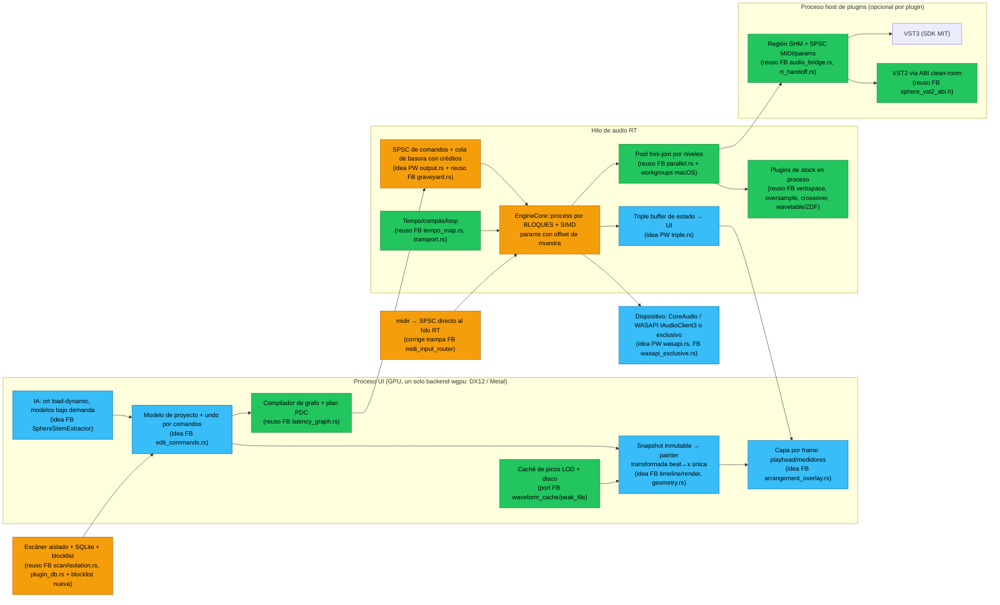

# 02 — Análisis de repos de referencia: futureboard-studio y Pro-Wave

> Fecha: 2026-11-11. Solo se leyeron archivos: no se compiló ni se ejecutó nada de ninguno de los dos repos.
> Las rutas son relativas a la raíz de cada repo:
> - `reference/futureboard-studio`, abreviado **FB**. Licencia MIT; se puede reutilizar código con atribución.
> - `reference/Pro-Wave`, abreviado **PW**. Licencia GPL-3.0-or-later; **solo ideas**, no se copia código.
>
> Abreviaturas de rutas de FB: `DAE` = `crates/SphereDirectAudioEngine`, `SPH` = `crates/SpherePluginHost`, `SUI` = `crates/SphereUIComponents`, `BAP` = `crates/BuiltinAudioPlugins/crates`.
>
> Método: FB es muy grande (~1 M líneas de Rust; solo `SUI` tiene 444 k líneas en 514 archivos). Se priorizaron los subsistemas núcleo y se verificaron a mano las afirmaciones clave. Lo no verificable offline (submódulos vacíos) se marca como **no verificado**.

---

## Resumen ejecutivo

| | futureboard-studio (MIT) | Pro-Wave (GPL-3) |
|---|---|---|
| Tamaño | ~1 M líneas de Rust; más C++ (VST3/CLAP/VST2) y Obj-C++ (AU) | ~77 k líneas de Rust, 126 archivos |
| UI | GPUI (Zed) vendorizado: Metal en macOS, **D3D11** en Windows | egui/eframe 0.37 sobre wgpu (GL/DX12/Vulkan/Metal) |
| Audio I/O | cpal 0.15 (fork) + WASAPI exclusivo propio + WDM-KS + ASIO (solo edición Pro) | cpal 0.18 + WASAPI compartido propio con `IAudioClient3` |
| Hosting de plugins | VST3, VST2 (ABI clean-room), CLAP y AU, **fuera de proceso**, con escáner aislado y caché SQLite; ARA2 en proceso | **Ninguno**. Hay un crate LADSPA en proceso que la app no usa |
| Plugins de stock | 25 crates de DSP propios (EQ dinámico, compresores, limitador con OS, FDN, sinte wavetable, samplers, ampli NAM) | 13 efectos en un solo `fx.rs` + sinte PolyBLEP + SoundFont |
| Paralelismo de audio | Pool fork-join propio por niveles (`DAE/src/parallel.rs`) | Un solo hilo, mezcla muestra a muestra |
| IA/ML | Separación de stems (MDX-NET/HT-Demucs vía `ort` con carga dinámica); tract-onnx opcional | Nada de ML; DSP clásico (onsets, YIN, WSOLA) |
| Madurez | Pre-alfa según el propio repo, pero con mucho endurecimiento real (606 tests en el motor y 2.862 en la UI) | Alfa; 780 `#[test]`; el README cifra lo hecho en 49 % del menú y 31 % del roadmap |

**Conclusión breve.** FB es la cantera principal de código reutilizable:
- el pool paralelo, el "graveyard", el tempo map y el planificador de PDC;
- el puente de memoria compartida para plugins fuera de proceso, el escáner aislado y la caché SQLite;
- la cabecera clean-room de VST2;
- varios DSP de calidad: oversampler polifásico, FDN de 16 líneas, crossover LR4, wavetables mipmapped, filtros ZDF y un medidor R128.

PW aporta sobre todo **disciplina y simplicidad** de motor:
- triple buffer para el estado;
- cola de comandos con "créditos" de basura;
- `assert_no_alloc` en CI;
- `GainRamp` y una elección de backend GPU pensada para ahorrar RAM.

Ambos comparten defectos que debemos evitar: procesamiento muestra a muestra, automatización a tasa de bloque y buses solo estéreo.

---

# Parte A — futureboard-studio (MIT)

## A1. Workspace y crates

**Workspace.** `Cargo.toml`: resolver 3, edición 2024, `license = "MIT"`, versión `2026.11.1-beta2.0.0`. Hay unos 60 miembros (`Cargo.toml:4-67`). GPUI (`crates/gpui`), los `vstplugins/*`, `external/nihplug_gpui` y `crates/SphereVoiceTune` están **excluidos** del workspace (`Cargo.toml:69-87`). La política de cuarentena para crates stub está en `ARCHITECTURE.md:86-112`.

### Crates núcleo

| Crate | Propósito | Tamaño |
|---|---|---|
| `apps/native/studio` | Lanzador `FutureboardNative` (solo `std`) más la cdylib `FutureboardEngine_x64`, que contiene toda la app (`CLAUDE.md`, `apps/native/studio/src/main.rs`, `engine_abi.rs`) | 5,5 k |
| `DAE` (lib `DirectAudio`) | Motor de tiempo real: grafo, transporte, mezclador, backends de dispositivo, export offline y puentes C++ VST3/CLAP/VST2 | 74 k Rust + C++ |
| `SPH` | Host y escáner de plugins fuera de proceso, IPC, memoria compartida y BD de plugins | 28,5 k |
| `SUI` | Toda la UI GPUI: timeline, piano roll, mezclador, proyecto, undo, i18n y keymaps | 444 k |
| `BuiltinAudioPlugins` + `BAP/*` | 25 crates de DSP de stock y `builtin_dsp_core` | 89 k |
| `SphereAudioPlugins` | DSP *legacy* dentro del motor (EQ, drive y comp simples) | 0,7 k |
| `SphereAudioProcessor` | Análisis (BPM, tonalidad, acordes), reparación de audio y time-stretch (Signalsmith vía `cc`) | 10 k |
| `SphereStemExtractor` | Separación de stems con ONNX | 3,2 k |
| `SphereMidiService` | MIDI de hardware (midir; CoreMIDI propio en macOS), MPE y SysEx | 10 k |
| `SphereAraHost` + `crates/Ara2Bridge/*` | Host ARA2 (bindings vendorizados, MIT/Apache) | 7 k + 26 k |
| `crates/gpui` | GPUI de Zed vendorizado y parcheado (Apache-2.0, `NOTICE.md`, `PATCHED.md`) | 120 k |

### Crates periféricos

Inflan la build y no los necesitamos: `SphereJamClient` (jam en red), `LiveStageEngine`, `SphereWebView` (CEF), `SphereVideoPlayer`, `SphereDiscordRPC`, `SphereEncoder` (Opus), `SphereVoxtune`, `solfege_*` (dependencias git) y las apps móviles.

### Dependencias clave (raíz `Cargo.toml`)

- **UI y GPU.** `gpui 0.2.2` (path); `wgpu 29.0.3` con dx12, vulkan, metal y gles; `accesskit 0.24`.
- **Audio.** `cpal 0.15`, parcheado a `external/cpal`, un submódulo **vacío** en este clon (`Cargo.toml:629`). Además `symphonia 0.5`, `rubato 0.16`, `rustfft 6`, `ebur128 0.1` y `memmap2 0.9`.
- **MIDI.** `midir 0.9`.
- **DSP de terceros.** `biquad 0.6`, `fundsp 0.23` (solo meowsyn) y `nam-rs 0.4`.
- **Concurrencia.** `crossbeam-channel 0.5` (la única cola; no se usan `rtrb`, `ringbuf` ni `arc-swap`), `parking_lot 0.12` y `rayon 1.8` (solo offline).
- **Serialización y datos.** `serde`, `serde_json`, `rusqlite 0.31` (bundled), `zip 9.4`, `uuid` y `slotmap`.
- **ML.** `ort =2.0.0-rc.11` con `load-dynamic` (`Cargo.toml:260-263`), `tract-onnx 0.22.2` y `ndarray 0.16`.
- **Perfil release.** `lto = true`, `codegen-units = 1`, `panic = "abort"`; sin `strip` ni `opt-level = "z"` (`Cargo.toml:652-656`). Los crates de DSP llevan `opt-level = 3` también en dev, porque si no no llegan a tiempo real (`Cargo.toml:640-650`).

## A2. Motor de audio (`DAE`)

### Modelo de hilos de tiempo real

**Backends** (`DAE/src/backend/mod.rs:1-15`):
- cpal (WASAPI compartido, CoreAudio y ALSA);
- WASAPI exclusivo propio, con MMCSS "Pro Audio" y modo por eventos (`backend/wasapi_exclusive.rs:517,689,854`);
- WDM-KS (`backend/wdm_ks.rs`, ~2 k líneas);
- ASIO, solo en la edición Pro privada (`README.md`, sección Editions).

**Prioridad del hilo.**
- En la ruta cpal, MMCSS se activa en el primer callback (`backend/cpal_backend.rs:517-522`).
- En Linux se usa SCHED_FIFO o RealtimeKit (`:600-870`).
- En macOS se menciona el *audio workgroup*, pero ese código estaría en el fork de cpal, que está vacío aquí: **no verificado**.

**Dos rutas de callback duplicadas**, cada una con su propio manejo de `LoadProject`:
- `engine/stream.rs:148-300` (legacy);
- `backend/render.rs`, con `drain_commands` en `:764` y `fill_output_f32` en `:1366`.

**Pool paralelo** (`DAE/src/parallel.rs`, 406 líneas; cabecera verificada en `:1-21`):
- Pool estático de hasta 31 workers que hacen *spin* y luego `park`. El hilo de audio los despierta con `unpark`.
- Reparto por un contador atómico `fetch_add` (no hay work-stealing), y el hilo de audio también consume trabajo.
- Si el pool está ocupado (un bounce offline concurrente), el lote se procesa en el propio hilo, porque el pool se reclama con compare-exchange y nunca se espera.
- Los workers usan MMCSS en Windows y FIFO en Linux; **no hay rama macOS** (`parallel.rs:309-340`).

**Planificación por niveles** (`DAE/src/engine/render/block.rs:584-790`):
- Pasada 1: todas las pistas fuente en paralelo.
- Pasada 2: buses y returns en orden topológico, agrupando pistas que no se alimentan entre sí (`feeds_track`, `mix.rs:534`).
- Solo las cadenas de inserts van en paralelo. Suma, sends y medidores siguen en serie, así que la salida es idéntica bit a bit con el pool activo o sin él (`render/chains.rs:29-90`).

**"Audioguard"** (`DAE/src/audioguard.rs`, 1.667 líneas):
- Cuando no hay nada en vivo (sin grabación, monitorización ni notas recientes), un hilo guardián renderiza bloques por adelantado en un anillo.
- El estado está tras un `parking_lot::Mutex` con `try_lock` (`:834`). Idea interesante para bajar xruns en reproducción pura, aunque mete un lock (no bloqueante) en la ruta RT.

### Grafo de audio

**Tipos de nodo** (`DAE/src/audio_graph.rs:13-27`): AudioInput, AudioClip, MidiClip, Instrument, InsertPlugin, TrackMixer, Send, Return/Bus/Group, Master, Output y Meter. En la práctica el runtime está organizado por pistas: `RuntimeTrack` solo tiene `block_l`/`block_r`, es decir, **todo es estéreo**.

**Compilación fuera del hilo de audio.**
- La UI construye un `EngineProjectSnapshot` (`SUI/src/layout/engine_snapshot.rs:993`).
- `load_project_as_of` corre en el executor de fondo (`SUI/src/layout/audio_transport.rs:1743-1747`) y produce un `RuntimeProject` completo: plan, detección de ciclos (`audio_graph.rs:124`), plan de latencias e índices resueltos.
- El resultado viaja como `EngineCommand::LoadProject(Box<RuntimeProject>)` (`engine/project.rs:590`).

**Swap sin glitch.**
- El callback hace `mem::swap`, envía all-notes-off y conserva la ganancia suavizada y el transporte.
- El grafo viejo se manda a un hilo **graveyard** por un canal acotado de capacidad 64. Así destructores, `munmap` y teardown de VST3 nunca corren en RT (`DAE/src/graveyard.rs:1-60,165`; `engine/stream.rs:225-283`).

**Rutas de señal.**
- Los sends se suman con SIMD (`mix.rs:567-622`).
- Hay ruta de Control Room y monitor.
- **No hay sidechain a nivel de motor**; solo existe dentro de algunos DSP de stock.
- Las salidas múltiples de VSTi se reparten a pistas hijas (`mix.rs:680`).

**Defecto.** Cada sincronización estructural reconstruye el grafo entero. Lo mitigan con un `EditImpact` por comando, para que mover un fader no reconstruya nada (`SUI/src/components/edit/edit_commands.rs:13-46`; el comentario en `:28-37` documenta el bug original).

### Comunicación UI ↔ audio

**Comandos.**
- Canal `crossbeam_channel::bounded::<EngineCommand>(512)` (`backend/cpal_backend.rs:238`, `engine/lifecycle.rs:53`); envío con `try_send` (`engine/commands.rs:178`).
- Unas 50 variantes (`DAE/src/command.rs:68-360`). Los IDs de parámetro son inline (`ParamKey [u8;31]`, `ResolvedParamId`).
- **Defecto:** algunas variantes llevan `String` o `HashSet<String>` (`command.rs:195,222-273,322`), y liberarlas ocurre en el hilo RT.

**Canal de vuelta.**
- `SharedState`: un struct grande de atómicos, con los f32 guardados como bits en `AtomicU32` (`engine/shared_state.rs:7-132`).
- Medidores por pista con `fetch_max` sobre los bits (`runtime/track.rs:587-623`).
- `InputRing` SPSC de 16.384 frames (`input_ring.rs`).
- `CommandBarrier` permite esperar a que el callback aplique los comandos (`native.rs:794`).

### Automatización

- **Modelo.** Breakpoints en beats f64 con curvas Linear, Hold, Smooth (smoothstep con tensión) y Jump; búsqueda con `partition_point` (`DAE/src/runtime/automation.rs:5-35,101-160,272-300`).
- **Evaluación por bloque, no por muestra.**
  - Los parámetros de plugin se empujan en el offset 0 y solo cuando cambian más que un epsilon (`render/chains.rs:199-247`).
  - El fader hace una rampa lineal dentro del bloque (`mix.rs:101-145`).
- **Alineación con la PDC.** `RuntimeAutomationClock` desplaza el beat de evaluación según el retardo de PDC (`automation.rs:315-345`). Es un detalle fino que conviene copiar.
- En la cola VST3, `SimpleParamValueQueue` tiene un único punto en offset 0 (`DAE/vst3bridge/include/vst3_processor_internal.hpp:126-145`), así que **no hay automatización sample-accurate hacia plugins**.

### PDC (`DAE/src/latency_graph.rs`, 848 líneas)

- **Latencia por strip:** suma de las latencias de VST3 en proceso, o el máximo de la latencia almacenada de los plugins puenteados (`:37-70`).
- **Coste del puente:** cada insert fuera de proceso añade **un periodo** de latencia (`DAE/src/plugin_bridge.rs:40`: `reported + bridge_period_frames`, verificado).
- **Plan:** latencia de camino de cada pista hasta el master, más un delay de salida por pista y delays por send, para alinear con el camino más lento (`:281-370`).
- `recompute_runtime_latency_graph` trabaja in place sin asignar memoria, así que se puede re-planificar desde el callback (`:308-345`).
- Las pistas silenciadas siguen avanzando sus anillos de retardo (`render/block.rs:626,761`).

### Transporte y tempo

- **Tempo map** (`DAE/src/tempo_map.rs`, 887 líneas):
  - curvas Hold, Linear (integración exacta `60/k·ln(bpm/bpm0)`) y Smooth (16 tramos lineales);
  - rango 20–999 BPM;
  - API `samples_at_beat`, `beat_at_samples` y `beats_for_sample_span` (`:238-268`).
  - Solo depende de serde: candidato directo a copiar.
- **Compás.** `time_signature_map.rs` con agrupaciones y la invariante "nunca vacío".
- **Tiempo musical.** No hay PPQ ni ticks: el tiempo musical es f64 en beats.
- **Loop.** `LoopBounds` en muestras, con utilidades para partir el bloque en el punto de loop (`transport.rs:13,118-216`).

### MIDI

- Los eventos llevan la muestra absoluta y el beat de origen (`runtime/midi.rs:26-40`).
- `schedule_midi_render_block` parte el bloque en los bordes de loop sin perder note-offs (`render/chains.rs:93-153`).
- **Defecto grave:** la entrada MIDI de hardware pasa por el **hilo de UI**. GPUI drena 64 eventos por frame y envía comandos con un id de pista `String` (`SUI/src/layout/midi_input_router.rs:419-460`). La latencia de tocar en vivo depende del framerate.
- La salida MIDI usa su propio hilo con reloj de pared y 10 ms de lookahead (`crates/SphereMidiService/src/lib.rs:477-600`).
- No hay generador ni seguidor de MIDI Clock real, solo flags (`lib.rs:42,49`).

### Grabación, freeze y export

- **Grabación** (`DAE/src/recording.rs:1-22`): pool de buffers preasignado, hilo escritor y contenedor `.rauf` propio. Si el disco no da abasto, inserta silencio para conservar la posición.
- **Render offline** (`DAE/src/export/offline_renderer.rs`): misma función de render que la reproducción; incluye tail hasta silencio, normalización, R128 y dither (`dsp/dither.rs`).
- **Freeze, Render in Place y Consolidate**: en la UI, como un solo paso de undo (`SUI/src/layout/bounce_ops.rs`).
- **Streaming de disco** (`DAE/src/streaming_source.rs`): los WAV se mapean en memoria; los formatos comprimidos se decodifican a un anillo atómico con "epoch" de ventana.

### Tests y madurez del motor

- 606 `#[test]`.
- `realtime_alloc_tests.rs` (21 tests) usa un asignador contador (`test_alloc.rs`) para asegurar que no se asigna memoria en RT.
- Prácticamente sin TODO ni FIXME.
- El motor es serio y está curtido; está muy acoplado al producto (Jam, ARA, Solfege, licencias).

## A3. Hosting de plugins (`SPH` + puentes C++ en `DAE`)

### Formatos y bindings

Soporta **VST3, VST2, CLAP y AU** (solo macOS); no hay LV2. No usa crates Rust de bindings (ni `vst3-sys` ni `clack`): son *shims* C++20 detrás de una ABI C, compilados con `cc`:

| Formato | Shim | Tamaño |
|---|---|---|
| VST3 | `DAE/vst3bridge/src/vst3_processor.cpp` | 5,9 k líneas |
| CLAP | `DAE/clapbridge/src/clap_processor.cpp` | 1,8 k |
| VST2 | `DAE/vst2bridge/src/vst2_processor.cpp` | 1,3 k |
| AU | `SPH/vst3backend/src/au_host.mm` y `au_scanner.mm` | — |

- Los SDKs (`external/vst3sdk`, `clap`, `ARA_SDK`) son submódulos **vacíos** en este clon.
- **VST2** usa la cabecera *clean-room* `DAE/vst2bridge/include/sphere_vst2_abi.h` (verificada en `:1-12`): declara solo el ABI de host (`AEffect`, `VstEvents`, `VstTimeInfo`) sin código de Steinberg. Soporta plugins *shell* (`SPH/vst3backend/src/vst3_scanner.cpp:398-415`). **Es justo lo que necesitamos para VST2 sin el SDK.**

### Sandbox fuera de proceso (por defecto)

**Procesos.**
- Binarios: `SPH/src/bin/futureboard_plugin_host.rs` (9.337 líneas en un solo archivo) y `futureboard_plugin_scanner.rs`.
- El modo en proceso exige la variable `FUTUREBOARD_PLUGIN_LEGACY_IN_PROCESS` (`SPH/src/plugin_host_client.rs:186-209`).
- Aislamiento configurable: `Shared`, `Module` (por defecto, un proceso por binario de plugin) o `Instance` (`SUI/src/layout/plugin_bridge_runtime.rs:1193-1245`).

**Control.**
- JSON delimitado por saltos de línea sobre stdin/stdout; protocolo v7 con tramas de hasta 512 MB (`SPH/src/ipc/mod.rs`).
- El stdout de los plugins "charlatanes" se redirige con `dup2` (`SPH/src/plugin_host_lifecycle.rs:95-160`).

**Audio.**
- Una región `#[repr(C)]` de memoria compartida por insert (`SPH/src/audio_bridge.rs`, 2.085 líneas; contrato wait-free en `:1-22`).
- Contiene audio de entrada y salida (2048 frames × 32 canales en f32), un anillo MIDI SPSC, un anillo de parámetros, transporte, latencia y medidores.
- Handshake `request_seq`/`done_seq` con **un bloque de latencia**.

**Despertares.**
- Windows: evento auto-reset.
- macOS: semáforo POSIX con *polling* cada 250 µs (`audio_bridge.rs:1147-1330`).

**Productor en el host.** Un hilo por proceso de host con MMCSS y `timeBeginPeriod(1)` (`futureboard_plugin_host.rs:3831-3855`). Los planes se cambian sin asignar memoria (`SPH/src/rt_handoff.rs`, 315 líneas).

**Espera del motor.** El motor puede hacer *spin* hasta un octavo del periodo (máximo 1 ms) por instancia (`SPH/src/plugin_bridge_sink.rs:63-100`). Si el host no entrega, pasa la señal seca (`DAE/src/engine/render/bridge.rs:16-40`).

**Recuperación de crashes.**
- Job object con kill-on-close en Windows (`SPH/src/platform/windows_process.rs`) y watchdog del proceso padre.
- Las instancias se recargan en un host nuevo (`plugin_bridge_runtime.rs:60-71`).
- Con tres crashes en 60 s se deja de reintentar y se muestra un panel de crash (`SUI/src/layout/plugin_ops.rs:252-273`).
- La salida con `TerminateProcess`/`_exit` evita crashes de `DLL_PROCESS_DETACH`.

### Escaneo

**Aislamiento.**
- Un proceso escáner por bundle, con timeout de 30 s por bundle y 600 s por formato (`SPH/src/scan/isolation.rs:26-60,390-401`).
- Centinela `@@FUTUREBOARD_SCAN_PAYLOAD@@` contra la basura en stdout.
- Carga el módulo de verdad; no usa `moduleinfo.json` como atajo.

**Caché SQLite en modo WAL** (`SPH/src/plugin_db.rs:313-371`):
- Tablas `plugins`, `plugin_scan_runs` y `plugin_scan_failures`.
- Frescura por mtime y tamaño de archivo (`:743-790`).
- Migraciones aditivas.

**Hueco:** no hay *blocklist* persistente para VST2/VST3/CLAP, así que los fallidos se re-escanean cada vez. Solo AU tiene un "safe mode" (`SPH/src/registry.rs:1139-1184`).

### Embebido de editores

Según `SUI/src/components/plugin_editor_backend.rs:48-87` (verificado):

- **Windows:** `RemoteNativeWindow`. La app crea un HWND hijo y el host fuera de proceso llama a `IPlugView::attached` sobre él.
  - Hay además modos *tool window* propio y desacoplado.
  - Los comentarios se contradicen sobre cuál es el modo por defecto (`SPH/src/native_editor.rs:79`, `futureboard_plugin_host.rs:6767`).
  - Causa raíz: la swap chain DirectComposition de GPUI pinta encima de las ventanas `WS_CHILD` (`DAE/vst3bridge/EDITORHOST_ALIGNMENT.md`).
- **macOS:** `HostOwnedNativeWindow`. El editor es una **ventana top-level del proceso host**, porque `NSView` no se puede reparentar entre procesos. Embeber dentro de la ventana principal (`LocalNativeView`) está solo en *groundwork*.
- **DPI.** Contexto per-monitor-v2 y `setContentScaleFactor` (`SPH/vst3backend/src/plugin_editor_window.cpp:136-175`).
- **Redimensionado.** Guarda contra la recursión en `resizeView` (`:195-280`), con un test de contrato (`SPH/tests/editor_resize_contract.rs`).
- **Teclado.** El espacio va al transporte del DAW (`editor_windows_windowproc.cpp:134-191`).
- **Teardown.** Orden `setFrame(nullptr)` → `removed()`.
- **Quirks por vendor.** UAD, CEF y otros en `SPH/src/editor_quirk.rs`.
- **Parches de GPUI para plugins**, porque GPUI se tragaba sus teclas y les robaba el foco: `translate_accelerator` y `WM_MOUSEACTIVATE` (`PATCHED.md`).

### Parámetros, estado, latencia y transporte

- **Parámetros.** Anillo compartido de f32 hacia `apply_param`.
  - **Defecto:** `enqueue_param` toma un `std::mutex` (`DAE/vst3bridge/include/vst3_processor_internal.hpp:1294-1296`, verificado; lo mismo en `clapbridge/src/clap_processor.cpp:742-743`).
- **Estado opaco.**
  - VST3: componente y controlador por separado.
  - VST2: `effGetChunk`.
  - Por IPC viaja en base64 dentro de JSON (`SPH/src/ipc/mod.rs:229-241`).
- **Latencia.**
  - VST3 `getLatencySamples` más un periodo de puente.
  - CLAP `latency_changed` reinicia el plugin.
  - **VST3 ignora `kLatencyChanged`** (`vst3_processor.cpp:1184-1192`).
- **Transporte.** Tempo, PPQ, compás y flags de play/rec en la región compartida, mapeados a `ProcessContext` y `VstTimeInfo` (`audio_bridge.rs:592-602`).
- **ARA2.** `crates/SphereAraHost` sobre un `Ara2Bridge` vendorizado (`crates/Ara2Bridge/VENDORING.md`). Corre **en proceso y en el hilo principal**, así que un crash de ARA tumba el Studio.

### Tests y madurez del host

- Unit tests en el binario host (46), `audio_bridge` (21), `ipc` (22) y la BD (12).
- Tests de integración: `SPH/tests/host_ipc_roundtrip.rs`, `macos_au_host.rs` y `DAE/src/engine/bridge_insert_tests.rs`.
- Hay comentarios obsoletos ("Stage 2… not yet pumped", `audio_bridge.rs:24-26`) en código que ya está cableado.
- Está endurecido contra plugins reales (Kontakt, UAD, Arturia, Neural DSP), pero depende mucho de variables de entorno y acumula capas de modos de editor.

## A4. Plugins de stock y DSP

**Interfaz común** (`BAP/builtin_dsp_core/src/lib.rs:41-55`, verificada):
- `StereoEffect { reset, set_sample_rate, process_stereo(l, r) -> (l, r) }` e `Instrument`. Ambas trabajan **muestra a muestra**.
- Cada plugin declara una tabla `ParamDescriptor` estática (`:13-39`) y un `ipc.rs` con índices numéricos "wire" estables. El hilo de audio solo llama a `apply_wire_param(u32, f32)`, sin cadenas (`BAP/equz8/src/ipc.rs:1-46`).
- El estado se guarda en JSON versionado (`equz8/src/ipc.rs:223-245`).

**Integración.**
- En Studio, 22 plugins corren en el **proceso host** (`futureboard_plugin_host.rs:309-334`, `SPH/src/builtin.rs:271-294`).
- c1073, meowsyn y drumsilencer no están cableados.
- El README dice "integración diferida" y "editor web compilado" (`README.md`, sección Built-in plug-ins), mientras `CLAUDE.md` y `ARCHITECTURE.md` dicen editores GPUI nativos (`SUI/src/components/plugin_kit.rs`): **la documentación ha derivado**.

**Bloques comunes** en `builtin_dsp_core`:
- `flush_denormal` y `SoftKneeCompressor`;
- `make_eq_coefficients` (envuelve `biquad`);
- `DelayRing` con lectura Lagrange y `Smoothed` (`delay.rs`);
- splitter LR4 de 4 bandas (`crossover.rs`) y espectro FFT (`spectrum.rs`).

### Plugins

| Plugin | Algoritmo (archivo) | Calidad |
|---|---|---|
| **equz8** (8 bandas, 37 tests) | Biquads RBJ (`biquad`) en DF1 f64; campana, shelves, LP/HP Butterworth en cascada hasta 48 dB/oct, notch; bandas dinámicas (`equz8/src/lib.rs:454-470,778-851,997`) | Buena. Fase mínima; el EQ dinámico rediseña coeficientes por muestra (costoso); la detección rectifica antes del band-pass (`:967`) |
| **equzx** (24 bandas, 51 tests) | Igual que equz8, más secciones de primer orden y colocación estéreo/L/R/M/S (`equzx/src/lib.rs:1-49,577`) | Buena |
| **compresser** (33 tests) | Pico enlazado, ganancia suavizada en dB (Giannoulis/Massberg/Reiss), knee cuadrático, HPF de sidechain; multibanda LR4 (`compresser/src/lib.rs:1-21`) | Sólida, sin lookahead |
| **zcomp** (36 tests) | Cuatro modelos (2500/Distressor/Avalon/SSL), mezcla RMS/pico, FF/FB, release dependiente del programa, saturación con **ADAA** (`zcomp/src/dsp.rs:1-40,130-198`) | Muy interesante |
| **burnLimit** (41 tests) | Lookahead de hasta 10 ms, seis estilos, dither TPDF, **medidor BS.1770/R128** (`burnLimit/src/loudness.rs`), OS 2/4/8× polifásico Kaiser de 32 taps por fase (`burnLimit/src/oversample.rs`, verificado) | True-peak por Catmull-Rom, no la FIR de BS.1770 (`lib.rs:393-428`); el techo final es un clamp instantáneo (`:1118-1121`) |
| **67Clipper** (28 tests) | Knee cuadrático; solo el residuo pasa por OS, así que lo que queda bajo el knee es bit-exacto (`67Clipper/src/lib.rs:1-26`) | Idea muy buena |
| **verbspace** (54 tests) | Pre-delay, 12 reflexiones tempranas, 4 allpass, **FDN de 16 líneas con Hadamard (FWHT)**, lecturas moduladas y absorción de dos shelves calculada por línea para un RT60 exacto; normaliza la energía (`verbspace/src/lib.rs:1-34,477-495`, verificado) | La mejor reverb de ambos repos |
| **echospace** (42) | Delay con dos cabezales y crossfade al cambiar el tiempo, wow/flutter con lectura cúbica, ducking | Buena |
| **imager** (37) | M/S por árbol LR4, Haas o allpass, mono bass | Buena |
| **zapp** (20) | Seis waveshapers con OS de hasta 8× (copia del oversampler de burnLimit) | Sin ADAA |
| **mixstation** (46) | Channel strip: biquads TDF-II, comp, saturación, limitador (`mixstation/src/dsp.rs`) | Buena |
| **waygate / Transient / deesser / duckstep / airboost** | Gate con histéresis y lookahead; seguidores rápido y lento; de-esser por resta de banda; ducker con *shaper* sincronizado; exciter Chebyshev | Correctos; la llave externa de duckstep no hace nada |
| **whitesharp** (58) | Corrección de afinación: YIN sobre ~12 kHz y TD-PSOLA estéreo (`whitesharp/src/detect.rs`) | Útil |
| **wrapsynth** (51) | Wavetable **mipmapped** (19 niveles de media octava, 512 armónicos, 8× sobremuestreada, cúbica), filtros **ZDF** (SVF Simper/Zavalishin, ladder, formante), 16 voces con fade al robar voz (`wrapsynth/src/wavetable.rs:1-40`, `filter.rs:1-17`) | Calidad de sinte real |
| **meowsyn** (3) | Osciladores de fundsp; LP de un polo con "resonancia" falsa (`meowsyn/src/lib.rs:437-445`) | Juguete |
| **drumsampler / quicksampler / slicer** | 64 pads y 32 voces con SVF TPT; Hermite; robo de voz con fade de 3 ms; carga de samples sin espera vía `AtomicPtr` (`rodharerist/src/dsp/handoff.rs`) | Buenos |
| **rodharerist** (251 tests) | Ampli de guitarra: triodos, inversor de fase, push-pull con sag a 4×/8×; NAM vía `nam-rs`; convolución de cabina particionada con L/R empaquetados en una sola FFT compleja (`dsp/ir.rs:1-40`); FTZ/DAZ por MXCSR (`dsp/nam.rs:1069-1095`) | Excelente |
| **drumsilencer** (aparcado) | Máscara GRU sobre STFT de baja latencia (5,3 ms) | **Pesos entrenados con MUSDB18-HQ, licencia no comercial** (`drumsilencer/README.md:20`): no usar |

**Rasgos transversales.**
- **No hay SIMD explícito** en los plugins (solo MXCSR). El SIMD del motor está en `DAE/src/dsp/simd.rs`.
- Sin asignación de memoria tras construirse; solo meowsyn y rodharerist lo verifican con un asignador contador.
- El DSP legacy de `crates/SphereAudioPlugins/src/lib.rs:464-474` ("comp" y "limit") son en realidad clippers sin memoria.

**Licencias.**
- Todo el DSP es MIT. La única derivación declarada es la reverb Freeverb de dominio público de rodharerist (`rodharerist/src/dsp/reverb.rs:1-3`).
- Los wrappers `vstplugins/*` usan el fork de NIH-plug (ISC), pero exportan VST3 con bindings `vst3-sys` **GPLv3** (`external/nihplug_gpui/README.md:233-241`): **no los usaremos**.
- La licencia de `nam-rs 0.4` no se pudo verificar offline; `deny.toml` solo permite licencias permisivas. **Revisarla antes de usarlo.**

## A5. UI (GPUI)

### Framework, backend GPU y texto

- **GPUI 0.2.2** vendorizado (`crates/gpui`).
- **macOS:** Metal y CoreText (`crates/gpui/crates/gpui_macos/src/metal_renderer.rs`).
- **Windows: Direct3D 11** con DirectWrite y *fallback* a GDI (`gpui_windows/src/directx_renderer.rs:63-75`, `gdi_text.rs`).
- **wgpu 29** se usa para Linux y para superficies propias, como los visualizadores. Estos se renderizan en D3D12 y se importan como textura compartida en el atlas D3D11 (`SUI/src/components/visualizer/gpu.rs:1-16`). Resultado: **dos stacks GPU en Windows**.

**Parches** (`PATCHED.md`, `crates/gpui/PATCHED.md`):
- SDF con `fwidth`;
- teclado y foco para ventanas de plugins;
- caché de layout de texto por ancho de truncado (midieron 13,5 ms por frame con 31 pistas antes del fix);
- `frame_profile` (`crates/gpui/src/frame_profile.rs`);
- consumo de scroll anidado.

Hay parches **sin documentar** (texturas D3D11 compartidas en `crates/gpui/src/platform.rs:1048-1068`, `FUTUREBOARD_GPU_ADAPTER`), así que el fork ha derivado.

### Renderizado de las vistas

**Modelo híbrido.** Elementos GPUI para input, foco y controles, y **pintado desde snapshots inmutables** en closures `canvas`. El trait `TimelineRenderer` "solo dibuja desde el snapshot: nada de decodificar, generar picos ni hacer layout" (`SUI/src/components/timeline/render/renderer.rs:16-29`). Hay un backend wgpu para el timeline aparcado (`WGPU_TIMELINE_COMPOSITE_READY = false`, `:46-51`).

**Piano roll.** La rejilla es un único canvas de quads por lotes ajustados a píxel; sustituyó a un `div` por fila (`SUI/src/components/piano_roll/grid_render.rs:1-30`). `piano_roll.rs` mide 8,5 k líneas.

**Waveforms.**
- Escalera LOD de 9 niveles, de 256 a 65.536 muestras por pico (`DAE/src/audio_file.rs:317`).
- Caché por chunks `(spp, chunk_index)` que apunta a 4 picos por columna de píxel (`SUI/src/components/timeline/waveform_cache.rs:91-128,270-300`).
- Archivo en disco `FBPEAKS1` con escritura atómica (`waveform_peak_file.rs:1-21`).
- Refinado bajo demanda solo para la ventana visible (`waveform_detail.rs`).

**Virtualización.** `VisibleTrackRange` con overscan de 2 (`timeline/render/snapshot.rs:20,135-148`) y `uniform_list`.

**Aislamiento por frame**, la idea más importante. Como GPUI ensucia todos los ancestros de una vista notificada, el playhead y los medidores los pinta la raíz encima de vistas cacheadas (`timeline/arrangement_overlay.rs:1-20`, `mixer_meter_layer.rs`). Además:
- cada carril de pista es una vista `AnyView::cached` (`timeline/track_lane_view.rs`);
- `frame_scheduler.rs` sigue el refresco de la pantalla y no programa frames en reposo.

**Transformada única.** `beat_to_x`/`x_to_beat` está en un solo sitio (`timeline/state/geometry.rs:1-25`) y `render/clip_geometry.rs` es la "fuente única de verdad" tanto para el hit-testing como para el pintado.

### Theming, i18n y keymaps

- **Tokens de tema.** `SUI/src/theme.rs` (macro `theme_color!`, `:870`), con temas JSON en `packages/shared/themes/*.json`. **Defecto:** `Colors::resolve` toma un `RwLock` y consulta un HashMap en cada llamada.
- **i18n.** `.ftl` parseados como `key=value`, sin Fluent real (`SUI/src/i18n.rs:120-160`).
- **Keymaps.** Perfiles JSON estilo Ableton, Cubase, FL, Pro Tools y Studio One (`packages/keymaps/*.json`, `SUI/src/keymap/`).
- **`DESIGN.md`.** Un solo acento cian; "la UI no debe mentir"; aislar medidores y playhead; *culling* fuera del viewport.

### Estado, undo y proyecto

- **Undo.** Enum de unos 56 comandos con snapshots antes/después, `VecDeque` acotado y coalescencia (`SUI/src/components/edit/edit_commands.rs:2463-2490`).
- **Proyecto.** `.fbproj` binario propio:
  - cabecera con magic `FBSTUD1\0`, versión y CRC32;
  - `PROJECT_VERSION = 63` (`SUI/src/project/format.rs:32,175,182`);
  - backup antes de migrar (`project/migrate.rs`);
  - autosave y escritura temporal + rename (`project/io.rs`).
- **Importación.** Solo XML de Cubase (`project/import/cubase_xml.rs`) y SMF.

## A6. IA/ML

- **Stems** (`crates/SphereStemExtractor`):
  - modelos MDX-NET (varios UVR) y HT-Demucs (`src/model.rs:7-27`);
  - descarga bajo demanda con SHA-256 a Documentos (`src/download.rs`);
  - `ort` con `load-dynamic`; ONNX Runtime 1.23.2 descargado con hash fijado en build (`apps/native/studio/build.rs:17,84-147`);
  - EPs CUDA, DirectML y CoreML opcionales (`backend/onnx_mdx.rs:47-81`);
  - *stub* espectral de respaldo etiquetado como tal (`backend/mod.rs:132`).
- **Análisis musical, con DSP clásico y sin ML:**
  - tempo por flujo espectral, autocorrelación y prior log-normal (`crates/SphereAudioProcessor/src/analysis/bpm.rs`);
  - tonalidad con Krumhansl-Schmuckler (`analysis/key.rs`);
  - acordes por cromagrama y plantillas (`analysis/chords.rs`).
- `tract-onnx` solo para un clasificador de instrumentos opcional sin modelo incluido (`analysis/onnx.rs`).

## A7. Inventario y madurez

| Área | Estado |
|---|---|
| Arreglo (audio, MIDI, instrumento, bus, return, folder), takes, marcadores, tempo y compás | Funciona según el código y los tests |
| Piano roll con CC, editor de audio y espectrograma | Funciona |
| Mezclador con inserts, sends, PDC, PFL/AFL y Control Room | Funciona; sin sidechain en el motor |
| VST3/VST2/CLAP/AU fuera de proceso y escaneo | Funciona; los editores en macOS no van embebidos |
| ARA2 | Funciona, en proceso |
| 22 plugins de stock | Funcionan en el host; meowsyn, c1073 y drumsilencer no |
| Stems y análisis | Funciona; requiere descargar ORT y los modelos |
| Renderers wgpu de timeline y mezclador | Aparcados |
| `SphereVoiceTune` | Stub en cuarentena |

- **Tests:** 606 en el motor y 2.862 en la UI; CI con fmt, `clippy -D warnings` y test (`ARCHITECTURE.md:116-128`).
- **Archivos gigantes:** `futureboard_plugin_host.rs` (9,3 k), `piano_roll.rs` (8,5 k), `plugin_ops.rs` (8,1 k), `project/format.rs` (6,4 k).
- **Binario y build:** CEF sigue siendo un requisito de build por la feature por defecto `builtin-plugin-editor` (`apps/native/studio/Cargo.toml:128-139`), aunque ningún editor lo use.

---

# Parte B — Pro-Wave (GPL-3.0: solo ideas)

## B1. Workspace y crates

`Cargo.toml` raíz: resolver 2, edición 2021. El perfil release incluye `lto`, `codegen-units = 1`, **`strip = true`**, `panic = "abort"` y `opt-level = 3`.

| Crate | Propósito | Tamaño |
|---|---|---|
| `crates/prowave-engine` | Motor RT: transporte, tempo map, sinte, mezclador, FX, disco, salida cpal/WASAPI | 18,7 k |
| `crates/prowave-app` | App egui con todas las vistas | 53,9 k |
| `crates/prowave-project` | Formato `.prowave`: zip con `project.json` y `media/` | 1 k |
| `crates/prowave-ladspa` | Host LADSPA en proceso (`libloading`). **La app no lo usa** (grep sin resultados en `prowave-app/src`) | 0,9 k |
| `prowave-logicx-import`, `prowave-garageband-import`, `prowave-guitarpro`, `prowave-musicxml` | Lectores de formatos | ~3 k |
| `xtask` | `check`, `rt-check`, `wasm-check`, `bench` y `status` (`xtask/src/main.rs:1-9`) | — |

**Dependencias clave.**
- **UI:** `eframe 0.37` (wgpu), `egui 0.37` y `winit 0.30.13`.
- **Audio:** `cpal 0.18.2` y `windows 0.62` para su WASAPI propio.
- **Colas y verificación RT:** `rtrb 0.4` y `assert_no_alloc 1.1.2`.
- **Medios y sonido:** `symphonia 0.5`, `rustysynth 1.3.8`, `memmap2 0.9` y `midir 0.11.1`.
- **Proyecto y scripting:** `serde_json`, `zip 9` y `rhai 1` (Scripter de MIDI con presupuesto de operaciones, `prowave-app/src/scripter.rs:1-15`).
- **Sin ML.**

**Deriva de la documentación.** `AGENTS.md` describe crates que **no existen** (`prowave-dsp`, `prowave-instruments`, `prowave-plugin-host`, `prowave-mixer`, `prowave-ui`, `prowave-wasm`), y `LINUX-MACOS-LIGHTWEIGHT.md` promete mimalloc, rkyv y SIMD que tampoco están en el código.

## B2. Motor de audio

**Arquitectura** (`prowave-engine/src/lib.rs:1-5`, `core.rs:1-2`):
- `EngineCore::process` no depende del dispositivo y se puede probar sin hardware.
- La UI habla con él por una cola SPSC de `Command` (`rtrb`).
- Lee el estado de vuelta con un **triple buffer** lock-free (`src/triple.rs`, 138 líneas) y contadores atómicos (`Shared`, `core.rs:616-647`).

**Ciclo de vida de la memoria** (`core.rs:332-546`, `output.rs:22-45`):
- Las cargas grandes viajan en `Box` y la versión vieja vuelve por una **cola de basura** (`Garbage`) para liberarse en el hilo de UI.
- `CommandQueue::send` reserva un **crédito** de basura por cada comando que retira estado, y rechaza el envío si no queda ninguno. Así la cola de retorno nunca se llena en RT. **Es elegante.**

**Hilo y dispositivo.**
- cpal (`output.rs`) o, en Windows, WASAPI compartido con **`IAudioClient3`**: pide el periodo mínimo del motor de audio (128–480 frames) sin modo exclusivo (`src/wasapi.rs:1-6,196-224`), más MMCSS "Pro Audio".
- El callback se envuelve en `assert_no_alloc` (`output.rs:184`) y se mide la carga DSP con `Instant::now` (`:175-176`).
- **Un solo hilo**, sin paralelismo.

**Procesado.**
- **Muestra a muestra** para todas las pistas, dentro del bucle `for frame in out.as_chunks_mut::<2>()` (`core.rs:2017`).
- 48 voces globales de sinte (`core.rs:27`).
- Suma en **f64** (`core.rs:808-814`) y hasta 1024 pistas (`MAX_TRACKS`, `core.rs:23`), con un test de 1000 pistas (`tests/thousand_tracks.rs`).

**Grafo.** No hay grafo general. Las pistas se clasifican como planas, "complejas" (FX o sends) o aux (`core.rs:1270-1285`). Hay 8 buses y 8 sends, y una aux **no puede alimentar otro bus** (`src/routing.rs:46-52`): un solo nivel de buses.

**Automatización.**
- Se lee cada 32 muestras (`AUTO_BLOCK`, `core.rs:29`), con rampas lineales `GainRamp` hacia el valor (`src/gain_smoothing.rs`).
- Los parámetros de FX se fijan con `set_param_norm` en cada lectura (`core.rs:1289-1320`).
- Curvas por exponente (`routing.rs:112-125`).
- El README la llama "sample-accurate", pero en realidad es control-rate de 32 muestras con rampas.

**PDC.**
- Se calcula en la UI (`prowave-app/src/engine_sync.rs:233-275`): un retardo "antes" y otro "después" por strip para alinear las aux.
- Solo cuenta la latencia de los FX propios; la de los instrumentos y plugins está pendiente (`ROADMAP.md:517`).

**Tempo map** (`src/tempo_map.rs`, 838 líneas):
- Step o Linear, 5–990 BPM.
- Segmentos precalculados en la UI, con búsqueda binaria en RT (`:1-12`).
- SMPTE con drop-frame.

**MIDI.**
- MIDI Clock (`src/clock.rs`, `TICKS_PER_BEAT`) y MTC de salida y entrada (`src/mtc.rs`, `prowave-app/src/mtc_in.rs`, `clock_follow.rs`).
- Eventos de salida por anillo hacia el hilo de UI (`MidiOutEvent`).

**Disco.**
- Un hilo decodifica con symphonia, remuestrea (lineal) y empuja bloques de 1024 frames en un anillo por clip.
- Seek por palabra atómica `(generation, frame)`, que descarta bloques obsoletos sin lock.
- Presupuesto de prefetch de 8 MiB repartido entre clips (`src/disk.rs:1-40`).

**Sincronización UI → motor.** `EngineSync` refleja lo que el motor ha **aceptado** y reintenta lo rechazado. Si solo cambian notas, envía `SetNotes` en vez de `SetSong`, para no reabrir el streaming (`prowave-app/src/engine_sync.rs:31-40,566-585`).

## B3. Hosting de plugins

**No existe.** `ROADMAP.md:540-545`, la fase 7 (CLAP, VST3 vía `vst3-sys`, AU, escáner con cuarentena), está sin empezar, y `resume.md:19` lo confirma. El único código de hosting es `prowave-ladspa` (en proceso y sin usar). Para nosotros no aporta nada en hosting.

## B4. Plugins de stock y DSP

Todo está en `src/fx.rs` (2.448 líneas), construido en el hilo de UI y procesado muestra a muestra, con hasta 32 parámetros por efecto y 15 inserts (`fx.rs:1-15`):

- **Efectos** (`FxKind`, `fx.rs:19-33`): ChannelEq, Compressor, MultiComp, Reverb (convolución), Delay, Chorus, Phaser, Overdrive, Filter, Gate, Limiter, MultiEq y Amp.
- **Filtros:** biquad RBJ en f32 (`fx.rs:532-560`).
- **Compresor:** knee suave fijo de 6 dB (`fx.rs:864-877`).
- **Limitador:** lookahead de 2 ms con mínimo deslizante y media móvil (`fx.rs:409,917-945`).
- **Amp:** cuatro etapas de válvula a 2× con una **half-band FIR de 31 taps** (unos 45 dB, `fx.rs:947-975`).
- **Convolución "Space Designer"** (`src/convolver.rs`): FFT radix-2 propia (`:123`), particionado uniforme con bloques de 512 (latencia de 512), IR sintético de hasta 12 s.
- **Sinte:** osciladores **PolyBLEP** y SVF (`src/synth.rs:183-220`); SoundFont vía rustysynth; kits Hydrogen.
- **Flex Time y Flex Pitch offline:** WSOLA y YIN (`src/flex.rs:1-20`).
- **Smart Tempo:** onsets y autocorrelación (`src/analysis.rs:1-12`).

**Calidad.** Más simple que FB, sin SIMD y con oversampling modesto. Útil solo como referencia de rangos de parámetros "estilo Logic".

## B5. UI (egui)

**Framework.** egui/eframe 0.37 en modo inmediato. Cada vista pinta con `Painter` y `clip_rect` (`prowave-app/src/tracks_area.rs`, `piano_roll.rs`, `mixer.rs`).

**Elección de backend GPU** (`src/graphics.rs:1-16`):
- Metal en macOS.
- **OpenGL en Windows y Linux** si funciona, para ahorrar unos 100 MB de RAM frente a arrancar todos los backends de wgpu.
- Si falla, se relanza a sí mismo con DX12 o Vulkan.
- `WGPU_BACKEND` lo fuerza manualmente.

**Waveforms.** Un único nivel de picos min/max en `OnceLock` (`model.rs:606`, `tracks_area.rs:2225-2300`), sin LOD.

**Otros.**
- `ui_scale.rs`: escala la interfaz por pasos del 5 % tras redimensionar, para no re-rasterizar fuentes en cada frame.
- `i18n.rs`: archivos `English = Traducción`.
- `theme.rs`: gris oscuro estilo Logic.

**Undo.** **Snapshot completo del `Project`** en cada gesto, con un límite de 100 (`src/undo.rs:1-20`). Es simple pero costoso en RAM con proyectos grandes.

**Peso.** El README reclama un binario de unos 15 MB y arranque en cientos de ms; `cargo xtask bench` lo verifica (`xtask/src/main.rs:7-8`).

## B6. Inventario y madurez

- **Estado declarado:** 88 de 180 entradas de menú y 24 de 77 ítems del roadmap (`README.md`, sección status); fase 4 (mezclador y DSP) "mayormente hecha" (`resume.md:17`).
- **Tests:** 780 `#[test]`. Tests de integración del motor en `crates/prowave-engine/tests/*.rs`: ciclo, ganancia, streaming, reclamación de estado y 1000 pistas.
- **Calidad del código:** 0 TODO; `#![deny(clippy::unwrap_used, clippy::expect_used)]` en el motor (`lib.rs:6`).
- **Falta:** plugins externos, Live Loops, WASM, Bézier y la PDC de plugins e instrumentos.

---

# Parte C — Recomendaciones para nuestro DAW

## C1. Mejores ideas a adoptar (ordenadas)

1. **Motor desacoplado del dispositivo y probado sin hardware** (PW `core.rs:1-2`; FB render offline = render RT en `DAE/src/export/offline_renderer.rs`). Un solo `process()` para tiempo real, bounce y tests.
2. **Compilar el grafo fuera del hilo RT, swap atómico y liberación en un graveyard** (FB `graveyard.rs`; PW `Garbage` más créditos en `output.rs:22-45`). Combinar ambos: canal de basura acotado **con créditos**, para que el hilo RT nunca encuentre la cola llena.
3. **Prueba de no-asignación en CI**: asignador contador o `assert_no_alloc` en todos los caminos RT (FB `test_alloc.rs` y `realtime_alloc_tests.rs`; PW `xtask rt-check`).
4. **Plugins de terceros fuera de proceso, con memoria compartida y SPSC** (FB `SPH/src/audio_bridge.rs`), pero con **aislamiento opcional por plugin** y en proceso por defecto para los de confianza. Así se evita el periodo extra por insert y su acumulación en cadena.
5. **Escáner en proceso aislado, con timeout, centinela en stdout y caché SQLite por mtime y tamaño** (FB `SPH/src/scan/isolation.rs`, `plugin_db.rs`), **más** una blocklist persistente, que FB no tiene.
6. **Pool paralelo fork-join por niveles, salida idéntica bit a bit con pool o sin él** (FB `parallel.rs`), añadiendo los *audio workgroups* de macOS (`os_workgroup`), que FB no tiene.
7. **Planificador de PDC que incluya la latencia de sends y automatización desplazada por la PDC** (FB `latency_graph.rs`, `RuntimeAutomationClock` en `runtime/automation.rs:315-345`).
8. **Triple buffer para el estado de UI** (meters y playhead coherentes de un mismo bloque, PW `triple.rs`) frente al struct de atómicos sueltos de FB.
9. **UI GPU: pintar desde snapshots inmutables con una sola transformada beat↔x, más una capa por frame (playhead y medidores) separada de vistas cacheadas** (FB `timeline/render/renderer.rs:16-29`, `state/geometry.rs`, `arrangement_overlay.rs`).
10. **Waveforms con LOD por chunks, caché en disco versionada y refinado bajo demanda** (FB `waveform_cache.rs`, `waveform_peak_file.rs`, `waveform_detail.rs`).
11. **`EditImpact` por comando de edición**: los faders no reconstruyen el grafo (FB `edit_commands.rs:13-46`).
12. **Ahorro de RAM con el backend GPU**: no inicializar varios backends de wgpu, elegir uno (PW `graphics.rs`). Con wgpu propio: DX12 en Windows y Metal en macOS, uno solo.
13. **WASAPI compartido con `IAudioClient3`** para baja latencia sin modo exclusivo (PW `wasapi.rs`), más WASAPI exclusivo como opción (FB `backend/wasapi_exclusive.rs`).
14. **Parámetros por índice "wire" numérico estable** (sin cadenas en RT) con un `ParamDescriptor` estático (FB `builtin_dsp_core/src/lib.rs:13-39`, `equz8/src/ipc.rs`).
15. **ML con `ort` en `load-dynamic`, modelos descargados bajo demanda con SHA-256 y EP CoreML/DirectML** (FB `SphereStemExtractor`): mantiene el binario pequeño.
16. **Scripting MIDI sandboxeado con presupuesto de operaciones** (PW `scripter.rs`, Rhai), aprovechable como base para transformaciones generadas por IA.

## C2. Módulos MIT de futureboard reutilizables directamente

Mantener el aviso "Copyright (c) 2026 Ariz Kamizuki, Futureboard Studio" y el texto MIT en `THIRD_PARTY_NOTICES`.

| Prioridad | Módulo | Esfuerzo de adaptación | Nota |
|---|---|---|---|
| 1 | `DAE/vst2bridge/include/sphere_vst2_abi.h` | Bajo | ABI VST2 clean-room; clave para hostear VST2 sin el SDK |
| 1 | `SPH/src/audio_bridge.rs` (SpscRing, región, kick events) | Medio | Quitar los bloques de medidores de stock; añadir canales variables |
| 1 | `SPH/src/rt_handoff.rs` | Bajo | Solo depende de crossbeam |
| 1 | `SPH/src/scan/isolation.rs` + `bin/futureboard_plugin_scanner.rs` (`stdout_guard`) | Medio | Añadir una blocklist persistente |
| 1 | `SPH/src/plugin_db.rs` | Medio | Esquema y frescura |
| 1 | `SPH/src/platform/windows_process.rs`, `plugin_host_lifecycle.rs` (`exit_now`, `take_protocol_stdout`) | Bajo | — |
| 2 | `DAE/src/parallel.rs` | Bajo/Medio | Añadir macOS RT y workgroups |
| 2 | `DAE/src/graveyard.rs` | Bajo | — |
| 2 | `DAE/src/tempo_map.rs`, `time_signature_map.rs`, `transport.rs` (loop) | Bajo | Solo dependen de serde |
| 2 | `DAE/src/latency_graph.rs` | Medio | Depende de `RuntimeTrack` |
| 2 | `DAE/src/test_alloc.rs` + patrón de `realtime_alloc_tests.rs` | Bajo | — |
| 2 | `DAE/src/dsp/simd.rs`, `dsp/dither.rs`, `input_ring.rs` | Bajo | — |
| 3 | `BAP/burnLimit/src/oversample.rs` | Bajo | Oversampler polifásico Kaiser; vectorizar |
| 3 | `BAP/verbspace/src/lib.rs` | Medio | FDN de 16 líneas; la mejor reverb |
| 3 | `BAP/builtin_dsp_core/src/{crossover,delay}.rs` | Bajo | LR4, Lagrange, smoother |
| 3 | `BAP/wrapsynth/src/{wavetable,filter}.rs` | Medio | Wavetable mipmapped + ZDF |
| 3 | `BAP/rodharerist/src/dsp/ir.rs`, `dsp/handoff.rs` | Bajo | Convolución particionada, celda wait-free |
| 3 | `BAP/burnLimit/src/loudness.rs` | Bajo | Medidor R128 |
| 3 | `BAP/compresser`, `BAP/zcomp/src/dsp.rs`, `BAP/67Clipper` | Medio | Detector, ADAA y clipper sobre el residuo |
| 4 | `SUI/.../timeline/waveform_cache.rs`, `waveform_peak_file.rs`, `waveform_detail.rs`, `DAE/src/audio_file.rs:317-540` | Medio | Atados a tipos de GPUI; portar la lógica |
| 4 | `crates/SphereAudioProcessor/src/analysis/{bpm,key,chords,chroma}.rs` | Bajo | Solo Rust y rustfft |
| 4 | `crates/SphereStemExtractor` (download, selección de EP, fallback) | Medio | — |
| 4 | `SUI/src/project/migrate.rs`, `SUI/src/keymap/` + `packages/keymaps/*.json` | Bajo | — |

**No reutilizar:**
- `vstplugins/*` y `external/nihplug_gpui`, por el VST3 GPLv3;
- los pesos de `drumsilencer`, entrenados con datos de licencia no comercial;
- `crates/SphereAudioPlugins`, cuyo "comp" y "limit" son clippers;
- `meowsyn`, que es un juguete.

**GPUI** es Apache-2.0, no MIT: si se usa, conservar su `LICENSE` y `NOTICE` y marcar los archivos modificados.

## C3. Trampas a evitar

1. **Procesar muestra a muestra en toda la cadena** (FB `builtin_dsp_core` `process_stereo`, PW `core.rs:2017`). Diseñar desde el día 1 un `process(&mut self, block: &mut AudioBlock)` por bloques, con SIMD (por ejemplo `wide` o `std::simd`) y control-rate más rampas.
2. **Automatización solo por bloque con offset 0** (FB `chains.rs:199-247`, cola VST3 de un punto). Nuestro DAW necesita colas de parámetros con offsets de muestra (`IParamValueQueue` multi-punto, eventos CLAP con `time`, división del bloque en VST2).
3. **Locks en rutas llamadas desde RT**: `std::mutex` en `enqueue_param` (FB `vst3_processor_internal.hpp:1296`), `try_lock` en Audioguard, `RwLock` en `Colors::resolve` para pintar.
4. **Strings en comandos o en RT**: `track_type: String` y comandos con `String`/`HashSet` (FB `command.rs:195,222-273`; `project_meters.rs:40`). Usar IDs compactos resueltos y liberar en el graveyard.
5. **MIDI en vivo pasando por el hilo de UI** (FB `midi_input_router.rs:419-460`). El callback de midir debe escribir a un SPSC que lea directamente el hilo de audio, con timestamp.
6. **Un periodo de latencia por cada insert puenteado**, que se acumula en cadenas (FB `plugin_bridge.rs:40`), y *spin* de hasta 1 ms por instancia en el callback (`plugin_bridge_sink.rs:63-100`). Agrupar la cadena entera de un host en una sola región, o dejar en proceso los plugins de confianza.
7. **Polling de 250 µs en macOS** para despertar el host (FB `audio_bridge.rs:1147-1330`). Usar `semaphore_t` de Mach, `os_sync_wait_on_address` o eventos de kqueue.
8. **Editores de plugin en macOS como ventanas separadas** (FB `plugin_editor_backend.rs`). Si queremos editores embebidos en macOS, el controlador o la vista tiene que estar en el proceso de la UI. Hay que decidirlo explícitamente.
9. **Reconstruir el grafo entero en cada cambio estructural** y **buses solo estéreo** (FB `RuntimeTrack`; PW con buses de un solo nivel). Diseñar con canales N y edición incremental.
10. **Dos stacks GPU en Windows** (GPUI con D3D11 más wgpu con D3D12, FB `visualizer/gpu.rs`), dos rutas de pintado del mezclador que hay que mantener sincronizadas, y un renderer wgpu aparcado. Un solo backend.
11. **Un fork de un framework UI pre-1.0 con parches sin documentar** (GPUI en FB) y un crate de UI de 444 k líneas con un `StudioLayout` "dios" repartido en unos 60 archivos `*_ops.rs`. Los tiempos de compilación y el acoplamiento se disparan.
12. **Undo por snapshot completo del proyecto** (PW `undo.rs`): la RAM crece con el tamaño del proyecto. Usar comandos con deltas, como FB.
13. **Deriva de la documentación**: `AGENTS.md` de PW describe crates inexistentes; el README de FB habla de editores web e "integración diferida", contradiciendo al código. Mantener la documentación generada o verificada por CI (como el `xtask status` de PW).
14. **Dependencias pesadas por defecto**: CEF obligatorio en la build (FB `apps/native/studio/Cargo.toml:128-139`), crates de jam/red/vídeo y `solfege-*` por git. Cada feature pesada debe ser opt-in.
15. **Pesos de ML con licencia no comercial** (FB drumsilencer). Auditar la procedencia de los datasets de cada modelo.
16. **No tener blocklist persistente** de plugins que crashean, y **no manejar `kLatencyChanged`** de VST3 (FB `vst3_processor.cpp:1184-1192`).

## C4. Diagrama: arquitectura propuesta y procedencia de cada pieza

**Leyenda:**
- **Verde:** código MIT de futureboard reutilizable con atribución.
- **Azul:** idea adoptada de FB o de PW, reimplementada por nosotros; de PW nunca se copia código.
- **Ámbar:** pieza nueva o corregida respecto a las referencias (procesado por bloques con parámetros sample-accurate, MIDI directo al hilo RT, blocklist del escáner, créditos en la cola de basura).
- **VST3 (sin color):** el SDK de Steinberg es MIT desde la versión 3.8; verificar la licencia vigente antes de vendorizarlo.
