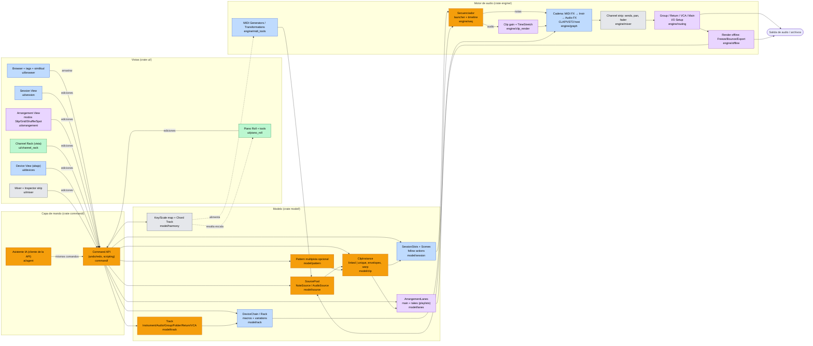

# 03 · Flujo de trabajo y UX de los DAW principales → propuesta unificada para AI-Track

> Fecha de la investigación: 2026-11-11. Versiones de referencia: **Ableton Live 12.4.x** (12.5 en beta), **FL Studio 2026.1.x**, **Logic Pro 12.3**, **Pro Tools 2026.11**.
> Objetivo: decidir qué conceptos tomar de cada DAW para un DAW nuevo en Rust orientado a música electrónica, y cómo encajarlos en **un solo modelo de datos coherente**.
> Nota de fiabilidad: las afirmaciones sobre versiones 2025-2026 provienen de notas de versión y prensa especializada (enlaces en §8). Las descripciones de los modelos de datos centrales provienen de los manuales oficiales y de conocimiento consolidado del producto. Donde una fuente es de foro o antigua, se indica.

---

## Índice

1. [Ableton Live 12](#1-ableton-live-12)
2. [FL Studio 2026](#2-fl-studio-2026)
3. [Logic Pro 12](#3-logic-pro-12)
4. [Pro Tools 2026](#4-pro-tools-2026)
5. [Tabla comparativa rápida](#5-tabla-comparativa-rápida)
6. [Propuesta de flujo unificado para AI-Track](#6-propuesta-de-flujo-unificado-para-ai-track)
7. [MVP priorizado frente a funciones posteriores](#7-mvp-priorizado-frente-a-funciones-posteriores)
8. [Fuentes](#8-fuentes)

---

## 1. Ableton Live 12

### 1.a Modelo mental y modelo de datos

- **Set** (proyecto) = lista de **pistas** + **escenas** + una **línea de tiempo de Arrangement**.
- **Pista**: tipos *MIDI*, *Audio*, *Group* (suma audio de sus hijas), *Return* (bus de envío), *Main*. Cada pista tiene exactamente **una cadena de dispositivos** (Device View, abajo de la pantalla).
- **Clip**: unidad de contenido de una sola pista. Hay dos tipos: clip MIDI (notas + envolventes) y clip de audio (referencia a sample + warp markers + envolventes). Cada clip tiene su propio loop, sus propiedades de lanzamiento (quantize, legato, follow actions) y sus **clip envelopes** (automatización o modulación relativa ligada al clip).
- **Dos "vistas" del mismo conjunto de pistas**:
  - **Session View**: matriz pista × escena de *clip slots*. Cada pista reproduce como máximo un clip a la vez. Una **escena** es una fila; lanzarla dispara todos sus clips. No es lineal: es un instrumento de improvisación y bocetado.
  - **Arrangement View**: línea de tiempo lineal por pista. Si una pista está reproduciendo un clip de Session, ignora el Arrangement hasta pulsar **"Back to Arrangement"**. La grabación de Session → Arrangement captura la improvisación.
- **Dispositivos y Racks**: cadena serie `MIDI FX → Instrumento → Audio FX`. Un **Rack** (Instrument / Drum / Audio Effect / MIDI Effect) contiene **cadenas paralelas**; en Instrument y Effect Racks cada cadena tiene zonas de *key*, *velocity* y *chain select*. Los Racks se anidan. Hasta **16 Macros** por Rack, con **Macro Variations** (instantáneas recuperables) y botón **Rand**. El **Drum Rack** asigna una cadena por nota (128 pads), con *choke groups* (16) y hasta 6 *return chains* internas.
- **Automatización**: absoluta en el Arrangement (por pista/parámetro) frente a **clip envelopes** (por clip, pueden ser relativas = "modulación" sobre el valor de la automatización).
- **Warping**: cada clip de audio tiene warp markers y un algoritmo (Beats, Tones, Texture, Re-Pitch, Complex, Complex Pro). Todo el audio se ajusta al tempo del Set por defecto.
- **Live 12**: escala y tonalidad (*Keys & Scales*) por clip, sincronizable con dispositivos; **MIDI Generators** (llenan un clip vacío: ritmo, arpegio, acordes, melodía) y **MIDI Transformations** (modifican notas: strum, ornament, arpeggiate, velocity shaper, etc.), ampliables con Max for Live; **Browser** con etiquetas (*tags*) y **búsqueda por similitud de sonido** (redes neuronales) y *Similar Sample Swapping* en Simpler/Drum Rack.

### 1.b Lo que más gusta (y por qué)

1. **Session View + escenas + follow actions**: permite bocetar loops sin compromiso lineal y tocar en directo. Es *la* razón de existir de Live en electrónica.
2. **Device View abajo con Racks y Macros**: cadenas visibles de izquierda a derecha; los Racks convierten cualquier cadena compleja en "un instrumento con 8-16 perillas". Macro Variations y Rand fomentan la exploración.
3. **Warping universal**: cualquier audio queda a tempo al soltarlo. Base del flujo de remix y sampling.
4. **Clip envelopes y modulación relativa**: automatización que viaja con el clip y se repite con su loop (polirritmias de modulación).
5. **Drum Rack + Simpler**: un sample por pad con su cadena propia; *slice to new Drum Rack* para hacer chops.
6. **Live 12 Keys & Scales + Generators/Transformations**: composición asistida sin salir del clip.
7. **Browser con tags y "similar sounds"**: reduce tiempo buscando samples.
8. **Flujo de bounce mejorado (12.2-12.3)**: *Bounce Track in Place*, *Bounce to New Track*, *Bounce Group*, *Paste Bounced Audio*.
9. **Device A/B (12.3)** y redisenos de dispositivos (Auto Filter, Erosion, Delay en 12.2-12.4).

### 1.c Puntos de dolor conocidos

- **Mezclador limitado**: históricamente no hay **VCAs**, la vista de mezcla es poco densa y la navegación por nombres de pista es pobre en sesiones grandes (quejas recurrentes en foros; parte de los hilos son de 2020).
- **Piano roll menos potente que el de FL**: sin atajos reasignables, comportamiento del lápiz discutido, cuantización considerada básica por algunos usuarios.
- **Rendimiento de UI** (lentitud en Windows reportada en el foro oficial) y estabilidad en algunas versiones con Push.
- **Curva de aprendizaje** de la dualidad Session/Arrangement ("¿por qué mi pista no suena? → Back to Arrangement").
- **Sin ventanas múltiples flexibles** (dos ventanas como máximo) y **sin ARA**.
- **Precio** de la edición Suite; la separación de stems solo está en Suite y solo con dispositivos nativos.

### 1.d Funciones de IA a 2026

| Función | Versión / fecha | Notas |
|---|---|---|
| Sound Similarity Search, Similar Sample Swapping | Live 12 (mar-2024) | Redes neuronales sobre la biblioteca local |
| MIDI Generators/Transformations | Live 12 | Algorítmicos (no generativos tipo LLM), extensibles con Max |
| **Stem Separation** local (Vocals/Drums/Bass/Others) | Live 12.3 (25-nov-2025), Suite | Desde clip o desde el Browser; también en Push Standalone |
| **Splice integration** + *Search with Sound* | Live 12.3 | Busca samples complementarios a partir de un audio |
| Separar stems de una selección de tiempo; fusionar stems | Live 12.4 (5-may-2026) | |
| Learn View, Link Audio, Quick Tags ampliados | Live 12.4 | Link Audio = audio en tiempo real entre pares de Link |

Ableton **no** ha lanzado un asistente conversacional ni generación de audio. Se han filtrado vídeos de un Live 13 con secuenciador por pasos y sintetizador de batería, sin anuncio oficial.

---

## 2. FL Studio 2026

### 2.a Modelo mental y modelo de datos

- **Channel Rack**: lista global de **canales** (generadores/instrumentos, samplers, capas, clips de audio, clips de automatización). Cada canal tiene secuenciador por pasos (16 pasos por defecto, hasta 512), un *graph editor* por paso (Note, Velocity, Release, Fine Pitch, Pan, Mod X, Mod Y, Shift, Rep) y un selector de **pista del Mixer** a la que envía su audio.
- **Pattern**: contenedor **multicanal**. Todos los patterns comparten el mismo conjunto de canales; cada pattern guarda sus pasos, notas de piano roll y automatización *para cada canal*. Un pattern de batería puede contener kick, snare y hats a la vez.
- **Playlist**: línea de tiempo con **pistas genéricas** que **no están ligadas** a instrumentos. Se pintan *Pattern Clips*, *Audio Clips* y *Automation Clips* en cualquier pista. Los pattern clips son **instancias enlazadas** (editar el pattern modifica todas las apariciones; "Make unique" las separa). FL ha ido añadiendo un modo en que un canal se liga a una pista del Playlist (pista de instrumento o audio), lo que acerca FL al modelo pista-clip.
- **Arrangements**: varias versiones de la Playlist en el mismo proyecto.
- **Mixer**: hasta 500 pistas (dinámicas desde FL 2025), 10 slots de efectos por pista, enrutamiento libre pista → pista con envíos ("route to this track only", sidechain).
- **Piano Roll**: considerado por muchos el mejor del sector. Ghost notes (notas de otros canales en gris), **resaltado de escala**, **Stamp** de acordes/escalas, notas **slide** y **porta**, propiedades por nota (pan, velocity, release, fine pitch, mod X/Y, color/canal MIDI), herramientas de *score*: **Arpeggiate**, **Chop**, **Glue**, **Strum**, **Flam**, **Randomize**, **LFO**, **Riff Machine**, **Quantize**, **Legato**, **Limit**, **Scale levels**, **Flip**. En 2026: **detección de notas y acordes en tiempo real** y **etiquetas por nota**.

### 2.b Lo que más gusta

1. **Velocidad del step sequencer**: de cero a beat en segundos; ideal para hip-hop, trap y EDM.
2. **Piano Roll y sus herramientas**: el slide de 303, el strum, el chop y el randomizer por escala son difíciles de igualar.
3. **Patterns reutilizables** pintados en cualquier pista del Playlist, con instancias enlazadas.
4. **Libertad del Playlist**: audio, patterns y automatización conviven en cualquier pista.
5. **Automation Clips** como objetos de primera clase (se pueden mover, copiar, enlazar a varios parámetros).
6. **Lifetime Free Updates**: confianza de la comunidad y precio.
7. **Contenido integrado**: FLEX (rediseñado en 2026), Loop Starter, FL Cloud.
8. **Routing visual del Mixer** con cables y sidechain sencillo.

### 2.c Puntos de dolor conocidos

- **Desacople canal ↔ pista del Mixer ↔ pista del Playlist**: tres numeraciones distintas para "la misma pista". Es la queja más repetida por quienes vienen de DAWs lineales.
- **Edición de audio y grabación** menos pulidas que Pro Tools/Logic/Cubase; el comping llegó tarde y es básico.
- **Patterns multicanal**: si un pattern mezcla instrumentos, es difícil separar partes para mezclar o reorganizar ("Split by channel" lo resuelve a posteriori).
- **Automatización dispersa**: automation clips vs. eventos dentro de patterns.
- **Interfaz de ventanas flotantes** que puede volverse caótica.
- **Sin vista tipo Session** para lanzar clips (existe *Performance Mode*, pero es secundario).

### 2.d Funciones de IA a 2026

| Función | Versión / fecha | Notas |
|---|---|---|
| Stem Separation | FL 21.2 (2023) | Separación de audio en stems dentro del Playlist |
| **Gopher** (asistente LLM) | FL 2025 (10-jul-2025) | Responde preguntas con el manual como base, en el idioma del usuario |
| **Loop Starter** | FL 2025; ampliado en 2025.2 y 2026 | Genera pilas de loops por género con sonidos de FL Cloud |
| **Gopher agéntico** | **FL 2026 (8-9 jul-2026)** | Ejecuta acciones: organizar pistas, enrutar el mixer, fijar niveles, ajustar parámetros de plugins, generar contenido de Piano Roll, resaltar elementos de la UI, crear scripts VFX. Funciona sobre la **misma API que los scripts MIDI** y solo está activo con su pestaña abierta. Según la prensa, no dibuja automatización ni elige presets exactos. Etiquetado "Experimental". Image-Line afirma que no entrena con datos de usuario |
| FL Cloud Project Backup | FL 2026 | Copias cifradas al guardar |
| Detección de acordes en tiempo real en Piano Roll | FL 2026 | |

**Lección clave para nosotros**: el agente de FL funciona porque la DAW ya expone una API de scripting completa. Diseñar AI-Track con una **API de comandos** desde el día 1 hace que el asistente sea "otro cliente" del modelo.

---

## 3. Logic Pro 12

### 3.a Modelo mental y modelo de datos

- **Proyecto** = **pistas** (audio, software instrument, Drummer/Session Player, externa MIDI) en la ventana principal (*Tracks area*), cada una ligada a un **channel strip** del Mixer.
- **Región** (equivalente a clip): región de audio o MIDI en la línea de tiempo; puede ser *alias* o *loop*. **Take folders** agrupan tomas para comping. **Live Loops** es una cuadrícula tipo Session (desde Logic 10.5), poco usada frente a la de Live.
- **Channel strip** (de arriba abajo): ajustes, EQ thumbnail, **MIDI FX**, **Instrumento**, **Audio FX** (inserts), **Sends**, salida, modo de automatización, pan, fader, medidor. Visible en el Inspector a la izquierda junto con el de la salida destino (dos strips lado a lado).
- **Smart Controls**: panel abajo con controles "de alto nivel" mapeados a parámetros de cualquier plugin del strip (similar a Macros, pero a nivel de pista y con layouts gráficos).
- **Track Stacks**:
  - **Summing Stack**: la pista principal es un **aux** que suma el audio de las subpistas (subgrupo real); admite Smart Controls que controlan subpistas; se guarda como patch.
  - **Folder Stack**: organizativo; su pista principal controla volumen/mute/solo de las subpistas **como un VCA**, sin sumar audio.
- **VCA faders** dedicados, **aux tracks** para buses de envío, **Track Alternatives** (versiones de una pista), **Chord Track** (con **Chord ID** desde Logic 12).
- **Flex Time / Flex Pitch**: edición de tiempo y afinación sobre el audio, por pista, con modos (Monophonic, Polyphonic, Slicing, Rhythmic, Speed, Tempophone).
- **Session Players** (Drummer + Bass + Keyboard desde Logic 11; **Synth Player** desde Logic 12): pistas cuyo contenido son "regiones de interpretación" parametrizadas (complejidad, intensidad, estilo) que siguen el Chord Track.

### 3.b Lo que más gusta

1. **Channel strip completo e Inspector**: todo el procesamiento de una pista de un vistazo, con la salida al lado.
2. **Track Stacks** (summing y folder) y **VCAs**: organización de mezclas grandes sin perder control.
3. **Smart Controls**: macros con UI gráfica para patches complejos.
4. **Session Players + Chord Track + Chord ID**: acompañamiento musical que se adapta a la armonía detectada desde cualquier audio o MIDI.
5. **Stem Splitter** (con guitarra y piano desde 11.2, y submezclas "acapella/instrumental").
6. **Mastering Assistant** (análisis + cadena de mastering adaptativa con caracteres "Clean/Valve/Punch/Transparent").
7. **Flex Time / Flex Pitch** integrados en la pista.
8. **Biblioteca de sonidos y precio** (199,99 USD perpetuo, actualizaciones gratuitas; también en la suscripción Apple Creator Studio).
9. **Flashback Capture** (11.2): recupera lo que tocaste sin estar grabando.

### 3.c Puntos de dolor conocidos

- **Solo macOS** (y Apple Silicon para Stem Splitter, ChromaGlow, Logic 12).
- **Live Loops** se percibe como un añadido, no como un flujo central.
- **Dualidad de automatización** pista vs. región, y la confusión entre Summing y Folder Stack (hilos frecuentes en foros de Apple y Gearspace).
- **Opacidad del environment** y del enrutamiento MIDI avanzado.
- **Modo de un solo editor activo** a la vez y paneles que compiten por espacio en pantallas pequeñas.
- Session Players ignoran el Chord Track si no se desmarca "Use Default Chord Progression for New Regions" (CDM).
- Chord ID imperfecto en material denso y con sesgo hacia la armonía occidental.

### 3.d Funciones de IA a 2026

| Función | Versión / fecha | Notas |
|---|---|---|
| Drummer | Logic X (2013) | Precursor de Session Players |
| Mastering Assistant | Logic 10.8 (2023); análisis en tiempo real en 11 | |
| **Session Players** (Bass, Keyboard) + **Stem Splitter** (4 stems) + **ChromaGlow** | Logic 11 (13-may-2024) | Stem Splitter y ChromaGlow requieren Apple Silicon |
| Stem Splitter con guitarra y piano + submezclas; **Flashback Capture**; Writing Tools/ChatGPT en el Notepad | Logic 11.2 (2025) | |
| **Synth Player** + **Chord ID** + Sound Library | **Logic 12 (28-30 ene-2026)** | ML + heurísticas, todo local |
| Chord ID mejorado; modo granular de Alchemy | Logic 12.3 (jun-2026) | |

Filosofía de Apple: "ML local, con controles musicales", no generación de canciones completas (CDM, Peter Kirn).

---

## 4. Pro Tools 2026

### 4.a Modelo mental y modelo de datos

- **Session** = pistas (Audio, Aux Input, Instrument, MIDI, Master Fader, **VCA Master**, Folder [Basic/Routing], Video) + **I/O Setup** (mapa con nombre de entradas físicas, salidas, **buses** internos e inserts de hardware).
- **Clip** = referencia a un fragmento de un archivo de audio o MIDI (*whole file* vs. *subset clip*). **Clip List** global. **Clip gain** antes de los inserts, con línea editable.
- **Playlists** por pista: versiones alternativas completas del contenido de la pista; vista de **Playlist lanes** para comping (seleccionar trozos y "promote" a la playlist principal). Desde 2026.11, colores y take IDs automáticos por toma.
- **Edit Window** y **Mix Window** separados. **Edit modes** globales (F1-F4):
  - **Shuffle**: los clips se empujan entre sí sin huecos (borrar desplaza todo lo posterior).
  - **Slip**: libre.
  - **Spot**: se introduce la posición numérica exacta (timecode).
  - **Grid** (absoluto o relativo).
- **Herramientas**: Trim, Selector, Grabber, Smart Tool (combinación según la zona del clip), Pencil.
- **Elastic Audio** (por pista: Polyphonic, Rhythmic, Monophonic, Varispeed, X-Form offline), **Beat Detective**, **Track Freeze** (12.4) / **Commit** (12.3) / **Bounce offline**.
- **Inserts A-J y Sends A-J** fijos por pista; **VCA Masters** y grupos de mezcla y edición con atributos.

### 4.b Lo que más gusta

1. **Edición de audio rápida y precisa**: Smart Tool, modos de edición, atajos de teclado (Keyboard Focus), fades por lotes.
2. **Playlists y comping**: estándar para voces y baterías multipista.
3. **Clip gain** independiente del fader.
4. **I/O Setup y enrutamiento**: buses con nombre, subrutas, hardware inserts; previsible en estudios grandes.
5. **Freeze / Commit / Bounce offline** muy controlables.
6. **VCAs, grupos con atributos, automatización avanzada** (Write/Touch/Latch/Trim, preview, write to selection).
7. **Estándar de la industria**: intercambio de sesiones entre estudios, post-producción, Atmos.

### 4.c Puntos de dolor conocidos

- **Suscripción** (Artist 99 USD/año, Studio 299, Ultimate 599) y licencias iLok; malestar sostenido desde 2022.
- **MIDI e instrumentos virtuales** históricamente débiles para producción (MPE no llegó hasta **2026.11**).
- **Sin flujo de bocetado/loops** comparable a Live o FL.
- **Solo AAX** (cerrado), interfaz anticuada en Windows (HiDPI y tema oscuro llegaron en 2026.11, parcialmente).
- Bugs y estabilidad discutidos en foros profesionales.

### 4.d Funciones de IA a 2026

| Función | Versión / fecha | Notas |
|---|---|---|
| **Splice integration** + Search With Sound | Pro Tools 2025.6 (jun-2025) | |
| **Speech-to-Text** local (transcribir clips/pistas, exportar CSV) | 2025.6, mejorado en 2026.4 | Studio/Ultimate |
| Track Pin, MPEG-H, Massive X Player | 2026.4 (30-abr-2026) | |
| **Extensions** (nuevo formato de herramientas no ligadas a pistas) + **Stem Separator** local (hasta 6 stems: Vocals, Drums, Bass, Guitar, Keys, Other) + **MPE** | **2026.11 (nov-2026)** | Stem Separator en todos los niveles; Avid afirma que no entrena con el audio del usuario |

---

## 5. Tabla comparativa rápida

| Concepto | Ableton Live | FL Studio | Logic Pro | Pro Tools |
|---|---|---|---|---|
| Unidad de contenido | Clip (1 pista) | Pattern (multicanal) + Audio/Automation clip | Región (1 pista), alias/loop | Clip (1 pista), referencia a archivo |
| Ligado instrumento ↔ pista | Sí, estricto | No (canal ↔ mixer ↔ playlist separados) | Sí | Sí |
| No lineal | Session View (central) | Performance mode (secundario) | Live Loops (secundario) | No |
| Cadena de dispositivos | Device View abajo, Racks anidables | 10 slots por pista del Mixer, Patcher | Channel strip, Smart Controls | Inserts A-J |
| Macros | 16 por Rack + variaciones | Patcher / Control Surface | Smart Controls | No |
| Grupos | Group (suma) | Mixer routing | Summing / Folder Stack + VCA | Aux, Folder, VCA |
| Automatización | Arrangement + clip envelopes | Automation clips + eventos de pattern | Pista + región | Pista (modos avanzados) |
| Tiempo en audio | Warp markers | Stretch + Slicex/Edison | Flex Time/Pitch | Elastic Audio, Beat Detective |
| Comping | Take lanes (Live 11+) | Básico | Take folders | Playlists |
| IA destacada 2026 | Stems, sound similarity, Splice | **Gopher agéntico**, Loop Starter | **Session/Synth Players, Chord ID**, Stem Splitter, Mastering Assistant | Stem Separator, Speech-to-Text, Extensions |

---

## 6. Propuesta de flujo unificado para AI-Track

### 6.1 Principios

1. **Un solo grafo de documento, varias vistas.** Session, Arrangement, Channel Rack, Mixer y Piano Roll son *vistas* sobre el mismo modelo; ninguna tiene datos propios no reflejados en el modelo (evita la confusión de FL de "tres numeraciones").
2. **La pista es la dueña del sonido** (Ableton/Logic/Pro Tools); **el contenido es reutilizable por referencia** (patterns enlazados de FL, alias de Logic, clips de Pro Tools).
3. **Toda edición es un `Command`** serializable (deshacer/rehacer, scripting, automatización de pruebas, colaboración futura y **agente IA** como cliente más).
4. **Electrónica primero**: Session + Drum Rack + Piano Roll de nivel FL son el núcleo; las herramientas de estudio (comping, modos de edición, I/O) se añaden encima sin romperlo.

### 6.2 Modelo de datos unificado

```
Project
├── Tempo/Meter map, Key/Scale map, Chord Track (global, en Arrangement)
├── SourcePool                       # FL patterns + Pro Tools Clip List + Live clips
│   ├── NoteSource  (id, notas con propiedades por nota, CC/MPE, escala asociada, longitud)
│   └── AudioSource (id, archivo, análisis: BPM, transientes, tonalidad, embedding de similitud)
├── Tracks[]
│   ├── kind: Instrument | Audio | Group(suma) | Folder(sin audio) | Return | VCA | Main
│   ├── DeviceChain: [MidiFx…] → Instrument? → [AudioFx…]   (cada nodo puede ser un Rack)
│   ├── ChannelStrip: input, clip-gain-aware, sends[], output (bus con nombre), pan, fader
│   ├── SessionSlots[scene] → ClipInstance?
│   ├── ArrangementLanes: main lane + take lanes (playlists)
│   └── Automation: lanes por parámetro (absolutas)
├── Scenes[] (nombre, tempo/meter opcional, follow actions de escena)
├── Buses / I/O Setup (entradas y salidas físicas, buses internos con nombre)
└── Patterns[] (opcional, "Pattern multipista")  → ver 6.3, conflicto 1

ClipInstance
├── source: SourceRef (linked) | owned copy ("make unique")
├── start, length, offset, loop {on, start, end}
├── gain (clip gain), fades, warp {markers, algoritmo}  (solo audio)
├── launch {quantize, legato, follow actions, probabilidad}
└── envelopes[] (modo: absoluto | modulación relativa)

Rack
├── kind: Instrument | Drum | AudioFx | MidiFx
├── chains[] (zonas key/vel/chain-select | nota de pad, choke group)
├── macros[16] (mapeos N:M con rango y curva) + variations[] + exclusiones de Rand
└── returns[] (solo Drum Rack)
```

**Equivalencias**: Pattern de FL = `NoteSource` enlazado (si es de un instrumento) o `Pattern` multipista (si es de batería con varios instrumentos). Región de Logic = `ClipInstance`. Playlist de Pro Tools = `ArrangementLane` alternativa. Smart Controls de Logic = **Macros del rack raíz de la pista** (cada pista tiene un rack implícito; no hay dos sistemas de macros).

### 6.3 Conflictos entre paradigmas y cómo resolverlos

| # | Conflicto | Resolución propuesta |
|---|---|---|
| 1 | **Pattern multicanal (FL) vs. clip de una pista (Live)** | El clip de una pista es la unidad canónica. Para el flujo de batería de FL, el **Drum Rack es la pista** y sus pads son los "canales": un pattern de batería es un `NoteSource` de esa pista (sin pérdida). Para patterns que mezclan instrumentos distintos (bajo + acordes) existe el objeto opcional **`Pattern` = grupo de `ClipInstance` enlazadas en varias pistas** que se mueve como bloque en el Arrangement (como los *clip groups*). No hay pistas de Playlist "genéricas". |
| 2 | **Channel Rack desacoplado del Mixer (FL) vs. pista = canal (Live/Logic)** | El **Channel Rack es una vista**: lista las pistas Instrument/Drum con fila de pasos para el clip seleccionado de la escena o pattern actual. Cada fila *es* una pista con su strip. Se elimina el selector de "insert del mixer". |
| 3 | **Session/Arrangement (Live) vs. Pattern + Playlist (FL)** | Mantener las dos vistas de Live. Session sirve también como "picker de patterns": arrastrar una escena al Arrangement inserta un `Pattern` enlazado. Modo opcional **"Arrangement follows"** que muestra claramente qué pistas están en Session (indicador y botón *Back to Arrangement* por pista y global). |
| 4 | **Grupos: Summing vs. Folder vs. VCA (Logic/Pro Tools) vs. Group (Live)** | Tres tipos explícitos y separados en la UI: **Group** (suma audio, tiene cadena), **Folder** (solo organiza; fader opcional que actúa como VCA de hijas), **VCA** (controla faders de pistas asignadas sin estar en jerarquía). Conversión con un clic Folder ↔ Group. |
| 5 | **Automatización: pista vs. clip envelope vs. automation clip (FL) vs. región (Logic)** | Dos capas: **Automatización de pista** (absoluta, Arrangement) y **envolvente de clip** (viaja con el clip; modo absoluto o *modulación* relativa). El automation clip de FL se emula con un **clip de automatización** en una lane de pista que se puede enlazar a N parámetros: es azúcar sobre la capa 2. Reglas de precedencia visibles (indicador LED en el parámetro). |
| 6 | **Modos de edición (Pro Tools) vs. "siempre a rejilla" (Live)** | Modos globales **Slip / Grid / Shuffle / Spot** en el Arrangement (F1-F4) con Grid por defecto para electrónica. Shuffle = "ripple" por pista o global. En Session no aplican. |
| 7 | **Warp (Live) vs. Flex (Logic) vs. Elastic (Pro Tools)** | Un único motor `TimeStretch` por `AudioSource`/clip: warp markers en el clip + algoritmo + modo "Seguir tempo" activable. Flex Pitch y edición de notas de audio quedan para una fase posterior. |
| 8 | **Playlists (Pro Tools) vs. Take lanes (Live/Logic)** | `ArrangementLanes` por pista: lane principal + lanes de tomas. "Duplicar playlist" = nueva lane completa. Comping con selección de rango y *promote*. |
| 9 | **Smart Controls vs. Macros** | Un solo sistema: el rack raíz de cada pista expone 16 macros; la vista de "Smart Controls" es un layout gráfico de esas macros. |
| 10 | **Device View abajo (Live) vs. Channel strip lateral (Logic)** | Device View abajo como principal (flujo electrónico). El Inspector izquierdo muestra un **channel strip compacto** de la pista seleccionada + su destino (estilo Logic), plegable. El Mixer completo es una vista conmutable (Tab). |
| 11 | **Freeze (Live/Pro Tools) vs. Commit/Bounce** | Tres acciones: **Freeze** (reversible, misma pista), **Bounce in place / to new track** (crea audio, conserva la pista original desactivada), **Export offline** (stems y mezcla). Todos por el mismo motor de render offline. |
| 12 | **Tempo y compás en Session** | El mapa de tempo vive en el Arrangement; las escenas pueden tener tempo/compás que se aplican al lanzarlas y se graban como automatización al capturar en el Arrangement. |
| 13 | **Escala por clip (Live 12) vs. escala global + Chord Track (Logic)** | Escala global con mapa en el tiempo, y **override por clip**. El Chord Track (manual o por detección) alimenta resaltado en el Piano Roll, Generators y futuros "players". |

### 6.4 Diagrama del flujo completo (señal, edición y mando)

Leyenda de colores: **naranja** = conceptos propios de AI-Track que unifican paradigmas (el "cambio" respecto a cualquier DAW existente); **azul** = origen Ableton; **verde** = origen FL Studio; **gris** = origen Logic; **morado** = origen Pro Tools. Los nombres de crate/módulo son una propuesta.



### 6.5 Flujos de trabajo de extremo a extremo

**A. Bocetar un beat (flujo FL + Live)**
1. Nueva pista Drum (Drum Rack). El Channel Rack muestra sus pads como filas con 16 pasos.
2. Se pintan pasos; el *graph editor* edita velocity/pan/pitch por paso (propiedades por nota del `NoteSource`).
3. Se duplica el clip en la siguiente escena y se varía. Las escenas forman las secciones.
4. Pista de bajo: Piano Roll con escala global, ghost notes del kick, notas *slide*, herramienta *Chop/Strum/Arp*.
5. Se lanzan escenas y se graba la interpretación al Arrangement (o se arrastran escenas como `Pattern`).

**B. Diseño de sonido (Live)**
1. Device View: instrumento → Audio FX; agrupar en Instrument Rack; mapear 8 macros; guardar variaciones; *Rand* para explorar.
2. Clip envelopes en modo modulación para movimiento por clip.

**C. Arreglo y edición (Pro Tools + Live)**
1. Arrangement en Grid; Shuffle para borrar secciones y cerrar huecos; Spot para alinear con referencias.
2. Grabación de voces en take lanes; comping; clip gain; warp para ajustar timing.

**D. Mezcla (Logic + Pro Tools)**
1. Vista Mixer: Groups para buses de batería, Folders para organizar, VCAs para el balance global, Returns para reverb/delay.
2. Inspector con strip compacto y destino. Automatización en lanes con modos Read/Touch/Latch/Write.
3. Freeze de pistas pesadas; export de stems offline.

**E. Asistencia IA (FL 2026 + Logic 12)**
1. "Organiza y colorea las pistas por tipo", "crea un bus de reverb y envía las voces al 20 %": el agente emite `Command`s visibles en el historial de deshacer.
2. Separación de stems desde el Browser o el clip; detección de acordes al Chord Track; búsqueda por similitud.

### 6.6 Distribución de pantalla propuesta (ventana principal)

```
┌──────────────────────────────────────────────────────────────────────────────────────────────┐
│ ▶ ■ ● ⟲  128.00 BPM  4/4  1.1.1  │ Key: F# minor ▾ │ Grid ▾ Slip|Grid|Shuffle|Spot │ CPU 23% │ ✦ IA │ 1
├──────────┬───────────────────────────────────────────────────────────────────────┬───────────┤
│ BROWSER  │  [Session ⇆ Arrangement ⇆ Mixer]  (Tab alterna)                       │ INSPECTOR │ 2
│ ─────────│ ┌───────────┬───────────┬───────────┬───────────┬──────────┬───────┐ │ ───────── │
│ ⌕ buscar │ │ 1 Drums ◉ │ 2 Bass  ◉ │ 3 Chords ◉│ 4 Vox   ◉ │ A Rev  ◉ │ Scene │ │ Clip:     │
│ Tags ▾   │ ├───────────┼───────────┼───────────┼───────────┼──────────┼───────┤ │ "Bass 1"  │
│ ▸ Sounds │ │ ▶ Beat A  │ ▶ Bass 1  │ ▶ Pad Fm  │ □         │          │ ▶ Intro│ │ Loop 4b   │
│ ▸ Drums  │ │ ▶ Beat B  │ ▶ Bass 2  │ ▶ Pad Fm  │ ▶ Vox Hk  │          │ ▶ Drop │ │ Escala:   │
│ ▸ Instr. │ │ □         │ □         │ □         │ □         │          │ ▶ Break│ │  global ▾ │
│ ▸ FX     │ │ ■ stop    │ ■ stop    │ ■ stop    │ ■ stop    │          │ ■ all  │ │ Follow: ▾ │
│ ▸ Samples│ ├───────────┴───────────┴───────────┴───────────┴──────────┴───────┤ │ ───────── │
│ ▸ Splice*│ │ Arrangement (mini-overview / o vista completa con take lanes)      │ │ Strip:    │
│ ≈ Similar│ │ |Intro      |Drop              |Break     |Drop 2           |    │ │ [EQ]      │
│ ▸ Proyect│ │ ▓▓▓▓░░░░░░░░▓▓▓▓▓▓▓▓▓▓▓▓▓▓▓▓▓▓▓░░░░░░░░░░░▓▓▓▓▓▓▓▓▓▓▓▓▓▓▓▓         │ │ Sends A B │
│          │ │ Chord Track:  F#m   | D   | A   | E                                 │ │ Out: Bus▾ │
│ Pool ▾   │ │                                                                   │ │ ▮ fader ▮ │
├──────────┴─┴───────────────────────────────────────────────────────────────────┴─┴───────────┤
│ PANEL INFERIOR  [Devices | Clip/Piano Roll | Channel Rack | Mixer compacto]  (Shift+Tab)     │ 3
│ ┌─MIDI FX──┐ ┌─Instrument Rack "Reese"────────────────────────────┐ ┌─EQ─┐ ┌─Comp─┐ ┌─Sat┐ │
│ │ Arp      │ │ Macros: (1)Cut (2)Res (3)Drive (4)Width ... (8)    │ │    │ │      │ │    │ │
│ │ Scale    │ │ Chains: Sub | Mid | Noise   Var: [A][B][C] [Rand]   │ │    │ │      │ │    │ │
│ └──────────┘ └────────────────────────────────────────────────────┘ └────┘ └──────┘ └────┘ │
├──────────────────────────────────────────────────────────────────────────────────────────────┤
│ Info / ayuda contextual │ Historial de comandos (incluye acciones IA) │ Mensajes             │ 4
└──────────────────────────────────────────────────────────────────────────────────────────────┘
 1 = Transporte + escala global + modos de edición + botón del asistente.
 2 = Área principal conmutable (Session/Arrangement/Mixer); en pantallas anchas Session y
     Arrangement pueden verse divididos (como arriba).
 3 = Panel inferior: Device View por defecto; el Piano Roll y el Channel Rack ocupan este panel
     o se expanden a pantalla completa (doble clic).
 4 = Barra de estado; el historial hace auditables las acciones del agente.
 * Splice u otros proveedores serían integraciones opcionales (fase posterior).
```

Vista del Piano Roll expandido (panel 3):

```
┌ Piano Roll · "Bass 1" · F# minor (resaltado) · Ghost: Drums ✓ Chords ✓ ───────────────────┐
│ Tools ▾ [Chop][Glue][Strum][Arp][Flam][Rand][LFO][Quantize][Legato][Stamp ▾][Gen ▾]         │
│ C#4 ░░░░░░░░░░░░░░░░░░░░░░░░░░░░░░░░░░░░░░░░░░░░░░░░░░░░░░░░░                               │
│ A3  ░░░░████░░░░░░░░░░░░░░░███▶slide░░░░░░░░░░░░░░░░░░░░░░░░░░░   (gris = notas fantasma)     │
│ F#3 ████░░░░░░████░░░░████░░░░░░░░████░░░░░░░░░░░░░░░░░░░░░░░░                               │
│ ─── Lane de propiedad: [Velocity▾|Pan|Release|Pitch fino|Mod X|Mod Y|Prob.|MPE] ────────── │
│     ▂▅█▃▂▅█▃▂▅█▃                                                                             │
└──────────────────────────────────────────────────────────────────────────────────────────────┘
```

### 6.7 Implicaciones de arquitectura para Rust (resumen)

- **Modelo inmutable/persistente en el hilo de UI** (`model/`) + **instantáneas compiladas** que se envían al hilo de audio sin bloqueos (`engine/`); el hilo de audio nunca toca el grafo editable.
- **`Command` como enum serializable** (serde) con `apply`/`invert`: base del undo, de los scripts, de los tests y del agente IA (el agente recibe un esquema de comandos y el estado resumido del proyecto, como hace Gopher con la API de scripting de FL).
- **Herramientas de Piano Roll y MIDI Generators como funciones puras** `fn(&NoteSource, &Params, &HarmonyContext) -> NoteSource`: fáciles de probar y de exponer al agente.
- **Un solo motor de render offline** para Freeze, Bounce, Export y separación de stems (el modelo de stems corre fuera del hilo de audio).
- **Hosting CLAP primero** (diseño moderno de modulación por nota y polifónica) y VST3 después; macros y automatización mapeadas a parámetros de host mediante IDs estables.

---

## 7. MVP priorizado frente a funciones posteriores

### P0 · MVP (un productor electrónico puede terminar un tema)

| # | Función | Origen |
|---|---|---|
| 1 | Transporte, tempo, compás, metrónomo, loop | Todos |
| 2 | Modelo `Command` con undo/redo ilimitado y guardado/carga del proyecto | Propio |
| 3 | Pistas Instrument, Audio, Group, Return, Main | Live/Logic |
| 4 | **Arrangement View** con clips MIDI y audio, Grid + Slip, loop/recorte/duplicado | Live/Pro Tools |
| 5 | **Session View** básica: slots, escenas, launch quantize, Back to Arrangement, grabar a Arrangement | Live |
| 6 | **Piano Roll**: dibujo, velocity lane, resaltado de escala global, ghost notes, quantize, chop, strum, arpeggiate (herramientas como funciones puras) | FL/Live 12 |
| 7 | **Drum Rack + vista Channel Rack** (step sequencer de 16-64 pasos con graph editor) | Live/FL |
| 8 | **Device View** con cadena MIDI FX → Instrumento → Audio FX; hosting **CLAP** (VST3 si el tiempo lo permite) | Live |
| 9 | Instrumentos nativos mínimos: **Sampler** (one-shot/slice) y **sintetizador sustractivo**; FX: EQ, compresor, reverb, delay, saturación, filtro | Live/Logic |
| 10 | **Mixer** con sends, pan, fader, medidores, salida a Group/Return; Inspector con strip compacto | Logic |
| 11 | **Automatización** de pista (Read/Write/Touch) en lanes | Todos |
| 12 | **Warp** básico (seguir tempo, marcadores, algoritmo de calidad alta + repitch) | Live |
| 13 | Clip gain y fades en clips de audio | Pro Tools |
| 14 | **Export offline** de mezcla y stems; **Bounce in place** | Pro Tools/Live 12.2 |
| 15 | Browser de archivos con preview a tempo | Live |

### P1 · Siguiente versión (profundidad de flujo)

- **Racks** con cadenas paralelas, zonas, 16 **macros**, **macro variations**, Rand, anidado.
- **Clip envelopes** (absoluto/modulación) y clips de automatización enlazables.
- **Follow actions** de clip y de escena, probabilidad por nota y por clip.
- Notas *slide*/*porta*, propiedades por nota completas (release, pan, mod X/Y, pitch fino), Stamp de acordes, Randomize por escala, LFO tool, Flam, Legato.
- `Pattern` multipista enlazado y "make unique"; vinculado clip ↔ `NoteSource` con instancias.
- **Folder** y **VCA**; modos **Shuffle** y **Spot**; grupos de edición/mezcla.
- **Take lanes / playlists y comping**; grabación en loop.
- **Freeze**; sidechain; I/O Setup con buses con nombre; PDC completo.
- Browser con **tags** y colecciones; mapa de escala por clip (override).
- Soporte VST3 completo y MIDI learn / superficies de control.

### P2 · Posterior (IA y diferenciadores)

- **Asistente IA agéntico** sobre la Command API (organizar, enrutar, nombrar, crear buses, aplicar herramientas MIDI), con vista previa y deshacer en un paso.
- **Separación de stems local** (4-6 stems) desde clip o Browser.
- **Búsqueda por similitud de sonido** (embeddings locales) y *sample swapping*.
- **Chord Track + detección de acordes** desde audio/MIDI; **MIDI Generators** (ritmo, acordes, melodía, arpegio) que siguen la armonía.
- **"Players"** paramétricos tipo Session Players (bajo, pads, batería) que siguen el Chord Track.
- **Mastering assistant** (análisis de loudness/espectro + cadena sugerida).
- Edición de afinación (tipo Flex Pitch), detección de transitorios avanzada (tipo Beat Detective).
- MPE completo, Ableton Link (y audio por red), formatos de extensiones/herramientas no ligadas a pistas (como Pro Tools Extensions), backup en la nube, colaboración.

Criterio de priorización: P0 cubre el ciclo bocetar → arreglar → mezclar → exportar con el modelo de datos definitivo (aunque partes de la UI sean mínimas). La IA va en P2 porque depende de una Command API estable y de un modelo con semántica rica, que son P0. Diseñar el `Command` y el `SourcePool` correctamente en P0 evita migraciones de formato de proyecto después.

---

## 8. Fuentes

### Ableton Live
- Ableton, *Live 12 Release Notes* (12.2, 12.3, 12.4): https://www.ableton.com/en/release-notes/live-12/
- Ableton, *Live 12 Manual – Instrument, Drum and Effect Racks*: https://www.ableton.com/en/live-manual/12/instrument-drum-and-effect-racks/
- Ableton, *All new features in Live 12*: https://www.ableton.com/en/live/all-new-features/
- Ableton blog, *Live 12.4 is coming* (feb-2026): https://www.ableton.com/de/blog/live-12-4-is-coming/
- Mixdown, *Live 12.4 public beta*: https://mixdownmag.com.au/news/ableton-live-12-4-enters-public-beta-with-link-audio-and-redesigned-devices/
- Mixdown, *Live 12.3 drops with stem separation and Splice*: https://mixdownmag.com.au/news/ableton-live-12-3-drops-overnight-with-stem-separation-and-splice-integration/
- MusicRadar, *Live 12.3 hidden features*: https://www.musicradar.com/music-tech/stem-separation-splice-integration-ableton-is-playing-catch-up-with-live-12-3-but-its-best-new-features-are-the-ones-hidden-beyond-the-headlines
- Magnetic Mag, *Live 12.3 local stem separation*: https://magneticmag.com/2025/11/ableton-live-12-3-adds-local-stem-separation-and-workflow-upgrades/
- CDM, *Ableton Live 12 everything new*: https://cdm.link/ableton-live-12-everything-new/
- MusicRadar, *Live 12 Suite review*: https://musicradar.com/reviews/ableton-live-12-suite-review
- Gearnews, filtración de Live 13 (no oficial): https://www.gearnews.com/?p=264356
- Foro de Ableton, *Investigating Ableton's Sluggish UI*: https://forum.ableton.com/viewtopic.php?p=1834530
- Admiral Bumblebee, *20 things I hate about…* (2020, crítica de mezclador/edición): https://admiralbumblebee.com/music/2020/02/01/20-things-I-hate-about.html
- KVR, *Ableton piano roll limits*: https://www.kvraudio.com/forum/viewtopic.php?p=8032267

### FL Studio
- Image-Line, *FL Studio 2025 released*: https://www.image-line.com/fl-studio-news/fl-studio-2025-whats-new-2
- Image-Line, *FL Studio 2025.2*: https://www.image-line.com/fl-studio-news/history/fl-studio-2025-2
- Image-Line, manual *Channel Rack*: https://www.image-line.com/fl-studio-learning/fl-studio-online-manual/html/channelrack.htm
- Image-Line, manual *Piano Roll menu/tools*: https://www.image-line.com/fl-studio-learning/fl-studio-online-manual/html/pianoroll_menu.htm
- Image-Line, manual *Piano roll Arpeggiator*: https://www.image-line.com/fl-studio-learning/fl-studio-online-manual/html/pianoroll_arpeggiate.htm
- Image-Line, manual *Gopher control*: https://www.image-line.com/fl-studio-learning/fl-studio-online-manual/html/gopher/gopher_control.htm
- Image-Line, manual *Workflow basics*: https://www.image-line.com/fl-studio-learning/fl-studio-online-manual/html/basics_workflow.htm
- Attack Magazine, *FL Studio 2026*: https://www.attackmagazine.com/news/fl-studio-2026-adds-redesigned-flex-cloud-backup-and-built-in-smart-assistance/
- MusicRadar, *Control FL Studio with an agentic AI chatbot*: https://www.musicradar.com/music-tech/you-can-now-control-fl-studio-with-an-ai-chatbot-from-inside-the-daw
- DJ Mag, *FL Studio 2026 available now*: https://djmag.com/tech/fl-studio-2026-available-now
- Rekkerd, *FL Studio 2026*: https://rekkerd.org/image-line-launches-fl-studio-2026-redesigned-flex-secure-cloud-project-backup-smart-assistance-more/
- RouteNote, *FL Studio 2026 Gopher*: https://routenote.com/blog/fl-studio-2026-gopher-ai-production-assistant/
- MusicRadar, *FL Studio 2025 AI assistant*: https://www.musicradar.com/music-tech/fl-studio-2025-introduces-chatgpt-style-ai-assistant-that-offers-music-production-advice-and-helps-you-use-the-daw
- Admiral Bumblebee, *30 days with FL Studio 20 – workflow* (2018): https://www.admiralbumblebee.com/music/2018/07/15/30-days-with-flstudio-20-workflow
- Admiral Bumblebee, *30 days with FL Studio 20 – piano roll tools* (2018): https://www.admiralbumblebee.com/music/2018/06/30/30-days-with-flstudio-20-piano-roll-tools
- KVR, hilos de flujo de trabajo de FL: https://www.kvraudio.com/forum/viewtopic.php?p=7202912

### Logic Pro
- Apple, *Logic Pro for Mac release notes*: https://support.apple.com/en-us/109503
- Apple, *Logic Pro 11 release notes*: https://support.apple.com/es-es/126835
- Synthtopia, *Logic Pro 12 & MainStage 4 now available* (30-ene-2026): https://www.synthtopia.com/content/2026/01/30/apple-logic-pro-12-mainstage-4-now-available-heres-whats-new/
- CDM, *Logic Pro 12 hands-on* (28-ene-2026): https://cdm.link/logic-pro-12-hands-on/
- Synth Anatomy, *Logic Pro 12.3*: https://synthanatomy.com/2026/06/apple-logic-pro-12.html
- Logic Studio Training, *Logic Pro 12 update / Chord ID*: https://logicstudiotraining.com/logic-pro-12-update/
- MusicTech, *Logic Pro 11 and Logic Pro for iPad 2*: https://musictech.com/news/industry/apple-logic-pro-for-mac-11-logic-pro-for-ipad-2/
- CDM, *Logic Pro 11 review*: https://cdm.link/logic-pro-11-review/
- Apple, *Track Stacks overview*: https://help.apple.com/logicpro/mac/10.1/en.lproj/lgcp9bc4b63d.html
- Sound On Sound, *Well Stacked* (Track Stacks): https://www.soundonsound.com/techniques/well-stacked
- Apple Community, *Summing vs Folder Stack*: https://discussions.apple.com/thread/8010887

### Pro Tools
- Avid, *What's new in Pro Tools*: https://www.avid.com/pro-tools/whats-new
- Avid, *Edit modes* (guía de usuario): https://www.avid.com/pro-tools/user-guide/edit-modes
- Avid, nota de prensa 2025.6 (Splice): https://www.avid.com/press-room/2025/06/avid-delivers-game-changing-splice-integration-to-power-music-creators-with-new-pro-tools-release
- Avid, *What's new in Pro Tools 2025.6*: https://www.avid.com/resource-center/whats-new-in-pro-tools-20256
- Avid, nota de prensa 2026.4: https://www.avid.com/press-room/2026/04/avid-powers-faster-workflows-and-next-generation-immersive-audio-with-latest-pro-tools-release
- Avid, *What's New in Pro Tools 2026.4* (PDF): https://resources.avid.com/SupportFiles/PT/Whats_New_in_Pro_Tools_2026.4.pdf
- Production Expert, *Pro Tools 2026.11 – Extensions, stem separation, MPE*: https://www.production-expert.com/production-expert-1/pro-tools-2026-11-adds-extensions-built-in-stem-separation-and-mpe
- audioXpress, *Extensions, local AI stem separation, MPE*: https://audioxpress.com/news/avid-expands-pro-tools-with-new-extensions-framework-local-ai-stem-separation-and-mpe-support
- MusicRadar, *Pro Tools 2025.6 Splice + Speech-to-Text*: https://www.musicradar.com/music-tech/splice-is-now-built-directly-into-pro-tools-avid-launches-pro-tools-2025-6-with-splice-integration-ai-speech-to-text-engine-and-more
- Mix, *Pro Tools 2026.4*: https://www.mixonline.com/technology/news-products/avid-launches-pro-tools-2026-4
- Sound On Sound, *Pro Tools Track Freeze* (12.4): https://www.soundonsound.com/techniques/pro-tools-track-freeze-124
- Sound On Sound, *Making Commitments* (Commit, 12.3): https://www.soundonsound.com/techniques/making-commitments
- Sound On Sound, *Pro Tools: Tiers & Subscriptions*: https://www.soundonsound.com/techniques/pro-tools-tiers-subscriptions
- Engadget, *Pro Tools subscription only*: https://www.engadget.com/pro-tools-subscription-service-perpetual-license-160010247.html
- MusicTech, *Using Edit Modes in Pro Tools*: https://www.musictech.net/tutorials/using-edit-modes-in-pro-tools/
