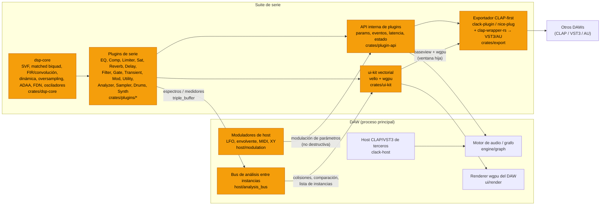

# 04 — Plugins de serie: lecciones de FabFilter y Waves, técnicas DSP y ecosistema Rust

> Investigación para la suite de plugins de serie de un DAW nuevo en Rust (macOS + Windows, bajo consumo de CPU, interfaces de plugin renderizadas por GPU).
> Fecha: 2026-11-11. Las fuentes están enlazadas en cada sección y reunidas al final. Cuando un dato no se pudo verificar en una fuente primaria, se indica.

---

## 0. Resumen ejecutivo

1. **FabFilter** marca la referencia de UX: la pantalla interactiva *es* el control principal. Los nodos se arrastran sobre el espectro, aparece un panel flotante junto a la banda seleccionada, la rueda del ratón cambia la Q, los valores se escriben a mano (incluso como notas, "A4"), la interfaz es vectorial y redimensionable, y la modulación se asigna arrastrando una fuente sobre cualquier control. El DSP queda oculto detrás de pocos modos bien elegidos (Zero Latency / Natural Phase / Linear Phase; "estilos" de compresión; "algoritmos" de limitación).
2. **Waves** marca la referencia de modelado y de catálogo. Emulaciones de consolas con licencia (SSL, API, Abbey Road), series "signature" con controles orientados al resultado (CLA), procesadores propios muy influyentes (L1/L2/L3, Renaissance, C6/F6) y, más recientemente, redes neuronales (Clarity Vx) y búsqueda de cadenas asistida por IA (StudioVerse). También deja lecciones negativas: el intento de pasar a solo suscripción en 2023 fracasó.
3. **El DSP de fondo** es conocido y está bien publicado: SVF TPT (Simper/Zavalishin), biquads con corrección del "cramping" (Vicanek), FIR de fase lineal por convolución particionada, compresores con computador de ganancia en dominio logarítmico (Giannoulis/Massberg/Reiss), true peak según ITU-R BS.1770, sobremuestreo polifásico, ADAA para saturación, FDN/Dattorro para reverb, PolyBLEP y wavetables con mipmaps para síntesis. Con esto se construye todo sin tocar propiedad intelectual ajena.
4. **Rust en 2026**: nih-plug está en **modo mantenimiento**. Su sucesor comunitario es **nice-plug** (0.4.x, sept. 2026, ISC, VST3 mediante el crate `vst3` MIT/Apache), aunque sus pruebas en macOS son limitadas. Alternativas: **truce** (CLAP/VST3/AU/AAX/LV2), **clack** (CLAP de bajo nivel, MIT/Apache) + **clap-wrapper-rs** (VST3/AUv2). Desde octubre de 2025 el **VST3 SDK es MIT**, lo que elimina el problema de GPL que tenía `vst3-sys`. Para la GPU: **wgpu + vello** (vectorial, 0.9 en mayo de 2026) es la opción más alineada con un DAW renderizado por GPU.
5. **Recomendación**: un núcleo DSP propio (crates puros, sin asignaciones de memoria en el hilo de audio, SIMD con `wide`), una API interna de plugins para el DAW y una capa delgada de exportación CLAP-first (clack o nice-plug) con VST3 encima. La UI usa una biblioteca de widgets propia sobre wgpu/vello, compartida entre el DAW y los plugins exportados.

---

## 1. FabFilter: cómo diseñan

### 1.1 Filosofía general
- **Pocos productos, muy pulidos y con un lenguaje visual común.** Toda la línea Pro comparte layout, interacción, navegador de presets, A/B, deshacer/rehacer, MIDI learn, ayuda contextual y escalado de la interfaz.
- **La pantalla es el instrumento.** En lugar de una fila de perillas, el usuario manipula directamente la curva, el umbral o la envolvente sobre la visualización de la señal.
- **El DSP se elige con "modos" y "estilos" con nombre** que encapsulan decenas de parámetros internos (topología del detector, curvas de release, rodilla, etc.).
- **Consumo de CPU contenido** y modos de alta calidad (sobremuestreo, fase lineal) opcionales.

### 1.2 Pro-Q 4 (EQ)
Fuentes: [Ayuda Pro-Q](https://www.fabfilter.com/help/pro-q), [modos de procesado](https://www.fabfilter.com/help/pro-q/using/processingmode), [analizador](https://www.fabfilter.com/help/pro-q/using/analyzer), [pantalla EQ](https://www.fabfilter.com/help/pro-q/using/eqdisplay), [noticia de lanzamiento](https://www.fabfilter.com/news/1733994000/fabfilter-releases-pro-q-4-equalizer-plug-in), [Sound On Sound](https://www.soundonsound.com/node/4933001).

- **Hasta 24 bandas**, con formas bell, shelf, cortes LP/HP con pendientes (incluidas fraccionarias, p. ej. 3,5 dB/oct), notch, band-pass, tilt y, nuevo en la v4, **all-pass**.
- **Tres modos de procesado**:
  - *Zero Latency*: imita la magnitud del EQ analógico sin latencia; es el modo más eficiente.
  - *Natural Phase*: imita magnitud **y** fase analógicas, sin pre-ringing apreciable ni latencia larga (FabFilter no publica el método).
  - *Linear Phase*: solo modifica la magnitud. Tiene cinco resoluciones con latencia a 44,1 kHz: Low 3072 muestras (~70 ms), Medium 5120 (~116 ms), High 9216 (~209 ms), Very High 17408 (~395 ms) y Maximum 66560 (~1509 ms). Si se mezclan bandas L/R y M/S, el proceso va en dos etapas y la latencia se duplica. El EQ dinámico funciona en fase lineal solo hasta "High".
- **EQ dinámico** por banda (bell/shelf), con umbral, rango y sidechain interno o externo.
- **Spectral Dynamics** (v4): compresión o expansión que actúa solo sobre las frecuencias *dentro* de la banda que superan el umbral. Es un procesado espectral (STFT) que siempre funciona en fase lineal.
- **Character modes** (v4): Clean, Subtle (saturación tipo transformador) y Warm (tipo válvula).
- **Analizador**: pre, post y SC/externo (incluido el espectro de *otra instancia* de Pro-Q). Rango de 60, 90 o 120 dB; resolución de 1024 a 8192 puntos; velocidad de caída; **tilt de 4,5 dB/oct alrededor de 1 kHz** por defecto; Freeze; **Spectrum Grab** (los picos del espectro se agarran y arrastran para crear o mover una banda); **detección de colisiones** (resplandor rojo donde el espectro propio y uno externo pueden enmascararse).
- **EQ Match** (iguala el espectro con una referencia) y **EQ Sketch** (dibujar la curva a mano).
- **Instance List** (v4): una vista con todas las instancias de Pro-Q 4, Pro-C 3, Pro-DS y Pro-G del proyecto, editables desde cualquier ventana, con copia de bandas entre instancias.
- **Stereo por banda**: Stereo / Left / Right / Mid / Side.
- **Interacción** (resumida de la ayuda):
  - Se arrastra la curva general para crear una banda; antes de soltar se ve una vista previa de la forma.
  - El punto donde se hace clic decide la forma: extremos → cortes; bordes de la curva → shelves; doble clic abajo → notch.
  - La rueda del ratón cambia la Q (en los cortes, la pendiente; con Shift, pendientes fraccionarias). Ctrl/Cmd+rueda cambia la ganancia y Alt+rueda el rango dinámico.
  - Alt+arrastrar restringe el movimiento a un eje y Shift da ajuste fino.
  - Selección por rectángulo y edición relativa de varias bandas.
  - Doble clic en un nodo abre la entrada numérica (Tab recorre Freq/Gain/Q; acepta "2k" o "A4").
  - Botón de pantalla completa; el rango vertical se amplía solo al arrastrar más allá de ±30 dB; zoom horizontal arrastrando la escala de frecuencias.

### 1.3 Pro-C 3 (compresor)
Fuentes: [Ayuda Pro-C](https://www.fabfilter.com/help/pro-c), [estilos y carácter](https://www.fabfilter.com/help/pro-c/using/styleandcharacter).
- **14 estilos**:
  - Modernos: Clean, Versatile, Smooth, Punch, Upward y TTM (compresión ascendente + descendente en 3 bandas, donde el umbral funciona como nivel objetivo).
  - Clásicos: Op-El, Vari-Mu, Classic y Opto.
  - Utilitarios: Vocal (rodilla y ratio automáticos), Mastering, Bus y Pumping.
- **Character**: Off, Tube, Diode o Bright, con Drive y enrutado Pre o Post compresión.
- **Lookahead de hasta 20 ms**, con un máximo configurable para acotar la latencia.
- **EQ de sidechain de 6 bandas** con las formas de Pro-Q, bandas mid-only o side-only, disparo por tempo del host o por MIDI y sidechain externo.
- Sobremuestreo de hasta 32×.
- Pantalla con historial de nivel y reducción de ganancia, y curva de transferencia.

### 1.4 Pro-L 2 (limitador)
Fuentes: [Ayuda Pro-L 2 — true peak](https://www.fabfilter.com/help/pro-l/using/truepeaklimiting), [noticia](https://www.fabfilter.com/news/1512462600/fabfilter-releases-fabfilter-pro-l-2-true-peak-limiter-plug-in), [Tape Op](https://tapeop.com/reviews/gear/127/pro-l-2-limiter-plug-in), [MusicRadar](https://www.musicradar.com/reviews/fabfilter-pro-l-2).
- **8 algoritmos.** Según las reseñas, Modern es el nuevo "para todo" y Transparent y Allround vienen de la v1. Los nombres restantes que suelen citarse (Punchy, Dynamic, Aggressive, Bus, Safe) no se verificaron en una fuente primaria en esta investigación.
- **True peak en dos etapas**: el limitador ultrarrápido actúa primero y luego se atenúa con suavidad cualquier exceso inter-muestra. Añade latencia.
- **Sobremuestreo** de 2× a 32× (fase lineal).
- Medición de loudness compatible con ITU-R BS.1770 / EBU R128.
- Pantalla con historial de forma de onda y reducción de ganancia, y escucha con ganancia unitaria (unity gain) para comparar sin el sesgo de volumen.

### 1.5 Pro-R 2 (reverb)
Fuente: [producto Pro-R 2](https://www.fabfilter.com/products/pro-r-2-reverb-plug-in).
- **Macro-controles perceptuales** en lugar de parámetros técnicos:
  - Space: mezcla continua de modelo de sala y decay.
  - Decay Rate: 25–400 %.
  - Distance, Brightness y Character (de limpio a "chorus").
- **Decay Rate EQ**: un EQ paramétrico de 6 bandas que fija el *tiempo de decay* por frecuencia. Es la idea más copiable conceptualmente, porque es control de T60 por banda.
- Post EQ de 6 bandas (M/S y L/R), ducking, Thickness (saturación y compresión), algoritmos Vintage (reverbs digitales de los 80–90) y Plate.

### 1.6 Pro-MB, Pro-DS, Pro-G
Fuentes: [Pro-MB](https://www.fabfilter.com/products/pro-mb-multiband-compressor-plug-in), [Ayuda Pro-Q (Instance List)](https://www.fabfilter.com/help/pro-q).
- **Pro-MB**: hasta 6 bandas, con el lema *"think bands, not crossovers"*. Las bandas se crean solo donde hacen falta y se pueden unir para formar un crossover clásico. Las pendientes van de 6 a 48 dB/oct. Tiene tres modos: **Dynamic Phase** (respuesta casi idéntica al multibanda tradicional, sin latencia ni pre-ringing, y solo cambia la fase cuando cambia la ganancia), Linear Phase (hasta 4× sobremuestreo) y Minimum Phase. Cada banda admite compresión, expansión, compresión ascendente o gating, y sidechain externo.
- **Pro-DS** (de-esser): detección inteligente orientada a voz única o "allround", modos de banda ancha o dividida, y lookahead. Los detalles exactos no se verificaron aquí.
- **Pro-G** (gate/expansor): varios estilos (incluidos upward y ducking), sidechain con EQ y pantalla de nivel en tiempo real.

### 1.7 Saturn 2 (distorsión multibanda con modulación)
Fuentes: [producto Saturn 2](https://www.fabfilter.com/products/saturn-2-multiband-distortion-saturation-plug-in), [modulación](https://www.fabfilter.com/help/saturn/using/modulation).
- **28 estilos** (de válvula suave a amplis de guitarra y bitcrush), **hasta 6 bandas**, crossovers de 6/12/24/48 dB/oct y fase lineal opcional.
- Por banda: drive, **feedback**, dynamics, tone y mix.
- HQ: Good (8×) y Superb (32×).
- **Matriz de modulación de 50 slots** con fuentes XLFO (forma libre, sincronizable), generador de envolvente (disparo por audio o MIDI), seguidor de envolvente, MIDI y controlador XY/slider. La fuente se arrastra sobre cualquier control y el slot fija la cantidad.

### 1.8 Volcano 3, Twin 3, Timeless 3
- **Volcano 3** (filtro), **Twin 3** (sintetizador) y **Timeless 3** (delay tipo cinta) aplican el mismo patrón: pantalla interactiva, varios filtros con enrutado flexible y el mismo sistema de modulación por arrastrar y soltar con XLFO, envolventes, seguidores y MIDI. Es una prueba de que **un único sistema de modulación transversal** da coherencia a toda una línea de productos.

### 1.9 Por qué su UX es icónica (lecciones aplicables)
| Patrón | Qué hace | Cómo adoptarlo sin copiar |
|---|---|---|
| Manipulación directa | La curva y el umbral se editan sobre la señal | Es un patrón genérico (Logic, Ableton EQ Eight, Bitwig): adoptarlo libremente |
| Panel flotante contextual | Los controles de la banda aparecen junto al nodo | Panel propio con otra forma, otra posición y otra tipografía |
| Creación según el contexto | La posición del clic decide la forma del filtro | Reglas propias y documentadas |
| Teclado y rueda | Rueda = Q; modificadores para gain y rango | Mapeo propio coherente en todo el DAW |
| Entrada numérica inteligente | "2k", "A4" | Genérico; adoptarlo |
| Analizador de alta calidad | Tilt, freeze, grab, colisiones | Lo implementamos de forma **nativa en el host** (ver §6.12): mejor que entre plugins |
| Vector, redimensionable y a pantalla completa | Nitidez a cualquier escala | wgpu + vello (§4.4) |
| Modulación arrastrable | Fuente → control | Hacerlo **a nivel de host** con modulación de parámetros CLAP |
| Estilos con nombre | Encapsulan la topología | Nombres propios y descriptivos ("Transparente", "Pegamento", "Óptico suave") |

---

## 2. Waves: cómo diseñan

### 2.1 Enfoque de modelado analógico
- **Emulaciones con licencia y respaldo de marca.** Las SSL 4000 E/G Channel y el G-Master Buss Compressor se hicieron con licencia de Solid State Logic: ingenieros de ambas empresas trabajaron más de un año en la colección de 2006, y luego llegó SSL EV2 con un modelado más reciente ([Waves: E o G](https://www.waves.com/ssl-e-channel-or-g-channel), [manual G-Channel](https://www.waves.com/1lib/pdf/plugins/ssl-g-channel.pdf), [ProSoundWeb](https://www.prosoundweb.com/waves-introduces-studio-classics-collection/), [manual EV2 (secundario)](https://manuals.plus/waves/ssl-ev2-channel-strip-plugin-manual)). La API Collection y la serie Abbey Road siguen el mismo modelo.
- **V-Series** (V-EQ3, V-EQ4, V-Comp): se describen como "modeladas según" módulos de consola británica (1066/1073, 1081, 2254) **sin la marca en el nombre**. Usan prefijo "V-" y números de modelo en la documentación ([Toolfarm](https://toolfarm.com/buy/waves_v-series), [manual V-Series](https://manuals.plus/waves/v-series-eq-and-compression-manual)). Para nosotros, aunque se nombre solo el número de modelo, esto exige revisión legal.
- **Método**: Waves no publica sus técnicas. Por lo que comunica (mediciones exhaustivas, colaboración con fabricantes, nuevas versiones con "mejor modelado de saturación"), se trata de un modelado de caja negra o gris basado en mediciones. Combina respuesta en frecuencia, comportamiento armónico, ruido, constantes de tiempo y la interacción entre controles, más que una simulación SPICE completa en tiempo real.
- **UX esqueuomórfica**: el faceplate reproduce el hardware. Es reconocible para ingenieros veteranos, pero poco escalable y poco accesible. **No conviene seguir este camino**: el trade dress de esos faceplates pertenece a los fabricantes de hardware.

### 2.2 Series Signature (CLA y otras)
- Plugins con nombre de artista (CLA = Chris Lord-Alge, con licencia de nombre e imagen) y **controles orientados al resultado**: faders por "intención" ("Bass", "Treble", "Compress", "Reverb", "Delay"), cada uno con 2–3 variantes preconfiguradas. La lección de producto: **un "modo rápido" o macro sobre DSP complejo**. El nombre y la imagen del artista, en cambio, no se pueden usar.

### 2.3 Limitadores L1 / L2 / L3
Fuentes: [Plugin Boutique L2](https://www.pluginboutique.com/products/13664-L2-Ultramaximizer), [KVR L3](https://www.kvraudio.com/product/l3-multimaximizer-by-waves), [KVR noticia L3](https://www.kvraudio.com/news-print.php?id=2112), [Mix: L3](https://www.mixonline.com/?p=92319), [solicitud de patente US20050281418A1](https://eureka.patsnap.com/patent-US20050281418A1).
- **L1/L2 Ultramaximizer**: limitador brickwall con lookahead y release manual o **ARC** (Auto Release Control, adaptativo). La etapa **IDR** recuantiza y aplica dither con noise shaping (se cita de 9.º orden) hasta 16–24 bits. Es una interfaz mínima (umbral, techo, release) y fue un estándar de facto del mastering de los 90 y 2000.
- **L3 Multimaximizer / Ultramaximizer**: limitador multibanda de 5 bandas con el motor **PLMixer** (Peak Limiting Mixer), que controla la relación de ganancia *entre bandas* para no necesitar un limitador de banda ancha final. L3-16 lo amplía a 16 bandas. Waves presentó la solicitud de patente US20050281418A1 ("Peak-limiting mixer for multiple audio tracks"), y su estado debe verificarse en la USPTO (ver §8).

### 2.4 Renaissance, C6/F6, H-Delay
Fuentes: [KVR F6](https://www.kvraudio.com/news/waves-releases-f6-floating-band-dynamic-eq-37353), [Gearnews F6](https://www.gearnews.com/?p=18755).
- **Renaissance** (RComp, RVox, RBass, REQ, RVerb): procesadores "musicales" de pocos controles con release adaptativo (ARC) y modos "Opto/Electro". Muestra que **pocas perillas bien calibradas** venden más que muchas perillas.
- **C6**: compresor multibanda de 4 bandas con crossover más 2 **bandas flotantes** (bandas dinámicas libres). **F6**: EQ dinámico de 6 bandas flotantes con HP/LP, bell y notch, procesado por banda en Stereo/Mid/Side, sidechain interno o externo por banda, solo y monitor de SC por banda, analizador FFT, cero latencia y bajo CPU. El patrón "banda flotante" es común en la industria (dynamic EQ); el *nombre* y la presentación son de Waves.
- **H-Delay**: delay "híbrido" de estética analógica, con sync, ping-pong, filtros en el loop, modulación y lo-fi.

### 2.5 IA: Clarity Vx y StudioVerse
Fuentes: [ProSoundWeb Clarity Vx](https://www.prosoundweb.com/waves-now-shipping-clarity-vx-vx-pro-vocal-noise-reduction-plugins/), [Mix](https://www.mixonline.com/?p=131830), [Clyne Media Clarity Vx Pro](https://clynemedia.com/waves/ClarityVxPro/Waves_ClarityVxPro.html), [Gearnews: Creative Access/StudioVerse](https://www.gearnews.com/?p=148742).
- **Clarity Vx / Vx Pro**: redes neuronales especializadas en separar voz y ambiente/ruido en tiempo real, entrenadas de antemano (no necesitan "aprender" el perfil de ruido). La versión Pro añade varias redes, entre ellas una "ECO" de bajo CPU para muchas instancias, control multibanda, "Reflections" para recuperar reflexiones naturales y un modo de conservar el ambiente. Waves no publica la arquitectura.
- **StudioVerse**: búsqueda y recomendación de **cadenas de plugins** creadas por la comunidad o por ingenieros, asistida por IA, dentro de StudioRack. La lección para un DAW: **presets de cadena compartibles y buscables** son una función de plataforma, no de un plugin.
- **Waves V17** (2026) anuncia separación de stems en tiempo real y una gestión de presets rediseñada, según [Production Expert](https://www.production-expert.com/production-expert-1/waves-v17-brings-redesigned-preset-management-and-real-time-stem-separation-with-mix-unlock). No se verificó en una fuente primaria.

### 2.6 Licencias y versiones
- **Versiones "V"** del catálogo completo (V13 con Apple Silicon nativo, V16.6.2 en abril de 2026, V17 anunciada), distribuidas con Waves Central. El plan WUP (Waves Update Plan) da acceso a las actualizaciones ([downloads](https://waves.com/downloads), [FAQ V16](https://www.waves.com/support/waves-V15-frequently-asked-questions), [Apple Silicon](https://waves.com/support/waves-with-apple-m1-processors)).
- **Marzo de 2023**: se anunció el paso a **solo suscripción** (Creative Access). Tras la reacción de los usuarios, **Waves restableció las licencias perpetuas y el WUP** días después ([Synthtopia](https://www.synthtopia.com/content/2023/03/28/waves-end-plugin-sales-moves-to-subscription-only-creative-access/), [MusicTech](https://www.musictech.com/news/industry/waves-subscription-only-u-turn-licenses/)).
- **Lecciones para nosotros**: (a) los plugins de serie deben venir incluidos en el DAW, sin activación aparte; (b) la versión exportada CLAP/VST3 para otros DAWs, si se vende, debe tener una licencia simple, offline y perpetua. Los usuarios castigan las migraciones forzadas de licencia.

---

## 3. Técnicas DSP de base (con referencias)

### 3.1 Filtros: SVF TPT y biquads
- **SVF con integración trapezoidal (TPT / ZDF)**: Andrew Simper (Cytomic), *"Linear Trapezoidal Integrated SVF"* ([PDF](https://cytomic.com/files/dsp/SvfLinearTrapOptimised2.pdf), [índice de papers](https://cytomic.com/technical-papers)). Vadim Zavalishin, *The Art of VA Filter Design* rev. 2.1 ([PDF, Native Instruments](https://www.native-instruments.com/fileadmin/ni_media/downloads/pdf/VAFilterDesign_2.1.0.pdf)).
  - **Ventajas**: estable bajo **modulación rápida de parámetros** (crítico para EQ dinámico, filtros con LFO y síntesis), da todas las salidas (LP/BP/HP/notch/peak/shelf) a partir de una sola estructura con una mezcla lineal, es numéricamente robusto a bajas frecuencias en f32 y es barato (~2 integradores).
  - **Limitación**: hereda el *cramping* de la transformada bilineal cerca de Nyquist (las campanas y shelves altos se estrechan y se deforman a 44,1/48 kHz).
- **Biquads RBJ**: [Audio EQ Cookbook (W3C Note)](https://www.w3.org/TR/audio-eq-cookbook/). Es la referencia de fórmulas; con DF1/TDF2 son muy eficientes para filtros estáticos, pero se portan peor ante la modulación.
- **Corrección del cramping**: Martin Vicanek, *"Matched Second Order Digital Filters"* (2016) ([PDF](https://www.vicanek.de/articles/BiquadFits.pdf)) y su variante para shelving de 2 polos ([PDF](https://www.vicanek.de/articles/2poleShelvingFits.pdf)). Son fórmulas cerradas que ajustan la magnitud a la del prototipo analógico hasta Nyquist, mejorando métodos previos (Orfanidis 1997, *"Digital parametric equalizer design with prescribed Nyquist-frequency gain"*, JAES 45(6); Massberg 2011, *"Digital low-pass filter design with analog-matched magnitude response"*, AES 131).
- **Decisión**: SVF TPT para todo lo modulado o dinámico, y biquads "matched" de Vicanek para bandas estáticas en un modo "Analógico" de cero latencia. Como alternativa, SVF con sobremuestreo 2× solo para bandas por encima de ~8 kHz.

### 3.2 EQ de fase lineal
- Se calcula la respuesta de magnitud objetivo (producto de los prototipos analógicos de cada banda) en una rejilla de frecuencias y se diseña un FIR simétrico por **muestreo en frecuencia + ventana** (Kaiser/Blackman-Harris), de longitud N. La latencia es N/2.
- Se aplica con **convolución FFT particionada** (uniforme para latencia fija o no uniforme para reducir CPU): W. G. Gardner, *"Efficient Convolution without Input-Output Delay"*, JAES 43(3), 1995; F. Wefers, *Partitioned Convolution Algorithms for Real-Time Auralization*, 2015.
- El FIR se recalcula en un hilo de trabajo y se hace crossfade entre el FIR viejo y el nuevo para evitar clics al mover parámetros.
- Con **pre-ringing**, los cortes empinados en graves "suenan antes". Hay que ofrecer resoluciones con compromiso explícito, como hace FabFilter (tabla §1.2).

### 3.3 EQ dinámico y "espectral"
- **EQ dinámico** por banda: detector sobre la señal filtrada por un filtro de la misma forma de la banda (o sidechain externo) → computador de ganancia (umbral, ratio, rodilla, rango) → la ganancia de la banda se modula de forma suave, por muestra o por sub-bloque de 16–32 muestras. Con SVF TPT el cambio de ganancia de un bell no produce transitorios. También hay modo de expansión.
- **Dinámica espectral** (tipo "Spectral Dynamics"): STFT con overlap del 75 %, ganancia por bin con suavizado temporal y en frecuencia, y resíntesis por overlap-add. Introduce latencia, así que queda para la v2.

### 3.4 Compresores: detector y computador de ganancia
- **Referencia principal**: D. Giannoulis, M. Massberg, J. D. Reiss, *"Digital Dynamic Range Compressor Design — A Tutorial and Analysis"*, JAES 60(6), 2012 ([OpenAlex W2104387568](https://openalex.org/W2104387568), [AES e-lib](https://www.aes.org/e-lib/browse.cfm?elib=16354)).
  - El computador de ganancia trabaja en **dominio logarítmico**, con rodilla suave cuadrática.
  - El detector recomendado es el **"smooth decoupled peak detector"**, o la versión "branching" en el dominio log, porque evita las distorsiones del detector de nivel lineal.
  - **Feedforward** frente a **feedback**: el feedback aporta el "carácter vintage" y la dependencia del programa.
  - Release dependiente del programa con dos constantes (rápida y lenta) o con una constante que depende del historial de la reducción de ganancia.
- **Lookahead** = retardar la señal principal respecto del detector. Se reporta como latencia fija (no cambiarla en caliente).
- Libros de apoyo: J. D. Reiss y A. McPherson, *Audio Effects: Theory, Implementation and Application* (CRC, 2014); U. Zölzer (ed.), *DAFX*, 2.ª ed. (Wiley, 2011).

### 3.5 Limitador y true peak
- **Lookahead + mínimo deslizante**: calcular la ganancia necesaria por muestra, aplicar un **filtro de mínimo deslizante** de ventana igual al lookahead (algoritmo de Lemire, *"Streaming maximum-minimum filter using no more than three comparisons per element"*, 2006, [arXiv cs/0610046](https://arxiv.org/abs/cs/0610046)) y suavizar con una ventana (dos box filters en cascada o Hann) de la misma longitud. Así la ganancia llega exactamente al objetivo en el pico, sin overshoot. Después viene un release adaptativo.
- **True peak**: ITU-R **BS.1770-5** ([ITU](https://www.itu.int/rec/R-REC-BS.1770)). Anexo 2: sobremuestreo 4× con FIR de interpolación polifásico (a 48 kHz) y medición del pico absoluto en dBTP. Normas de loudness: [EBU R128](https://tech.ebu.ch/publications/r128), EBU Tech 3341/3342 (medidores M/S/I y LRA).
- **Sobremuestreo del limitador**: detección TP a 4× (barata), procesado opcional a 2–8× con halfband FIR de fase lineal y un **clipper** final de seguridad en el dominio sobremuestreado.
- **Dither**: TPDF con noise shaping opcional (filtros de error de orden bajo). Los nombres "IDR" y similares son de Waves; nuestro término es solo "Dither".

### 3.6 Sobremuestreo (polifásico halfband IIR/FIR)
- **IIR halfband polifásico** (pares de allpass): M. Valenzuela y A. Constantinides, *"Digital signal processing schemes for efficient interpolation and decimation"*, IEE Proc. 1983. Implementación de referencia: **HIIR** de Laurent de Soras (WTFPL; [sitio](http://ldesoras.free.fr/prod.html#src_hiir)). Tiene latencia muy baja (unas pocas muestras), fase no lineal pero suave y un coste mínimo. Es el **modo por defecto** para saturadores y filtros.
- **FIR halfband de fase lineal** (Parks-McClellan o Kaiser): para mastering y limitador, con latencia de decenas de muestras por etapa.
- Etapas 2× en cascada para 4× y 8×. Toda latencia se reporta al host.

### 3.7 Antialiasing en saturación: ADAA
- **ADAA de 1.er y 2.º orden**: J. Parker, V. Zavalishin, E. Le Bivic, *"Reducing the Aliasing of Nonlinear Waveshaping Using Continuous-Time Convolution"*, DAFx-16 ([PDF](https://dafx16.vutbr.cz/dafxpapers/20-DAFx-16_paper_41-PN.pdf)); S. Bilbao, F. Esqueda, J. Parker, V. Välimäki, *"Antiderivative Antialiasing for Memoryless Nonlinearities"*, IEEE SPL 24(7), 2017 ([doi:10.1109/LSP.2017.2675541](https://doi.org/10.1109/LSP.2017.2675541)).
- Para sistemas con estado (filtros no lineales): M. Holters, *"Antiderivative Antialiasing for Stateful Systems"*, Applied Sciences 10(1), 2019 ([doi:10.3390/app10010020](https://doi.org/10.3390/app10010020)).
- Avance reciente: Bernardini y Giampiccolo, *"Arbitrary-Order Antiderivatives of Canonical Piecewise-Linear Functions"*, IEEE SPL 2026 ([doi:10.1109/LSP.2026.3707496](https://doi.org/10.1109/LSP.2026.3707496)).
- **Práctica**: ADAA1 + sobremuestreo 2× logra una supresión de aliasing comparable a 8× ingenuo con ~¼ del CPU. Hay que cuidar el caso mal condicionado (x[n] ≈ x[n−1]) con la ruta de respaldo del punto medio.
- Modelado analógico más profundo, como referencia para la v2: método DK nodal (Yeh, Abel, Smith, *"Automated physical modeling of nonlinear audio circuits..."*, IEEE TASLP 2010), Wave Digital Filters (Fettweis; Werner et al.; la librería C++ chowdsp_wdf, BSD) y caja negra neuronal (Wright, Damskägg, Välimäki, DAFx-19).

### 3.8 Reverb: FDN y Dattorro
- **FDN**: J.-M. Jot y A. Chaigne, *"Digital delay networks for designing artificial reverberators"*, AES 90th Conv., 1991. Es una red de N líneas (8–16) con matriz de mezcla unitaria (Householder u Hadamard, que es barata y SIMD-friendly), filtros de absorción por línea para el T60 dependiente de la frecuencia y modulación lenta de las longitudes para evitar el sonido metálico.
- **Control preciso del T60 por banda**: Schlecht y Habets, *"On lossless feedback delay networks"*, IEEE TSP 2017; Välimäki y Liski, *"Accurate cascade graphic equalizer"*, IEEE SPL 2017; Prawda, Välimäki y Schlecht, *"Improved reverberation time control for feedback delay networks"*, DAFx-19. Es la base de un "EQ de decay" propio.
- **Plate de Dattorro**: J. Dattorro, *"Effect Design, Part 1: Reverberator and Other Filters"*, JAES 45(9), 1997 ([PDF CCRMA](https://ccrma.stanford.edu/~dattorro/EffectDesignPart1.pdf)). Es una topología publicada (estilo Griesinger) de uso generalizado.
- **Revisión general**: Välimäki, Parker, Savioja, Smith, Abel, *"Fifty Years of Artificial Reverberation"*, IEEE TASLP 2012 ([doi:10.1109/TASL.2012.2189567](https://doi.org/10.1109/TASL.2012.2189567)).

### 3.9 Analizadores
- STFT con ventana Hann o Blackman-Harris y **overlap del 50–75 %**. Tamaños de 2048 a 32768 según la resolución en graves que se quiera (se puede usar un tamaño de FFT distinto por rango de frecuencia, o zero-padding).
- **Suavizado fraccional de octava**: Hatziantoniou y Mourjopoulos, *"Generalized fractional-octave smoothing of audio and acoustic responses"*, JAES 48(4), 2000.
- Balística: ataque instantáneo, caída exponencial en dB/s, peak hold y promedio largo para EQ match. El **tilt** (p. ej. 3–4,5 dB/oct) es una convención extendida (Voxengo SPAN, Pro-Q, etc.).
- Loudness según BS.1770 con filtro K y gating (crate `ebur128`, §4.3).
- **Arquitectura**: el hilo de audio solo copia las muestras a un ring buffer lock-free; la FFT corre en un hilo de trabajo y la GPU dibuja (mapeo logarítmico de frecuencia en shader). Con la UI cerrada, el CPU del analizador es ~0.

### 3.10 Síntesis: VA y wavetable
- **Osciladores VA sin aliasing**: PolyBLEP y PolyBLAMP. V. Välimäki y A. Huovilainen, *"Antialiasing Oscillators in Subtractive Synthesis"*, IEEE Signal Processing Magazine 24(2), 2007; E. Brandt, *"Hard Sync Without Aliasing"*, ICMC 2001 (minBLEP).
- **Filtros de síntesis**: ladder ZDF con no linealidad tanh (Zavalishin, caps. 5–6) y SVF TPT.
- **Wavetable**: frames de 2048 muestras; **mipmaps limitados en banda** por octava, generados por FFT (se anulan los armónicos por encima de Nyquist para cada octava). Interpolación lineal entre frames y entre niveles de mipmap. Serie práctica: N. Redmon, EarLevel Engineering, *"A wavetable oscillator"* ([parte 1](https://www.earlevel.com/main/2012/05/03/a-wavetable-oscillator%E2%80%94introduction/)).
- **Unison**: hasta 8–16 voces desafinadas por oscilador, procesadas en paralelo con SIMD (f32x8).

### 3.11 SIMD y prácticas de tiempo real
- **Estrategias de vectorización**:
  - Por voces (síntesis, unison): es la que mejor escala.
  - Por bandas (EQ: 4–8 SVF en paralelo, uno por lane).
  - Por líneas (FDN 8×8 con Hadamard).
  - Por canales (estéreo en f32x2/f32x4 es pobre; mejor agrupar bandas × canales).
- **En Rust**: `wide` (estable, mapea f32x4/f32x8 a SSE2/AVX2/NEON) hoy; `core::simd` sigue en nightly. Detección en tiempo de ejecución de AVX2/FMA en x86 (`is_x86_feature_detected!` + `#[target_feature]`); en Apple Silicon NEON es la base.
- **Denormales**: activar FTZ/DAZ (MXCSR en x86, FPCR.FZ en AArch64) al entrar en `process` y restaurar al salir.
- **Cero asignaciones, locks o I/O en el hilo de audio** (verificar con `assert_no_alloc` en debug).
- Parámetros suavizados (one-pole o rampas lineales por sub-bloque).
- Coeficientes calculados en f64 y procesado en f32. Acumuladores largos (LUFS integrado) en f64.

---

## 4. Ecosistema Rust (estado a noviembre de 2026)

### 4.1 Frameworks de plugin y exportación CLAP/VST3
| Opción | Estado 2026 | Formatos | Licencia | Comentario |
|---|---|---|---|---|
| **nih-plug** ([GitHub](https://github.com/robbert-vdh/nih-plug)) | **Modo mantenimiento** (README) y remite a un fork comunitario | CLAP, VST3 | ISC (framework); los bindings VST3 originales eran **GPLv3** | No usarlo para código nuevo |
| **nice-plug** ([docs.rs 0.3.0](https://docs.rs/crate/nice-plug/0.3.0), [README 0.1.1](https://docs.rs/crate/nice-plug/0.1.1/source/README.md)) | Activo: 0.3.0 (17-08-2026) → 0.4.2 (14-09-2026); proyecto comunitario de RustAudio en Codeberg | CLAP, VST3 (crate `vst3` 0.3, MIT/Apache), standalone | ISC | Adaptadores egui, iced, Slint (WIP), vizia-plug y ejemplos con wgpu. **"Pruebas limitadas en macOS"**: es un riesgo para nosotros |
| **truce** ([GitHub](https://github.com/Boscop/truce)) | Marcado como estable | CLAP, VST3, LV2, AUv2, AUv3, AAX, standalone | MIT/Apache (con "Framework License" solo para frameworks comerciales derivados) | CLI `cargo truce`, parámetros `derive`, hot reload, presets TOML y SIMD propio (`truce-simd` sobre `wide`) |
| **clack** ([GitHub](https://github.com/prokopyl/clack)) | "Feature-complete", API aún inestable y sin releases | CLAP (plugin **y host**) | MIT/Apache | Ideal para que el DAW **hospede** CLAP y para exportar CLAP con nuestra propia capa |
| **clap-wrapper-rs** ([GitHub](https://github.com/blepfx/clap-wrapper-rs)) | 0.14 (mar-2026) | Añade VST3 y AUv2 a un plugin CLAP | — | Patrón "CLAP-first" ([ejemplo](https://github.com/CrushedPixel/rust-clap-first-example)) |
| **coupler / vst3** ([vst3-rs](https://github.com/coupler-rs/vst3-rs)) | `vst3` 0.3 con bindings pregenerados | VST3 | MIT/Apache | Bindings VST3 limpios |
| **Beamer** ([docs.rs](https://docs.rs/crate/beamer/0.2.3)) | Joven | AU, VST3 | — | A vigilar |

**Cambio clave**: Steinberg relicenció el **VST 3 SDK bajo MIT** con la versión 3.8, en octubre de 2025 ([licencia VST3](https://steinbergmedia.github.io/vst3_dev_portal/pages/VST+3+Licensing/VST3+License), [nota de prensa](https://ocl-steinberg-live.steinberg.net/_storage/asset/819253/storage/master/Press%20Release%20-%202025-10-29%20-%20VST%203.8%20-%20EN.pdf), [LibreArts](https://librearts.org/2025/11/steinberg-relicenses-vst3-and-asio/)). Ya no hace falta un acuerdo para usar el SDK. **Pero el logotipo y la marca "VST" siguen siendo de Steinberg** y tienen sus propias reglas de uso. AAX sigue exigiendo un acuerdo con Avid y la firma PACE.

**Validación**: [clap-validator](https://github.com/free-audio/clap-validator), el validador VST3 del SDK y pluginval.

### 4.2 GUI por GPU
| Opción | Render | Adecuación |
|---|---|---|
| **wgpu** ([GitHub](https://github.com/gfx-rs/wgpu)) | Metal / DX12 / Vulkan | Base común del DAW y de los plugins |
| **vello** ([GitHub](https://github.com/linebender/vello)) | 2D vectorial por compute GPU; 0.8 (mar-2026), 0.9 (may-2026); también existen las variantes Vello CPU y Vello Hybrid | **Recomendado** para curvas, espectros y perillas vectoriales escalables ([Linebender dic-2025](https://linebender.org/blog/tmil-24/)) |
| **egui** | Inmediato (wgpu/glow) | Prototipos y paneles de depuración; estética difícil de pulir |
| **iced** | Retenido (wgpu) | Viable; adaptador oficial en nice-plug |
| **vizia** ([GitHub](https://github.com/vizia/vizia)) + [vizia-plug](https://github.com/vizia/vizia-plug) | femtovg (OpenGL), no wgpu | Pensado para plugins, pero no comparte el stack wgpu |
| **baseview** ([GitHub](https://github.com/RustAudio/baseview)) | Ventana hija para editores de plugin | Necesario para la exportación CLAP/VST3 |

**Recomendación**: crear una biblioteca de widgets propia (`ui-kit`) sobre **wgpu + vello**, con un modelo retenido de escena. Dentro del DAW, la UI del plugin se dibuja **en la misma superficie wgpu del DAW** (sin ventana aparte y sin coste de contexto). En la exportación CLAP/VST3, la misma `ui-kit` se monta en una ventana hija con baseview y raw-window-handle. Los espectros y medidores llegan por `triple_buffer` y los cambios de parámetros por eventos CLAP o atómicos.

### 4.3 Crates DSP y utilidades
| Crate | Uso | Nota |
|---|---|---|
| **realfft** / **rustfft** ([realfft](https://github.com/HEnquist/realfft), [RustFFT](https://github.com/ejmahler/RustFFT)) | FFT real (analizador, fase lineal, convolución, wavetables) | Maduros, con SIMD (AVX/NEON) |
| **fundsp** ([GitHub](https://github.com/SamiPerttu/fundsp)) | Prototipado DSP con notación de grafo; incluye SVF, oversample y reverb | 0.23. Útil para I+D y tests, no como motor de producción de la suite |
| **synfx-dsp** ([GitHub](https://github.com/WeirdConstructor/synfx-dsp)) | Osciladores, SVF, sobremuestreo y utilidades de HexoSynth | 0.5.6; referencia y piezas puntuales |
| **biquad** ([GitHub](https://github.com/korken89/biquad-rs)) | Biquads DF1/DF2T con coeficientes RBJ | Simple; sirve de referencia para tests |
| **dasp** ([GitHub](https://github.com/RustAudio/dasp)) | Conversión de muestras e interpolación | Poco activo; usar con moderación |
| **wide** ([GitHub](https://github.com/Lokathor/wide)) | SIMD estable | Base de nuestro SIMD |
| **ebur128** ([GitHub](https://github.com/sdroege/ebur128)) | Loudness BS.1770 / R128 y true peak | Port en Rust de libebur128 (MIT) |
| **rubato** ([GitHub](https://github.com/HEnquist/rubato)) | Resampling (importar samples) | Maduro |
| **symphonia** ([GitHub](https://github.com/pdeljanov/Symphonia)) | Decodificar WAV/AIFF/FLAC/MP3/OGG | Para los samplers |
| **creek** ([GitHub](https://github.com/MeadowlarkDAW/creek)) | Streaming de audio desde disco en tiempo real | Para el sampler |
| **rtrb**, **triple_buffer**, **basedrop** | Comunicación RT-safe y liberación diferida | Imprescindibles |
| **assert_no_alloc** | Verificar que no se asigna memoria en el hilo de audio | En CI/debug |
| **Firewheel** ([GitHub](https://github.com/BillyDM/Firewheel)) | Motor de grafo de audio (del autor de Meadowlark / nice-plug) | Referencia de arquitectura |
| Referencias con licencia permisiva | Airwindows ([MIT](https://github.com/airwindows/airwindows)), Signalsmith Stretch ([MIT, C++](https://github.com/Signalsmith-Audio/signalsmith-stretch)), HIIR (WTFPL) | Se pueden portar respetando la licencia. **Evitar GPL** (Surge, Vital, Rubber Band GPL, plugins GPL de nih-plug) si la suite será cerrada |

---

## 5. Arquitectura propuesta

**Principios**: un núcleo DSP independiente del formato; la misma implementación sirve al DAW (API interna, sin overhead) y a la exportación CLAP/VST3. UI única sobre wgpu + vello. La modulación y la comunicación entre instancias (colisiones, lista de instancias, comparación de espectros) la provee el **host**.

**Leyenda**: en naranja, los nodos nuevos que propone este documento (suite de serie, API interna, ui-kit, exportador, moduladores de host y bus de análisis). En el color por defecto, las piezas del DAW que se asumen de otros documentos (motor, renderer y hosting de terceros).

**Flujo de una instancia**:
1. El motor llama a `process(&mut ctx)` con buffers y una cola de eventos (notas, parámetros, modulación).
2. El plugin procesa por sub-bloques de 32 muestras (actualización de coeficientes y modulación) y publica medidores y espectros en un `triple_buffer`.
3. La UI (en el renderer del DAW o en la ventana hija de baseview) lee esos datos a 60–120 Hz y envía los cambios de parámetros como eventos.
4. La latencia de cada plugin se declara (extensión `latency` de CLAP) y el motor compensa (PDC). Un cambio de latencia solo se aplica al reiniciar el procesado, nunca en caliente.

---

## 6. Suite de serie v1

**Convención de CPU**: % de **un núcleo** de clase Apple M1 / Zen 3, a 48 kHz, estéreo, buffer de 128 muestras. Un frame estéreo a 48 kHz dura 20,8 µs, así que **1 % ≈ 208 ns por frame**. Son objetivos de diseño que hay que medir en CI con benchmarks (criterion) sobre señales reales. La latencia se expresa en muestras a 48 kHz.

### 6.0 Tabla resumen
| # | Plugin | Algoritmo principal | Latencia | CPU objetivo |
|---|---|---|---|---|
| 1 | EQ paramétrico/dinámico | SVF TPT + biquad matched (Vicanek); FIR por convolución particionada | 0 / 0 / 2048–16384 | ≤0,3 % (8 bandas) · ≤0,8 % dinámico · ≤2 % fase lineal |
| 2 | Compresor | Feedforward/feedback en log, detector suave, release dependiente del programa | 0 (lookahead 0–20 ms opcional) | ≤0,5 % (≤1,5 % con OS 4×) |
| 3 | Limitador | Lookahead + mínimo deslizante + ventana; TP 4× BS.1770 | 48–240 + OS | ≤1 % (TP) · ≤3 % (OS 8×) |
| 4 | Saturador multibanda | Waveshapers + ADAA1 + OS IIR halfband; crossovers LR4 | ~4–8 (OS IIR) | ≤1,5 % (2 bandas) · ≤6 % (6 bandas HQ) |
| 5 | Reverb | FDN 8/16 + ER; plate Dattorro; T60 por banda | 0 | ≤1,5 % (8 líneas) · ≤3 % (16) |
| 6 | Delay | Líneas fraccionarias (Hermite), filtros y saturación en el loop | 0 | ≤0,7 % |
| 7 | Filtro multimodo | SVF + ladder ZDF no lineal (ADAA/OS 2×) | 0–4 | ≤1 % |
| 8 | Gate/Expansor | Detector con histéresis, hold, lookahead | 0 (lookahead opcional) | ≤0,2 % |
| 9 | Transient shaper | Diferencia de envolventes rápida y lenta en dB | 0 (lookahead opcional) | ≤0,2 % |
| 10 | Modulación (chorus/flanger/phaser) | Delays modulados; allpass TPT en cascada | 0 | ≤0,5 % |
| 11 | Utilidad | Ganancia, pan, M/S, mono en graves, polaridad, retardo | 0 | ≤0,05 % |
| 12 | Analizador/Medidor | STFT en hilo de trabajo; BS.1770; vectorscopio | 0 | ≤0,05 % en el hilo de audio |
| 13 | Sampler | Zonas multisample, streaming, Hermite o sinc polifásico | 0 | ≤0,05 %/voz (Hermite) |
| 14 | Drum sampler | 16 pads, capas, choke, multi-salida | 0 | ≤0,05 %/voz |
| 15 | Synth wavetable/VA | PolyBLEP + wavetables con mipmaps; SVF/ladder; unison SIMD | 0 | ≤0,15 %/voz básica; 16 voces ≤3 % |

### 6.1 EQ paramétrico y dinámico
- **DSP**:
  - Hasta 24 bandas, con formas bell, low/high shelf, tilt, notch, band-pass, all-pass y LP/HP de 6 a 96 dB/oct (cascadas de SVF Butterworth; las pendientes fraccionarias se obtienen mezclando la salida de órdenes adyacentes).
  - **Modos** con nombres propios:
    - *Directo* (0 latencia, SVF TPT; es el mejor para automatización y dinámica).
    - *Analógico* (0 latencia, biquads matched de Vicanek para bandas estáticas; sin cramping; las bandas dinámicas siguen en SVF).
    - *Fase lineal* (FIR + convolución particionada; resoluciones de 2048/4096/8192/16384 muestras a 48 kHz).
  - **Dinámico por banda**: detector con el mismo filtro de la banda, umbral, ratio, rango (±), attack/release, SC interno o externo y "auto-umbral" que aprende el nivel durante N segundos.
  - **Stereo por banda**: Stereo/L/R/M/S. Las bandas M/S se agrupan para no duplicar la conversión.
  - "Carácter" opcional: saturación suave post-EQ con ADAA.
- **Latencia**: 0 (Directo/Analógico); N/2 en fase lineal.
- **CPU**: 8 bandas estáticas ≤0,3 % (SIMD f32x8 por bandas); 8 dinámicas ≤0,8 %; fase lineal (8192) ≤2 %.
- **UX**:
  - Nodos arrastrables sobre el espectro, con panel flotante propio.
  - Creación según el contexto, rueda = Q, entrada "2k" o "A4", teclado de piano opcional en el eje de frecuencias y auto-gain por estimación de loudness.
  - Analizador pre/post/SC con tilt, freeze y "agarrar pico".
  - **Detección de enmascaramiento entre pistas provista por el host** (el bus de análisis conoce todas las pistas sin trucos inter-proceso).
  - **EQ Match**: espectro promedio de referencia frente al propio, suavizado a 1/6 oct; ajuste de N bandas por selección codiciosa de picos + mínimos cuadrados; las bandas resultantes quedan editables.
  - Lista de instancias del proyecto (función del DAW).
- **Crates**: `dsp-core` propio (SVF, matched), `realfft`, `wide`, `triple_buffer`.

### 6.2 Compresor
- **DSP**:
  - Computador de ganancia en dB con rodilla suave (Giannoulis). Detector peak/RMS/mezcla con "smooth decoupled" o "branching".
  - Topología feedforward o feedback seleccionable.
  - Release dependiente del programa (dos constantes con mezcla por historial de reducción). Modo upward (compresión ascendente).
  - **Estilos propios** (son presets de topología, no nombres de terceros): *Limpio*, *Pegamento* (bus, ratio bajo, release auto), *Óptico suave* (release con memoria de dos estados), *Válvula variable* (ratio creciente con el nivel), *Golpe* (feedback, attack medio) y *Ascendente*.
  - Lookahead de 0–20 ms; la latencia queda fija al máximo elegido. Sidechain interno o externo con EQ de SC (reutiliza las bandas del EQ), escucha del SC, stereo link en %, M/S, mix paralelo, auto-makeup y rango.
  - Carácter: saturación pre o post con OS 2–4× opcional.
- **Latencia**: 0 sin lookahead; lookahead + OS en caso contrario.
- **CPU**: ≤0,5 % (≤1,5 % con carácter y OS 4×).
- **UX**: historial de nivel desplazable con la reducción de ganancia superpuesta (líneas en GPU), curva de transferencia con umbral y rodilla arrastrables, medidores in/out/GR y un **modo macro** de 3 controles (Cantidad, Velocidad, Color) inspirado en el enfoque "signature".
- **Crates**: `dsp-core`, `wide`.

### 6.3 Limitador
- **DSP**:
  - Lookahead de 1–5 ms, mínimo deslizante (Lemire) y suavizado por ventana de la misma longitud, con release adaptativo.
  - Algoritmos propios definidos por la forma del ataque, la curva de release y un pre-clipper suave: *Transparente*, *Denso*, *Golpe*, *Seguro*.
  - True peak con OS 4× polifásico (BS.1770-5) en la detección; procesado OS opcional de 2–8× (halfband FIR) y clipper de techo final en el dominio sobremuestreado.
  - Medición LUFS M/S/I, LRA y TP, con objetivos configurables.
  - Dither TPDF con noise shaping opcional (16/20/24 bits).
- **Latencia**: lookahead (48–240 muestras) + retardo del OS (~16–64 muestras por etapa FIR).
- **CPU**: ≤1 % con TP; ≤3 % con OS 8×.
- **UX**: forma de onda desplazable con la ganancia aplicada y marcas de overshoot TP, escucha a ganancia igualada (resta la ganancia aplicada para juzgar el color), "escuchar la diferencia" y presets de destino por plataforma (editables, porque las normas de cada plataforma cambian).
- **Crates**: `dsp-core`, `ebur128` (o implementación propia validada contra él).

### 6.4 Saturador multibanda (con modulación)
- **DSP**:
  - 1–6 bandas con crossovers Linkwitz-Riley 4.º orden en TPT (mínima fase) o fase lineal opcional.
  - Por banda: drive, estilo, bias (asimetría → armónicos pares), tone (tilt), dynamics (expansor o compresor en la banda), feedback alrededor de la no linealidad (con un retardo de 1 muestra), mix y nivel.
  - **Estilos**: tanh suave, cinta (tanh + pre/de-énfasis; histéresis en la v2), válvula asimétrica, diodo, clip duro, wavefolder y reductor de bits o de muestreo (aliasing *intencional*, sin OS).
  - **Antialiasing**: ADAA1 en todos los shapers con antiderivada cerrada + OS 2× IIR halfband por defecto; modos HQ 4×/8×.
  - **Modulación**: usa el sistema de moduladores del host (LFO multisegmento, envolvente ADSR por audio o MIDI, seguidor, MIDI, XY), que se arrastra sobre cualquier control. Internamente consume eventos de modulación CLAP (no destructivos).
- **Latencia**: ~4–8 muestras (IIR); más en fase lineal.
- **CPU**: 2 bandas OS 2× ≤1,5 %; 6 bandas OS 8× ≤6 %.
- **UX**: pantalla de bandas tipo "bandas, no crossovers" con un diseño propio, curva de transferencia en vivo por banda, osciloscopio y visualización de la modulación (anillos animados en los controles modulados).
- **Crates**: `dsp-core` (ADAA, OS), `wide`.

### 6.5 Reverb
- **DSP**:
  - **FDN de 8 o 16 líneas** (Hadamard SIMD), longitudes primas con modulación lenta y reflexiones tempranas (multi-tap + allpass de difusión).
  - **T60 por frecuencia** con filtros de absorción por línea, diseñados desde un "EQ de decay" de 4–6 bandas (Välimäki/Liski; Prawda et al.).
  - Macro *Tamaño* (acopla longitudes y decay), predelay sincronizable, *Distancia* (relación ER/cola y filtrado), *Brillo* y *Movimiento* (profundidad de modulación).
  - Modo **Plate** (Dattorro). Post-EQ, ducking por sidechain, width, freeze y gate.
  - v1.1: convolución con IR mediante convolución particionada no uniforme sin latencia (Gardner).
- **Latencia**: 0.
- **CPU**: 8 líneas ≤1,5 %; 16 líneas ≤3 %; plate ≤0,8 %.
- **UX**: curva editable de *tiempo de decay en función de la frecuencia*, sobre la que se arrastran puntos (es la idea de control perceptual, con forma y estética propias), visualización de energía de la cola y presets por espacio.
- **Crates**: `dsp-core`, `realfft` (convolución v1.1).

### 6.6 Delay
- **DSP**:
  - Dos líneas (L/R, ping-pong o mono) con tiempo libre o sincronizado (con puntillo y tresillo).
  - Interpolación fraccional Hermite cúbica (Thiran solo para retardos fijos, no para modulados).
  - **Cambio de tiempo** en dos modos: *Salto* (crossfade) y *Cinta* (glide con cambio de pitch).
  - Feedback con SVF HP/LP, saturación ADAA dentro del loop (limitando la ganancia del loop), wow/flutter (LFO y ruido filtrado), difusión (allpass), ducking y freeze.
- **Latencia**: 0.
- **CPU**: ≤0,7 %.
- **UX**: línea de tiempo con los ecos visibles y arrastrables (tiempo y nivel), y filtro del loop editable en la misma pantalla.
- **Crates**: `dsp-core`.

### 6.7 Filtro multimodo
- **DSP**:
  - 1–2 filtros en serie o paralelo. Tipos: SVF 12/24 dB (LP/BP/HP/notch/peak), **ladder ZDF** con tanh (resonancia hasta auto-oscilación), comb y formante (v1.1).
  - Drive pre-filtro. No linealidad del ladder con OS 2× o ADAA para sistemas con estado (Holters).
  - Modulación del host + keytrack MIDI + seguidor de envolvente.
- **Latencia**: 0 (sin OS) o ~4 (OS IIR).
- **CPU**: ≤1 %.
- **UX**: respuesta en frecuencia animada mientras se modula y XY de cutoff/resonancia.

### 6.8 Gate/Expansor
- **DSP**: detector peak/RMS con **histéresis** (umbrales de apertura y cierre separados), attack/hold/release, rango, ratio para expansión, lookahead de 0–10 ms, filtro de SC (banda), SC externo, modo ducking y salida de disparo MIDI opcional (útil para reemplazo de batería).
- **Latencia**: 0 o el lookahead.
- **CPU**: ≤0,2 %.
- **UX**: historial de nivel con zonas abierto/cerrado coloreadas y umbrales arrastrables sobre la propia gráfica.

### 6.9 Transient shaper
- **DSP**: dos seguidores de envolvente en dB, uno rápido y otro lento. Su diferencia positiva da el *ataque* y la negativa el *sustain*. Las ganancias de ataque y sustain son independientes del nivel. Lookahead opcional para realzar el ataque sin recortar, clipper de salida y modo en 2 bandas (v1.1).
- **Latencia**: 0 o el lookahead (~1–5 ms).
- **CPU**: ≤0,2 %.
- **UX**: forma de onda con la curva de ganancia aplicada y las zonas de ataque y sustain marcadas.
- **Nota**: "Transient Designer" es una marca de SPL; nuestro plugin se llamará de forma genérica (p. ej. "Transitorios").

### 6.10 Modulación: chorus, flanger y phaser
- **DSP**:
  - *Chorus/ensemble*: 2–6 voces de delay de 5–30 ms con LFO desfasados (Hermite).
  - *Flanger*: 0,1–10 ms con feedback ± y opción through-zero (retrasa la señal seca).
  - *Phaser*: 2–12 allpass de 1.er orden en TPT con feedback y desfase estéreo del LFO.
  - Sync al tempo, mix y width.
- **Latencia**: 0 (el through-zero añade el retardo de la seca de forma explícita).
- **CPU**: ≤0,5 %.
- **UX**: un solo plugin con selector de modo y visualización del LFO y de las muescas del phaser sobre el espectro.

### 6.11 Utilidad
- Ganancia/trim con suavizado, pan con leyes de −3, −4,5 o −6 dB, balance, width/M-S, **mono por debajo de X Hz** (crossover LR4), polaridad por canal, intercambio de canales, filtro DC, retardo en muestras o ms para alinear fases y mute/solo de canal.
- **Latencia**: 0. **CPU**: ≤0,05 %.
- **UX**: compacta, con medidor de correlación integrado.

### 6.12 Analizador y medidor
- **DSP**:
  - Espectro STFT (4096–32768, Blackman-Harris, overlap del 75 %, suavizado de 1/3 a 1/24 de octava, tilt, peak hold y promedio).
  - Espectrograma (textura en anillo en la GPU).
  - LUFS M/S/I y LRA (BS.1770-5/R128), true peak, correlación, vectorscopio/goniómetro y balance L/R por banda.
  - **Comparación entre pistas mediante el bus de análisis del host** (superposición de espectros y "mapa de colisiones" global).
- **Latencia**: 0.
- **CPU**: ≤0,05 % en el hilo de audio; ~1 % de un núcleo de trabajo con la vista abierta y ~0 con la vista cerrada.
- **UX**: vista acoplable en el mixer del DAW y "freeze" para comparar antes y después.
- **Crates**: `realfft`, `ebur128`, `rtrb`, `triple_buffer`.

### 6.13 Sampler
- **DSP**:
  - Zonas por rango de nota y velocidad, capas, round robin (secuencial o aleatorio) y loops (sustain/release con crossfade).
  - **Streaming desde disco**: los primeros ~100–500 ms van precargados en RAM y el resto se lee en un hilo de trabajo (patrón creek).
  - Interpolación Hermite por defecto y **sinc polifásica con ventana** (16–32 taps) en modo HQ.
  - Por voz: ADSR de amplitud, filtro (SVF/ladder), LFO, pitch envelope y glide.
  - Time-stretch en la v2 (Signalsmith Stretch, MIT; evitar Rubber Band GPL salvo licencia comercial).
  - Importación de **SFZ** (formato abierto) y de WAV/AIFF/FLAC con símbolos y metadatos de loop.
- **Latencia**: 0.
- **CPU**: ≤0,05 %/voz con Hermite y ≤0,15 %/voz con sinc HQ; 64 voces ≤3 % (Hermite).
- **UX**: mapa de teclado y velocidad con arrastrar y soltar desde el navegador del DAW, forma de onda con marcadores de loop y auto-mapeo por nombre de archivo o pitch detectado.
- **Crates**: `symphonia`, `rubato`, `creek`, `basedrop`.

### 6.14 Drum sampler
- **DSP**:
  - 16 pads por banco (varios bancos). Por pad: capas por velocidad, round robin, tune, AHD/ADSR, filtro, drive (ADAA), transient (reutiliza §6.9), pan y envíos.
  - **Grupos de choke**.
  - **Multi-salida** (puertos de audio CLAP → canales del mixer del DAW).
  - Modo *slice*: detección de transitorios (flujo espectral) → pads.
- **Latencia**: 0.
- **CPU**: ≤0,05 %/voz; 32 voces ≤2 %.
- **UX**: rejilla de pads con forma de onda en miniatura, arrastrar samples desde el navegador y "kit" como preset de cadena compartible.

### 6.15 Sintetizador wavetable/VA
- **DSP**:
  - 2–3 osciladores **VA** (saw/square/tri con PolyBLEP y PolyBLAMP, PWM y hard sync con BLEP) o **wavetable** (frames de 2048 muestras, mipmaps por octava vía FFT, posición de frame modulable y modos de warp como sync, bend y PWM).
  - Sub, ruido y **unison** de hasta 8–16 voces en SIMD f32x8.
  - 2 filtros (SVF, ladder ZDF, comb), 3 envolventes, 3+ LFO, matriz de modulación con arrastrar y soltar, y FX internos (reutilizan las crates de la suite).
  - **MPE** y **expresiones por nota de CLAP** (modulación polifónica).
  - Importación de wavetables desde WAV de ciclo único o multi-frame (formato genérico).
- **Latencia**: 0.
- **CPU**: voz básica (2 osc, sin unison, 1 filtro) ≤0,15 %; 16 voces ≤3 %; patches densos (unison 8 × 2 osc × 16 voces) ≤10 %.
- **UX**: vista 3D o 2D de la wavetable renderizada en GPU, envolventes editables sobre la gráfica, anillos de modulación y "macro" de 4–8 controles.
- **Crates**: `realfft` (mipmaps), `wide`, `dsp-core`.

### 6.16 Transversal a toda la suite
- Un solo **modelo de parámetros** (rangos, unidades, curvas, suavizado y automatización por muestra o sub-bloque) compartido con la API interna y con la exportación CLAP.
- **Estado** serializado de forma versionada (migraciones), presets en un formato abierto (TOML/JSON) y "cadenas" compartibles (la lección de StudioVerse).
- **Calidad**:
  - Tests de respuesta en frecuencia contra los prototipos analógicos (tolerancia en dB).
  - Medición de aliasing con barridos senoidales.
  - Null tests.
  - Benchmarks de CPU en CI.
  - clap-validator y el validador VST3.
  - Fuzzing de estados y parámetros.
- **Accesibilidad**: entrada por teclado en todos los controles, escalado de 50–400 %, alto contraste y lectores de pantalla (AccessKit) en la ui-kit.

---

## 7. Plan de exportación CLAP/VST3 de los plugins de serie
1. **CLAP-first**: es el formato nativo más cercano a nuestro modelo (modulación de parámetros, expresiones por nota, latencia y thread pool). Implementarlo con `clack-plugin` (control total, MIT/Apache) o con nice-plug (más rápido de arrancar, pero con riesgo en macOS y API joven).
2. **VST3** con `clap-wrapper-rs` o directamente con `vst3` 0.3 (MIT/Apache; el SDK ya es MIT). **AUv2** con clap-wrapper en macOS, si se quiere Logic.
3. **AAX** queda fuera de la v1 (requiere acuerdo con Avid y PACE); truce lo soporta si se decide más adelante.
4. Firma y notarización en macOS y firma de código en Windows.
5. Alternativa de "todo incluido": **truce**, si el equipo prefiere un framework con CLI y más formatos. Recomiendo prototipar un plugin (Utilidad + EQ) con clack y con truce durante 2 semanas antes de decidir.

---

## 8. Qué NO copiar (marcas, trade dress, patentes, licencias)

> Esto no es asesoramiento legal. Antes del lanzamiento conviene una revisión de marcas y una búsqueda de *freedom-to-operate* con un abogado de PI.

### 8.1 Marcas y nombres (no usar en nombres de producto, presets ni marketing)
- **FabFilter**: FabFilter, Pro-Q, Pro-C, Pro-L, Pro-R, Pro-MB, Pro-DS, Pro-G, Saturn, Volcano, Twin, Timeless. Evitar también sus nombres de función distintivos ("Natural Phase", "Spectrum Grab", "Instance List", "EQ Sketch", "Dynamic Phase", "XLFO") aunque no conste su registro: usar términos propios.
- **Waves**: Waves, Ultramaximizer, Multimaximizer, Renaissance, MaxxBass, IDR, ARC, PLMixer, StudioVerse, StudioRack, Clarity, Creative Access, CLA y cualquier "Signature Series".
- **Hardware y artistas**: SSL/Solid State Logic, API, Neve, Abbey Road, LA-2A, 1176, Fairchild, Pultec, Transient Designer (SPL) y nombres de ingenieros o artistas (derecho de imagen). Evitar también los números de modelo de hardware como reclamo ("estilo 1081"): Waves usa ese enfoque en la V-Series, pero para nosotros requiere revisión legal y no aporta valor.
- **Formatos**: el logo y la marca "VST" tienen reglas de uso de Steinberg aunque el SDK sea MIT; "Audio Units" es de Apple; "AAX" es de Avid.

### 8.2 Trade dress (aspecto visual distintivo)
- No replicar la **estética FabFilter**: su paleta de colores de bandas sobre un fondo oscuro degradado, la forma y ubicación del panel flotante, el estilo de perillas, la tipografía, la disposición de la barra inferior ni los iconos. **Sí** podemos usar el *patrón* de manipulación directa, que es genérico.
- No reproducir **faceplates de hardware** (como hace Waves con SSL, API o Abbey Road): pertenecen a los fabricantes y obligan a una UX esqueuomórfica que no escala.
- Definir pronto un **lenguaje visual propio** (paleta, formas de nodos, movimiento y densidad) documentado en la ui-kit.

### 8.3 Patentes (verificar estado; diseñar alrededor si siguen vigentes)
- **Waves PLMixer**: solicitud **US20050281418A1** ("Peak-limiting mixer for multiple audio tracks"). Si se concedió, con 20 años desde la presentación (~2004–2005) probablemente ya expiró, pero **hay que confirmarlo en la USPTO** y revisar familias y continuaciones. Nuestro limitador v1 es de banda única, así que el riesgo es bajo. Un limitador multibanda "con interacción entre bandas" requiere revisión.
- **FabFilter**: no se encontraron patentes en esta búsqueda (inventores y fundadores: Frederik Slijkerman, Floris Klinkert). Aun así, hacer una búsqueda FTO sobre: EQ dinámico espectral, fase "dinámica" en crossovers multibanda, aproximación de fase analógica sin latencia y detección de colisiones entre instancias.
- **Comunicación entre instancias y enmascaramiento**: otras empresas (p. ej. iZotope, con sus funciones de unmasking inter-plugin) pueden tener patentes sobre detección de enmascaramiento entre pistas. **Hay que buscar antes de implementar** el "mapa de colisiones" del host.
- **IA de reducción de ruido**: no entrenar con salidas de productos de terceros; usar datasets con licencia explícita (p. ej. DNS Challenge de Microsoft revisando su licencia, o datos propios).
- Las técnicas de §3 están **publicadas en la literatura académica** (SVF TPT, Vicanek, Giannoulis, ADAA, FDN, Dattorro, PolyBLEP, BS.1770). Las patentes antiguas relacionadas (p. ej. de Lexicon sobre reverbs) han expirado por antigüedad, pero conviene documentar el origen público de cada algoritmo en el repositorio, por si hay disputas.

### 8.4 Contenido y código
- No copiar **presets, wavetables, IR ni samples** de terceros. Crear contenido propio o licenciado.
- No portar código **GPL** (Surge XT, Vital, Dexed, Rubber Band GPL, plugins GPL de nih-plug, `vst3-sys`) si la suite es propietaria. Licencias seguras para portar: MIT, BSD, ISC, Apache y WTFPL (Airwindows, Signalsmith, HIIR, chowdsp_wdf BSD), conservando los avisos de copyright.
- No describir la suite como "clon de", "alternativa a Pro-Q" ni similares. Las comparativas nominativas en blogs, si se hacen, deben pasar revisión legal.

---

## 9. Riesgos y preguntas abiertas
1. **Framework**: nice-plug tiene pruebas limitadas en macOS y una API que cambia rápido (0.1 → 0.4 en 2026); clack no tiene releases. Mitigación: aislar la exportación en `crates/export` y no acoplar el DSP ni la UI al framework.
2. **vello en ventanas hijas de plugin** dentro de hosts de terceros (Metal/DX12 en ventanas embebidas, hosts que recrean ventanas): hay que prototiparlo pronto en Ableton, Logic (AU), Reaper y Bitwig.
3. **Modulación de host frente a modulación interna**: decidir si las fuentes (LFO, envolvente) viven en el host (con más poder y coherencia, como Bitwig) o en cada plugin (necesario para que funcionen en otros DAWs). Propuesta: un módulo `modulation` compartido que el plugin incrusta cuando se exporta y que el host provee cuando corre dentro del DAW.
4. **Los objetivos de CPU** son estimaciones de diseño: hay que validarlos con benchmarks en M1 y Zen 3/4 al cerrar cada plugin.
5. Pendiente de verificar en una fuente primaria: los nombres de los 8 algoritmos de Pro-L 2, el estado de la patente PLMixer y el contenido de Waves V17.

---

## 10. Fuentes

**FabFilter**
- https://www.fabfilter.com/help/pro-q
- https://www.fabfilter.com/help/pro-q/using/processingmode
- https://www.fabfilter.com/help/pro-q/using/analyzer
- https://www.fabfilter.com/help/pro-q/using/eqdisplay
- https://prod.fabfilter.com/help/pro-q/using/dynamic-eq
- https://www.fabfilter.com/news/1733994000/fabfilter-releases-pro-q-4-equalizer-plug-in
- https://www.soundonsound.com/node/4933001
- https://www.fabfilter.com/help/pro-c
- https://www.fabfilter.com/help/pro-c/using/styleandcharacter
- https://www.fabfilter.com/help/pro-l/using/truepeaklimiting
- https://www.fabfilter.com/news/1512462600/fabfilter-releases-fabfilter-pro-l-2-true-peak-limiter-plug-in
- https://tapeop.com/reviews/gear/127/pro-l-2-limiter-plug-in
- https://www.musicradar.com/reviews/fabfilter-pro-l-2
- https://www.fabfilter.com/products/pro-r-2-reverb-plug-in
- https://www.fabfilter.com/products/pro-mb-multiband-compressor-plug-in
- https://www.fabfilter.com/products/saturn-2-multiband-distortion-saturation-plug-in
- https://www.fabfilter.com/help/saturn/using/modulation
- https://www.recordingmag.com/?p=18757

**Waves**
- https://www.waves.com/ssl-e-channel-or-g-channel
- https://www.waves.com/1lib/pdf/plugins/ssl-g-channel.pdf
- https://www.prosoundweb.com/waves-introduces-studio-classics-collection/
- https://manuals.plus/waves/ssl-ev2-channel-strip-plugin-manual
- https://toolfarm.com/buy/waves_v-series
- https://manuals.plus/waves/v-series-eq-and-compression-manual
- https://www.pluginboutique.com/products/13664-L2-Ultramaximizer
- https://www.kvraudio.com/product/l3-multimaximizer-by-waves
- https://www.kvraudio.com/news-print.php?id=2112
- https://www.mixonline.com/?p=92319
- https://eureka.patsnap.com/patent-US20050281418A1
- https://www.kvraudio.com/news/waves-releases-f6-floating-band-dynamic-eq-37353
- https://www.gearnews.com/?p=18755
- https://www.prosoundweb.com/waves-now-shipping-clarity-vx-vx-pro-vocal-noise-reduction-plugins/
- https://www.mixonline.com/?p=131830
- https://clynemedia.com/waves/ClarityVxPro/Waves_ClarityVxPro.html
- https://www.gearnews.com/?p=148742
- https://www.synthtopia.com/content/2023/03/28/waves-end-plugin-sales-moves-to-subscription-only-creative-access/
- https://www.musictech.com/news/industry/waves-subscription-only-u-turn-licenses/
- https://waves.com/downloads
- https://www.waves.com/support/waves-V15-frequently-asked-questions
- https://waves.com/support/waves-with-apple-m1-processors
- https://www.production-expert.com/production-expert-1/waves-v17-brings-redesigned-preset-management-and-real-time-stem-separation-with-mix-unlock

**DSP (académicas y técnicas)**
- Simper, SVF: https://cytomic.com/files/dsp/SvfLinearTrapOptimised2.pdf · https://cytomic.com/technical-papers
- Zavalishin, *The Art of VA Filter Design*: https://www.native-instruments.com/fileadmin/ni_media/downloads/pdf/VAFilterDesign_2.1.0.pdf
- Vicanek: https://www.vicanek.de/articles/BiquadFits.pdf · https://www.vicanek.de/articles/2poleShelvingFits.pdf
- RBJ Cookbook: https://www.w3.org/TR/audio-eq-cookbook/
- Giannoulis/Massberg/Reiss 2012: https://openalex.org/W2104387568 · https://www.aes.org/e-lib/browse.cfm?elib=16354
- ITU-R BS.1770: https://www.itu.int/rec/R-REC-BS.1770 · EBU R128: https://tech.ebu.ch/publications/r128
- Lemire 2006: https://arxiv.org/abs/cs/0610046
- HIIR (de Soras): http://ldesoras.free.fr/prod.html#src_hiir
- Parker/Zavalishin/Le Bivic DAFx-16: https://dafx16.vutbr.cz/dafxpapers/20-DAFx-16_paper_41-PN.pdf
- Bilbao et al. 2017: https://doi.org/10.1109/LSP.2017.2675541
- Holters 2019: https://doi.org/10.3390/app10010020
- Bernardini y Giampiccolo 2026: https://doi.org/10.1109/LSP.2026.3707496
- Dattorro 1997: https://ccrma.stanford.edu/~dattorro/EffectDesignPart1.pdf
- Välimäki et al. 2012: https://doi.org/10.1109/TASL.2012.2189567
- Redmon, wavetable: https://www.earlevel.com/main/2012/05/03/a-wavetable-oscillator%E2%80%94introduction/
- Otras citadas por referencia bibliográfica: Jot y Chaigne (AES 1991); Gardner (JAES 1995); Wefers (2015); Hatziantoniou y Mourjopoulos (JAES 2000); Orfanidis (JAES 1997); Massberg (AES 2011); Välimäki y Huovilainen (IEEE SPM 2007); Brandt (ICMC 2001); Schlecht y Habets (IEEE TSP 2017); Välimäki y Liski (IEEE SPL 2017); Prawda et al. (DAFx-19); Yeh et al. (IEEE TASLP 2010); Wright et al. (DAFx-19); Reiss y McPherson (2014); Zölzer (2011).

**Rust y formatos**
- https://github.com/robbert-vdh/nih-plug
- https://docs.rs/crate/nice-plug/0.3.0 · https://docs.rs/crate/nice-plug/0.1.1/source/README.md
- https://github.com/Boscop/truce
- https://github.com/prokopyl/clack
- https://github.com/blepfx/clap-wrapper-rs · https://github.com/CrushedPixel/rust-clap-first-example
- https://github.com/coupler-rs/vst3-rs · https://docs.rs/crate/vst3/0.3.0
- https://docs.rs/crate/beamer/0.2.3
- https://docs.rs/crate/truce-simd/0.52.0/source/README.md
- https://steinbergmedia.github.io/vst3_dev_portal/pages/VST+3+Licensing/VST3+License
- https://librearts.org/2025/11/steinberg-relicenses-vst3-and-asio/
- https://github.com/free-audio/clap-validator
- https://github.com/linebender/vello · https://linebender.org/blog/tmil-24/
- https://github.com/gfx-rs/wgpu · https://github.com/vizia/vizia · https://github.com/vizia/vizia-plug · https://github.com/RustAudio/baseview
- https://github.com/SamiPerttu/fundsp · https://docs.rs/crate/fundsp/0.23.0
- https://github.com/WeirdConstructor/synfx-dsp · https://github.com/korken89/biquad-rs · https://github.com/RustAudio/dasp
- https://github.com/HEnquist/realfft · https://github.com/ejmahler/RustFFT · https://github.com/HEnquist/rubato
- https://github.com/Lokathor/wide · https://github.com/sdroege/ebur128 · https://github.com/pdeljanov/Symphonia
- https://github.com/MeadowlarkDAW/creek · https://github.com/BillyDM/Firewheel
- https://github.com/airwindows/airwindows · https://github.com/Signalsmith-Audio/signalsmith-stretch
