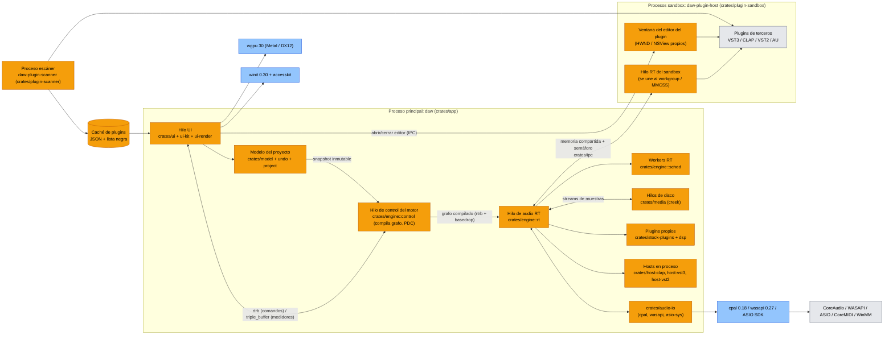

# 05 — Stack tecnológico en Rust para un DAW profesional de música electrónica

> Fecha de investigación: 2026-11-11. Versiones verificadas contra la API de crates.io ese mismo día.
> Restricciones: solo Rust; macOS (Apple Silicon + Intel) y Windows; UI renderizada por GPU; consumo mínimo de CPU, RAM y tamaño de binario e instalador; alojar plugins VST2 y VST3 (idealmente CLAP); plugins propios incluidos.
>
> Aviso legal: este documento no es asesoría legal. Las conclusiones sobre licencias (sobre todo VST2 y ASIO) deben validarse con un abogado antes del lanzamiento comercial.

---

## 0. Resumen ejecutivo

| Área | Recomendación | Alternativa |
|---|---|---|
| UI por GPU | **Toolkit propio retenido y delgado** sobre `winit` 0.30 + `wgpu` 30 + texto Linebender (`parley`/`swash`/`skrifa`) + `taffy` (layout) + `accesskit` (accesibilidad). Lienzos especializados (timeline, piano roll, medidores) dibujados con quads instanciados y SDF. `egui` 0.37 solo para paneles internos y de depuración. | **GPUI** 0.2.2 (Zed) si se acepta un API pre-1.0 y sin accesibilidad; **Slint** 1.18 (licencia royalty-free) para el chrome clásico. |
| Audio I/O | `cpal` 0.18 como base (CoreAudio, WASAPI compartido, ASIO) + crate `wasapi` 0.27 para WASAPI exclusivo + FFI propio (`windows`, `objc2-core-audio`) para MMCSS "Pro Audio" y *audio workgroups* de macOS. | Backend CoreAudio directo con `coreaudio-rs` 0.14. |
| ASIO | SDK de ASIO bajo la **licencia propietaria** de Steinberg (gratuita, firmando el acuerdo). **No** usar la opción GPLv3. | Solo WASAPI exclusivo (muchos usuarios de Windows exigirán ASIO). |
| VST3 | Crate `vst3` 0.3 (coupler-rs, MIT/Apache, bindings generados desde las cabeceras ya MIT). **Evitar `vst3-sys` (GPLv3).** | `rack` (FFI C++, experimental). |
| CLAP | `clack-host` 0.2 + `clack-extensions` 0.2 (MIT/Apache). | `clap-sys` 0.5 en crudo. |
| VST2 | Opcional, detrás de *feature flag* y con revisión legal: bindings propios generados desde la cabecera *clean-room* de Xaymar (`vst2sdk`, BSD-3). **Nunca VeSTige ni FST (GPL).** | No soportar VST2 en la v1. |
| AU (macOS) | Fase 2: `objc2-audio-toolbox` (AUv2/AUv3). | — |
| Aislamiento | Procesos *sandbox* por plugin/fabricante/grupo (modelo Bitwig) con memoria compartida + semáforos; escaneo en un proceso separado. | En proceso (modo "dentro del DAW") como opción de rendimiento. |
| Motor | Motor propio: grafo compilado fuera del hilo RT, intercambio sin bloqueo (`rtrb`, `basedrop`), *scheduler* multihilo con contadores atómicos, PDC, automatización con precisión de muestra, mapa de tempo. Firewheel y Meadowlark como referencia, no como base. | — |
| MIDI | `midir` 0.11 (MIDI 1.0) + `wmidi` 4 + `midly` 0.5 (SMF) + `midi2` 0.11 (UMP); MIDI 2.0 nativo vía CoreMIDI y Windows MIDI Services en fase 2. | — |
| Archivos | `symphonia` 0.6 (MPL-2.0), `hound` 3.5, `rubato` 5, `signalsmith-stretch` 0.1 (MIT), `creek` 1.2 (streaming de disco). **Evitar Rubber Band (GPL) salvo licencia comercial.** | — |
| Proyecto | `serde` + `serde_json` (manifiesto legible) + `postcard`/`zstd` (blobs) con esquema versionado y migraciones; undo/redo por transacciones de comandos; autoguardado atómico. | `ron` 0.12. |
| Distribución | `cargo-packager` (.app/.dmg, NSIS) o **Velopack** (instalación + actualizaciones delta, MIT); firma Developer ID + notarización (`notarytool` o `rcodesign`); Windows: Azure **Artifact Signing** + NSIS/MSI (no MSIX). | `cargo-dist` 0.34. |
| Tamaño objetivo | Ejecutable principal 15–25 MB por arquitectura; instalador ≤ 20 MB sin contenido de librería; RAM en reposo ≤ 150 MB; CPU de la UI en reposo ~0 %. | — |

Licencias que **obligarían a publicar el DAW bajo GPL** si se usan como vienen: `vst3-sys` (GPLv3), ASIO SDK en su opción GPLv3, VeSTige (GPLv2), FST (GPLv3+), Rubber Band (GPLv2+), FFTW (GPL), Slint en su opción GPLv3. Todas tienen sustituto o licencia propietaria alternativa (ver sección 10).

---

## 1. Arquitectura propuesta (diagrama)

Leyenda: los nodos **naranjas** (`cambio`) son componentes que construimos nosotros; los **azules** son crates de terceros; los **grises** son procesos o APIs del sistema operativo. Todo el sistema es nuevo; el color separa lo propio de lo ajeno.



Flujo de principio a fin: el usuario edita en la UI; la UI aplica un comando al modelo (con undo); el hilo de control recibe un *snapshot* del modelo, recompila el grafo de audio (orden topológico, asignación de buffers, compensación de latencia) y lo envía al hilo RT por una cola sin bloqueo; el hilo RT procesa cada bloque repartiendo nodos entre los workers, llama a plugins propios en proceso y a plugins de terceros en proceso o por memoria compartida hacia un sandbox; los medidores y la posición de reproducción vuelven a la UI por `triple_buffer`. El escáner corre en su propio proceso y deja su resultado en una caché que la UI lee.

---

## 2. Framework de UI por GPU

### 2.1 Requisitos específicos de un DAW

1. Miles de clips y notas visibles a 60–120 fps, con zoom continuo que invalida casi todo (el autor de Meadowlark lo describe con detalle: formas de onda, curvas Bézier de automación, miles de rectángulos en el minimapa del piano roll, texto en cada clip).
2. Widgets dibujados a mano: formas de onda con *mipmaps* de picos, piano roll, medidores con caída, osciloscopios y espectros.
3. Redibujado reactivo: cero trabajo de CPU/GPU si nada cambia. La UI no debe ocupar más de uno o dos núcleos, para dejar sitio al audio y a las GUIs de los plugins.
4. Varias ventanas (mezclador desacoplado, editores de plugins flotantes).
5. Acceso a `HWND`/`NSView` para ofrecer una ventana padre al editor del plugin. Los plugins VST3/CLAP/VST2 piden un handle nativo y crean su propia vista hija.
6. Arrastre relativo con el puntero bloqueado (knobs y faders), algo que el autor de Meadowlark señaló como bloqueante en GTK.
7. Texto nítido (hinting, subpíxel o escala de grises de calidad), IME, accesibilidad.
8. Binario pequeño.

### 2.2 Comparativa (estado a noviembre de 2026)

| Framework | Versión / licencia | Renderizado | Rendimiento con miles de elementos | Dibujo personalizado | Texto | Multiventana | Handle nativo para editores | Accesibilidad | Tamaño | Madurez |
|---|---|---|---|---|---|---|---|---|---|---|
| **wgpu + renderer propio** | wgpu 30.0.1, MIT/Apache | Metal / DX12 (Vulkan/GL desactivables) | Máximo: instancing, culling y caché por tile bajo nuestro control | Total (WGSL) | Lo que integremos: `parley` + `swash`/`skrifa` + atlas | Sí (winit) | Sí, directo vía `raw-window-handle` | `accesskit` 0.25 (a integrar) | El menor de los viables | Bloques maduros; el toolkit lo construimos nosotros |
| **vello** | 0.12.0, Apache/MIT | Compute shaders; `vello_hybrid` 0.2 y `vello_cpu` 0.4 | Bueno para vectores complejos; el README dice que el renderer de compute es experimental y que Vello CPU es hoy el más maduro | Vectorial (kurbo/peniko) | Integración con parley/glifo | N/A (es un renderer) | N/A | N/A | Medio | En evolución; útil como capa vectorial, no como toolkit |
| **iced** | 0.14.0 (dic. 2025), MIT | wgpu + tiny-skia | Medio: Elm, diff del árbol; desde 0.14 redibujado reactivo | `Canvas` + shaders propios | cosmic-text | Sí (desde 0.12) | Posible con trabajo | Sin soporte oficial confirmado | Medio | Estable, pre-1.0 |
| **egui** | 0.37.0, MIT/Apache | wgpu / glow | Modo inmediato: regenera la UI cada frame que redibuja; con miles de clips exige trucos | Muy fácil (`Painter`) | Aceptable, no de primera | Multi-viewport | Posible | Sí (AccessKit) | Pequeño | Muy madura, muy usada en prototipos de DAW (Sonix, ProWave, Yadaw) |
| **vizia** | 0.4.0, MIT | Skia (`skia-safe`) | Medio | Sí | Bueno (Skia) | Limitado | Vía baseview (orientado a plugins) | Parcial | Grande (Skia añade decenas de MB al build) | Equipo pequeño; pensada para GUIs de plugins |
| **Slint** | 1.18.1, GPLv3 / Royalty-free 2.0 / comercial | FemtoVG, Skia o software | Bueno en UIs declarativas; los lienzos personalizados son su punto débil | Limitado (imágenes y paths) | Bueno | Sí | Limitado | Sí (AccessKit) | Pequeño–medio | Madura, con empresa detrás. La licencia royalty-free cubre escritorio propietario |
| **makepad** | 1.0.0 (may. 2025), MIT/Apache | Shaders propios (Metal, DX11, GL) | Muy alto, diseñado para GPU | Total (DSL de shaders) | Propio | No documentado | No documentado | No mencionada | Pequeño | Equipo pequeño, documentación escasa, sin releases en GitHub |
| **GPUI** | `gpui` 0.2.2 en crates.io, Apache-2.0 | Metal (macOS), DirectX 11 (Windows, desde 2025), Vulkan/Blade (Linux) | Muy alto: probado en Zed a 120 fps con miles de elementos | Sí (elementos con `paint`) | Excelente (CoreText / DirectWrite) | Sí | No documentado | No mencionada | Árbol de dependencias grande (8 MB de fuente) | Pre-1.0 con cambios incompatibles frecuentes; se aprende leyendo el código de Zed; hay forks (`gpui-ce`) y `gpui-component` 0.9 de Longbridge |
| **Xilem / Masonry** | 0.4.0 (oct. 2025), Apache-2.0 | Vello | Prometedor | Sí | parley (excelente) | En progreso | No | Sí (AccessKit, desde el diseño) | Medio | Experimental |
| **Freya** | 0.5.2, MIT | Skia | Medio | Sí | Muy bueno (Skia) | Sí | No documentado | Sí (AccessKit) | Grande (Skia) | Joven, un mantenedor principal |

### 2.3 Recomendación: toolkit propio retenido y delgado sobre `winit` + `wgpu`

**Decisión:** construir `ui-kit` (árbol retenido, layout con `taffy`, eventos, foco, accesibilidad con `accesskit`) y `ui-render` (renderer `wgpu` con tres primitivas: quads instanciados con esquinas redondeadas y bordes en SDF, polilíneas y curvas teseladas para automación y formas de onda, y texto desde un atlas de glifos rasterizado en CPU con `swash`/`skrifa` y maquetado con `parley`). Los lienzos del timeline, el piano roll y los medidores se dibujan directamente contra el renderer, sin widgets por elemento.

**Por qué:**

- **Rendimiento con miles de clips.** El cuello de botella del DAW no son los botones sino el timeline. Un renderer propio permite *culling* por rango visible, un buffer de instancias por pista que solo se reescribe al cambiar el modelo, formas de onda servidas desde *mipmaps* de picos precalculados (subidos como texturas o storage buffers) y texto de clips cacheado. Ningún framework genérico ofrece esto sin pelearse con él.
- **Redibujado reactivo y presupuesto de CPU.** Controlamos cuándo se pide un frame: medidores y cursor de reproducción a la frecuencia de la pantalla solo mientras hay transporte o señal; cero frames en reposo.
- **Editores de plugins.** `winit` expone `raw-window-handle` 0.6, así que creamos ventanas flotantes (con propietario en Windows y `NSPanel`/hijas en macOS) y pasamos el `HWND`/`NSView` al plugin. Con el sandbox, la ventana del editor la crea el proceso del plugin, y el toolkit solo tiene que coordinar posición, foco y cierre por IPC.
- **Binario y RAM.** `wgpu` solo con Metal en macOS y DX12 en Windows (sin Vulkan ni GL), sin Skia: es la opción más ligera de las que tienen texto de calidad.
- **Licencias.** Todo MIT/Apache.

**Coste y mitigación:** construir un toolkit es caro (lo advierte el autor de Meadowlark, que acabó escribiendo el suyo, Yarrow). Para acotarlo:

1. No hacer un toolkit genérico: solo los widgets que el DAW necesita (≈40).
2. Usar `egui` 0.37 sobre el mismo `wgpu` para herramientas internas, paneles de depuración y prototipos de pantallas secundarias (preferencias, gestor de plugins) mientras se construye `ui-kit`.
3. Reutilizar el stack de texto de Linebender (parley, swash, skrifa, harfrust), que es el más sólido del ecosistema.
4. Si en la fase de prototipo el coste se dispara, el plan B es **GPUI**: rendimiento probado, texto nativo excelente y DX11 en Windows. Sus contras son el API pre-1.0 atado al roadmap de Zed, la falta de accesibilidad y la falta de documentación sobre handles nativos para editores (hay que verificarlo con un prototipo). El plan C es **Slint** con licencia royalty-free para el chrome y un widget `wgpu` propio para los lienzos.

**Detalles de implementación:**

- Ventanas: `winit` 0.30.13 estable (0.31 sigue en beta 4). Bloqueo del puntero y movimiento relativo con `DeviceEvent::MouseMotion` + `CursorGrabMode`.
- Texto: rasterizar glifos en CPU a un atlas (como recomienda Meadowlark), con escala de grises y *gamma* correcta. El texto de las notas del piano roll solo se dibuja por encima de cierto zoom.
- Formas de onda: pirámide de picos (min/max por cada 2^n muestras) calculada en segundo plano al importar y guardada en caché junto al proyecto (`.peaks`, `memmap2`).
- Accesibilidad: `accesskit` 0.25 + `accesskit_winit`. El árbol accesible se construye desde el árbol retenido; los lienzos exponen nodos virtuales (pistas, clips, notas seleccionadas).
- Menús nativos: `muda` 0.21. Diálogos de archivo: `rfd` 0.18.

---

## 3. Audio I/O

### 3.1 Base: `cpal` 0.18.2 (Apache-2.0)

Novedades relevantes según el CHANGELOG:
- 0.16: prioridad de tiempo real en hilos WASAPI.
- 0.17: `StreamError::StreamInvalidated`, `BufferUnderrun`, buffer de CoreAudio configurado para callbacks predecibles, `IMMDevice` expuesto y arreglo de `kAsioResetRequest`.
- 0.18 (jun. 2026): feature `realtime`, `ErrorKind::RealtimeDenied` y `DeviceChanged`, `buffer_size()`, latencia de hardware de ASIO en los *timestamps*, reenrutado automático de WASAPI al cambiar el dispositivo por defecto.
- 0.18.2: arreglo de duplex en ASIO y xruns en CoreAudio.

Lo que **no** cubre `cpal`: WASAPI exclusivo, *audio workgroups* de macOS y un duplex de dispositivo único en CoreAudio/WASAPI (en *Unreleased* solo para ALSA, JACK y Web). Por eso `audio-io` envuelve `cpal` detrás de un trait propio y añade backends propios donde haga falta.

### 3.2 Windows

- **ASIO:** `cpal` con feature `asio` → `asio-sys` 0.4. El script de build busca el SDK de ASIO o lo descarga de Steinberg; requiere LLVM/Clang para `bindgen`.
  - **Licencia:** en octubre de 2025 Steinberg añadió una opción **GPLv3** al SDK de ASIO, junto a la licencia propietaria existente. Si usamos la vía GPLv3, el DAW entero tendría que ser GPLv3. Para un producto cerrado hay que **firmar el acuerdo de licencia propietaria de ASIO** (gratuito, con condiciones de uso de marca). `asio-sys` (Apache-2.0) solo contiene los bindings; el SDK no se redistribuye en el repositorio.
  - Recomendación: fijar `CPAL_ASIO_DIR` a una copia del SDK bajo control de versiones privado (sin descargas en el build) y guardar el acuerdo firmado.
- **WASAPI exclusivo:** crate `wasapi` 0.27 (HEnquist, MIT), con modo exclusivo y orientado a eventos. Es la opción de baja latencia sin drivers de terceros.
- **MMCSS:** en el hilo de audio, `AvSetMmThreadCharacteristicsW("Pro Audio")` + `AvSetMmThreadPriority(AVRT_PRIORITY_CRITICAL)` vía crate `windows` 0.62. Los workers y el hilo RT del sandbox se registran en la misma tarea MMCSS. `audio_thread_priority` 0.38 (Mozilla, MPL-2.0) es una alternativa ya hecha, pero se recomienda llamar a la API directamente para controlar la clase de tarea.
- Planificador de energía: avisar si el plan de energía es "Ahorro" y desactivar el *power throttling* (EcoQoS) del proceso con `SetProcessInformation`.

### 3.3 macOS

- **CoreAudio** vía `cpal` o directamente con `coreaudio-rs` 0.14 / `objc2-core-audio` 0.3 para controlar el *buffer frame size*, `kAudioDevicePropertyIOCycleUsage` y dispositivos agregados.
- **Audio workgroups (Apple Silicon):** imprescindibles para que los workers RT corran en núcleos de rendimiento con la misma *deadline* que el hilo de I/O. Flujo, según Apple: obtener el workgroup del dispositivo (`kAudioDevicePropertyIOThreadOSWorkgroup`); en cada worker, fijar primero la política `THREAD_TIME_CONSTRAINT_POLICY` (si no, `os_workgroup_join` devuelve `EINVAL`, según el foro de JUCE); llamar a `os_workgroup_join` y guardar el *token* en una variable `thread_local`; `os_workgroup_leave` al terminar. Para el **sandbox**, `os_workgroup_copy_port` / `os_workgroup_create_with_port` permiten compartir el workgroup con otro proceso. No hay crate Rust maduro para esto, así que irá en un módulo FFI propio (`audio-io::macos::workgroup`).
- Permiso de micrófono: `NSMicrophoneUsageDescription` en `Info.plist`.

### 3.4 Denormales

- x86/x86_64: activar FTZ y DAZ en MXCSR (`_mm_setcsr`) al inicio de cada callback RT y en cada worker. En Rust se hace con `core::arch` o `asm!`, porque `_mm_setcsr` está desaconsejado en Rust reciente.
- AArch64: activar el bit FZ de FPCR con `asm!("msr fpcr, ...")`.
- Crate `no_denormals` 0.3 (MIT) encapsula ambos con un guard RAII. Hay que restaurar el estado al salir, porque algunos plugins asumen el estado de la FPU del host.
- Como cinturón y tirantes, añadir DC/ruido de -300 dB en los filtros IIR propios.

---

## 4. Alojamiento de plugins

### 4.1 VST3: licencia MIT desde 3.8 (verificado)

- El **VST 3 SDK 3.8.0** (publicado el 2025-10-20, nota de prensa del 2025-10-29) pasó a **MIT**. La opción dual GPLv3/propietaria **ya no existe**, y ya no hace falta firmar acuerdos con Steinberg. El uso del nombre y logo "VST" es opcional, pero si se usa hay que seguir las reglas de marca de Steinberg. La licencia **no cubre VST2**. La versión 3.8 añade interfaces de MIDI 2.0 que sustituyen a `IMidiLearn`/`IMidiMapping`.
- Crate recomendado: **`vst3` 0.3.0** (coupler-rs, MIT/Apache): bindings generados de las cabeceras C++ originales y utilidades para implementar interfaces COM desde Rust. Es de bajo nivel (todo `unsafe`), así que el host se construye encima: `IHostApplication`, `IComponentHandler`, `IPlugFrame`, `IParameterChanges`, `IEventList`, `IBStream`, `IConnectionPoint`, `IRunLoop` (solo Linux; no aplica a nuestras plataformas).
- **No usar `vst3-sys`** (RustAudio): su README declara GPLv3.
- Escaneo rápido: el SDK 3.7.5+ genera `moduleinfo.json` dentro del bundle; si existe, se lee sin cargar el binario. Es opcional y algunos bundles lo traen mal, así que siempre hace falta un *fallback* que cargue el plugin en el proceso escáner.

### 4.2 CLAP

- **`clack-host` 0.2.0** + `clack-extensions` 0.2.0 (prokopyl, MIT/Apache, publicados el 2026-09-12). El autor lo describe como "feature-complete" pero con API aún cambiante y documentación incompleta. Separa los handlers por hilo (compartido, hilo principal, procesador de audio), lo que encaja con el modelo de hilos de CLAP. Incluye un host de ejemplo con `cpal`.
- CLAP debe ser el **formato de referencia interno**: eventos con *offset* de muestra, modulación polifónica, expresiones por nota, `thread-pool` del host, `state-context`, `latency`, `tail`, `audio-ports-config`, `note-ports`, `gui` (ventana embebida o flotante) y `timer-support`/`posix-fd`.

### 4.3 VST2: ¿es legalmente viable en 2026?

Hechos:
- Steinberg dejó de conceder licencias del SDK de VST2 en octubre de 2018. Según un hilo de KVR citado por un desarrollador que consultó con el abogado de Steinberg, el acuerdo VST3 (v2.1, cláusula 9) **termina los acuerdos VST2 previos**. El README de `vst-rs` afirma que "ya no es posible adquirir una licencia para distribuir productos VST 2".
- `vst-rs` está **archivado y obsoleto** desde el 2024-03-27. `vst2-sys` 0.2.0 no se actualiza desde 2021.
- Cabeceras de ingeniería inversa:
  - **VeSTige**: GPLv2. DPF la abandonó por ese motivo.
  - **FST** (IOhannes): GPLv3+, y exige licencia compatible en el proyecto que la use.
  - **Xaymar `vst2sdk`**: **BSD-3-Clause**, se presenta como *clean room*, v0.3.0 (verano de 2025) y cubre "casi toda" la funcionalidad. El autor pide consultar a un abogado antes de usarla en un producto de pago y aclara que no concede derechos de marca.
- Steinberg ha afirmado en foros que cualquier reingeniería del API de VST2 "no es legal". Eso es una postura, no una sentencia: la ingeniería inversa para interoperabilidad tiene protección en la UE (Directiva 2009/24/CE, art. 6), pero el riesgo de conflicto, de marca y comercial existe.

Conclusión y recomendación:
- **Legalmente posible, pero con riesgo real.** No hay un camino "limpio" con licencia de Steinberg para un host nuevo. La vía menos arriesgada:
  1. Generar bindings propios con `bindgen` desde la cabecera BSD-3 de Xaymar (nunca VeSTige, FST ni el SDK oficial), en un crate aislado `host-vst2`.
  2. Compilarlo solo en el binario sandbox `daw-plugin-host` y tras una *feature* desactivable por build y por región.
  3. No usar el logo ni la marca "VST" en referencia a VST2; describirlo como "compatibilidad con plugins 2.4 heredados".
  4. Obtener una opinión legal escrita antes del lanzamiento.
  5. Plan de salida: si Steinberg reclama, se desactiva sin tocar el resto del producto.
- Contexto de producto: la mayoría de fabricantes ya distribuyen VST3 y/o CLAP. VST2 importa sobre todo para plugins gratuitos o abandonados. Se recomienda posponerlo a la v1.x tras validar la demanda.

### 4.4 Audio Unit (macOS, opcional)

- `objc2-audio-toolbox` 0.3 (`AudioComponentFindNext`, `AudioComponentInstanceNew`, `AUAudioUnit` para AUv3). Los AUv3 se ejecutan fuera de proceso por diseño del sistema salvo que se pida en proceso. La vista se obtiene con `requestViewController`.
- `rack` 0.4.8 (MIT/Apache) tiene AU "production-ready" en macOS, pero usa FFI C++ y su VST3 es experimental. Sirve como referencia, no como dependencia.

### 4.5 Aislamiento fuera de proceso (modelo Bitwig)

Bitwig ofrece varios modos de alojamiento, de "dentro de Bitwig" (más eficiente, sin protección) a procesos separados ("Together" por defecto, "By vendor", "By plug-in", por instancia). Los benchmarks de usuarios muestran que "dentro de Bitwig" consume menos CPU y RAM. Ardour, en cambio, defiende el alojamiento en proceso por latencia y simplicidad. Diseño propuesto:

- **Binario `daw-plugin-host`** (crate `plugin-sandbox`), uno por grupo según el modo elegido: todos juntos, por fabricante, por plugin o por instancia. Por defecto: plugins propios en proceso y terceros en un sandbox compartido.
- **Transporte RT:** un segmento de memoria compartida por sandbox (`memmap2` sobre `CreateFileMapping`/`shm_open`; `shared_memory` 0.12 está sin actualizar desde 2022) con:
  - buffers de audio por instancia, en doble buffer;
  - colas SPSC de eventos y parámetros (ring buffer propio sobre memoria compartida, porque `rtrb` no es *shm-safe*);
  - sincronización por ciclo: el hilo RT del host escribe la entrada y señala un semáforo o evento con nombre (Windows: `CreateEvent` + `SetEvent`/`WaitForSingleObject`; macOS: `semaphore_signal`/`semaphore_timedwait` de Mach o *futex-like* `os_sync_wait_on_address` en macOS 14.4+). El sandbox procesa y señala de vuelta. Si no responde en el presupuesto del bloque (p. ej. 70 % del periodo), se emite silencio para ese nodo y se marca como "atrasado".
  - Alternativa más cómoda: `iceoryx2` 0.10 (MIT/Apache, zero-copy IPC). Hay que evaluar su tamaño y su comportamiento RT antes de adoptarlo.
- **Control (no RT):** `interprocess` 2.4 (sockets locales o *named pipes*) + `postcard` para mensajes: cargar plugin, estado, abrir editor, cambios de latencia.
- **Prioridad:** el hilo RT del sandbox se registra en MMCSS (Windows) o se une al workgroup del dispositivo vía puerto Mach (macOS).
- **Fallos:** si el proceso muere, el host lo detecta (handle de proceso / `kqueue` `EVFILT_PROC`), deja el nodo en silencio, recupera el último estado guardado del plugin y ofrece "recargar". Los *minidumps* del sandbox se capturan con `crash-handler` 0.8 + `minidumper` 0.11.
- **Ventaja extra en macOS:** un sandbox `x86_64` ejecutado con Rosetta permite cargar plugins solo-Intel desde el DAW nativo ARM64 (como hacen Bitwig y Logic).
- **Editores:**
  - Windows: el editor vive en una ventana de nivel superior del sandbox, con propietario lógico en la ventana principal (`SetWindowLongPtr(GWLP_HWNDPARENT)` entre procesos funciona, con matices de foco). Se evita el `SetParent` entre procesos con estilo `WS_CHILD` por sus problemas de input y DPI.
  - macOS: no se pueden incrustar `NSView` entre procesos, así que el editor siempre es una ventana del sandbox que se sincroniza en posición y nivel con la principal.
- **Escaneo:** binario `daw-plugin-scanner` que se lanza por lotes con *timeout* por plugin (p. ej. 20 s). Lee `moduleinfo.json` si existe; si no, carga, enumera, extrae metadatos (nombre, fabricante, categoría, puertos, latencia) y escribe un resultado JSON. El host mantiene una caché indexada por ruta + `mtime` + tamaño (`blake3` del binario solo si cambian), una lista negra persistente y un reescaneo incremental en segundo plano.

---

## 5. Diseño del motor de audio

### 5.1 Referencias en el ecosistema

- **Firewheel** 0.14 (BillyDM, MIT/Apache): grafo DAG, nodos propios, optimización de silencio, tolerancia a fallos de stream y sin mutex en el camino de audio. Va a integrarse en Bevy y declara explícitamente que **no** pretende ser un motor de DAW. Útil como referencia de API de nodos y de manejo de fallos.
- **Meadowlark / Dropseed:** el autor dejó el frontend Rust y se centró en un motor (Dropseed) modular y con CLAP completo. Del ecosistema Meadowlark siguen vivos `creek` 1.2 (streaming de disco RT-safe), `symphonium` 0.13 (wrapper de Symphonia) y `rtaudio` 0.8.
- **Ojo:** el crate `audio_graph` 0.1.0 de crates.io **no** es el de Meadowlark (repositorio de plantilla, 45 descargas). `dasp_graph` 0.11 no se actualiza desde 2020. Ninguno se recomienda.
- Conceptos de Ardour (grafo de procesos con *triggers* y *activation counts*, latencia por puerto) y de Bitwig (sandbox, modulación por nota, *engine* separado de la UI).

### 5.2 Diseño recomendado (crate `engine`)

**Separación de estados:**
1. **Modelo** (`model`), dueño: hilo UI. Estructura persistente con IDs estables (`slotmap` 1.1).
2. **Plan de ejecución** (`engine::compile`), construido en el hilo de control a partir de un *snapshot* del modelo: lista topológica de nodos, buffers preasignados y reutilizados (asignación por coloreado de intervalos de vida), retardos de compensación insertados y contadores de dependencia.
3. **Estado RT** (`engine::rt`): solo lee el plan activo y su propio estado mutable (DSP de cada nodo).

**Intercambio sin bloqueos:**
- UI → control: `crossbeam-channel` 0.5.
- Control → RT: `rtrb` 0.4.1 (SPSC sin espera) con `Box<Plan>`. El plan antiguo se devuelve por otra cola y se libera fuera del hilo RT. Con `basedrop` 0.1.3 (`Shared`/`Owned` con *collector*) la liberación diferida es automática.
- RT → UI: `triple_buffer` 9.0.1 (MPL-2.0) para medidores, posición y espectros. Contadores con `portable-atomic`/`atomic_float`.
- Parámetros de alta frecuencia (UI → RT): array de `AtomicU32` (f32 en bits) con *flags* de cambio, más eventos con *offset* de muestra para automatización grabada.

**Scheduler multihilo:**
- Un pool de N workers (N = núcleos de rendimiento − 1), creados al arrancar, con prioridad RT, MMCSS o workgroup y FTZ/DAZ.
- Por bloque: cada nodo tiene un contador atómico de dependencias pendientes; los nodos listos van a una cola de trabajo (`crossbeam-deque` 0.8 con robo de trabajo, o cola MPMC acotada propia). Al terminar un nodo se decrementan sus sucesores. El hilo de I/O también trabaja y espera con *spin* acotado y luego futex o semáforo.
- Las pistas sin dependencias entre sí (el caso típico) se paralelizan bien; la cadena serie de una pista no.
- Heurística: si el grafo es pequeño o el buffer muy corto, procesar en un solo hilo (el despertar de los workers cuesta microsegundos).

**PDC (compensación de latencia):**
- Cada nodo reporta su latencia (VST3 `getLatencySamples`, CLAP `latency`, propios). En la compilación se calcula la latencia acumulada por camino y se insertan líneas de retardo en las ramas más cortas antes de cada suma (buses, sidechains, envíos).
- Cuando un plugin cambia su latencia (VST3 `restartComponent(kLatencyChanged)`, CLAP `latency.changed`) se recompila el plan fuera del hilo RT.
- La automación y los eventos MIDI se adelantan en la latencia acumulada aguas abajo, y la monitorización en vivo se ofrece en modo "baja latencia" que omite plugins con latencia.

**Automatización con precisión de muestra:**
- Curvas en el modelo: puntos con tiempo musical + tipo de curva (lineal, exponencial, Bézier o escalón).
- En RT, por bloque y parámetro: se generan eventos de cambio con *offset* de muestra. A los plugins se les pasan nativamente (VST3 `IParameterChanges` con `sampleOffset`, CLAP `CLAP_EVENT_PARAM_VALUE`/`PARAM_MOD`). Los nodos propios reciben una rampa por bloque o subbloques de 16–32 muestras para suavizar.
- Modulación (estilo Bitwig): se modela aparte de la automación (`PARAM_MOD` en CLAP; en VST3 se aproxima con cambios de valor).

**Tiempo y tempo:**
- Tiempo musical en *ticks* enteros (p. ej. 960 PPQN × 2^k o `u64` de "superticks" divisibles por 2, 3, 5 y 7 para tresillos exactos) y tiempo de muestra en `u64`.
- Mapa de tempo: segmentos con tempo constante o rampa lineal en BPM. Se precomputa una tabla de conversión tick↔muestra por segmento (integral analítica para rampas) y se busca por bisección. Compases (`TimeSig`) en una lista aparte.
- El *transport* RT entrega a cada nodo el `ProcessContext` (VST3) o `clap_event_transport` en cada bloque y en cada cambio a mitad de bloque (bucles, saltos).

**Prohibido en el hilo RT:** asignar memoria, bloquear mutex, hacer E/S, `println!`, liberar `Arc` con su último dueño o llamar a APIs del SO no RT. Se verifica con `assert_no_alloc` 1.1.2 (BSD-1-Clause) en debug y `rtsan-standalone` 0.3 (RealtimeSanitizer de LLVM; probar en macOS, en Windows no está garantizado).

**Plugins propios** (`stock-plugins` + `dsp`):
- Trait interno `Processor` con API alineada con CLAP (eventos con *offset*, estado serializable, latencia y *tail*). Se ejecutan en proceso, sin coste de IPC.
- DSP en `dsp`: filtros (SVF/TPT, biquad), osciladores con antialiasing (PolyBLEP o *wavetable* con mipmaps), envolventes, compresor y limitador con *lookahead*, reverb (FDN), delay, EQ paramétrico, saturación con *oversampling* (polifase), y medidores LUFS con `ebur128` 0.1 (MIT). FFT con `realfft` 3.5 / `rustfft` 6.4.
- SIMD: `std::simd` todavía es *nightly*; usar `core::arch` con despacho en tiempo de ejecución (AVX2/FMA en x86, NEON en ARM) o el crate `wide`. Base de compilación x86-64-v2.
- Si en el futuro se quieren distribuir también como plugins CLAP/VST3 sueltos: `nice-plug` 0.4.2 (ISC, sucesor comunitario de NIH-plug, "experimental"). Hay que verificar qué bindings VST3 usa; si usa `vst3-sys`, eso arrastra GPLv3.

---

## 6. MIDI

| Necesidad | Crate | Notas |
|---|---|---|
| Puertos MIDI 1.0 (macOS/Windows) | `midir` 0.11.1 (MIT) | Windows usa WinMM: sin MIDI 2.0 y sin multicliente. |
| CoreMIDI directo (UMP, MIDI 2.0) | `coremidi` 0.9.2 (MIT) o `objc2-core-midi` 0.3 | CoreMIDI admite UMP desde macOS 11. |
| Windows MIDI Services (MIDI 2.0, multicliente) | crate `windows` (WinRT `Microsoft.Windows.Devices.Midi2`) | Fase 2. Requiere el SDK de Windows MIDI Services en Windows 11; detectar en tiempo de ejecución y volver a WinMM si no está. |
| Mensajes MIDI 1.0 | `wmidi` 4.0.11 (MIT) | Sin asignaciones, apto para RT. |
| UMP / MIDI 2.0 | `midi2` 0.11.1 (MIT/Apache) | Tipos fuertes para UMP. |
| Archivos SMF | `midly` 0.5.3 (Unlicense) | Lectura y escritura sin copias; sin cambios desde 2023, pero el formato es estable. |
| MIDI-CI / SysEx completo | `midi-msg` 0.9 (MIT) | Opcional. |

Modelo interno: las notas llevan expresiones por nota (pitch bend, presión, timbre/CC74, pan) en un formato neutral parecido a las expresiones de nota de CLAP. MPE (convención MIDI 1.0 de un canal por nota) se convierte a ese modelo en la entrada y de vuelta al enviar a plugins que solo hablan MIDI 1.0. En VST3 se mapea a *Note Expression*; en CLAP, a `CLAP_EVENT_NOTE_EXPRESSION`.

---

## 7. Archivos, códecs, remuestreo y time-stretch

| Función | Crate | Licencia | Nota |
|---|---|---|---|
| Decodificación (WAV, AIFF, FLAC, MP3, AAC, Vorbis, ALAC…) | `symphonia` 0.6.1 | **MPL-2.0** | Copyleft por archivo: compatible con un producto cerrado si no se modifican sus archivos (o se publican los modificados). |
| Wrapper cómodo | `symphonium` 0.13 | MIT/Apache | Meadowlark. |
| Escritura WAV | `hound` 3.5.1 | Apache-2.0 | Sin cambios desde 2023, estable. |
| FLAC (codificar) | `flac-bound` 0.5 (libFLAC, BSD) | MIT | Alternativa: codificador FLAC en Rust puro si aparece uno maduro. |
| MP3 (codificar) | `mp3lame-encoder` 0.3 | **LGPL-3.0** | Si se ofrece, enlazar LAME dinámicamente. Opcional. |
| Streaming de disco RT | `creek` 1.2.3 | MIT/Apache | Lectura anticipada con buffers RT-safe. |
| Remuestreo | `rubato` 5.0.1 | MIT/Apache | Sinc asíncrono y FFT; con `audioadapter` 5. |
| Time-stretch / pitch | `signalsmith-stretch` 0.1.3 | MIT (bindings y librería) | Compila C++ con `cc` (excepción a "solo Rust"); hay que fijar la versión y revisar el submódulo. Calidad buena para música electrónica. Plan B: portar la librería a Rust (≈2 k líneas). |
| Rubber Band | `rubberband` 0.1.5 | **GPL-2.0+** | **No usar** sin licencia comercial de Breakfast Quay; su FFTW opcional también es GPL. |
| Mapeo de archivos | `memmap2` 0.9 | MIT/Apache | Caché de picos. |

Warp estilo Ableton: análisis de transitorios (flujo espectral con `realfft`) → marcadores de *warp* → stretch por segmentos con `signalsmith-stretch` en un hilo de pre-render, guardado en caché (no en tiempo real cuando sea posible, para ahorrar CPU).

---

## 8. Formato de proyecto, estado, undo/redo y autoguardado

**Formato:** un directorio-paquete `MiTema.aitrack/` (en macOS, registrado como *document package*) con:
- `project.json`: manifiesto legible, `serde_json` 1.0.154, con `"format_version": N`, IDs estables y referencias a medios.
- `plugins/<id>.state`: estado opaco de cada plugin (bytes de VST3 `getState`, CLAP `state.save`), comprimido con `zstd` 0.14.
- `media/`: audio consolidado opcional; `cache/` con picos y renders de warp (regenerable, se excluye de las copias).

Alternativa binaria: `postcard` 1.1 para un guardado rápido de proyectos enormes. JSON sigue siendo preferible por los *diffs*, el soporte y la depuración.

**Versionado:** cada versión del esquema es un módulo `model::v{N}` congelado; `migrate_v{N}_to_v{N+1}` en cadena; *tests* con *fixtures* de cada versión publicada (`insta` 1.49 para snapshots). Política: leer cualquier versión antigua y escribir solo la actual; si el archivo es de una versión futura, abrir en solo lectura.

**Undo/redo:**
- Patrón comando con transacciones: `trait Command { apply, revert, merge? }` agrupado en `Transaction` (p. ej. "mover 300 notas" es un solo paso). Los comandos de arrastre continuo se fusionan (`merge`) al soltar.
- Alternativa y complemento: modelo con estructuras persistentes (copy-on-write con `Arc` por pista o clip), donde el undo es volver a un *snapshot* previo. Esto facilita además el envío de *snapshots* al hilo de control. Recomendación: *snapshots* COW como mecanismo base y comandos como unidad semántica (nombre en el menú, fusión).
- El crate `undo` 0.52 (MIT/Apache) sirve, pero un sistema propio de 300 líneas da más control.
- El estado de los plugins solo es "deshacible" si el plugin lo permite. Se captura el estado del plugin en los puntos de undo relevantes (cargar preset, eliminar dispositivo).

**Autoguardado:** cada N minutos y tras operaciones destructivas, serializar el *snapshot* en un hilo de fondo a `autosave/…json.tmp`, hacer `fsync` y renombrar atómicamente (`tempfile` 3.27 `persist`). Al arrancar, si hay un autoguardado más nuevo que el proyecto, ofrecer recuperarlo. Rutas con `dirs` 7.

---

## 9. Empaquetado, firma, actualizaciones y tamaño

### 9.1 Herramientas

| Necesidad | Opción recomendada | Notas |
|---|---|---|
| Bundle `.app` + `.dmg`, instalador NSIS / MSI | `cargo-packager` 0.11.8 (CrabNebula, Apache/MIT) | Sin actualizaciones desde noviembre de 2025: riesgo de mantenimiento. Alternativa: `xtask` propio con `cargo-bundle` 0.12. |
| Instalación + **actualizaciones delta** | **Velopack** 1.2 (MIT, núcleo en Rust, SDK Rust) | Windows, macOS y Linux; descarga solo lo que cambió. |
| CI de releases | `cargo-dist` 0.34 (axo) | Muy bueno para CLI y MSI. Para apps GUI con `.app` y notarización exige trabajo extra. |
| Licencias de terceros | `cargo-about` 0.9 + `cargo-deny` 0.20 | `cargo-deny` con lista de licencias permitidas que **rechace GPL/AGPL/LGPL** en todo el grafo. |
| Análisis de tamaño | `cargo-bloat` 0.12, `cargo-llvm-lines` | — |

### 9.2 macOS

- Firma **Developer ID Application** + *hardened runtime* + **notarización** (`xcrun notarytool` o `rcodesign` del crate `apple-codesign` 0.29, MPL-2.0, que firma y notariza desde CI en Windows o Linux; sin releases desde noviembre de 2024).
- **Entitlements críticos para un host de plugins:**
  - `com.apple.security.cs.disable-library-validation`: sin él, el *hardened runtime* impide cargar plugins de otros equipos de desarrollo.
  - `com.apple.security.device.audio-input`: entrada de audio.
  - `com.apple.security.cs.allow-unsigned-executable-memory` y/o `allow-jit`: algunos plugins los necesitan (JIT, protección anticopia). Ponerlos **solo en el binario sandbox**, no en el principal. Esta es otra ventaja del diseño fuera de proceso.
- Arquitecturas: binarios separados `aarch64` y `x86_64` (más ligeros) o universal con `lipo` (duplica el tamaño). Recomendado: un `.dmg` universal para simplificar la descarga y, aparte, el sandbox `x86_64` para plugins solo-Intel bajo Rosetta en Apple Silicon.

### 9.3 Windows

- Firma: **Azure Artifact Signing** (antes Trusted Signing; GA en enero de 2026 en EE. UU., Canadá y Europa; plan Basic desde 9,99 USD/mes y 5 000 firmas). Hay que verificar la elegibilidad de personas físicas o empresas pequeñas según el país; hay reportes anecdóticos de rechazos en Europa. La alternativa es un certificado OV/EV en HSM.
- Instalador: **NSIS** (vía cargo-packager) o **Velopack Setup.exe**. **No se recomienda MSIX**: su sistema de archivos y registro virtualizados chocan con las carpetas estándar de plugins (`C:\Program Files\Common Files\VST3`, `CLAP`), los drivers ASIO de terceros y los plugins que escriben en el registro.
- Instalación por máquina (Program Files) para los *contents* compartidos y por usuario para las actualizaciones rápidas; decidir según el canal.

### 9.4 Perfil de compilación para binarios pequeños y rápidos

```toml
[profile.release]
opt-level = 3            # el DSP necesita velocidad
lto = "fat"
codegen-units = 1
panic = "abort"          # ver nota
strip = "symbols"
debug = "line-tables-only"
split-debuginfo = "packed"   # .dSYM / .pdb aparte para simbolizar minidumps

# La UI y el código frío pueden ir optimizados para tamaño
[profile.release.package.ui-kit]
opt-level = "s"
[profile.release.package.project]
opt-level = "s"
```

- `panic = "abort"`: un *unwind* en el hilo RT es inaceptable y a través de FFI es comportamiento indefinido. Con autoguardado + `crash-handler`/`minidumper` + el sandbox para terceros, abortar es aceptable. En los puntos FFI de entrada (callbacks que llaman los plugins al host) **no** debe haber pánicos: devolver códigos de error.
- `wgpu` solo con backends nativos: `default-features = false, features = ["metal"]` en macOS y `["dx12"]` en Windows (más `wgsl`), sin Vulkan ni GL.
- Plugins propios **compilados dentro del binario principal**, no como DLLs separadas: se comparte el código DSP y se ahorra espacio.
- Fuentes: incluir solo una familia variable (p. ej. Inter variable, ≈ 800 KB) y comprimir los recursos con `zstd`.
- Asignador: el del sistema por defecto. `mimalloc` 0.1.52 (MIT) solo si las mediciones lo justifican, nunca en el hilo RT.
- **Tamaños realistas** (estimación, a validar con `cargo-bloat` en el prototipo): ejecutable principal 15–25 MB por arquitectura (wgpu + texto + motor + plugins propios); sandbox 3–6 MB; escáner 2–4 MB; instalador comprimido 10–20 MB sin librería de sonidos (la librería va en descargas aparte bajo demanda). En reposo: < 1 % de CPU de UI con redibujado reactivo y RAM ≤ 150 MB sin proyecto cargado.

---

## 10. Pruebas de código en tiempo real

1. **Render offline determinista:** el motor se puede ejecutar sin dispositivo (`audio-io::offline`), con tamaños de bloque y frecuencias de muestreo parametrizados (32…4096 muestras, 44,1/48/96 kHz) y tamaños de bloque **variables y aleatorios** en cada llamada (como hacen los DAWs reales).
2. **Archivos de audio de referencia (*golden*):** proyectos de prueba renderizados a WAV de 32 bits flotantes y comparados con tolerancia (diferencia máxima < -120 dBFS o *null test* RMS). Se versionan con Git LFS. Si un cambio intencional altera el sonido, se regeneran con un comando `xtask golden --bless`.
3. **Invariantes de PDC y grafo:** `proptest` 1.12 genera grafos aleatorios (sumas, sidechains, envíos con latencias aleatorias) y verifica que un impulso llega alineado a la salida desde todos los caminos.
4. **Estructuras sin bloqueo:** `loom` 0.7 para los ring buffers propios en memoria compartida y para el intercambio del plan.
5. **Seguridad RT:** `assert_no_alloc` activo en *debug* y en los tests del motor; `rtsan-standalone` en CI de macOS; *tracing* de *deadline misses* en builds de perfilado (contador por bloque, sin E/S en RT).
6. **Fuzzing** (`cargo-fuzz` + `libfuzzer-sys`, solo en desarrollo): parser de proyectos y migraciones, parser SMF, decodificadores (entradas de Symphonia), protocolo IPC del sandbox (mensajes malformados no deben tumbar el host) y alojamiento de plugins (secuencias aleatorias de carga, activación, cambio de bloque, parámetros, estado, `setState` con datos corruptos y apertura/cierre de editor).
7. **Compatibilidad de plugins:** un corpus de plugins comerciales y gratuitos (Serum, Vital, Diva, FabFilter, Valhalla, Kontakt, Surge XT, etc.) en máquinas de CI dedicadas (macOS ARM, macOS Intel, Windows); comparación con el validador VST3 del SDK (ahora MIT) y con `clap-validator`; `pluginval` (GPLv3) usado solo como herramienta externa, sin enlazarlo.
8. **UI:** snapshots de render (`insta` con imágenes renderizadas *headless* por `wgpu`) y benchmark de frame con proyectos sintéticos (200 pistas, 10 000 clips, 100 000 notas) con objetivo de < 4 ms de CPU por frame.

---

## 11. Workspace de Cargo recomendado

```
ai-track/
├─ Cargo.toml                 # [workspace], perfiles, lints, versiones compartidas
├─ deny.toml                  # política de licencias (bloquear GPL/LGPL/AGPL)
├─ xtask/                     # empaquetado, firma, notarización, golden files, bloat
└─ crates/
   ├─ app/                    # bin "daw": raíz de composición, arranque, ventanas
   ├─ model/                  # modelo puro (pistas, clips, notas, automación, IDs)
   ├─ time/                   # ticks, mapa de tempo, compases, conversiones
   ├─ undo/                   # transacciones, comandos, snapshots COW
   ├─ project/                # serialización versionada, migraciones, autoguardado
   ├─ engine/                 # compilación del grafo, PDC, scheduler, transporte, RT
   ├─ dsp/                    # primitivas DSP, SIMD, denormales, oversampling
   ├─ stock-plugins/          # instrumentos y efectos propios (trait Processor)
   ├─ audio-io/               # cpal + wasapi exclusivo + ASIO + CoreAudio + MMCSS/workgroups
   ├─ midi-io/                # midir, CoreMIDI, Windows MIDI Services, MPE→modelo interno
   ├─ plugin-api/             # abstracción de plugin hospedado independiente del formato
   ├─ host-clap/              # alojamiento CLAP (clack-host)
   ├─ host-vst3/              # alojamiento VST3 (vst3 crate, COM)
   ├─ host-vst2/              # [feature "vst2"] bindings clean-room BSD-3
   ├─ host-au/                # [macOS, fase 2] AUv2/AUv3
   ├─ ipc/                    # memoria compartida, colas SPSC shm, semáforos, protocolo
   ├─ plugin-sandbox/         # bin "daw-plugin-host" (procesos aislados)
   ├─ plugin-scanner/         # bin "daw-plugin-scanner" + caché/lista negra
   ├─ media/                  # decodificar, codificar, remuestrear, stretch, picos, streaming
   ├─ ui-render/              # renderer wgpu (quads SDF, paths, atlas de glifos)
   ├─ ui-kit/                 # toolkit retenido (taffy, eventos, foco, accesskit)
   ├─ ui/                     # vistas: arreglo, piano roll, mezclador, navegador, dispositivos
   ├─ platform/               # integración con el SO (menús, diálogos, rutas, energía)
   ├─ crash/                  # crash-handler + minidumper + subida opcional (sentry)
   └─ test-utils/             # render offline, comparación de audio, proyectos sintéticos
```

Dependencias permitidas entre capas: `ui` → `ui-kit` → `ui-render`; `ui` → `model`/`undo`/`project`; `engine` → `model` (solo *snapshots*), `time`, `dsp`, `plugin-api`; `host-*` → `plugin-api`; `app` lo une todo. `engine` **no** depende de `ui`; `model` no depende de nada con E/S.

---

## 12. Tabla de dependencias

Versiones de crates.io a 2026-11-11.

| Crate | Versión | Licencia | Propósito | Riesgo |
|---|---|---|---|---|
| wgpu | 30.0.1 | MIT/Apache-2.0 | GPU (Metal/DX12) | Bajo; API con cambios por versión mayor |
| winit | 0.30.13 (0.31 beta) | Apache-2.0 | Ventanas, eventos | Bajo–medio (migración a 0.31) |
| raw-window-handle | 0.6.2 | MIT/Apache/Zlib | Handles nativos para editores | Bajo |
| parley | 0.12.0 | Apache/MIT | Maquetado de texto | Medio (pre-1.0) |
| swash / skrifa / harfrust | 0.2.10 / 0.50.0 / 0.15.0 | Apache/MIT, MIT | Rasterizado, fuentes, shaping | Bajo–medio |
| taffy | 0.15.1 | MIT | Layout flex/grid | Bajo |
| accesskit | 0.25.2 | MIT/Apache | Accesibilidad | Bajo |
| egui / egui-wgpu | 0.37.0 | MIT/Apache | Herramientas internas y depuración | Bajo |
| vello / vello_hybrid | 0.12.0 / 0.2.0 | Apache/MIT | Opcional: vectores complejos | Medio (experimental) |
| muda / rfd | 0.21.2 / 0.18.0 | Apache/MIT, MIT | Menús nativos, diálogos | Bajo |
| cpal | 0.18.2 | Apache-2.0 | Audio I/O multiplataforma | Bajo–medio |
| asio-sys + ASIO SDK | 0.4.0 | Apache-2.0 + **SDK propietario o GPLv3** | ASIO en Windows | **Alto si se elige GPLv3**; firmar la licencia propietaria |
| wasapi | 0.27.0 | MIT | WASAPI exclusivo | Bajo (un mantenedor) |
| coreaudio-rs / objc2-core-audio | 0.14.2 / 0.3.2 | MIT/Apache, Zlib/Apache/MIT | CoreAudio directo, workgroups | Bajo |
| windows / windows-sys | 0.62.2 / 0.61.2 | MIT/Apache | MMCSS, IPC, WinRT MIDI | Bajo |
| objc2 | 0.6.5 | MIT | APIs de Apple | Bajo |
| audio_thread_priority | 0.38.0 | MPL-2.0 | Alternativa para prioridad RT | Bajo |
| no_denormals | 0.3.0 | MIT | FTZ/DAZ | Bajo (trivial, se puede reimplementar) |
| vst3 | 0.3.0 | MIT/Apache | Bindings VST3 | Medio (un mantenedor, bajo nivel) |
| clack-host / clack-extensions | 0.2.0 | MIT/Apache | Host CLAP | Medio (API cambiante, un mantenedor) |
| Xaymar vst2sdk (cabecera) | 0.3.0 | BSD-3-Clause | VST2 clean-room (opcional) | **Alto (legal)** |
| objc2-audio-toolbox | 0.3.2 | Zlib/Apache/MIT | Host AU (fase 2) | Bajo–medio |
| rtrb | 0.4.1 | MIT/Apache | SPSC sin espera | Bajo |
| basedrop | 0.1.3 | MIT/Apache | Liberación diferida fuera de RT | Medio (poca actividad) |
| triple_buffer | 9.0.1 | **MPL-2.0** | Estado RT → UI | Bajo |
| crossbeam-channel / crossbeam-deque | 0.5.17 / 0.8.8 | MIT/Apache | Colas no RT, robo de trabajo | Bajo |
| arc-swap | 1.9.5 | MIT/Apache | Configuración compartida (no RT) | Bajo |
| portable-atomic / atomic_float | 1.15.0 / 1.1.0 | Apache/MIT | Atómicos f32/f64 | Bajo |
| slotmap | 1.1.1 | Zlib | IDs estables del modelo | Bajo |
| smallvec / bumpalo | 1.16.5 / 3.20.3 | MIT/Apache | Contenedores sin asignaciones | Bajo |
| memmap2 | 0.9.12 | MIT/Apache | Memoria compartida, caché de picos | Bajo |
| interprocess | 2.4.8 | 0BSD/Apache | Canal de control IPC | Bajo |
| iceoryx2 | 0.10.0 | MIT/Apache | Alternativa IPC zero-copy | Medio (tamaño y RT por validar) |
| crash-handler / minidumper | 0.8.1 / 0.11.0 | MIT/Apache | Minidumps | Bajo |
| sentry | 0.49.5 | MIT | Envío de errores (opcional, con consentimiento) | Bajo (privacidad) |
| midir | 0.11.1 | MIT | MIDI 1.0 | Bajo |
| coremidi | 0.9.2 | MIT | CoreMIDI/UMP | Bajo |
| wmidi | 4.0.11 | MIT | Mensajes MIDI 1.0 | Bajo |
| midi2 | 0.11.1 | MIT/Apache | UMP / MIDI 2.0 | Medio |
| midly | 0.5.3 | Unlicense | SMF | Bajo (estable, sin cambios) |
| symphonia | 0.6.1 | **MPL-2.0** | Decodificación | Bajo (cumplir MPL) |
| hound | 3.5.1 | Apache-2.0 | WAV | Bajo |
| flac-bound | 0.5.0 | MIT (+ libFLAC BSD) | Exportar FLAC | Medio (C) |
| rubato / audioadapter | 5.0.1 / 5.0.0 | MIT/Apache | Remuestreo | Bajo |
| signalsmith-stretch | 0.1.3 | MIT | Time-stretch y pitch | Medio (C++ vía `cc`, bindings con poca actividad) |
| creek | 1.2.3 | MIT/Apache | Streaming de disco RT | Medio |
| realfft / rustfft | 3.5.1 / 6.4.1 | MIT, MIT/Apache | FFT | Bajo |
| ebur128 | 0.1.11 | MIT | Medición LUFS | Bajo |
| serde / serde_json | 1.0.229 / 1.0.154 | MIT/Apache | Serialización del proyecto | Bajo |
| postcard | 1.1.3 | MIT/Apache | IPC y blobs binarios | Bajo |
| zstd | 0.14.3 | BSD-3-Clause | Compresión de estados y recursos | Bajo |
| blake3 | 1.8.7 | CC0/Apache | Hashes de caché | Bajo |
| tempfile / dirs | 3.27.0 / 7.0.0 | MIT/Apache | Autoguardado atómico, rutas | Bajo |
| tracing | 0.1.44 | MIT | Logs (fuera de RT) | Bajo |
| assert_no_alloc | 1.1.2 | BSD-1-Clause | Verificar RT (dev) | Bajo |
| rtsan-standalone | 0.3.0 | Apache-2.0 | RealtimeSanitizer (dev) | Medio (soporte en Windows) |
| loom / proptest / insta | 0.7.3 / 1.12.0 / 1.49.0 | MIT, MIT/Apache, Apache | Pruebas | Bajo |
| libfuzzer-sys | 0.4.13 | MIT/Apache + NCSA | Fuzzing (dev) | Bajo |
| velopack | 1.2.161 | MIT | Instalador + actualizaciones | Medio |
| cargo-packager | 0.11.8 | Apache/MIT | Bundles e instaladores (herramienta) | Medio (sin actualizaciones desde nov. 2025) |
| apple-codesign (rcodesign) | 0.29.0 | MPL-2.0 (herramienta) | Firma y notarización desde CI | Medio (sin actualizaciones desde nov. 2024) |
| cargo-deny / cargo-about | 0.20.2 / 0.9.3 | MIT/Apache | Cumplimiento de licencias | Bajo |
| nice-plug (opcional) | 0.4.2 | ISC | Exportar plugins propios como CLAP/VST3 | Medio (experimental; vigilar la dependencia VST3) |

**Evitar:** `vst3-sys` (GPLv3), `vst` / `vst-rs` (archivado), VeSTige (GPLv2), FST (GPLv3+), `rubberband` (GPL-2.0+), FFTW (GPL), `audio_graph` 0.1 de crates.io (no es el de Meadowlark), `dasp_graph` (abandonado), `shared_memory` (sin mantenimiento desde 2022), Slint en su opción GPLv3 (si se usa Slint, que sea con la licencia royalty-free o comercial).

**MPL-2.0** (symphonia, triple_buffer, audio_thread_priority, apple-codesign) es copyleft débil **por archivo**: permite un producto cerrado siempre que los archivos MPL modificados se publiquen. No obliga a liberar el DAW.

---

## 13. Registro de riesgos (top 10)

| # | Riesgo | Tipo | Prob. | Impacto | Mitigación |
|---|---|---|---|---|---|
| 1 | **Alojar VST2 sin licencia de Steinberg** (reclamación por marca, copyright o reingeniería; no hay licencias nuevas desde 2018 y el acuerdo VST3 terminó los acuerdos VST2 previos) | Legal | Media | Alto | VST2 opcional tras *feature*, solo en el sandbox, con cabecera BSD-3 clean-room (nunca VeSTige/FST/SDK oficial), sin marca "VST" para VST2, opinión legal escrita y capacidad de desactivarlo por actualización. Priorizar VST3 + CLAP. |
| 2 | **Contaminación GPL** (ASIO en su opción GPLv3, `vst3-sys`, Rubber Band, FST/VeSTige, Slint GPL o una dependencia transitiva) | Legal | Media | Crítico | Firmar la licencia **propietaria** de ASIO, usar el crate `vst3` (MIT/Apache), `cargo-deny` con lista blanca de licencias en CI que falle ante GPL/LGPL/AGPL, `cargo-about` para el aviso de licencias y revisión legal de cada nueva dependencia nativa. |
| 3 | **Coste y retraso del toolkit de UI propio** | Técnico/plazo | Alta | Alto | Alcance acotado (~40 widgets), `egui` como andamiaje, stack de texto Linebender, prototipo de timeline y piano roll con 10 000 clips en el primer trimestre como hito de decisión; plan B GPUI y plan C Slint + lienzo wgpu. |
| 4 | **Compatibilidad con plugins de terceros** (VST3 por COM `unsafe` en Rust, casos límite de hilos y estado, plugins que asumen comportamiento de Cubase/Live) | Técnico | Alta | Alto | Corpus de 100+ plugins en CI, validador VST3 y `clap-validator`, sandbox por defecto, *quirks* por plugin en una base de datos, *fuzzing* del host y registro detallado de llamadas en builds de diagnóstico. |
| 5 | **Sobrecoste y latencia del sandbox** (cambios de contexto por bloque, sobre todo con buffers de 32–64 muestras; editores no incrustables en macOS) | Técnico | Media | Medio–alto | Modos de alojamiento configurables (en proceso, compartido, por fabricante, por plugin), agrupar los nodos de un sandbox en una sola llamada por bloque, espera activa acotada antes del semáforo, workgroup compartido por puerto Mach, MMCSS en el sandbox, ventanas de editor sincronizadas. Medir el sobrecoste por bloque como KPI. |
| 6 | **Violaciones de tiempo real** (asignaciones, bloqueos o liberaciones de `Arc` en el hilo de audio → *dropouts*) | Técnico | Media | Alto | `assert_no_alloc` en debug, `rtsan` en CI, `basedrop` para liberar fuera de RT, revisión de código específica de RT, test de estrés de 24 h con buffer de 64 muestras y contador de *xruns* visible para el usuario. |
| 7 | **Firma y notarización en macOS frente a plugins** (el *hardened runtime* bloquea la carga de bibliotecas de otros equipos; plugins que necesitan JIT o memoria ejecutable) | Plataforma | Alta | Alto | `disable-library-validation` en el host y el sandbox; `allow-jit`/`allow-unsigned-executable-memory` solo en el sandbox; pruebas de notarización en cada release candidate; sandbox `x86_64` bajo Rosetta para plugins Intel. |
| 8 | **Crates críticos con un solo mantenedor** (`vst3`, `clack-host`, `basedrop`, `wasapi`, `creek`, `signalsmith-stretch`, `asio-sys`) | Ecosistema | Media | Medio–alto | Fijar versiones, hacer *vendoring* o fork interno preparado, contribuir upstream, y aislar cada uno detrás de traits propios (`plugin-api`, `audio-io`) para poder sustituirlo; presupuestar mantenimiento propio. |
| 9 | **Rendimiento en Apple Silicon** (workers sin workgroup que caen en núcleos de eficiencia; FPU/denormales; comportamiento de plugins solo-Intel) | Técnico | Media | Alto | Módulo FFI de workgroups desde el inicio, `THREAD_TIME_CONSTRAINT_POLICY` antes de unirse, pruebas en M1–M4 con buffers cortos, FTZ por hilo, benchmark de *deadline misses*. |
| 10 | **Crecimiento del tamaño y la RAM** (Skia u otras dependencias grandes, binarios universales, recursos, símbolos) | Producto | Media | Medio | Presupuesto de tamaño en CI (`cargo-bloat`; el build falla si el ejecutable supera 25 MB), `wgpu` sin Vulkan/GL, sin Skia, debuginfo separado, contenido descargable bajo demanda, revisión de cada dependencia con `cargo tree -e features`. |

Riesgos adicionales a vigilar:
- Calidad del time-stretch frente a élastique (zplane, comercial): evaluar con escuchas ciegas y contemplar licenciarlo si hace falta.
- La Ley Europea de Accesibilidad (aplicable desde 2025) probablemente no cubre un DAW, pero `accesskit` reduce el riesgo reputacional.
- Disponibilidad de Azure Artifact Signing para la entidad legal del proyecto según el país.

---

## 14. Plan de verificación inmediato (prototipos de 2–4 semanas)

1. **UI:** timeline con 200 pistas, 10 000 clips y formas de onda reales en `winit` + `wgpu` propio, frente al mismo caso en GPUI. Medir CPU por frame, RAM, tamaño del binario y calidad del texto en Windows con escalado del 125 % y del 150 %.
2. **Host:** cargar 20 plugins VST3 y 10 CLAP populares con `vst3` y `clack-host`, en proceso y en sandbox; medir el sobrecoste por bloque con buffers de 64 y 128 muestras a 48 kHz.
3. **Audio I/O:** ASIO (con el SDK bajo licencia propietaria), WASAPI exclusivo y CoreAudio con workgroups; medir la latencia de ida y vuelta con un *loopback* físico.
4. **Legal:** consulta formal sobre VST2 (cabecera clean-room) y firma del acuerdo propietario de ASIO.

---

## 15. Fuentes

**Licencias de Steinberg (VST3, ASIO, VST2)**
- Nota de prensa VST 3.8 (MIT), 2025-10-29: https://ocl-steinberg-live.steinberg.net/_storage/asset/819253/storage/master/Press%20Release%20-%202025-10-29%20-%20VST%203.8%20-%20EN.pdf
- Licencia VST 3 (portal de desarrollo): https://steinbergmedia.github.io/vst3_dev_portal/pages/VST+3+Licensing/VST3+License
- Anuncio de VST 3.8.0 SDK: https://forums.steinberg.net/t/vst-3-8-0-sdk-released/1011988
- Sound On Sound, Steinberg adopta MIT: https://www.soundonsound.com/news/steinberg-adopt-mit-license-vst3
- Libre Arts, relicencia de VST3 y ASIO: https://librearts.org/2025/11/steinberg-relicenses-vst3-and-asio/
- Heise, ASIO y VST con licencias abiertas: https://heise.de/-10963451
- Nota de prensa ASIO / OBS, 2025-10-15: https://ocl-steinberg-live.steinberg.net/_storage/asset/808575/storage/master/Press%20Release%20-%202025-10-15%20-%20OBS%20Partnership-%20EN.pdf
- CDM, VST3 y ASIO abiertos: https://cdm.link/open-steinberg-vst3-and-asio/
- KVR, acuerdos VST2 tras 2018: https://www.kvraudio.com/forum/viewtopic.php?p=8863508
- JUCE forum, VST2 bajo licencia VST3: https://forum.juce.com/t/hosting-vst2-plugins-under-vst3-sdk-license/37079?page=2
- Xaymar vst2sdk (BSD-3, clean room): https://github.com/Xaymar/vst2sdk
- FST (GPLv3): https://sources.debian.org/src/fst/0.177.0-1/README.md
- DPF, abandono de VeSTige por GPLv2: https://git.kx.studio/DISTRHO/DPF/raw/commit/39bdf2a66b2c8f3a5000658a4dafbfb4a190d607/LICENSING.md
- vst-rs (archivado y obsoleto): https://github.com/RustAudio/vst-rs
- vst3-sys (GPLv3): https://github.com/RustAudio/vst3-sys
- moduleinfo.json en VST 3.7.5: https://forums.steinberg.net/t/vst-3-7-5-sdk-released/786928

**Alojamiento de plugins**
- vst3 crate (coupler-rs): https://github.com/coupler-rs/vst3-rs
- clack: https://github.com/prokopyl/clack · https://docs.rs/clack-host
- rack: https://github.com/sinkingsugar/rack
- nice-plug: https://codeberg.org/RustAudio/nice-plug
- Bitwig, gestión de plugins: https://bitwig.com/userguide/latest/vst_plug-in_handling_and_options
- Bitwig, protección ante cuelgues: https://www.bitwig.com/support/technical_support/what-is-plug-in-crash-protection-26/
- Ardour, por qué no aísla plugins: https://ardour.org/plugins-in-process.html
- Steinberg forum, benchmarks de sandboxing: https://forums.steinberg.net/t/fr-plug-in-sandboxing-for-better-cpu-and-a-crash-free-experience/1023467

**UI**
- GPUI en crates.io / docs.rs: https://docs.rs/crate/gpui/0.2.2
- Zed en Windows (DirectX 11): https://zed.dev/blog/windows-progress-report · https://www.theregister.com/2025/08/22/everything_is_different_on_windows/
- gpui-ce (fork comunitario): https://github.com/gpui-ce/gpui-ce
- iced 0.14: https://github.com/iced-rs/iced/releases/tag/0.14.0 · https://book.iced.rs/faq.html
- egui: https://github.com/emilk/egui
- vizia: https://github.com/vizia/vizia
- Slint, licencias: https://slint.dev/pricing
- makepad: https://github.com/makepad/makepad
- vello: https://github.com/linebender/vello
- Xilem / Masonry: https://github.com/linebender/xilem
- Freya: https://github.com/marc2332/freya
- Billy Messenger, "DAW Frontend Development Struggles" (2023-02-21): https://billydm.github.io/blog/daw-frontend-development-struggles
- Billy Messenger, "Clarifying Some Things" (2023-05-16): https://billydm.github.io/blog/clarifying-some-things
- Yarrow (Meadowlark): https://relatedrepos.com/gh/MeadowlarkDAW/Yarrow

**Audio I/O y tiempo real**
- cpal CHANGELOG: https://github.com/RustAudio/cpal/blob/master/CHANGELOG.md
- cpal docs (ASIO): https://docs.rs/crate/cpal/latest
- asio-sys: https://docs.rs/crate/asio-sys/latest
- wasapi-rs: https://github.com/HEnquist/wasapi-rs
- audio_thread_priority: https://github.com/mozilla/audio_thread_priority
- Apple, audio workgroups: https://developer.apple.com/documentation/audiotoolbox/adding-parallel-real-time-threads-to-audio-workgroups · https://developer.apple.com/videos/play/wwdc2020/10224/
- Apple, os_workgroup_join: https://developer.apple.com/documentation/os/os_workgroup_join
- Apple, os_workgroup_create_with_port: https://developer.apple.com/documentation/os/os_workgroup_create_with_port
- Apple, portar audio a Apple Silicon: https://developer.apple.com/documentation/apple-silicon/porting-your-audio-code-to-apple-silicon
- JUCE forum, EINVAL al unirse a un workgroup: https://forum.juce.com/t/os-workgroup-join-consistently-returns-einval-cant-join-audio-workgroup/54240
- no_denormals: https://github.com/Sin-tel/no_denormals

**Motor, MIDI y medios**
- Firewheel: https://github.com/BillyDM/firewheel
- creek: https://codeberg.org/Meadowlark/creek · symphonium: https://codeberg.org/Meadowlark/symphonium
- rtrb: https://github.com/mgeier/rtrb · basedrop: https://github.com/micahrj/basedrop · triple_buffer: https://github.com/HadrienG2/triple-buffer
- assert_no_alloc: https://github.com/Windfisch/rust-assert-no-alloc · rtsan-standalone: https://github.com/realtime-sanitizer/rtsan-standalone-rs
- midir: https://github.com/Boddlnagg/midir · midi2: https://github.com/midi2-dev/bl-midi2-rs · midly: https://github.com/negamartin/midly · coremidi: https://github.com/chris-zen/coremidi
- Symphonia: https://github.com/pdeljanov/Symphonia · rubato: https://github.com/HEnquist/rubato
- signalsmith-stretch-rs: https://github.com/colinmarc/signalsmith-stretch-rs
- Rubber Band, licencia: https://breakfastquay.com/rubberband/license.html

**Distribución**
- cargo-packager: https://github.com/crabnebula-dev/cargo-packager
- cargo-dist: https://github.com/axodotdev/cargo-dist
- Velopack: https://github.com/velopack/velopack
- apple-codesign / rcodesign: https://github.com/indygreg/apple-platform-rs
- Azure Artifact Signing: https://azure.microsoft.com/en-us/products/artifact-signing · https://www.devclass.com/security/2026/01/14/code-signing-windows-apps-may-be-easier-and-more-secure-with-new-azure-artifact-service/4079554
- Precios de Artifact Signing: https://azure.microsoft.com/pricing/details/trusted-signing/

**Versiones y licencias de crates:** API pública de crates.io (`https://crates.io/api/v1/crates/<nombre>`), consultada el 2026-11-11.
