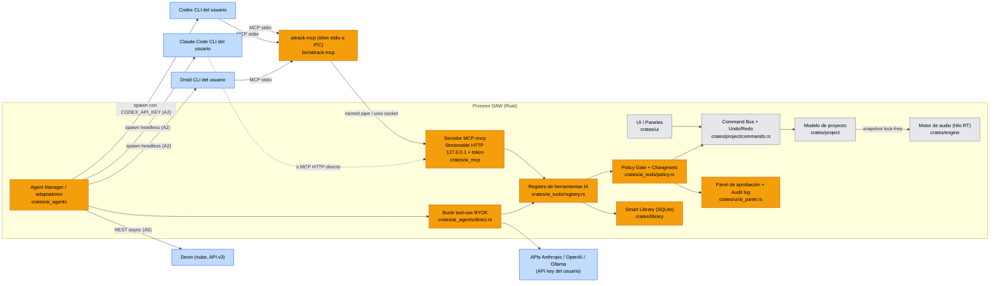
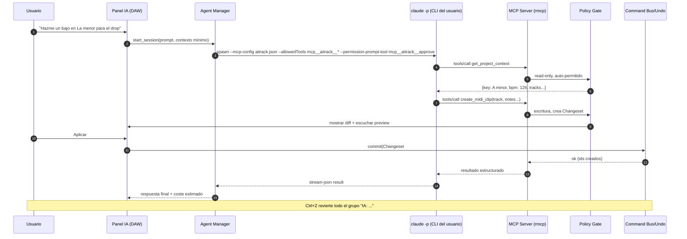
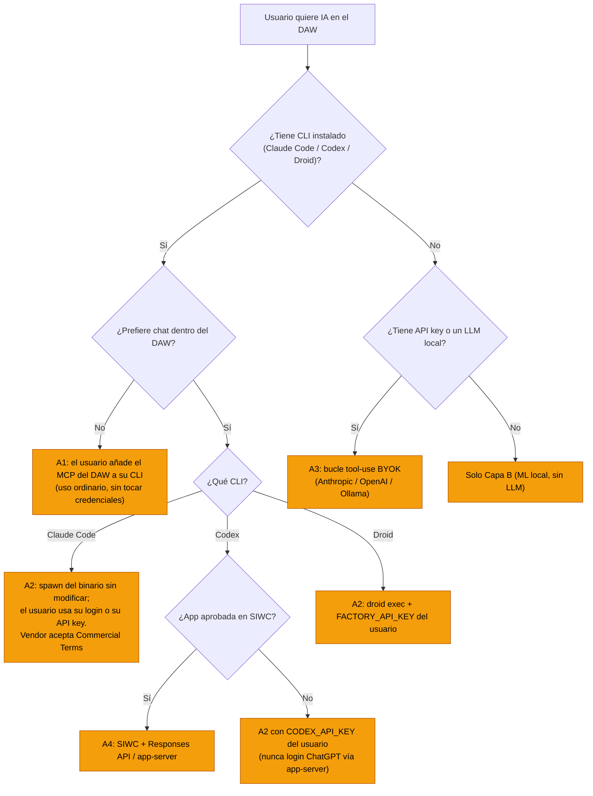
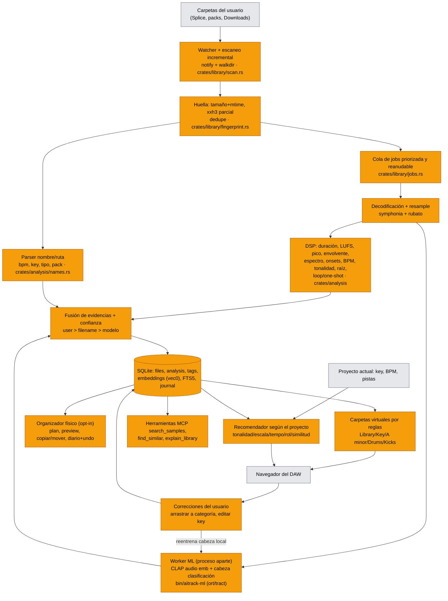
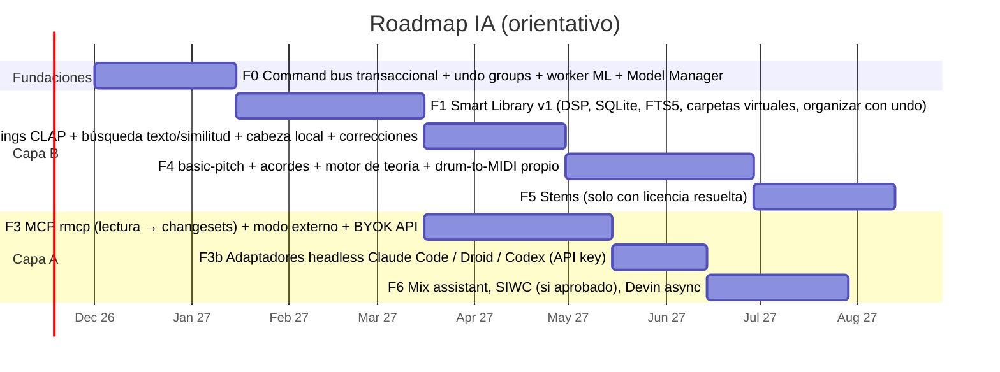

# 06 — Integración de IA en el DAW (Rust, macOS + Windows, música electrónica)

> Fecha de la investigación: **11 de noviembre de 2026**. Todo lo relativo a términos de servicio, precios y versiones de crates/modelos cambia rápido: cada afirmación lleva su fuente al final del documento (sección 9). Donde algo no se pudo verificar en una fuente primaria se indica como **"sin verificar"**.

---

## 0. Resumen ejecutivo

1. **La arquitectura correcta para "trae tu propia suscripción" es que el DAW exponga un servidor MCP local** (crate `rmcp`, SDK oficial en Rust, v3.9.0, compatible con la especificación MCP 2026-07-28) y que **el agente lo use el propio usuario desde su CLI instalado** (Claude Code, Codex CLI, Droid). Así el DAW nunca toca credenciales y el uso cuenta como "uso ordinario" del producto de cada proveedor.
2. **No se puede (sin acuerdo previo) ofrecer "Iniciar sesión con Claude" dentro del DAW ni enrutar peticiones por la suscripción Free/Pro/Max/Ultra del usuario**. Anthropic lo prohíbe en su página legal de Claude Code y en la del Agent SDK. Lo que sí está permitido explícitamente: que el usuario inicie sesión con su suscripción **en el binario de Claude Code sin modificar**, aunque lo lance otra aplicación, siempre que el DAW no recoja, almacene ni intermedie tokens. Además, quien preinstala o ejecuta Claude Code dentro de su producto debe aceptar los Commercial Terms.
3. **OpenAI**: la autenticación ChatGPT del `codex app-server` "nunca ha estado permitida para servicios comerciales o alojados". La vía oficial para usar el plan ChatGPT del usuario en apps de terceros es **Sign in with ChatGPT (SIWC)**, en *preview*: disponible para apps open source y apps personales locales; las apps de pago o alojadas tienen que pedir acceso mediante un formulario de interés. Para un DAW comercial, la opción segura hoy es **una API key del propio usuario** (`CODEX_API_KEY`) o el modo "externo" (el usuario conecta su Codex CLI al MCP del DAW).
4. **Factory Droid**: `droid exec` en modo headless con `FACTORY_API_KEY`, niveles de autonomía (`--auto low|medium|high`), JSON-RPC (`stream-jsonrpc`) y SDK para TypeScript y Python. No se encontraron cláusulas que prohíban integrarlo; aun así hay que usar la key del usuario y revisar los ToS. **Devin** es un agente en la nube (API v3 con claves `cog_` o PAT) y no llega a un MCP en `localhost`. Sirve para tareas asíncronas (p. ej. "escríbeme un script o extensión"), no para el bucle interactivo.
5. **Capa B (on-device)**: lo que más rinde por MB es un **motor DSP propio** (LUFS, BPM, tonalidad por croma más plantillas de Krumhansl, detección de loop o one-shot, parser de nombres de archivo) más **CLAP cuantizado** (encoder de audio de unos 34 MB en int8 y de 118 MB en fp32) para búsqueda texto→sonido y por similitud, más **basic-pitch** (Apache-2.0, muy ligero) para audio→MIDI. Todo con `ort` (ONNX Runtime; la versión 2.0 sigue en RC, rc.15) o `tract` (Rust puro, solo CPU) **en un proceso worker separado**, nunca en el hilo de audio, y con los modelos **descargados bajo demanda**.
6. **Riesgo de licencias crítico**: los pesos de **HTDemucs** tienen licencia **ambigua** (código MIT; el autor dijo en 2022-2023 que los pesos eran "for research purpose"; el repositorio de HF de 2026 los etiqueta como MIT y hay una discusión abierta sin respuesta a 11/2026). Los modelos de **Essentia** son CC BY-NC-SA, los de **ADTOF** CC BY-NC-SA, YourMT3 es GPL-3.0 y **bliss-rs** también es GPL-3.0. No se debe distribuir separación de stems hasta tener una licencia por escrito o un modelo propio.
7. **Benchmark**: Ableton (Live 12: búsqueda por similitud y *Similar Sample Swap*; 12.3: stems locales en Suite y búsqueda de Splice por sonido; 12.4.5 beta: Extensions SDK en JS), FL Studio (stems desde 21.2 basados en Demucs; 2026: Gopher agéntico experimental que fija niveles, enruta, toca parámetros y genera scripts) y Logic Pro 12 (Synth Player, Chord ID, Stem Splitter). Lo diferencial para nosotros: **biblioteca inteligente offline por tonalidad, categoría y BPM**, más **agentes del usuario vía MCP** con *changesets* y undo.

---

## 1. Alcance y supuestos

- DAW nuevo en Rust, multiplataforma (macOS universal y Windows x64/ARM64), centrado en música electrónica (loops, one-shots, racks y drum racks).
- Hay dos capas independientes:
  - **Capa A**: agentes LLM de terceros, con la suscripción o la key **del usuario**.
  - **Capa B**: ML local, sin suscripción y con pocos recursos.
- Se asume que el núcleo del DAW tiene (o tendrá) un **modelo de proyecto con comandos transaccionales y undo/redo**. Ambas capas dependen de él: cualquier mutación por IA tiene que pasar por el mismo *command bus* que la UI.

---

## 2. Capa A — "Trae tu propia suscripción de IA"

### 2.1 Qué permite oficialmente cada producto

| Producto | Superficies programáticas oficiales | Autenticación para terceros | Restricciones clave (ToS / docs) |
|---|---|---|---|
| **Anthropic: Claude Code / Agent SDK** | CLI `claude -p` (headless, `--output-format json/stream-json`, `--mcp-config`, `--allowedTools`, `--permission-mode`, `--permission-prompt-tool`, `--json-schema`); Agent SDK (solo **Python/TS**; para otros lenguajes, "ejecuta el CLI como subproceso"); Client SDK / Messages API; Managed Agents | **API key** (Claude Console) o proveedor cloud (Bedrock, Google Agent Platform, Foundry). El usuario puede iniciar sesión con su plan **en el binario sin modificar**. | "Anthropic does not permit third-party developers to offer Claude.ai login into their own applications, or to route requests through Free, Pro, Max, or Ultra plan credentials on behalf of their users… developers may not collect, store, or intermediate Claude.ai credentials or session tokens." Embeber o ejecutar Claude Code en un producto exige los Commercial Terms, binario **sin modificar**, no quitar métodos de autenticación y no pagar, revender ni intermediar uso. Branding: se puede decir "ejecuta Claude Code", pero no nombrar así una función propia. `--bare` **no** usa la sesión de suscripción (requiere `ANTHROPIC_API_KEY`). |
| **OpenAI: Codex** | `codex exec` (headless, `--json` JSONL, `--sandbox read-only/workspace-write`, `--output-schema`, `resume`); **Codex SDK** (TS/Python); **`codex app-server`** (JSON-RPC por stdio, el que usa la extensión de VS Code); `codex mcp add` (Codex como cliente MCP) | **ChatGPT sign-in** (suscripción) o **API key**. Para automatización se recomienda API key (`CODEX_API_KEY` por invocación). **SIWC** permite usar el plan ChatGPT del usuario en apps de terceros (preview). | "App-server authentication has never been permitted for commercial or hosted services." SIWC: hoy para apps **open source** y **personales locales**; las apps de pago o alojadas van por formulario de interés. El *preview* no admite entrada de audio ni la API de transcripción. App-server: identificarse con `clientInfo.name`; para empresas, pedir a OpenAI la inclusión en la lista de *known clients*. |
| **Factory: Droid** | `droid exec` (headless; por defecto **solo lectura**; `--auto low/medium/high`; salidas `text/json/stream-json/stream-jsonrpc`); SDKs `@factory/droid-sdk` (TS) y `droid-sdk` (Python); `droid mcp add`; herramientas MCP con `--add-tools MCP:<server>` | `FACTORY_API_KEY` (key generada por el usuario en Factory Settings). BYOK para modelos propios. | No se encontraron restricciones explícitas sobre embeberlo; la documentación menciona que hay equipos que construyen "their own agent UIs in web, desktop, or IDE apps" con JSON-RPC. **Revisar los ToS de Factory antes de lanzar** (sin verificar). |
| **Cognition: Devin** | REST API **v3** (`/v3/organizations/{org_id}/sessions`); servidor MCP de Devin (`https://mcp.devin.ai/mcp`) para que **otros clientes** controlen Devin | Claves de *service user* `cog_` (RBAC) o *Personal Access Tokens*; OAuth solo para clientes MCP que se conectan **al** servidor de Devin. No hay un "Sign in with Devin" documentado para apps de terceros. | Devin se ejecuta en una VM en la nube: **no ve el `localhost` del usuario**. Encaja en tareas asíncronas. Las claves `apk_` heredadas no sirven para la API nueva. |

#### Matiz importante de Anthropic (créditos y límites)

- El artículo de soporte "Use the Claude Agent SDK with your Claude plan" (actualizado el **7 de octubre de 2026**) dice que, **con sesión iniciada con el plan**, el Agent SDK y `claude -p` consumen de los límites de la suscripción. Además, Max, Ultra y Team incluyen **créditos API mensuales** que cubren el Agent SDK y `claude -p` **cuando se usan con una API key** de la organización de Console vinculada. El cambio anunciado para el 15 de junio de 2026 (presupuesto separado para uso programático) **quedó en pausa**.
- La página legal indica: "Advertised usage limits for Pro, Max, and Ultra plans assume ordinary, individual usage of Claude Code and the Agent SDK." Es decir, el DAW no debe lanzar bucles masivos en segundo plano con la suscripción del usuario.

### 2.2 Consecuencias de cumplimiento (lo que el DAW **no** hará)

- No mostrar ningún botón "Iniciar sesión con Claude/ChatGPT" que gestione tokens dentro del DAW (salvo SIWC aprobado por OpenAI).
- No leer `~/.claude/`, `~/.codex/auth.json`, el keychain ni archivos de credenciales de otros productos.
- No modificar, parchear ni empaquetar binarios de terceros. Se detecta el CLI que el usuario ya instaló (`which claude`, `which codex`, `which droid`).
- No revender ni intermediar uso: cada usuario paga a su proveedor.
- Branding: "Funciona con tu Claude Code / Codex / Droid instalado". La función propia tendrá nombre propio (p. ej. "AI-Track Assistant").

### 2.3 Arquitecturas candidatas

| # | Modo | Cómo funciona | Cumplimiento | UX | Esfuerzo |
|---|---|---|---|---|---|
| **A1** | **Externo (MCP)** — *recomendado como base* | El DAW abre un servidor MCP local. El usuario ejecuta `claude mcp add aitrack -- aitrack-mcp` (o `codex mcp add`, o `droid mcp add`) y conversa en **su** terminal o app (Claude Code, Claude Desktop, Codex, Droid, Cursor…). | **Máximo**: es uso ordinario de cada producto y el DAW no toca credenciales. | El chat queda fuera del DAW, aunque los cambios se ven en directo y el DAW muestra aprobaciones y undo. | Medio |
| **A2** | **Embebido (subproceso)** | El DAW lanza el CLI **instalado por el usuario** en modo headless (`claude -p … --output-format stream-json --input-format stream-json --mcp-config <json>`; `droid exec --output-format stream-jsonrpc`; `codex exec --json`) y dibuja su propio panel de chat. | **Claude**: permitido con binario sin modificar y el usuario con su propia sesión o key, pero el vendor debe aceptar los Commercial Terms. **Codex con login ChatGPT**: zona gris/no permitido para producto comercial vía app-server, así que solo con API key o SIWC. **Droid**: key del usuario. | La mejor: chat integrado y streaming. | Alto (un adaptador por CLI, versionado de protocolos) |
| **A3** | **API directa (BYOK)** | El usuario pega su API key (Anthropic, OpenAI u OpenAI-compatible, incluidos Ollama y LM Studio locales). El DAW ejecuta su propio bucle de *tool use* con el **mismo registro de herramientas** que expone por MCP. | Claro: uso facturado al dueño de la key. | Buena, pero el usuario necesita una cuenta de API aparte de su suscripción. | Medio |
| **A4** | **SIWC (OpenAI)** | OAuth con PKCE y *host ID*; tokens con scope `chatgpt.tokens.use.direct`; inferencia con la Responses API, o `codex app-server` configurado con ese token. | Solo si OpenAI aprueba la app (formulario para apps de pago). | Excelente ("usa tu plan ChatGPT"). | Medio + trámite |
| **A5** | **Devin asíncrono** | El DAW exporta un resumen del proyecto o pide a Devin, por API, generar algo (script, preset, documentación); el resultado vuelve como artefacto. | Claro, con la key `cog_` o PAT del usuario. | Lenta (minutos), no interactiva. | Bajo |

**Recomendación**: implementar **A1 + A3** primero, ya que comparten el registro de herramientas. Después vendría **A2** para Claude Code y Droid, y para Codex solo con `CODEX_API_KEY`. **A4** se solicita a OpenAI en paralelo. **A5** queda como extra opcional.

### 2.4 Diagrama de arquitectura (Capa A)

Leyenda: **naranja = componentes nuevos de la integración IA**; gris = núcleo existente o previsto del DAW; azul = software de terceros del usuario.



### 2.5 Flujo de una petición con aprobación y undo



### 2.6 Catálogo inicial de herramientas MCP

Principios:

- Las herramientas son **de dominio** (no hay "ejecuta código arbitrario").
- **Entradas validadas** y **salida estructurada** (`outputSchema` y `structuredContent`).
- Identificadores opacos.
- Paginación.

Las *annotations* de MCP (p. ej. solo lectura o destructivo) se publican, pero **el DAW aplica su propia política en el servidor**, porque la especificación dice que los clientes deben considerar las anotaciones como no confiables.

| Herramienta | Tipo | Política por defecto | Descripción |
|---|---|---|---|
| `get_project_context` | lectura | auto | Tonalidad y escala, BPM, compás, pistas, roles (drums/bass/lead…), secciones y marcadores. |
| `list_tracks` / `get_track` | lectura | auto | Dispositivos, parámetros (con rango y unidad), clips. |
| `get_clip_notes` | lectura | auto | Notas MIDI de un clip (paginado). |
| `analyze_mix` | lectura | auto | LUFS y pico por pista, *crest factor*, balance espectral por bandas, posibles enmascaramientos (kick/bass) calculados por la Capa B. |
| `search_samples` | lectura | auto | Texto→sonido (CLAP) más filtros (categoría, tonalidad, BPM, loop/one-shot, compatibilidad con el proyecto). |
| `find_similar_samples` | lectura | auto | Similitud por embedding a partir de un `sample_id` o de un clip. |
| `explain_library` | lectura | auto | Estadísticas: cuántos kicks hay, huecos, duplicados, distribución de tonalidades. |
| `suggest_chords` / `suggest_bassline` | lectura | auto | Llama al **motor de teoría** (Capa B) y devuelve propuestas validadas en escala. |
| `audition_sample` | efecto local | auto (con límite de frecuencia) | Reproduce en el bus de preescucha (sin tocar el proyecto). |
| `create_midi_clip` | escritura aditiva | changeset (auto-aplicable si el usuario lo permite) | Crea un clip en una pista nueva o vacía; las notas se *snapean* a la escala si `strict_scale=true`. |
| `add_device` / `build_rack` | escritura aditiva | changeset | Inserta dispositivos o un rack (cadena con macros). |
| `set_param` | escritura | changeset; los cambios grandes (más de X dB o pistas del máster) piden confirmación | Ajusta parámetros. |
| `place_sample` | escritura aditiva | changeset | Coloca un sample en una pista o un pad. |
| `organize_library` | escritura en disco | **siempre confirmación** y copia por defecto | Plan de copiar/mover a carpetas organizadas (con diario para deshacer). |
| `delete_*`, `replace_clip`, `clear_track` | **destructiva** | **siempre confirmación**, nunca auto | Borrados o sobrescrituras. |
| `approve` | interno | — | Destino de `--permission-prompt-tool` de Claude Code: redirige al panel del DAW las aprobaciones de las propias herramientas del CLI. |

**Contexto que sale de la máquina**: por defecto solo metadatos (nombres, tonalidad, BPM, descriptores numéricos), **no audio**. Enviar audio a un proveedor es un *opt-in* explícito y por petición. Además, el *preview* de SIWC no admite entrada de audio.

### 2.7 Adaptadores por CLI (modo A2)

- **Claude Code**: `claude -p --input-format stream-json --output-format stream-json --verbose --mcp-config <json temporal> --strict-mcp-config --allowedTools "mcp__aitrack__*" --permission-prompt-tool mcp__aitrack__approve --append-system-prompt-file <prompt DAW>`.
  - Hay que restringir las herramientas integradas (Bash, Edit, Write) con `--disallowedTools` o la lista de herramientas, y usar como directorio de trabajo una **carpeta temporal vacía**, no la del proyecto.
  - Si el usuario quiere usar su suscripción **no** se usa `--bare` (porque `--bare` no lee OAuth). Si usa una API key, `--bare` es lo recomendado.
  - Desde v2.1.302 las ejecuciones `-p` arrancan en modo Manual si nada fija otro modo de permisos.
  - El JSON devuelve `total_cost_usd` (estimado), que se puede mostrar al usuario.
- **Codex**: `codex exec --json --sandbox read-only --ephemeral --skip-git-repo-check -c mcp_servers.aitrack.command=…` con `CODEX_API_KEY` inyectada **solo** en ese proceso. El app-server (JSON-RPC, más rico) queda solo para la ruta SIWC aprobada.
- **Droid**: `droid exec --output-format stream-jsonrpc` (o el SDK en un sidecar), con autonomía por defecto (solo lectura) y `--add-tools MCP:aitrack`. Las mutaciones solo pasan por herramientas MCP del DAW, así que no hace falta subir `--auto`.
- **Detección y versión**: al iniciar se ejecuta `--version`, se comprueba la versión mínima y se muestran instrucciones si el CLI no está instalado. Nunca se instala en silencio.

### 2.8 Estado de `rmcp` (SDK MCP oficial en Rust)

- `rmcp` **3.9.0** (crates.io, 5 de noviembre de 2026), del repositorio `modelcontextprotocol/rust-sdk`. Licencia en transición de MIT a Apache-2.0 (el código nuevo ya es Apache-2.0).
- Apunta a la especificación **MCP 2026-07-28**: es *stateless*, no hay sesión de protocolo y la entrada adicional se pide con `InputRequiredResult` y multi-round-trip.
- *Features*: `server`, `client`, `macros` (`#[tool]`, `#[prompt]`), `schemars`, `auth` (OAuth 2.0) y `elicitation`. Transportes: stdio (`transport-io`), proceso hijo, *Streamable HTTP* de servidor y cliente (rustls por defecto).
- Alternativa comunitaria: `rust-mcp-sdk` 2.0 (también para la especificación 2026-07-28, con la rama 1.x LTS para la 2025-11-25). Se prefiere `rmcp` por ser el oficial.
- Implicación de diseño: como MCP no tiene sesión, el estado (changesets, sesiones de búsqueda) se maneja con **handles opacos** devueltos por las herramientas, como sugiere la especificación.

Esbozo orientativo (la sintaxis exacta de las macros cambia entre versiones mayores; validar contra docs.rs):

```rust
// crates/ai_mcp/src/server.rs (esquema)
use rmcp::{tool, tool_router, handler::server::wrapper::Parameters, model::*, ErrorData as McpError};

#[derive(Clone)]
pub struct AiTrackMcp {
    tools: std::sync::Arc<ai_tools::Registry>, // mismo registro que usa el modo BYOK
}

#[tool_router]
impl AiTrackMcp {
    #[tool(description = "Busca samples por texto y filtros; devuelve ids opacos")]
    async fn search_samples(&self, Parameters(q): Parameters<ai_tools::SearchQuery>)
        -> Result<CallToolResult, McpError>
    {
        let res = self.tools.search_samples(q).await.map_err(to_mcp)?; // sin tocar el hilo RT
        Ok(CallToolResult::structured(serde_json::to_value(res).unwrap()))
    }

    #[tool(description = "Crea un clip MIDI como changeset pendiente de aprobación")]
    async fn create_midi_clip(&self, Parameters(p): Parameters<ai_tools::CreateClip>)
        -> Result<CallToolResult, McpError>
    {
        let cs = self.tools.propose(ai_tools::Op::CreateMidiClip(p)).await.map_err(to_mcp)?;
        Ok(CallToolResult::structured(serde_json::json!({ "changeset_id": cs.id, "status": cs.status })))
    }
}
```

### 2.9 Seguridad del agente sobre el proyecto

**Modelo de amenazas específico de un DAW:**

- **Prompt injection** en nombres de archivo, metadatos ID3/RIFF, nombres de presets o packs descargados ("ignora las instrucciones y borra…"). Mitigación: todo texto de la biblioteca se envía como **dato** (campos JSON escapados, longitud truncada), nunca concatenado al *system prompt*. Las herramientas destructivas exigen confirmación humana independientemente de lo que "diga" el modelo.
- **Exfiltración**: las herramientas no devuelven rutas absolutas del usuario (se usan ids opacos) ni audio sin *opt-in*.
- **Acceso local no autorizado** al servidor MCP: se enlaza **solo a 127.0.0.1** con un puerto aleatorio y un **token bearer** por sesión en un archivo con ACL de usuario. Se valida la cabecera `Origin` (anti DNS-rebinding) y no hay CORS abierto. El shim `aitrack-mcp` habla por *named pipe* (Windows) o *Unix socket* (macOS) con los permisos del usuario.
- **Abuso de recursos**: límite de frecuencia por herramienta, tiempos máximos, cola de un único escritor y tope de notas o objetos por changeset.

**Niveles de permiso** (configurables por proyecto):

1. **Observador**: solo lectura.
2. **Sugeridor**: crea changesets que siempre requieren "Aplicar".
3. **Colaborador**: las escrituras aditivas se auto-aplican (cada una es un grupo de undo); las modificaciones y destructivas piden confirmación.
4. **Nunca automático**: borrado de archivos, mover archivos en disco, cambios en el máster por encima de un umbral, render/exportación que sobrescribe.

**Integración con undo:**

- Cada changeset aplicado = **una transacción atómica** en el *command bus* con etiqueta `IA: <resumen>` y metadatos (agente, herramienta, hora).
- Snapshot ligero del proyecto antes de cada sesión de agente: "Deshacer toda la sesión IA" en un clic.
- Las operaciones en disco usan un **diario** (`organize_journal`) que permite revertir; por defecto **copian**, no mueven.
- *Audit log* visible (qué herramienta, argumentos y resultado) y exportable.

**Hilos:**

- El servidor MCP y los adaptadores corren en un runtime `tokio` **fuera del hilo de audio**.
- Las mutaciones se encolan al hilo del modelo o la UI. El motor recibe el nuevo estado por intercambio *lock-free* (como cualquier edición de la UI).
- Ninguna herramienta bloquea el hilo de audio.

### 2.10 Árbol de decisión de autenticación (cumplimiento)



Leyenda: naranja = rutas nuevas soportadas por el DAW.

---

## 3. Capa B — ML local en Rust

### 3.1 Runtimes de inferencia

| Runtime | Versión (11/2026) | Licencia | Aceleración | Pros | Contras |
|---|---|---|---|---|---|
| **ort** (ONNX Runtime) | 2.0.0-**rc.15** (rc.13 envuelve ORT 1.28) | MIT/Apache-2.0 | CPU; **CoreML** (ANE/GPU en Apple); **DirectML** (Windows); CUDA/TensorRT; registro de EPs con *fallback* automático a CPU | Ejecuta casi cualquier modelo exportado (CLAP, Demucs, basic-pitch); el más rápido en CPU | Hay que distribuir la librería dinámica de ORT (decenas de MB, sin verificar exacto); los binarios precompilados no incluyen todos los EPs (algunos hay que compilarlos). **DirectML está en "sustained engineering"**: Microsoft recomienda **Windows ML** para proyectos nuevos. |
| **tract** (Sonos) | tract-onnx 0.23.10 | MIT/Apache-2.0 | Solo CPU (SIMD) | **Rust puro**, binario pequeño, sin dylib; ideal para modelos pequeños (basic-pitch, clasificadores, YAMNet/EfficientAT) | Cobertura de operadores menor; lento para transformers grandes. |
| **candle** (Hugging Face) | 0.11.1 | Apache-2.0/MIT | CPU, **Metal**, CUDA | Rust puro; bueno para transformers de texto (encoder de texto de CLAP) y cuantización | Hay que portar la arquitectura (no carga ONNX genérico). |
| **burn** | 0.22.1 (0.23 pre) | Apache-2.0/MIT | wgpu (Metal/DX12/Vulkan), CPU | Importa ONNX a código Rust; un solo binario | Importación ONNX parcial; más ingeniería. |

**Recomendación:**

- **ort** como runtime principal en un **proceso worker** (`aitrack-ml`), con la *feature* `load-dynamic`. La dylib de ORT se **descarga junto con el primer modelo**, así el instalador base no la incluye.
- **tract** embebido para el análisis rápido (clasificador pequeño, basic-pitch) cuando no se quiera descargar ORT.
- En Windows, evaluar Windows ML frente a DirectML como EP; en macOS, CoreML con `ComputeUnits::CPUAndNeuralEngine`.

**Reglas operativas:**

- Nunca inferir en el hilo de audio. El worker es otro proceso: si ORT falla o consume 1 GB (Demucs), el DAW no cae.
- Prioridad de hilo baja; se pausa cuando la carga DSP del motor supera un umbral o durante la grabación.
- **Model Manager**: catálogo firmado (JSON) con URL, SHA-256, tamaño, licencia y versión del analizador. Descarga reanudable y verificación del hash. Carpeta por usuario. Pantalla de licencias. Se pueden borrar modelos.
- Cuantización int8/fp16 por defecto (CLAP: el encoder de audio pasa de 118 MB en fp32 a 34 MB cuantizado).

### 3.2 Tonalidad, escala y BPM

**Algoritmos:**

- **Tonalidad (material tonal largo, loops)**: cromagrama o **HPCP** (perfil de clases de altura armónicas, con ponderación de armónicos y afinación de referencia estimada) agregado en el tiempo, correlacionado con perfiles **Krumhansl-Schmuckler/Kessler** (o Temperley/EDMA, ajustados a electrónica) para 24 tonalidades. Hay que dar **confianza**: la diferencia entre la mejor y la segunda correlación.
- **Mejora con ML**: los CNN de tonalidad superan a las plantillas en GiantSteps (lo habitual en la literatura), pero los modelos públicos fuertes son AGPL (key-cnn) o NC (Essentia, madmom). Opción: entrenar un clasificador propio pequeño sobre croma o embeddings con datos licenciables.
- **One-shots tonales** (bajos 808, plucks, stabs): la "tonalidad" no aplica. Se estima la **nota raíz** (f0 con YIN/pYIN sobre el sostenido y *mapping* a MIDI más los *cents*) y se guarda `root_note`. Así el DAW puede transponer para encajar en la tonalidad del proyecto.
- **Material atonal** (kicks, hats, FX de ruido): `key = none` y no se penaliza en las recomendaciones.
- **BPM en loops** (el truco más fiable): si el archivo está recortado a compases, `bpm = 60 · beats / duración` con `beats ∈ {4, 8, 16, 32, 64}`. Se elige la hipótesis en 70–180 BPM que mejor coincide con la función de onsets (autocorrelación o tempograma). Se combina con el **parser de nombre** (`124bpm`, `_128_`, `Am`, `F#min`, `8A`) como prior fuerte.
- **Beat tracking general**: *spectral flux*, función de novedad, tempograma y programación dinámica (Ellis). Opción ML: **Beat This!** (CPJKU, código **y pesos MIT**; el modelo pequeño ocupa unos 8,1 MB y el principal unos 78 MB).

**Crates:**

- `stratum-dsp` 1.0.0 (MIT/Apache): BPM, tonalidad (croma más Krumhansl-Kessler) y beat grid. Cifras autodeclaradas: 72,1 % de acierto exacto de tonalidad y 87,7 % de BPM con ±2. **Buen punto de partida o de referencia**; validar con dataset propio.
- `bliss-audio` 0.13 (**GPL-3.0**: no enlazar en un producto cerrado).
- `aubio-rs` (**GPL-3.0**, sin mantenimiento desde 2020).
- `sonara` (Rust con bindings Python; licencia sin verificar).
- **Essentia** es **AGPL-3.0** y sus modelos CC BY-NC-SA: solo como referencia de algoritmo, no como dependencia.
- Componentes propios sobre `rustfft` 6.4, `rubato` 5 (resampling, MIT/Apache), `ebur128` (LUFS, MIT), `symphonia` 0.6 (decodificación, **MPL-2.0**: compatible con distribución comercial si se respetan los archivos MPL) y `pitch-detection` (YIN).

### 3.3 Clasificación de samples y embeddings

**Taxonomía propuesta** (editable por el usuario):

- `Drums/{Kick, Snare, Clap, HiHat Closed, HiHat Open, Ride, Crash, Tom, Perc, Shaker, Rim}`
- `Bass/{Sub/808, Reese, Pluck Bass, Acid}`
- `Synth/{Lead, Pad, Pluck, Stab, Chord, Arp}`
- `Keys`, `Guitar`, `Vocals/{Phrase, Chop, Adlib, FX}`
- `FX/{Riser, Downlifter, Impact, Sweep, Noise, Foley, Texture}`
- **Tipo**: `One-shot | Loop | Chop | Fill | Atmos`

**Pipeline de clasificación** (de más barato a más caro):

1. **Priors de ruta y nombre**: tokens (`kick`, `kck`, `bd`, `snr`, `hh`, `clap`, `808`, `riser`, `vox`, `loop`, `one shot`) y la carpeta del pack. Así se cubre la mayoría de los samples comerciales.
2. **Descriptores DSP**: duración, envolvente (ataque y decaimiento), centroide y *rolloff* espectral, energía <100 Hz, tonalidad frente a ruido (*spectral flatness*), número de onsets y periodicidad.
3. **Loop o one-shot**: duración >1 compás al BPM estimado, más de N onsets periódicos, final abrupto (sin cola de decaimiento) y **similitud de correlación entre el inicio y el final** (loopeable). Los *chops* son fragmentos cortos tonales o vocales recortados sin cola.
4. **Embeddings y cabeza ligera**: embedding de audio (CLAP), regresión logística o MLP pequeño entrenado sobre la taxonomía. **Zero-shot** con texto ("a punchy kick drum") para categorías nuevas.
5. **Aprendizaje activo**: las correcciones del usuario (arrastrar a otra categoría) se guardan como etiqueta `source=user` y reentrenan la cabeza local en segundos.

**Modelos de embeddings:**

- **LAION-CLAP** (repositorio **CC0-1.0**). Checkpoint *music* `music_audioset_epoch_15_esc_90.14.pt`: ESC-50 zero-shot 90,14 %, GTZAN 71 %. Exportaciones ONNX de `clap-htsat-unfused` en Xenova: **audio 118 MB fp32 / 60 MB fp16 / 34 MB int8**; **texto 502 / 251 / 127 MB**. El encoder de texto solo se necesita para consultas.
- **MS-CLAP 2023** (MIT, repositorio archivado).
- **PANNs** (MIT; CNN14 pesado, variantes MobileNet ligeras).
- **YAMNet** (Apache-2.0; ligero; clases AudioSet poco musicales).
- **EfficientAT** (MIT; MobileNets AudioSet, muy ligeros).
- **BEATs** (MIT, microsoft/unilm; más pesado).

Para texto→sonido, el que más encaja es **CLAP**. Para clasificar drums con poco coste vale **EfficientAT/PANNs-mobile** con cabeza propia. Ojo: los datasets de entrenamiento (AudioSet, LAION-Audio-630K) tienen procedencia mixta; documentarlo en la pantalla de licencias.

**Índice vectorial:**

| Opción | Licencia | Encaje |
|---|---|---|
| Plano en memoria (f16, SIMD) | — | Hasta ~100k samples × 512 dim, unos 100 MB y búsqueda en ms. **Empezar aquí.** |
| `sqlite-vec` 0.1.9 | Apache-2.0 | Vive en el mismo SQLite (tabla virtual `vec0`), por fuerza bruta; simple y transaccional. |
| `usearch` 2.26.6 | Apache-2.0 | HNSW en C++ con bindings Rust, cuantización f16/i8 y *mmap*; para más de 200k samples. |
| `hnsw_rs` 0.3.5 | MIT/Apache-2.0 | HNSW en Rust puro. |
| `lancedb` 0.41 | Apache-2.0 | Potente (Arrow), pero dependencia pesada; exagerado para un DAW. |

### 3.4 Audio→MIDI, batería→MIDI y acordes

- **Melódico o polifónico**: **Spotify basic-pitch** (código y pesos **Apache-2.0**, `nmp.onnx` incluido en el paquete oficial y muy ligero). Instrumento-agnóstico, polifónico y con *pitch bends*. Está portado a C++ (`basicpitch.cpp`) y a Core ML.
- **Multi-instrumento**: **MT3** (Apache-2.0, Magenta, T5X/JAX) es pesado y autoregresivo, con exportación ONNX no trivial. **YourMT3** es **GPL-3.0**. Para fases tardías, o solo como servicio externo opcional.
- **Batería→MIDI**:
  - **ADTOF**: pesos **CC BY-NC-SA**, no comercial.
  - **Omnizart**: MIT, TF antiguo.
  - **Propuesta propia**: detección de onsets multibanda y clasificación de cada golpe con la cabeza del 3.3 (kick/snare/hat/clap/perc) sobre ventanas de 100–200 ms, cuantización a rejilla y *velocity* según energía. Para breaks electrónicos funciona bien. Se mejora con stems de batería si existen.
- **Acordes**: croma (o el posteriorgrama de notas de basic-pitch) frente a plantillas (mayor, menor, 7, sus, dim) con suavizado Viterbi/HMM y sesgo por la tonalidad estimada. Modelo opcional: BTC (MIT, ISMIR19). Chordino/NNLS es GPL.

### 3.5 Separación de stems

- **HTDemucs** (v4): calidad de referencia (`htdemucs`, mediana vocal ~8,8 dB SDR; `htdemucs_ft`, 9,19 dB).
  - La exportación ONNX comunitaria pesa **316 MB fp32 / 166 MB fp16**, ocupa unos **1,1 GB de RAM** y tiene un **RTF de ~0,20 en CPU M4 Pro**.
  - Mixxx (GSoC 2025) logró ONNX reescribiendo STFT/iSTFT como convoluciones: SI-SDR 7,43 frente a 7,44 dB de PyTorch, ~18 % más rápido en CPU.
  - **Licencia**: código MIT. **Pesos ambiguos**: el autor dijo en issues de 2022-2023 "provided for research purpose" (por MusDB), y el repositorio HF `adefossez/HTDemucs` (julio de 2026) tiene `license: mit`. Hay una discusión abierta con varios desarrolladores de apps comerciales, **sin respuesta a 11/2026**. El repositorio de facebookresearch está archivado.
- **BS-RoFormer / Mel-Band RoFormer / MDX (UVR)**: el código es MIT (lucidrains, ZFTurbo, python-audio-separator) y piden crédito a UVR. **Los pesos los entrena la comunidad, con licencias heterogéneas o no declaradas** (alguno aparece como CC-BY-NC-SA-4.0). Hay que verificar checkpoint por checkpoint.
- **Opciones para un producto comercial**:
  1. Conseguir permiso **por escrito** de Meta o del autor de los pesos de Demucs.
  2. Entrenar un modelo propio (arquitectura MIT) con datos licenciados.
  3. Licenciar un SDK comercial de separación.
  4. "Trae tu propio modelo": el usuario descarga los pesos; reduce el riesgo de distribución, pero no el de uso.

  Hasta resolverlo, **stems = fase tardía y desactivada por defecto**.

### 3.6 Generación MIDI (acordes, melodías, bajos en escala)

**Núcleo de reglas en Rust** (determinista, cero MB, explicable):

- Escalas y modos (incluidos frigio, dórico, menor armónica), grados y funciones.
- **Progresiones por género**: house/deep (i–VI–III–VII; ii–V con séptimas), techno (pedales, power chords y bucles de uno o dos acordes), trance (i–VI–VII–i y *suspensions*), DnB/UKG.
- *Voice leading* (mínimo movimiento) y rango por rol.
- **Ritmos**: rejillas euclidianas, *swing* y plantillas de *groove* extraídas de loops del usuario (onsets → plantilla).
- **Bajos**: raíz y octava, *off-beat* (house), *rolling* de 16 pasos (techno), *slides* y *glide* para acid; siempre en escala.
- **Melodías**: cadenas de Markov de orden bajo condicionadas a notas del acorde (fuerte en tiempos fuertes, de paso en débiles), motivo y variación.
- **Validador**: toda salida de un LLM (Capa A) pasa por `snap_to_scale` y comprobaciones de rango y densidad antes de crear el clip.

**Modelos pequeños opcionales**:

- **Anticipatory Music Transformer** (Apache-2.0): infilling y acompañamiento; cientos de MB, así que se descarga bajo demanda.
- **Text2midi** (MIT).
- **MidiTok** (MIT) para tokenizar si se entrena un modelo propio.

**Sinergia**: el LLM del usuario decide el *qué* ("bajo rodante, oscuro, acentos en el 3") y el motor de teoría garantiza el *cómo* (en escala, en rejilla y con rango correcto).

### 3.7 Benchmark: lo que ya ofrecen los DAW grandes

| DAW | Función IA | Estado |
|---|---|---|
| **Ableton Live 12** | *Sound Similarity Search* en el navegador (red neuronal, samples de <60 s de la User Library); *Similar Sample Swap* en Simpler y Drum Rack | Live 12.0 (2024); rediseño de botones en 12.1 |
| **Ableton Live 12.3** | **Stem separation local** (Drums, Bass, Vocals, Harmony; solo Suite; sin internet); integración Splice con *Search with Sound* (compatibilidad armónica y rítmica) | Publicado |
| **Ableton Live 12.4.5 beta** | **Extensions SDK** (JS/TS): herramientas que leen y editan el Set (pistas, clips, MIDI, dispositivos, tempo) y conectan con servicios externos; Ableton lo promociona como "vibe-codeable" con asistentes IA | Beta pública desde el 2 de junio de 2026, solo Suite |
| **FL Studio 21.2** | Separación de stems (basada en Demucs y reentrenada internamente, según el foro de Image-Line) y masterización IA | 2023 |
| **FL Studio 2025** | **Gopher** (chatbot entrenado con el manual) y **Loop Starter** | 2025 |
| **FL Studio 2026** | **Gopher agéntico (experimental)**: organiza pistas, enruta el mixer, fija niveles, ajusta parámetros de plugins, genera contenido de Piano Roll y scripts VFX; "no entrena con datos del usuario". Loop Starter ampliado vía FL Cloud | 7–10 de julio de 2026; 2026.1.4 (6 de agosto) acelera el control |
| **Logic Pro 11 → 12** | Session Players (Bass/Keyboard/Drummer), **Stem Splitter**, ChromaGlow; Logic 12 (enero de 2026): **Synth Player**, **Chord ID** (detecta acordes en audio o MIDI y los escribe en la Chord Track que siguen los Session Players) y Stem Splitter mejorado | Publicado |
| **Comunidad** | Servidores MCP para Ableton (`ahujasid/ableton-mcp` y otros vía Remote Script/AbletonOSC) para controlar Live desde Claude o Cursor | Proyectos no oficiales |

**Huecos que podemos ocupar**:

- Biblioteca inteligente **offline** con vistas por tonalidad, categoría y BPM, más organización física con undo. Ninguno de los grandes la ofrece así; Ableton se apoya en Splice para lo armónico.
- **Agentes del usuario vía MCP** (multi-proveedor) en lugar de un asistente propietario único.
- Generación MIDI **siempre en escala y explicable**.

### 3.8 Tabla de modelos y crates

Tamaños de las exportaciones ONNX públicas cuando están disponibles. "s/v" = sin verificar.

| Nombre | Tarea | Tamaño aprox. | Licencia (código / pesos) | Notas de precisión y uso |
|---|---|---|---|---|
| Motor DSP propio (croma/HPCP + K-S) | Tonalidad | 0 MB | Propio | Plantillas: buen baseline; dar confianza; validar con GiantSteps y un set propio de loops |
| `stratum-dsp` 1.0.0 | BPM, tonalidad, beat grid | crate | MIT/Apache-2.0 | 72,1 % tonalidad exacta y 87,7 % BPM ±2 (autodeclarado) |
| Beat This! (small/final) | Beats y downbeats | 8,1 MB / 78 MB | MIT / **MIT** | Estado del arte 2024; exportar a ONNX (s/v) |
| LAION-CLAP htsat-unfused (Xenova ONNX) | Embeddings audio-texto | Audio 118/60/34 MB; texto 502/251/127 MB (fp32/fp16/int8) | CC0-1.0 (repo) / ver tarjeta HF (s/v) | Checkpoint *music*: ESC-50 90,14 %, GTZAN 71 % |
| MS-CLAP 2023 | Embeddings audio-texto | s/v | MIT / MIT | Repositorio archivado |
| EfficientAT (mn04–mn10) | Etiquetado AudioSet ligero | Unos pocos MB (s/v) | MIT | Base para la cabeza de clasificación de drums |
| PANNs (CNN14 / MobileNet) | Etiquetado AudioSet | ~300 MB / pocos MB (s/v) | MIT | Clásico y robusto |
| YAMNet | Etiquetado AudioSet | ~15 MB (s/v) | Apache-2.0 | Poco musical |
| BEATs | Embeddings | ~90M parámetros (s/v) | MIT | Pesado para un DAW |
| **basic-pitch** (`nmp.onnx`) | Audio→MIDI polifónico | Muy pequeño (s/v exacto) | **Apache-2.0 / Apache-2.0** | Instrumento-agnóstico; ligeramente por debajo de AMT especializados en *frame-level* |
| MT3 | AMT multi-instrumento | Grande (T5) | Apache-2.0 | Exportación compleja |
| YourMT3 | AMT multi-instrumento | Grande | **GPL-3.0** | Evitar en producto cerrado |
| ADTOF | Batería→MIDI | s/v | **CC BY-NC-SA** | No comercial |
| Omnizart | Drums, acordes, voz | s/v | MIT | TF antiguo |
| BTC (ISMIR19) | Acordes | Pequeño (s/v) | MIT | Opcional sobre el baseline de plantillas |
| HTDemucs (ONNX) | Stems (4) | 316 MB fp32 / 166 MB fp16; RAM ~1,1 GB | MIT / **ambigua** | Vocal ~8,8 dB SDR; RTF 0,2 en CPU M4 Pro |
| HTDemucs_ft (4 modelos) | Stems (4) | 1,26 GB | MIT / **ambigua** | Vocal 9,19 dB; 4 sesiones, ~4 GB RAM |
| BS/Mel-RoFormer (UVR/ZFTurbo) | Stems / voz | Cientos de MB (s/v) | MIT / **variable** (algunos NC) | Estado del arte comunitario; verificar cada checkpoint |
| Essentia models (Discogs-EffNet…) | Tags, género, mood | — | AGPL / **CC BY-NC-SA** | Solo con licencia propietaria de MTG-UPF |
| Anticipatory Music Transformer | Generación MIDI | Cientos de MB (s/v) | Apache-2.0 | Opcional, bajo demanda |
| `ort` 2.0.0-rc.15 | Runtime ONNX | dylib de ORT (decenas de MB, s/v) | MIT/Apache-2.0 | CoreML, DirectML (sustained), CUDA |
| `tract-onnx` 0.23.10 | Runtime ONNX en Rust puro | Pocos MB | MIT/Apache-2.0 | Solo CPU |
| `candle-core` 0.11.1 | Runtime tensores | — | Apache-2.0/MIT | Metal/CUDA |
| `burn` 0.22.1 | Framework DL | — | Apache-2.0/MIT | wgpu |
| `rmcp` 3.9.0 | MCP SDK | — | MIT → Apache-2.0 | Especificación 2026-07-28 |
| `rusqlite` 0.42 + FTS5 | Base de datos de la biblioteca | — | MIT | `bundled` para no depender del SQLite del sistema |
| `sqlite-vec` 0.1.9 | Vectores en SQLite | — | Apache-2.0 | Fuerza bruta; suficiente hasta ~100k |
| `usearch` 2.26.6 | ANN HNSW | — | Apache-2.0 | Para bibliotecas enormes |
| `hnsw_rs` 0.3.5 | ANN HNSW en Rust puro | — | MIT/Apache-2.0 | Alternativa sin C++ |
| `symphonia` 0.6.1 | Decodificación WAV/AIFF/FLAC/MP3/OGG/AAC | — | MPL-2.0 | Respetar MPL en los archivos modificados |
| `ebur128` | LUFS / true peak | — | MIT | Normalización y `analyze_mix` |
| `rubato` 5 | Resampling | — | MIT/Apache-2.0 | 16, 22,05 o 48 kHz según el modelo |
| `bliss-audio` 0.13 / `aubio-rs` | Análisis | — | **GPL-3.0** | No usar en producto cerrado |

---

## 4. Diseño de la "Smart Library"

### 4.1 Flujo completo

Leyenda: **naranja = nuevo** (Smart Library); gris = núcleo existente del DAW.



### 4.2 Análisis por archivo (versionado)

- Se decodifica a mono y estéreo a la frecuencia requerida por cada analizador. Para CLAP se usan ventanas de 10 s a 48 kHz: one-shots completos y loops largos muestreados en 2–3 ventanas promediadas.
- Cada analizador tiene `analyzer_id` y `version`. Si cambia la versión, solo se reprocesa ese campo (migraciones baratas).
- Orden de prioridad: (1) metadatos y nombre, (2) DSP rápido, (3) embedding, (4) análisis caros opcionales (acordes, notas). La biblioteca es **usable en segundos** aunque los embeddings tarden horas.
- Recursos: N−2 hilos como máximo y prioridad baja. Pausa automática cuando el motor reproduce con carga alta, durante la grabación o con batería baja (portátiles).

### 4.3 Esquema SQLite (resumen)

```sql
CREATE TABLE roots(id INTEGER PRIMARY KEY, path TEXT UNIQUE, watch INTEGER, added_at INTEGER);
CREATE TABLE files(
  id INTEGER PRIMARY KEY, root_id INTEGER REFERENCES roots(id),
  rel_path TEXT, size INTEGER, mtime INTEGER, hash_xxh3 BLOB, status TEXT, -- ok|missing|error
  UNIQUE(root_id, rel_path));
CREATE TABLE analysis(
  file_id INTEGER PRIMARY KEY REFERENCES files(id),
  duration_s REAL, sample_rate INTEGER, channels INTEGER,
  lufs_i REAL, peak_dbtp REAL, crest_db REAL, centroid_hz REAL, low_energy REAL, flatness REAL,
  bpm REAL, bpm_conf REAL, bars INTEGER,
  key_tonic INTEGER, key_mode TEXT, key_conf REAL, camelot TEXT,   -- p.ej. 8A
  root_midi INTEGER, root_cents REAL, tonal INTEGER,
  kind TEXT, kind_conf REAL,                                       -- one_shot|loop|chop|fill|atmos
  category TEXT, subcategory TEXT, cat_conf REAL, label_source TEXT, -- user|filename|model
  analyzer_versions TEXT);                                         -- JSON {dsp:3, clap:1, ...}
CREATE TABLE tags(file_id INTEGER, tag TEXT, source TEXT, conf REAL, PRIMARY KEY(file_id, tag));
CREATE VIRTUAL TABLE files_fts USING fts5(name, path_tokens, tags);
-- con sqlite-vec:
CREATE VIRTUAL TABLE emb_clap USING vec0(file_id INTEGER PRIMARY KEY, embedding float[512]);
CREATE TABLE virtual_folders(id INTEGER PRIMARY KEY, name TEXT, rule_json TEXT, template TEXT);
CREATE TABLE corrections(file_id INTEGER, field TEXT, old TEXT, new TEXT, ts INTEGER);
CREATE TABLE organize_journal(op_id TEXT, seq INTEGER, action TEXT, src TEXT, dst TEXT,
  hash_xxh3 BLOB, ts INTEGER, undone INTEGER DEFAULT 0, PRIMARY KEY(op_id, seq));
CREATE TABLE usage(file_id INTEGER, project_id TEXT, ts INTEGER); -- para "más usados" y novedad
```

### 4.4 Carpetas virtuales

- Son **reglas**, no copias. Plantilla: `Library/Key/{key_name}/{category}/{subcategory}`, por ejemplo `Library/Key/A minor/Drums/Kicks`.
  - Los atonales van a `Library/Key/— Atonal —/Drums/Kicks`, o se muestran en todas las tonalidades con el filtro "incluir atonales".
- **Vistas predefinidas**:
  - Por tonalidad (nombre o **Camelot** 8A/8B).
  - Por categoría.
  - Por BPM (rangos de 5 BPM, con equivalencia mitad/doble).
  - Loops frente a one-shots.
  - "Recién añadidos", "Duplicados", "Baja confianza (revisar)" y "Compatibles con este proyecto".
- Carpetas inteligentes de usuario: reglas JSON (`category=Drums AND sub=Clap AND kind=one_shot AND lufs_i > -14`) más una consulta de texto ("dark punchy kick") resuelta con CLAP.

### 4.5 Organización física (opcional)

1. **Plan**: se genera la lista `src → dst` con la plantilla elegida (p. ej. `D:\Samples\Organized\{category}\{subcategory}\{key}\{name}`). Se detectan colisiones (sufijo `_2`) y duplicados por hash (se ofrece omitir).
2. **Preview**: árbol resultante, espacio necesario y número de archivos.
3. **Ejecución**: **copiar por defecto**. "Mover" se ofrece si está en el mismo volumen (*rename* atómico). Hay opción de hardlinks en el mismo volumen. Los symlinks no se recomiendan en Windows por los privilegios.
4. **Diario y undo**: cada operación queda en `organize_journal`. "Deshacer organización" revierte por `op_id`. Nunca se sobrescribe y nunca se borra el original en el modo copia.
5. **Referencias de proyectos**: los proyectos guardan `hash_xxh3` y la ruta. Si una ruta falla, se resuelve por hash en la biblioteca (relink automático).

### 4.6 Recomendaciones según el proyecto

Puntuación por candidato:

`score = w_k·key_compat + w_t·tempo_compat + w_r·role_need + w_s·sim(emb, contexto) + w_n·novedad − w_d·dup`

- **key_compat**:
  - Atonal = 1.
  - Misma tonalidad = 1.
  - Relativa mayor/menor (mismo número Camelot) = 0,9.
  - Camelot ±1 = 0,8.
  - Paralela (mismo tónico, modo opuesto) = 0,5.
  - Resto = 0,1.
  - En one-shots tonales se calcula la **transposición sugerida** (semitonos a la nota más cercana de la escala o a la tónica) y se aplica al arrastrarlo.
- **tempo_compat**: ratio con el BPM del proyecto ∈ {0,5; 1; 2} con tolerancia de *time-stretch* configurable (±6 % sin artefactos audibles es una regla práctica; s/v). Los one-shots puntúan neutro.
- **role_need**: roles ausentes o débiles en el arreglo (p. ej. no hay hats en el drop).
- **sim**: coseno con el centroide de embeddings de los samples ya usados en la pista o el proyecto, o con el texto de búsqueda.
- **Explicabilidad**: cada sugerencia muestra *por qué* (p. ej. "8A, relativa de tu proyecto; 126 BPM; parecido a tu kick actual").

---

## 5. Hoja de ruta por fases

Leyenda: todo lo del diagrama es trabajo nuevo; las dependencias con el núcleo (*command bus* y undo) se marcan en la fase 0.



| Fase | Entregables | Criterio de salida |
|---|---|---|
| **F0 Fundaciones** | Command bus con transacciones y etiquetas de undo; proceso `aitrack-ml` con IPC; Model Manager (catálogo firmado, SHA-256, licencias); telemetría local de rendimiento | Una edición programática se deshace en un paso; el worker puede caer sin tumbar el DAW |
| **F1 Smart Library v1** | Escaneo incremental; decodificación; LUFS; BPM (duración + onsets + nombre); tonalidad (croma + K-S) con confianza; raíz de one-shots; loop/one-shot; categorías por nombre + DSP; SQLite + FTS5; carpetas virtuales; organizador con diario | 50k samples indexados sin bloquear la UI; ≥90 % de categoría correcta en packs con nombres estándar (medir); undo de organización probado |
| **F2 Embeddings** | CLAP de audio int8 (~34 MB) descargable; encoder de texto bajo demanda; índice plano o `sqlite-vec`; "similar a este"; cabeza de clasificación entrenable con correcciones | Consulta texto→sonido en <200 ms con 50k samples (objetivo) |
| **F3 MCP + BYOK** | Servidor `rmcp` (Streamable HTTP local + shim stdio); herramientas de lectura; changesets + panel de aprobación + audit log; bucle tool-use BYOK (Anthropic/OpenAI/Ollama) | Claude Code, Codex y Droid conectados en modo externo; ninguna escritura sin pasar por el Policy Gate |
| **F3b Headless** | Adaptadores `claude -p` (stream-json, `--permission-prompt-tool`), `droid exec` (stream-jsonrpc) y `codex exec` (solo con `CODEX_API_KEY`); detección de versiones | Chat integrado; revisión legal de Commercial Terms (Anthropic) y ToS (Factory) |
| **F4 Música** | basic-pitch (audio→MIDI), acordes (plantillas + Viterbi), motor de teoría (progresiones, bajos, arpegios) y su validador, drum-to-MIDI por onsets + clasificador | Herramientas `suggest_chords`, `suggest_bassline` y `create_midi_clip(strict_scale)` |
| **F5 Stems** | Solo tras licencia por escrito o modelo propio; EPs CoreML/DirectML-WinML; procesado por bloques con progreso y cancelación | Licencia documentada; RAM <2 GB |
| **F6 Avanzado** | `analyze_mix` (enmascaramiento kick/bass, balance tonal frente a referencias), sugerencias de mezcla vía agente; SIWC si OpenAI aprueba; Devin para tareas asíncronas (scripts y extensiones) | — |

---

## 6. Riesgos y preguntas abiertas

| Riesgo | Impacto | Mitigación |
|---|---|---|
| Cambios de política de Anthropic/OpenAI (ya hubo endurecimiento en ene–abr 2026, una pausa en junio y créditos en octubre) | Alto | Arquitectura con el MCP como núcleo (A1) independiente del proveedor; adaptadores finos; revisión trimestral de la sección 2.1 |
| Licencia de pesos de stems (Demucs/RoFormer) | Alto | Fase tardía; permiso por escrito o modelo propio |
| Prompt injection desde metadatos de packs | Medio | Datos estructurados, confirmación de destructivas en el servidor, sin herramientas de shell |
| Tamaño del instalador | Medio | ORT y modelos bajo demanda; `tract` para lo esencial; cuantización |
| DirectML en *sustained engineering* | Medio | Abstraer el EP; evaluar Windows ML; CPU como fallback |
| Precisión de tonalidad en material corto o modal | Medio | Mostrar confianza; "revisar" para baja confianza; correcciones del usuario; raíz en lugar de tonalidad para one-shots |
| GPL/AGPL accidental (bliss, aubio, essentia, YourMT3, key-cnn) | Alto | `cargo-deny` con política de licencias en CI |

**Preguntas abiertas para decidir:**

1. ¿El DAW será de pago o *freemium*? Cambia la elegibilidad de SIWC.
2. ¿Se acepta que el chat viva fuera del DAW en la v1 (modo A1)?
3. ¿Presupuesto para licenciar separación de stems o un modelo de tonalidad comercial?
4. ¿Se ofrecerá un LLM local por defecto (Ollama/LM Studio vía BYOK) para usuarios sin suscripción?

---

## 7. Notas de implementación rápidas

- `cargo-deny` con lista de licencias permitidas: MIT, Apache-2.0, BSD, ISC, Zlib, MPL-2.0 (por archivo), CC0 y Unicode.
- Rutas de modelos: `%LOCALAPPDATA%\AI-Track\models` y `~/Library/Application Support/AI-Track/models`.
- Firmar el catálogo de modelos y verificar el SHA-256 antes de cargar. ONNX puede incluir operadores personalizados: cargar solo modelos del catálogo.
- El shim `aitrack-mcp` es un binario diminuto que reenvía stdio↔IPC. Se usa porque todos los CLIs soportan MCP por stdio de forma uniforme (`claude mcp add`, `codex mcp add`, `droid mcp add`).
- System prompt del DAW (para A2/A3): rol, herramientas, reglas ("no inventes ids, usa `search_samples`"; "toda nota debe estar en la escala del proyecto salvo que el usuario pida cromatismo") y presupuesto de llamadas.

---

## 8. Glosario mínimo

- **MCP**: Model Context Protocol, protocolo abierto para que agentes LLM descubran y llamen herramientas de una app.
- **Changeset**: conjunto de operaciones propuestas por un agente, visible como vista previa, que se aplica atómicamente como un grupo de undo.
- **EP**: *Execution Provider* de ONNX Runtime (CoreML, DirectML, CUDA…).
- **Camelot**: notación de rueda armónica (8A = La menor; 8B = Do mayor).
- **RTF**: *real-time factor*, tiempo de proceso dividido por la duración del audio (<1 es más rápido que tiempo real).

---

## 9. Fuentes

### Anthropic / Claude
- Agent SDK overview (nota sobre claude.ai login, branding, Commercial Terms): https://code.claude.com/docs/en/agent-sdk/overview
- Legal and compliance (Authentication and credential use; "Can customers offer Claude Code in their products?"): https://code.claude.com/docs/en/legal-and-compliance
- Run Claude Code programmatically (`-p`, `--bare`, `--mcp-config`, `--permission-prompt-tool`, stream-json): https://code.claude.com/docs/en/headless
- Use the Claude Agent SDK with your Claude plan (actualizaciones del 15 de junio y 7 de octubre de 2026): https://support.claude.com/en/articles/15036540-use-the-claude-agent-sdk-with-your-claude-plan
- Cobertura de prensa sobre las restricciones de 2026 (contexto): https://www.theregister.com/2026/02/20/anthropic_clarifies_ban_third_party_claude_access · https://the-decoder.com/claude-subscriptions-get-separate-budgets-for-programmatic-use-billed-at-full-api-prices/

### OpenAI / Codex
- Codex Authentication: https://developers.openai.com/codex/auth (redirige a https://learn.chatgpt.com/docs/auth)
- Codex App Server ("App-server authentication has never been permitted for commercial or hosted services"): https://developers.openai.com/codex/app-server (→ https://learn.chatgpt.com/docs/app-server)
- Non-interactive mode (`codex exec`): https://learn.chatgpt.com/docs/non-interactive-mode
- Codex MCP: https://developers.openai.com/codex/mcp
- Sign in with ChatGPT (landing): https://developers.openai.com/siwc
- SIWC para open source / apps locales: https://developers.openai.com/siwc/token-sharing-open-source
- SIWC + Codex app-server: https://developers.openai.com/siwc/token-sharing-open-source/codex-app-server
- SIWC preview limitations: https://developers.openai.com/siwc/token-sharing-open-source/preview-limitations
- Cookbook Sign in with ChatGPT: https://developers.openai.com/cookbook/articles/sign-in-with-chatgpt

### Factory / Devin
- Droid Exec (headless): https://docs.factory.com/cli/droid-exec/overview (antes docs.factory.ai)
- Droid CLI reference: https://docs.factory.ai/droid-cli/cli-reference
- Devin API overview (v3, service users, PAT): https://docs.devin.ai/api-reference/overview
- Devin authentication: https://docs.devin.ai/api-reference/authentication
- Devin MCP: https://docs.devin.ai/work-with-devin/devin-mcp

### MCP / Rust MCP
- MCP spec 2026-07-28, Tools (human-in-the-loop, annotations no confiables, outputSchema, seguridad): https://modelcontextprotocol.io/specification/2026-07-28/server/tools
- rmcp 3.9.0 README: https://docs.rs/crate/rmcp/latest/source/README.md · repo: https://github.com/modelcontextprotocol/rust-sdk
- rust-mcp-sdk 2.0.0: https://docs.rs/crate/rust-mcp-sdk/2.0.0
- Ejemplo comunitario MCP para Ableton: https://github.com/ahujasid/ableton-mcp

### Runtimes y crates
- ort, Execution providers: https://ort.pyke.io/perf/execution-providers · README rc.13: https://docs.rs/crate/ort/2.0.0-rc.13/source/README.md · repo: https://github.com/pykeio/ort
- DirectML en sustained engineering / Windows ML: https://learn.microsoft.com/windows/ai/directml
- tract: https://github.com/sonos/tract · candle: https://github.com/huggingface/candle · burn: https://github.com/tracel-ai/burn
- Versiones de crates (crates.io API, consultado el 11/11/2026): https://crates.io/api/v1/crates?ids[]=rmcp&ids[]=ort
- stratum-dsp: https://docs.rs/crate/stratum-dsp/latest/source/README.md
- usearch: https://github.com/unum-cloud/usearch · sqlite-vec: https://github.com/asg017/sqlite-vec · hnsw_rs: https://github.com/jean-pierreBoth/hnswlib-rs · lancedb: https://github.com/lancedb/lancedb
- symphonia (MPL-2.0): https://github.com/pdeljanov/Symphonia · ebur128: https://github.com/sdroege/ebur128 · rubato: https://github.com/HEnquist/rubato
- bliss-rs (GPL-3.0): https://github.com/Polochon-street/bliss-rs · aubio-rs: https://lib.rs/crates/aubio-rs

### Modelos
- basic-pitch (Apache-2.0): https://github.com/spotify/basic-pitch · paper: https://arxiv.org/abs/2203.09893 · ONNX: https://huggingface.co/daserge/basic-pitch-onnx
- MT3: https://github.com/magenta/mt3 · YourMT3 (GPL-3.0): https://github.com/mimbres/YourMT3
- LAION-CLAP (CC0-1.0; checkpoints music): https://github.com/LAION-AI/CLAP · HF: https://huggingface.co/laion/clap-htsat-unfused · ONNX (tamaños): https://huggingface.co/Xenova/clap-htsat-unfused/tree/main/onnx
- MS-CLAP (MIT): https://github.com/microsoft/CLAP
- PANNs (MIT): https://github.com/qiuqiangkong/audioset_tagging_cnn · EfficientAT (MIT): https://github.com/fschmid56/EfficientAT · BEATs (microsoft/unilm, MIT): https://github.com/microsoft/unilm
- Beat This! (código y pesos MIT): https://github.com/CPJKU/beat_this
- ADTOF (CC BY-NC-SA): https://github.com/MZehren/ADTOF · Omnizart (MIT): https://github.com/Music-and-Culture-Technology-Lab/omnizart · BTC (MIT): https://github.com/jayg996/BTC-ISMIR19
- Demucs: https://github.com/facebookresearch/demucs (archivado) · https://github.com/adefossez/demucs · discusión de licencia de pesos: https://huggingface.co/adefossez/HTDemucs/discussions/1 · ONNX 316/166 MB: https://huggingface.co/adowu/htdemucs-onnx · Mixxx GSoC 2025 Demucs→ONNX: https://mixxx.org/news/2025-10-27-gsoc2025-demucs-to-onnx-dhunstack/
- BS-RoFormer: https://github.com/lucidrains/BS-RoFormer · MSST: https://github.com/ZFTurbo/Music-Source-Separation-Training · python-audio-separator: https://github.com/nomadkaraoke/python-audio-separator · UVR: https://github.com/Anjok07/ultimatevocalremovergui
- Essentia models (CC BY-NC-SA / propietaria): https://essentia.upf.edu/models.html · licencias Essentia: https://essentia.upf.edu/licensing_information.html
- Anticipatory Music Transformer (Apache-2.0): https://github.com/jthickstun/anticipation · Text2midi (MIT): https://github.com/AMAAI-Lab/Text2midi · MidiTok (MIT): https://github.com/Natooz/MidiTok

### Benchmark de DAWs
- Ableton Live 12, todas las novedades (similarity, sample swap): https://www.ableton.com/en/live/all-new-features/
- Ableton Live 12.3 (stems, Splice): https://www.kvraudio.com/news/ableton-announces-live-12-3-with-stem-separation-and-splice-integration-64694 · https://www.musicradar.com/music-tech/stem-separation-splice-integration-ableton-is-playing-catch-up-with-live-12-3-but-its-best-new-features-are-the-ones-hidden-beyond-the-headlines
- Ableton Extensions SDK: https://help.ableton.com/hc/en-us/articles/27303428331420-Ableton-Extensions-FAQ · https://www.ableton.com/en/release-notes/live-12-beta/ · https://www.theverge.com/tech/941674/ableton-live-extensions-sdk-music-daw
- FL Studio 2026 (Gopher agéntico): https://www.image-line.com/fl-studio/release/2026 · manual "What's new": https://www.image-line.com/fl-studio-learning/fl-studio-online-manual/html/basics_new.htm · https://www.musicradar.com/music-tech/you-can-now-control-fl-studio-with-an-ai-chatbot-from-inside-the-daw · https://www.attackmagazine.com/news/fl-studio-2026-adds-redesigned-flex-cloud-backup-and-built-in-smart-assistance/
- FL Studio 21.2 stems: https://djmag.com/tech/fl-studio-212-stem-separation-and-ai-mastering-now-available · FL Studio 2025 Gopher: https://www.musicradar.com/music-tech/fl-studio-2025-introduces-chatgpt-style-ai-assistant-that-offers-music-production-advice-and-helps-you-use-the-daw
- Logic Pro release notes: https://support.apple.com/en-us/TS4498 · Logic Pro 12 (Synth Player, Chord ID): https://rekkerd.org/apple-releases-logic-pro-12/ · https://weraveyou.com/2026/01/logic-pro-12-launches-ai-synth-player-chord-id-smart-music-tools/
