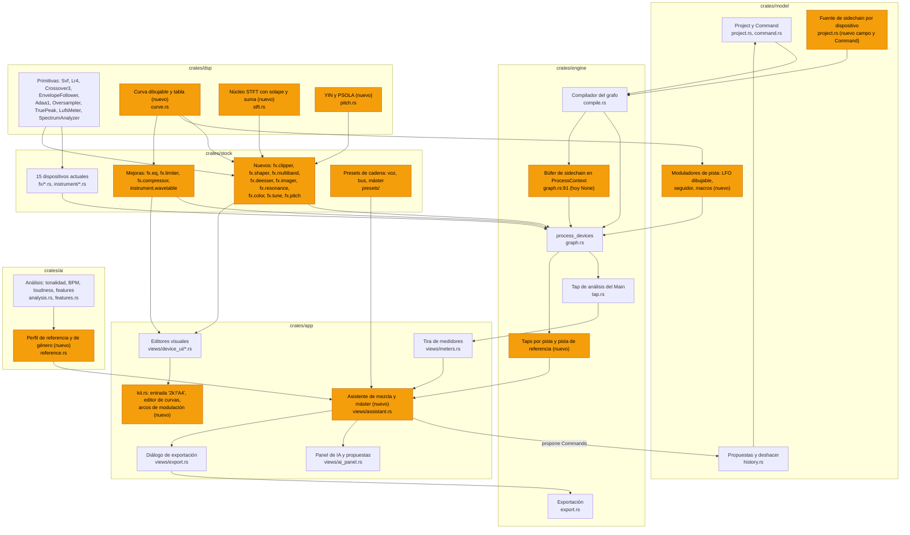

# 07 — Mezcla, mastering y plugins de referencia: estudio y plan para los dispositivos de serie

> Estudio para llevar los dispositivos de serie de AI-Track al nivel de los plugins que usa la industria.
> Fecha: 2026-11-11. Continúa a `04-plugins-dsp-fabfilter-waves.md` y no lo repite: el DSP de base (SVF, biquads matched, ADAA, FDN, true peak, sobremuestreo) está allí.
> Solo lectura: no se compiló ni se ejecutó nada. Lo que se dice de nuestro código sale de leer `crates/stock/src`, `crates/dsp/src`, `crates/engine/src/graph.rs`, `crates/model/src/project.rs` y `crates/app/src/views/device_ui`.
>
> Marcas de fiabilidad: **[P]** fuente primaria (página o manual del fabricante, norma), **[S]** fuente secundaria (reseña, blog, tienda), **[M]** dato de memoria no comprobado en esta sesión, **[NV]** no se pudo verificar. Los números sin marca dentro de una especificación propia son propuestas de diseño nuestras, no datos de terceros.

---

## 0. Resumen

1. **El hueco más caro no es un plugin, es el enrutado.** El motor llama a todos los dispositivos con `sidechain: None` (`crates/engine/src/graph.rs:91`) y el modelo no guarda una fuente de sidechain. El compresor y el gate ya tienen el parámetro "External", pero hoy no hace nada. Sin sidechain no hay ducking de bajo con bombo, que es el gesto más repetido de la música electrónica. Tampoco hay moduladores de host (LFO o envolvente arrastrables a cualquier control), que es lo que hace querido a Serum y a toda la línea FabFilter.
2. **Faltan seis dispositivos que un productor de electrónica abre en cada sesión**: curva de volumen dibujable sincronizada (clase LFOTool, Kickstart, VolumeShaper), compresor multibanda ascendente y descendente (clase OTT), clipper, de-esser, imager estéreo por bandas y supresor de resonancias (clase soothe). Ninguno es difícil salvo el último, y casi todo el DSP necesario ya está en `crates/dsp` (crossover LR4, seguidores, ADAA, sobremuestreo, true peak, LUFS).
3. **Los quince dispositivos actuales tienen buen DSP y editores visuales, pero se quedan cortos en lo que el profesional toca a diario.** Al EQ le faltan fase lineal, escucha de banda, espectro previo y posterior, entrada "2k"/"A4", selección múltiple y rango dinámico en ambos sentidos. Al limitador le faltan estilos, escucha a ganancia unitaria, escucha de la diferencia, dither con noise shaping y objetivos de loudness. El sintetizador wavetable tiene 6 tablas fijas, sin importación, sin modos de warp, 2 LFO de forma fija y 8 ranuras de matriz: está lejos de la clase Serum.
4. **Los números de plataforma que circulan son en buena parte folclore.** Solo Spotify publica cifras completas (−14 LUFS, −1 dBTP, −2 dBTP si el máster supera −14) [P]. Apple no publica un objetivo en LUFS; el −16 es una medición de terceros [S]. SoundCloud dice en su ayuda que sí normaliza [P], al contrario de lo que repiten muchos blogs. Los másters comerciales de electrónica están en torno a −8,3 LUFS integrados (rango −11,3 a −6,2) [S, iZotope 2025]. El asistente del DAW debe mostrar esos datos con su fuente y dejar los objetivos editables.
5. **Novedades de 2025–2026 que cambian la lista del usuario**: soothe3 sustituye a soothe2 (mayo de 2026) [P/S]; Ozone 12 (septiembre de 2025) añade IRC 5, Unlimiter y Stem EQ [P/S]; Serum 2 (marzo de 2025, hoy 2.1.5) pasa a 3 osciladores con 5 motores, 2 filtros, 4 envolventes, hasta 10 LFO y 8 macros [P]; Native Instruments lanzó Massive XL el 27-10-2026 como sucesor de Massive X [P]; RC-20 Retro Color 2 salió a principios de noviembre de 2026 [S]; Kontakt va por la 8 y Pigments por la 7 [P].
6. **De las referencias locales, futureboard-studio (MIT) es la más aprovechable**: tiene de-esser, ducker con curva (duckstep), clipper (67Clipper), imager de 4 bandas, limitador con medidor BS.1770, corrector de afinación (whitesharp) y un sintetizador wavetable. Se puede reescribir con diseño propio y anotar en `NOTICE` si algún bloque queda cercano. De Lemon-Studio (GPL-3) solo se toman ideas: el multibanda con mapas dibujados (Press) y el modo de fase lineal del EQ.

Orden de trabajo recomendado (detalle en §4):

| # | Qué | Valor | Esfuerzo |
|---|---|---|---|
| 1 | Enrutado de sidechain en modelo y motor | Muy alto | Medio |
| 2 | `fx.shaper`: curva de volumen dibujable (ducking sin sidechain) | Muy alto | Medio |
| 3 | `fx.clipper` | Alto | Bajo |
| 4 | `fx.multiband`: multibanda ascendente y descendente | Muy alto | Medio |
| 5 | Limitador: estilos, ganancia unitaria, diferencia, dither, objetivos | Alto | Medio |
| 6 | EQ: escucha de banda, espectro pre/post/SC, entrada numérica, rango dinámico ±, selección múltiple | Alto | Medio |
| 7 | `fx.deesser` | Alto | Bajo |
| 8 | Wavetable clase Serum, fase 1: importar tablas, warp, LFO dibujable, arrastrar para modular | Muy alto | Alto |
| 9 | `fx.imager` | Medio | Bajo |
| 10 | Asistente de mezcla y mastering (lista de comprobación, avisos, objetivos) | Alto | Medio |
| 11 | `fx.resonance`: supresor de resonancias y ducking espectral | Alto | Alto |
| 12 | `fx.color`: cinta y lo-fi | Medio | Medio |
| 13 | `fx.tune` y `fx.pitch`: afinación y formantes | Medio | Alto |
| 14 | EQ de fase lineal, EQ match, colisiones entre pistas | Medio | Alto |

---

## 1. Qué hace un ingeniero de mezcla y uno de mastering (música electrónica)

### 1.1 Mezcla, paso a paso

Cada fila dice qué se hace, con qué herramienta, qué lectura se mira y qué números son habituales. Los números son convenciones de oficio, no normas; la columna de fuente dice de dónde salen.

| # | Paso | Qué se hace | Herramienta | Lectura que se mira | Números habituales | Fuente |
|---|---|---|---|---|---|---|
| 1 | Preparación | Ordenar, nombrar, colorear, agrupar en buses (drums, bajo, sintes, voces, FX), cargar 2 o 3 temas de referencia | Grupos, pista de referencia | — | Referencias igualadas en loudness antes de comparar, en su sección más fuerte | [S] MasteringTheMix |
| 2 | Gain staging | Poner cada fuente a un nivel cómodo antes de procesar, para que los plugins con umbral y saturación trabajen en su zona | Ganancia de clip, Utility | Pico y RMS por pista | 0 VU ≈ −18 dBFS RMS (se usan también −20 y −16); picos en torno a −12 a −6 dBFS. En un DAW de coma flotante no es obligatorio técnicamente; sirve para los plugins no lineales y para no saturar el bus | [S] Sound On Sound |
| 3 | Balance estático | Mezclar solo con faders y pan. Empezar por bombo y bajo, después el resto | Faders, pan | Medidor del bus, oído | No hay convención numérica creíble para "bombo a −10 dBFS" [NV]. El método del ruido rosa (subir cada pista hasta que apenas se oiga sobre el ruido) da un balance de partida, nada más | [S] Sound On Sound |
| 4 | Relación bombo y bajo | Decidir quién ocupa el sub. Afinar el bombo a la tonalidad, separar fundamentales o alternarlas en el tiempo con ducking | Analizador, EQ, ducking | Espectro 30–120 Hz, correlación | Fundamental del bajo en house y tech house entre 40 y 80 Hz [S, blog] | [S] |
| 5 | EQ sustractiva | Quitar lo que estorba: pasa-altos en lo que no necesita graves, cortes estrechos en resonancias, limpiar 200–500 Hz | EQ paramétrico con escucha de banda | Espectro previo y posterior, escucha de banda | Cortes de 2 a 6 dB con Q de 2 a 8; pasa-altos de 12 a 24 dB/oct. No hay fuente numérica verificada para frecuencias fijas [NV] | oficio |
| 6 | EQ aditiva | Dar carácter: aire, presencia, cuerpo | EQ, shelves | Espectro, oído a volumen igualado | Realces anchos (Q 0,5 a 1,5) de 1 a 4 dB | oficio |
| 7 | Dinámica por pista | Controlar picos y dar pegada o cuerpo | Compresor, transient shaper, clipper en drums | Reducción de ganancia, historial | Voces 3 a 6 dB de reducción; drums con ataque 10 a 30 ms para dejar pasar el transitorio; clipper en bombo y caja 2 a 4 dB | [S] blogs |
| 8 | Sidechain y ducking | Bajar el bajo, los pads y las reverbs cuando suena el bombo | Compresor con sidechain, o curva de volumen sincronizada | Reducción, forma de onda de bombo y bajo superpuestas | Ataque menor de 2 a 4 ms; ratio 4:1 a 10:1 o más; release 100 a 150 ms o ajustado al tempo (negra en ms = 60000/BPM); 2 a 3 dB para un ducking discreto, 5 dB o más para que bombee | [S] EDMProd |
| 9 | Multibanda y "OTT" | Aplastar hacia arriba y hacia abajo por bandas para dar densidad y brillo a sintes, bajos y drums | Multibanda ascendente y descendente | Nivel por banda, cantidad | Mezcla (Depth) de 20 a 50 % en la mayoría de los casos; 100 % en growls y leads agresivos | oficio |
| 10 | Saturación | Añadir armónicos para que el sub se oiga en altavoces pequeños y los sintes llenen | Saturador, cinta, distorsión multibanda | Curva de transferencia, armónicos, nivel igualado | Comparar siempre a ganancia compensada | oficio |
| 11 | Resonancias y sibilancia | Domar asperezas que cambian de frecuencia (voces, platos, supersaws) | De-esser, supresor de resonancias, EQ dinámico | Reducción por frecuencia, escucha de la diferencia | Sibilancia en 4 a 10 kHz; guía de Logic: 5 a 8 kHz voz femenina, 3 a 6 kHz masculina [P, Apple]; FabFilter cita 8 a 10 kHz como típico [P] | [P] |
| 12 | Espacio en envíos | Reverbs y delays en retornos compartidos, filtrados y con ducking | Envíos, reverb, delay, EQ en el retorno | Nivel del retorno, espectro | Truco de Abbey Road: pasa-altos a 600 Hz y pasa-bajos a 10 kHz antes de la reverb [S]. Pre-delay muy variable (8 a 120 ms según la fuente) [NV como regla] | [S] Soundfly |
| 13 | Estéreo y mono | Ensanchar medios y agudos, mono en graves, comprobar la suma a mono | Utility, imager, vectorscopio | Correlación, balance | Mono por debajo de 80 a 150 Hz; correlación por encima de 0. Es un criterio por defecto, no una regla | [S] Sonible |
| 14 | Buses | Pegar los grupos con compresión suave, EQ de bus, saturación de bus | Compresor de bus, EQ | Reducción | 1 a 3 dB de reducción, ratio 2:1 a 4:1, ataque 10 a 30 ms, release automático | [S] |
| 15 | Automatización | Mover faders, filtros y envíos para dar forma a la canción: subidas, cortes antes del drop, aperturas de filtro | Automatización, envolventes de clip | — | Bajar 0,5 a 1 dB antes del drop hace que el drop parezca más fuerte | oficio |
| 16 | Comprobaciones | Mono, volumen bajo, auriculares, altavoz pequeño, comparar con referencias a loudness igualado | Analizador, medidor de loudness, pista de referencia | LUFS, espectro frente a la referencia, correlación | Monitorización calibrada: ruido rosa a −20 dBFS RMS por altavoz a 74–83 dB SPL (C, lento) según el volumen de la sala | [S] Sound On Sound |
| 17 | Margen para el máster | Exportar sin limitador en el bus y sin clipping | Medidor | Pico real, sin "overs" | No hay norma. Se pide −6 dBFS de pico, o simplemente que no recorte y que no lleve limitador [S]. En 24 bits o coma flotante el nivel exacto no afecta a la calidad | [S] Splice |

Pendiente espectral de referencia: el ruido rosa cae 3 dB/oct; SPAN y Pro-Q dibujan por defecto con 4,5 dB/oct de inclinación [P]; un estudio sobre 772 números uno encontró unos 5 dB/oct de caída entre 100 Hz y 4 kHz [S, Pestana et al. 2013]. Un espectro que se ve plano con 4,5 dB/oct de inclinación es una mezcla equilibrada.

Cadena de voz habitual: (puerta) → EQ sustractiva → compresor → de-esser → EQ aditiva → saturación → reverb y delay por envío. La posición del de-esser se discute [S, iZotope].

### 1.2 Mastering, paso a paso

Orden de cadena. La guía de iZotope pone EQ correctiva → dinámica multibanda o correctiva → compresión de banda ancha → EQ tonal → limitador, y dice que EQ, compresor y limitador suelen bastar [S]. El orden largo (saturación → imagen → clipper → limitador → dither) es consenso de blogs, no una norma.

| # | Etapa | Qué se decide | Herramienta | Lectura | Números habituales | Fuente |
|---|---|---|---|---|---|---|
| 1 | Escucha y medición | Comparar con referencias a loudness igualado; apuntar problemas | Medidor, analizador, referencia | LUFS integrado y a corto plazo, espectro promedio, correlación, pico real | — | oficio |
| 2 | EQ correctiva | Quitar subgrave inútil, resonancias, dureza | EQ (a menudo M/S y fase lineal) | Espectro promedio frente a la referencia | Movimientos de 0,5 a 2 dB con Q ancha [NV: la guía de iZotope no da cifras] | oficio |
| 3 | Dinámica correctiva | Controlar una banda que salta (graves sueltos, platos) | Multibanda o EQ dinámico | Reducción por banda | Ejemplo de iZotope: bandas por debajo de unos 130 Hz y por encima de 3 kHz | [S] iZotope |
| 4 | Compresión de bus | Pegar la mezcla | Compresor estilo VCA de bus | Reducción | Ratio 1,25:1 a 2:1; 1 a 3 dB de reducción (Splice: 2 dB como máximo); ataque discutido (unos 30 ms o más lento); release automático o al tempo | [S] Splice |
| 5 | EQ tonal | Aire, peso, presencia | EQ, shelves anchos | Espectro | ±0,5 a 1,5 dB | oficio |
| 6 | Saturación o excitador | Densidad y armónicos | Saturador, cinta | Nivel igualado | Poco; se juzga con ganancia compensada | oficio |
| 7 | Imagen | Mono en graves, ancho en agudos | Imager por bandas, EQ M/S | Correlación, vectorscopio | Graves en mono por debajo de 100 a 150 Hz, sobre todo si va a vinilo | [S] |
| 8 | Clipper | Recortar los picos de bombo y caja para que el limitador trabaje menos | Clipper con sobremuestreo | dB recortados | 1 a 2 dB en el máster; 2 a 4 dB en drums sueltos. Sin fuente de revista; es práctica de blogs y de fabricantes | [S] Newfangled |
| 9 | Limitador | Subir al loudness objetivo sin distorsión audible | Limitador de pico real | Reducción, LUFS a corto plazo, pico real | 1 a 3 dB de reducción suena transparente; los másters fuertes necesitan más. Sobremuestreo 4× como mínimo; FabFilter recomienda 4× con al menos 0,1 ms de lookahead [P] | [P] FabFilter, [S] |
| 10 | Techo | Dejar margen para los códecs con pérdida | Limitador | dBTP | −1 dBTP (Spotify, AES, EBU, Apple pide "al menos 1 dB"); −2 dBTP si el máster es fuerte (Spotify, SoundCloud). FabFilter lista −0,1 dBTP para CD. En la práctica la mayoría de los éxitos de 2024 pasan de 0 dBTP | [P], [S] |
| 11 | Dither | Reducir la profundidad de bits | Dither con noise shaping opcional | — | Una sola vez, al final, solo al bajar de bits; no para MP3 o AAC [P, FabFilter]. Conversión de frecuencia de muestreo antes del dither | [P], [S] |
| 12 | Control de calidad | Escuchar el archivo final entero; comprobar inicio y final, clics, metadatos | Medidor, reproductor | LUFS, LRA, pico real del archivo | — | oficio |

### 1.3 Objetivos por plataforma (lo que está publicado y lo que no)

| Plataforma | Lo que publica | Lo que es medición de terceros |
|---|---|---|
| Spotify | −14 LUFS según ITU 1770; niveles Loud −11, Normal −14, Quiet −19 (Premium). Sube los másters bajos dejando 1 dB de margen; en Loud aplica un limitador a −1 dB con 5 ms de ataque y 100 ms de caída. Recomienda −1 dBTP, o −2 dBTP si el máster supera −14 LUFS. El reproductor web no normaliza [P] | — |
| Apple Music | Sound Check sube o baja por pista o por álbum. Apple Digital Masters: 24 bits a la frecuencia nativa (44,1 a 192 kHz), "al menos 1 dB de margen", comprobar el recorte con `afclip` [P] | −16 LUFS [S, Ian Shepherd] |
| YouTube | No publica número. "Volumen estable" no se aplica a música oficial [P] | −14 LUFS, solo baja; lectura "content loudness" en Estadísticas para nerds [S] |
| Tidal | Nada oficial encontrado | −14 LUFS, por álbum, solo baja [S] |
| Amazon Music | Solo un interruptor [P] | −14 LUFS [S]; el "−2 dBTP" no se pudo rastrear hasta Amazon [NV] |
| Deezer | Solo un interruptor [P] | −15 LUFS [S] |
| SoundCloud | Dice que normaliza y da el mismo consejo que Spotify (−14 LUFS, −1 dBTP). Subir sin pérdida, 16 bits y 44,1 kHz o más [P] | Muchos blogs dicen que no normaliza: contradice la ayuda oficial |
| Beatport | Estéreo, 44,1 kHz y 16 bits (página de 2023) [P]. Vende descargas: no normaliza | 24 bits y 48 kHz admitidos según una fuente secundaria [NV] |
| Bandcamp | WAV, AIFF o FLAC, 16 bits y 44,1 kHz como mínimo; 24 bits sí, 32 no [P] | "No normaliza" [S] |
| Club (CDJ, rekordbox) | El Auto Gain de rekordbox no viaja al USB: en cabina suena el nivel del archivo más el trim del DJ [P, manual] | Objetivo de Auto Gain sin documentar; un fabricante midió unos −10 LUFS [S] |
| TikTok, Instagram | Nada oficial | Cifras contradictorias [NV] |

Normas de contexto: ITU-R BS.1770-5 (noviembre de 2023) define la ponderación K, bloques de 400 ms con 75 % de solape, puerta absoluta a −70 LKFS y relativa a −10 LU, y pico real con sobremuestreo 4× [P]. EBU R 128 v5.0: −23 LUFS, máximo −1 dBTP [P]. ATSC A/85: −24 LKFS, pico real por debajo de −2 dBTP [P, valores por resúmenes]. AES TD1008 (2021, luego AES77-2023): música a −16 LUFS con normalización por pista, pista más fuerte del álbum a −14 con normalización por álbum, máximo −1 dBTP a la entrada del códec [P].

Consecuencia para el diseño: los objetivos del asistente son presets editables con su fecha y su fuente, no constantes en el código.

### 1.4 Loudness comercial por género

Las fuentes de más confianza son los dos estudios de iZotope y los ingenieros con nombre. Las tablas por género vienen de vendedores de herramientas de medición, con métodos que no se pueden auditar, y discrepan entre sí de 2 a 4 LU. Las que miden previsualizaciones de 30 a 120 s miden la parte fuerte, no el tema entero.

Anclas:
- 54 canciones del top 10 del Billboard Global 200, primera mitad de 2024: integrado −8,3 ± 1 LUFS (de −11,1 a −6,0), máximo a corto plazo −6 ± 1, LRA entre 3,7 y 6,8 LU; la mitad con pico real entre 0 y +0,75 dBTP [S, iZotope].
- Hot Dance/Electronic 2025: integrado medio −8,3 (de −11,3 a −6,2), corto plazo medio −6,1, LRA 5,5 a 6,6 [S, iZotope].
- MasteringTheMix: "fuerte" es unos −6 LUFS a corto plazo en la sección más fuerte; "dinámico" es −9 a −11. Para club, −6 a −9 LUFS con −0,1 dBTP [S].
- Ian Shepherd: no pasar de −10 LUFS a corto plazo con pico real de −1 como máximo [S].

| Género | Integrado, mediana según fuentes (LUFS) | Fiabilidad |
|---|---|---|
| House | −9,2 a −8,0 | Vendedores [S] |
| Tech house | −8,9 a −8,8 | [S] |
| Techno peak-time | −8,6 a −6,5 | [S], discrepan 2 LU |
| Techno melódico | −10,5 a −8,8 | [S] |
| Hard techno | −7,3 a −6,7 | [S] |
| Drum & bass | −6,5 a −4,3 | [S], discrepan 2 LU |
| Dubstep | −6 a −4,5 | [S] |
| EDM, big room | −8,7 a −6,7 | [S] |
| Trap, hip-hop | −10,0 a −8,5 | [S] |
| Pop | −9,5 a −8,3 | iZotope + [S] |
| Latino (no específico de reggaetón) | −10,7 a −9,4 | [S], muestra pequeña |
| Reggaetón | Sin medición creíble; una guía aconseja −9 a −7 | [NV] |
| Ambient | −14,1 a −13,8 | [S] |
| Lo-fi | Sin dato creíble | [NV] |

Lectura práctica: para streaming, cualquier máster por encima de −14 LUFS se baja; lo que se gana al masterizar fuerte es densidad, no volumen. Para club y descarga no hay normalización y el nivel del archivo cuenta. Por eso el género manda más que la plataforma.

### 1.5 Entregables

- Máster principal: WAV de 24 bits a la frecuencia de la sesión (Spotify acepta FLAC o WAV de 44,1 kHz y 16 bits o más y reproduce como máximo 24 bits y 44,1 kHz [P]).
- Para CD o DDP: 16 bits y 44,1 kHz con dither [M].
- Apple Digital Masters: 24 bits, frecuencia nativa, comprobado contra el codificador AAC [P].
- Versiones: instrumental, radio edit, clean, extended o club mix; stems si el sello los pide.
- Vinilo: graves en mono por debajo de 100 a 150 Hz (algunos cortadores piden no hacerlo salvo que lo pidan), sibilancia controlada; un 12" a 33⅓ rpm suena mejor con 15 a 18 minutos por cara, a 45 rpm con 9 a 12 [S, Disc Makers].
- Álbum: no forzar todas las pistas al mismo LUFS; con normalización por álbum la pista más fuerte suele quedar unas 2 LU por encima de la media [P, AES].
- Metadatos: ISRC, título, artista, y el informe de loudness (integrado, LRA, pico real) junto al archivo.

Nuestro diálogo de exportación (`crates/app/src/views/export.rs`) ya ofrece WAV de 16 bits con dither, 24 bits y 32 bits flotante, MP3 a 320 kbps, stems y normalización de pico a −0,3 dBFS. Le faltan: normalizar a un LUFS objetivo, techo en dBTP, informe de loudness del archivo y perfiles por destino (§5).

---

## 2. Los plugins de referencia en 2025–2026, por categoría

Para cada uno: versión comprobada y lo que lo hace querido, en términos de funciones e interacciones. Las URL están en §7.

### 2.1 EQ y control espectral

| Plugin (versión) | Por qué se usa | Marca |
|---|---|---|
| FabFilter Pro-Q 4 | La pantalla es el control. Bandas dinámicas y espectrales, lista de instancias, EQ match, agarrar picos del espectro, colisiones entre pistas. Detalle en §3.1 | [P] |
| Three-Body Kirchhoff-EQ (1.7.4, julio de 2026) | 32 bandas, 15 tipos de filtro, dinámica con dos umbrales (por encima y por debajo), detección relativa, lookahead, modos de fase cero latencia, analógico, lineal y mixto, modelos de EQ clásicos. Es el rival "más técnico" de Pro-Q | [P] página de Plugin Alliance; el número de modelos vintage es incoherente en la propia página |
| oeksound soothe3 (1.0.6; lanzado el 19-05-2026) | Sustituye a soothe2. Supresión de resonancias que sigue a la señal: no hay que buscar la frecuencia. Un control Detail en lugar de Sharpness y Selectivity, Tilt, Max cut, modos Soft (umbral adaptativo) y Hard, hasta 8 bandas de ponderación, L/R o M/S, sidechain externo con escucha, delta. Latencia 2304 muestras (0 en baja latencia, 3456 en fase lineal). Cortes de hasta 40 dB | [P] manual |
| oeksound soothe2 (anterior) | Depth, Sharpness, Selectivity, Attack, Release, Mix, Trim, Delta, Soft/Hard; 4 bandas más cortes | [P] |
| oeksound spiff (1.4.4), bloom (1.1.x) | spiff: transitorios por análisis espectral, sin crossovers. bloom: ecualizador tonal adaptativo con 4 controles | [P] |
| Soundtheory Gullfoss (Standard, Live, Master) | EQ que cambia "más de 300 veces por segundo" según un modelo auditivo. Cinco controles: Recover (sube lo enmascarado), Tame (baja lo que enmascara), Bias, Brighten, Boost. Marcadores de rango arrastrables | [P] ediciones y latencias; [S] controles |
| TDR Nova (2.2.3, gratis) | 4 bandas dinámicas más HP/LP, con sección de dinámica completa por banda. La alternativa gratuita de EQ dinámico | [P] |
| Wavesfactory Trackspacer (2.5.10) | EQ de 32 bandas que aplica la curva inversa del espectro del sidechain: abre hueco para la voz o el bombo sin tocar el resto. Un control (Amount) más filtros, ataque, release y M/S | [P] |

Lo que piden estos plugins a un DAW: buen analizador, bandas dinámicas en ambos sentidos, sidechain por banda, un supresor espectral y ducking espectral por sidechain.

### 2.2 Dinámica

| Plugin (versión) | Por qué se usa | Marca |
|---|---|---|
| FabFilter Pro-C 3 | 14 estilos (Clean, Versatile, Smooth, Punch, Upward, TTM; Op-El, Vari-Mu, Classic, Opto; Vocal, Mastering, Bus, Pumping). Carácter Tube, Diode o Bright. Umbral automático, disparo por tempo del host, EQ de sidechain de 6 bandas, lookahead 0–20 ms, hold hasta 500 ms, mix 0–200 %, sobremuestreo hasta 32× | [P] |
| FabFilter Pro-MB | Hasta 6 bandas colocadas libremente, pendientes 6–48 dB/oct, modos Dynamic Phase, Linear Phase y Minimum Phase, compresión o expansión por banda, sidechain externo, mix 0–200 % | [P] |
| Xfer OTT (1.37, gratis) | El sonido de la electrónica desde 2010: tres bandas con compresión descendente y ascendente a la vez. Controles: Depth, Time, ganancia de entrada y salida, ganancia por banda, Upward % y Downward %. Cruces fijos en 88,3 Hz y 2,5 kHz. Viene del preset "OTT" de Multiband Dynamics de Ableton | [P] versión; [S] controles y cruces |
| Ableton Multiband Dynamics | Tres bandas, cada una con umbral "Above" y "Below"; cada bloque puede comprimir o expandir. Time escala todos los ataques y releases; Amount escala todas las ratios; Soft Knee; RMS o Peak; sidechain | [P] manual de Live 12 |
| SSL Native Bus Compressor 2 | El compresor de bus VCA de la consola 4000 G. Ratios clásicas 2, 4 y 10 más 1,5, 3, 20 y X; ataque nuevo de 20 ms; releases nuevos de 0,4, 0,8 y 1,2 s; HPF de sidechain, Mix, sobremuestreo | [P] |
| Cytomic The Glue (1.9.3) | La misma idea con Range (límite de reducción), HPF de sidechain de 6 dB/oct, Mix y Peak Clip | [P] |
| Ableton Glue Compressor | Range, Dry/Wet, Soft Clip a −0,5 dB, sobremuestreo 2× | [P] |
| Xfer LFOTool (1.5 según el enlace de demo) | Curva de LFO dibujable para volumen, pan y filtro; 12 gráficas por preset conmutables por nota MIDI; sincronía exacta a la muestra | [P] parcial |
| Kickstart 2 (2.0.9) | Ducking en un clic: 16 curvas, arrastrar para ajustar la longitud, disparo por audio que sigue cualquier patrón de bombo, modo multibanda que solo baja los graves, vista de bombo y bajo superpuestos | [P] |
| Cableguys ShaperBox 3 (3.6) y VolumeShaper 7 | 11 Shapers (Pitch, Reverb, Time, Drive, Noise, Liquid, Filter, Crush, Volume, Pan, Width), 3 bandas por Shaper, cada una con su LFO dibujable y su seguidor de envolvente; disparo por transitorios de audio, incluido el sidechain externo; longitudes de 1/128 a 32 compases | [P] |

### 2.3 Limitadores y clippers

| Plugin (versión) | Por qué se usa | Marca |
|---|---|---|
| FabFilter Pro-L 2 | 8 estilos, pico real, medidor de loudness con objetivos, escucha a ganancia unitaria y de la diferencia. Detalle en §3.2 | [P] |
| iZotope Ozone 12 (septiembre de 2025) | Maximizer con IRC 5, Upward Compress y Soft Clip. Módulos nuevos: Stem EQ, Unlimiter, Bass Control. Master Assistant con flujos a medida, objetivo de loudness y hasta 60 s de análisis | [P/S]; la lista completa de modos IRC no se pudo leer en la ayuda [NV] |
| SIR StandardCLIP | Clipper de referencia en electrónica. Modos Hard Clip, Soft Clip Classic y Soft Clip Pro (al 25/50/75/100 % comprime los últimos 6/12/18/24 dB a la mitad). Sobremuestreo hasta 256× con filtros de fase lineal o mínima, factor distinto para render | [P] manual |
| Kazrog KClip 3 | 8 modos (Smooth, Crisp, Tube, Tape, Germanium, Silicon, Broken Speaker, Guitar Amp), 4 bandas con modo propio, M/S, medidor LUFS, sobremuestreo hasta 32× | [P] |
| Schwabe Digital Gold Clip | Clippers Modern, Classic y Hard; "Gold" añade hasta 6 dB de ganancia no lineal que desaparece cerca del techo; Alchemy contornea medios y agudos después del recorte; mezcla paralela | [P] |
| Newfangled Elevate (1.5) | Limitador de 26 bandas en escala Mel con limitador adaptativo por banda, énfasis de transitorios y clipper espectral | [P] |

### 2.4 De-essers, saturación y color

| Plugin (versión) | Por qué se usa | Marca |
|---|---|---|
| FabFilter Pro-DS | Detección Single Vocal o Allround, banda ancha o banda partida, lookahead hasta 15 ms. Detalle en §3.3 | [P] |
| FabFilter Saturn 2 | 28 estilos, hasta 6 bandas, drive, mix, feedback, dynamics, tone y nivel por banda, HQ 8× y 32×, 50 ranuras de modulación | [P] |
| Soundtoys Decapitator (5.5) | Cinco estilos (A, E, N, T, P) modelados sobre previos y distorsionadores de estudio, Punish (+20 dB), Tone, filtros, Mix y compensación automática de salida | [P] producto; estilos por copia del manual |
| XLN RC-20 Retro Color 2 (noviembre de 2026) | Seis módulos reordenables (Noise, Wobble, Distort, Digital, Space y el nuevo Echo), Magnitude que escala todo, Varispeed, sincronía de tempo, compresor y clip maestros. La v1 tenía Magnetic y el deslizador Flux, que la página actual ya no muestra | [P] v2; v1 [M] |
| Dada Life Sausage Fattener | Dos controles (Fatness, Color) y ganancia: compresión más saturación en un gesto | [S]; sin página oficial encontrada |
| iZotope Trash (relanzado) | Más de 60 distorsiones y más de 600 respuestas a impulso, mezcladas en una rejilla XY; 3 bandas | [P] |
| Soundtoys Devil-Loc Deluxe | Compresor y distorsión extrema de dos controles para drums | [P] |

### 2.5 Reverb y delay

| Plugin (versión) | Por qué se usa | Marca |
|---|---|---|
| Valhalla Room (2.0.5) | 12 algoritmos, secciones Early y Late separadas, decay de 0,1 a 100 s con tres bandas | [P] |
| Valhalla VintageVerb (4.0.5) | 22 modos y tres "colores" de época (1970s, 1980s, Now) que cambian el ancho de banda y la modulación | [P] |
| Valhalla Supermassive (5.0.0, gratis) | 22 modos sobre redes de delays con realimentación de hasta 2 s por línea; Warp convierte ecos en reverb; colas enormes | [P] |
| ValhallaDelay (3.0.0) | Modos Tape, HiFi, BBD, Digital, Ghost, Pitch, RevPitch; Era y Age cambian el modelo y su desgaste | [P] |
| FabFilter Pro-R 2 (2.06) | Control Space continuo, EQ de tiempo de decay de 6 bandas, post-EQ, ducking, auto gate, congelación, importar IR | [P] |
| Soundtoys EchoBoy (5.5) | 30 estilos de eco, modos Single, Dual, Ping-Pong y Rhythm Echo (hasta 16 taps), Groove y Feel para que las repeticiones adelanten, retrasen o balanceen | [P] |
| Waves H-Delay | 1 a 3500 ms, cuatro caracteres analógicos, botón LoFi, HP/LP enlazables, modulación, ping-pong | [P] |

### 2.6 Estéreo, utilidades y medición

| Plugin (versión) | Por qué se usa | Marca |
|---|---|---|
| iZotope Ozone Imager (gratis) e Imager de Ozone 12 | Ancho por bandas (hasta 4), Stereoize I (decorrelación tipo Haas) y II, tres vectorscopios (Polar Sample, Polar Level, Lissajous), correlación, "Recover Sides" en Ozone 12 | [P] |
| Voxengo MSED (3.13, gratis) | Codificar y decodificar M/S, ganancia y pan de Mid y Side, mute de cada uno, correlación | [P] |
| Voxengo SPAN (3.24, gratis) | Analizador con tamaño de bloque, solape y pendiente ajustables (4,5 dB/oct por defecto), M/S, correlación, escalas K, LUFS, pico real | [P] |
| Youlean Loudness Meter 2 (2.5.15) | LUFS integrado, corto y momentáneo, LRA, PLR, DR, pico real, gráfica de historial e histograma; presets de plataformas en la versión Pro | [P] |
| ADPTR Metric AB, Mastering The Mix REFERENCE y LEVELS | Comparar con hasta 16 referencias a loudness igualado; LEVELS marca en rojo la sección que se sale de su umbral | [P/S] |
| Sonarworks SoundID Reference | Corrección de auriculares y monitores | [P] |

### 2.7 Afinación y voz

| Plugin (versión) | Por qué se usa | Marca |
|---|---|---|
| Antares AutoTune Pro 11 (11.6.0) | Modo Auto en tiempo real y modo Graph por nota; Retune Speed, Flex Tune, Humanize, Transpose, baja latencia; Harmony Player de 4 voces; ARA2; modo clásico "AutoTune 5" | [P]; Throat y Formant en la 11 [S] |
| Celemony Melodyne 5 | Edición por nota de afinación, tiempo, vibrato, formantes y sibilantes; polifónico (DNA) en las ediciones editor y studio; ARA. No hay Melodyne 6 | [P] |
| Soundtoys Little AlterBoy (5.5) | Pitch ±12 semitonos, Formant, Link, modos Transpose, Quantize y Robot, Drive | [P] |
| Ableton Auto Shift (Live 12) | Corrección en tiempo real con vibrato, desplazamiento de tono y de formantes, y modo MIDI | [P] manual |

### 2.8 Sintetizadores

| Plugin (versión) | Por qué se usa | Marca |
|---|---|---|
| Xfer Serum 2 (2.1.5) | Detalle en §3.4 | [P] |
| Vital | Wavetable con warp espectral, modulación arrastrable con vista animada, LFO dibujables, texto a wavetable. Código GPLv3: no se copia | [P]; versión actual [NV] |
| NI Massive X y Massive XL (27-10-2026) | 2 osciladores wavetable con diez modos (Standard, Bend, Mirror, Hardsync, Wrap, Formant, ART, Gorilla, Random, Jitter), enrutado libre, Performers, 16 macros. Massive XL añade importación de wavetables y generador de presets desde audio | [P] |
| Arturia Pigments 7 (7.0.1) | Seis motores (Wavetable, Virtual Analog, Sample, Granular, Harmonic, Modal), modulación muy visual, 20 efectos en dos buses de inserción y un envío | [P] |
| u-he Diva (1.4.8) | Osciladores y filtros analógicos modelados con realimentación sin retardo, mezclables entre modelos; calidad draft, fast, great y divine | [P] |
| LennarDigital Sylenth1 (3.072) | 4 osciladores con 8 voces de unísono cada uno; poco CPU y un sonido que encaja en la mezcla sin trabajo | [P] |
| Kilohearts Phase Plant | Semimodular: generadores de onda, wavetable, sample y ruido, y tres carriles de efectos | [P] |

### 2.9 Samplers, baterías y efectos creativos

| Plugin (versión) | Por qué se usa | Marca |
|---|---|---|
| NI Kontakt 8 | El estándar de instrumentos muestreados; la 8 añade Tools (Chords, Phrases, Patterns), Leap para loops y osciladores wavetable | [P] |
| NI Battery 4 | Matriz de celdas (hasta 128), efectos por celda, buses, arrastrar para enrutar | [P] |
| XLN XO (1.8.6) | Ordena los one-shots por parecido sonoro en un mapa ("Space"), secuenciador con Accentuator, combinador de ritmos y de samples | [P] |
| Output Portal | Efecto granular sobre la entrada con un control XY | [S] |
| Sugar Bytes Effectrix 2 (2.0.4) | 14 efectos secuenciados en una rejilla de 32 pasos | [P] |
| Image-Line Gross Beat | Búfer de 2 compases con 36 curvas de tiempo y 36 de volumen dibujables: half-time, scratch, gate | [P] manual; venta como VST sin confirmar [NV] |
| Cableguys HalfTime (1.1.x) | Medio tiempo en un botón: modos 2×, 1,5× y 4×, bucle de 1/16 a 8 compases, banda partida, fundidos de entrada y salida | [P] |

Los dispositivos de Live que el usuario ya conoce y con los que nos comparará: EQ Eight, Compressor, Glue Compressor, Multiband Dynamics, Limiter (modos Standard, Soft Clip y True Peak; lookahead de 1,5, 3 o 6 ms; Maximize; L/R o M/S) [P], Saturator, Roar, Auto Filter, Auto Pan-Tremolo, Echo, Drum Buss, Shifter, Spectral Resonator, Spectral Time, Vocoder, Utility, Wavetable, Operator, Drift, Meld, Simpler, Sampler y Drum Rack.

---

## 3. Los cuatro que nombró el usuario, como especificación

Cada apartado tiene dos partes: **lo que hace el original** (verificado en su ayuda, con marca) y **nuestra especificación** (diseño propio: otros nombres, otra disposición, otro aspecto). No se copian nombres de modos, iconos, colores ni la forma de los paneles.

### 3.1 EQ de clase Pro-Q

#### Lo que hace Pro-Q 4 [P, ayuda de FabFilter]

**Bandas y formas**
- Hasta 24 bandas [P, doc 04]. Diez formas: Bell, Low Shelf, Low Cut, High Shelf, High Cut, Notch, Band Pass, Tilt Shelf, Flat Tilt, All Pass.
- Pendientes de 0 a 96 dB/oct, con valores fraccionarios; Low Cut y High Cut ofrecen además Brickwall. Mínimos: Bell y Notch 12 dB/oct; cortes y Band Pass 0; el resto 6.
- Frecuencia de 10 Hz a 30 kHz. Ganancia de −30 a +30 dB. Q sin rango publicado en la página; 1 es el ancho por defecto.
- Botón de interacción ganancia-Q: en las campanas la Q se estrecha al subir la ganancia.
- Colocación estéreo por banda (Stereo, L, R, Mid, Side) y botón de tijera que parte una banda en L/R o M/S.

**Crear bandas**
- Arrastrar la curva amarilla global crea una banda, con vista previa de la forma mientras se arrastra.
- Pasar el ratón por el fondo muestra una vista previa; clic o doble clic la añade.
- Doble clic en la zona baja: Notch. Doble clic en el extremo izquierdo o derecho: Low Cut o High Cut. Arrastrar la curva en los extremos: shelf.
- Alt+clic crea una banda dinámica; Alt+Shift+clic, una espectral.
- EQ Sketch: dibujar la curva entera de un trazo y el EQ propone las bandas.

**Editar**
- Arrastrar el punto: frecuencia y ganancia. Con varias bandas seleccionadas, la ganancia escala de forma relativa.
- Rueda: Q; en cortes, la pendiente por pasos (Shift da pendientes fraccionarias). Ctrl/Cmd+rueda: ganancia. Alt+rueda: rango dinámico. Alt+Ctrl/Cmd+rueda: cambia ganancia y rango dinámico enlazados en sentido contrario.
- Ctrl/Cmd+arrastre vertical: Q de todas las seleccionadas. Shift: ajuste fino. Alt al arrastrar: bloquea un eje.
- Alt+clic en el punto: bypass. Ctrl+Alt+clic: cambia la forma. Alt+Shift+clic: cambia la pendiente.
- Doble clic en el punto: entrada numérica; Tab recorre frecuencia, ganancia y Q. La frecuencia admite "100", "2k", "A4" o "C#2+13".
- Selección: clic, rectángulo sobre el fondo, Ctrl/Cmd+clic para sumar, Shift+clic para un rango.
- Clic derecho en el punto: menú de banda (copiar, hacer dinámica, hacer espectral…). Clic derecho en el fondo: pegar. Las bandas se copian entre instancias.
- Panel de valores flotante junto al punto con bypass, borrar, solo y forma.

**Pantalla**
- Escala de EQ de ±3, 6, 12 o 30 dB; se amplía sola si se arrastra más allá. Zoom horizontal arrastrando la escala de frecuencias; doble clic vuelve al rango completo. La pantalla llega a 30 kHz.
- Teclado de piano opcional en el eje de frecuencias, para cuantizar a notas.
- Pantalla completa y reescalado.

**EQ dinámico**
- Campanas y shelves (y Flat Tilt, según la sección de controles) pueden ser dinámicas, también en fase lineal hasta la resolución High.
- Rango dinámico de −30 a +30 dB: negativo comprime, positivo expande. Se ajusta con un anillo alrededor del control de ganancia o arrastrando el indicador en la pantalla.
- Modo automático por defecto: ataque y release automáticos y umbral que sigue el nivel de la banda. Un panel "expandir" da umbral manual (con el nivel de disparo dibujado en el deslizador), ataque y release en una escala porcentual (50 % = automático), sidechain externo, disparo por la banda o "Free" con filtros propios, y escucha del disparo.
- Una barra amarilla en el anillo enseña el cambio de ganancia en vivo.

**Dinámica espectral**
- Variante que solo actúa sobre las frecuencias de la banda que superan el umbral. Controles añadidos: Spectral Density (ancho de las zonas disparadas) y Spectral Tilt (3 dB/oct sobre el espectro de detección, activado por defecto). Obliga a fase lineal en esa banda.

**Modos de proceso y carácter**
- Zero Latency, Natural Phase y Linear Phase (resoluciones Low a Maximum; latencias en doc 04 §1.2). Carácter Clean, Subtle y Warm.

**Analizador**
- Pre, Post y SC/Ext (sidechain externo o el espectro posterior de otra instancia, dibujado con contorno rojo claro).
- Rango 60, 90 (por defecto) o 120 dB. Resolución 1024, 2048, 4096 u 8192 puntos. Velocidad de caída. Tilt con 4,5 dB/oct por defecto. Freeze (mantenido o fijo).
- Colisiones: resplandor rojo donde el espectro propio y el externo pueden enmascararse.
- Spectrum Grab: dejar el ratón quieto sobre el espectro unos segundos lo congela, etiqueta los picos principales con su frecuencia (o su nota) y permite arrastrar un pico para crear una campana con Q automática.
- Frecuencia bajo el cursor en la escala inferior.

**EQ Match**
- Referencia: espectro guardado, la propia entrada en otro pasaje, otra instancia, el sidechain o un archivo de audio arrastrado.
- Los espectros se promedian; tras unos 30 s la media se estabiliza y una línea blanca muestra la diferencia. "Match" propone bandas; un deslizador elige cuántas (más bandas siguen diferencias pequeñas, menos solo la forma general).

**Salida**
- Auto Gain (estimación estática a partir de las curvas, no medida), Gain Scale (escala la ganancia de todas las campanas y shelves), nivel de −∞ a +36 dB, pan L/R o M/S, inversión de fase, bypass con compensación y sin clics.
- Lista de instancias: todas las instancias del proyecto en una vista, editables desde cualquier ventana.

#### Nuestra especificación (`fx.eq`, evolución del actual)

Estado actual: 8 bandas; Bell, Low Shelf, High Shelf, Low Cut, High Cut, Notch, Band Pass, Tilt; 6–96 dB/oct; canal Stereo/Mid/Side/Left/Right; dinámica solo descendente (umbral, ratio, ataque, release); modos Matched y Classic; auto gain; editor con nodos, rueda para Q, doble clic para crear según la zona, panel de valores, menú contextual, flechas y `[` `]`.

| Área | Especificación | Notas de DSP |
|---|---|---|
| Bandas | 16 en v1.1 (24 después). Formas nuevas: tilt plano, all-pass, corte "muro" | All-pass de 2.º orden con SVF TPT. Tilt plano: cascada de shelves de primer orden repartidos por octavas. Corte "muro": elíptico de orden alto o FIR en fase lineal |
| Pendientes | Las 8 actuales más fraccionarias | Mezcla de la salida de dos órdenes vecinos (doc 04 §6.1) |
| Rango | 10 Hz – 30 kHz, ±30 dB, Q 0,025 – 40 | Hoy 20 Hz – 20 kHz, ±24 dB, Q 0,1 – 18 |
| Dinámica por banda | Sustituir umbral+ratio por **Rango dinámico** −30…+30 dB (negativo comprime, positivo expande) más umbral. Umbral automático por defecto; ataque y release automáticos con un control de velocidad 0–100 %. Disparo: la banda, filtro libre o sidechain externo. Escucha del disparo | El detector ya existe. Umbral automático: media móvil del nivel de la banda (constante de 1 a 3 s) más un margen. Requiere el sidechain del motor (§4.0) |
| Modo espectral | En v2, dentro de la banda: solo bajan los bins que sobresalen | Reutiliza el núcleo STFT de `fx.resonance` (§4.3.5) limitado al rango de la banda |
| Proceso | Directo (SVF), Analógico (matched) y Fase lineal (2048, 4096, 8192, 16384) | FIR por muestreo en frecuencia y convolución particionada; crossfade al cambiar (doc 04 §3.2). Lemon-Studio tiene un modo así para estudiar la idea, sin copiar |
| Analizador | Capas Pre, Post y Sidechain u otra pista; rango 60/90/120 dB; resolución; caída; inclinación 0/3/4,5 dB/oct; congelar; media larga | `SpectrumAnalyzer` de `crates/dsp/src/spectrum.rs` ya da el posterior. El previo sale de un segundo tap. El de otra pista lo da el bus de análisis del host |
| Escucha de banda | Mantener pulsado un nodo con una tecla (por ejemplo, Alt+clic mantenido) deja oír solo lo que esa banda toca: pasa-banda con la misma frecuencia y Q; en shelves y cortes, la zona afectada | Parámetro transitorio no guardado; un SVF pasa-banda extra |
| Agarrar un pico | Con el espectro congelado, los 5 picos más salientes llevan etiqueta de frecuencia y nota; arrastrar uno crea una campana con Q derivada del ancho del pico | Detección de picos por prominencia sobre el espectro suavizado a 1/6 de octava |
| Selección múltiple | Rectángulo, Ctrl+clic, Shift+clic; mover varias; escalar ganancias; copiar y pegar bandas entre instancias | Un comando `SetParams` por gesto (ya existe el patrón de edición sellada) |
| Entrada numérica | Doble clic en el nodo o en el valor; acepta "2k", "440", "A4", "C#2+13"; Tab recorre | Analizador de texto en `kit.rs`, reutilizable en todos los dispositivos |
| Pantalla | Rango ±3/6/12/30 dB con ampliación automática; zoom horizontal; teclado de piano; tamaño ampliado | Hoy 18 o 30 dB |
| Salida | Escala de ganancia global 0–200 %, inversión de polaridad, pan o balance M/S | Auto gain actual se mantiene |
| Dibujar la curva | Trazar la curva con el ratón y ajustar N bandas | Mismo ajuste que el EQ match: selección codiciosa de picos más mínimos cuadrados |
| Igualar a una referencia | Aprender el espectro propio y el de una pista de referencia o un archivo durante 10 a 30 s; proponer de 3 a 12 bandas como **propuesta** aceptable o descartable | Encaja con el sistema de propuestas de `aitrack-model` |
| Colisiones | Sombrear las zonas donde esta pista y otra elegida tienen energía a la vez | Función del host (§5.3) |

Nombres propios sugeridos para los modos: Directo, Analógico, Fase lineal. Para la dinámica: "Rango dinámico", "Solo picos" (la variante espectral).

### 3.2 Limitador de clase Pro-L

#### Lo que hace Pro-L 2 [P, ayuda de FabFilter]

**Estilos (8)**

| Estilo | Comportamiento descrito por FabFilter |
|---|---|
| Transparent | Fiel al original, evita bombeo y coloración |
| Punchy | El más audible; apretado, bombea un poco. Para pistas sueltas y música con ritmo marcado |
| Dynamic | Realza los transitorios antes de limitar para conservar pegada |
| Allround | Equilibrio entre loudness y transparencia |
| Aggressive | Cercano al recorte. Para EDM, rock, metal |
| Modern | Por defecto en la v2. Transparente, llega a mucho loudness y funciona con lookahead casi nulo |
| Bus | No transparente a propósito: pegar, bombear, aplastar buses de batería |
| Safe | Pensado para no distorsionar nunca; para material delicado |

Los cuatro últimos necesitan más latencia.

**Dos etapas.** Una etapa rápida de transitorios, gobernada por el Lookahead, y una etapa lenta de release, gobernada por Attack y Release, que responde a la dinámica media. Lookahead corto conserva transitorios y da más loudness aparente con riesgo de distorsión; por debajo de 0,1 ms se acerca al recorte duro. Ataque corto con release largo es más limpio y puede bombear; ataque largo con release corto da más presencia y puede distorsionar. Los rangos numéricos no están en la página [NV].

**Enlace de canales** separado para las dos etapas: Transients (suele ir por debajo del 100 %) y Release (se empieza en 100 %).

**Pico real.** Medición de pico real conmutable (cumple BS.1770 y R128) y limitación de pico real que garantiza el techo. Sobremuestreo hasta 32× [P, doc 04]. Recomendación del fabricante: 4× con al menos 0,1 ms de lookahead mantiene los picos entre muestras dentro de unos 0,1 dB.

**Techos recomendados** en la ayuda: −1,0 dBTP (EBU R128, Spotify, YouTube), −2,0 dBTP (ATSC A/85), −0,1 dBTP (CD, iTunes).

**Pantalla en tiempo real.** Entrada en gris azulado, salida en azul oscuro, reducción en rojo desde arriba con los picos de reducción etiquetados, y una línea fina de loudness. Modos: Slow Down, Fast, Slow, Infinite (todo el audio desde que se abrió) y Off. Disposición compacta que oculta la pantalla.

**Medidores.** Escalas de 16, 32 y 48 dB; K-12, K-14 y K-20; y escala de loudness. Pico y RMS a la vez (el RMS sigue la especificación Momentary de R128). El número de pico máximo cambia de color: verde con pico real activo, naranja si supera el techo, rojo si pasa de 0 dBTP.

**Loudness.** Momentary, Short Term e Integrated; el elegido se ve grande y los otros dos como barras. Máximo momentáneo o a corto plazo. LRA cuando se elige Integrated. Pausa, reinicio y reinicio automático al arrancar la reproducción. Objetivos: −9 LUFS (CD), −14 LUFS (streaming), −23 LUFS (EBU R128), −24 LUFS (ATSC A/85) y personalizado. Escala de +9 o +18 LU sobre el objetivo, absoluta o relativa.

**Opciones.** Unity Gain (el nivel de salida pasa a ser el inverso de la ganancia, para oír el efecto sin el aumento de volumen; los medidores se ponen amarillos). Audition Limiting (se oye solo la diferencia). Filtro de DC. Disparo por sidechain externo (para masterizar por stems). Lock Output al comparar presets. Bypass compensado.

**Dither.** 24, 22, 20, 18 o 16 bits. Noise shaping Basic (sube el ruido por encima de 6 kHz), Optimized (más bajo en conjunto, sube más por encima de 10 kHz) y Weighted (según la sensibilidad del oído, diseñado para 44,1 kHz).

#### Nuestra especificación (`fx.limiter`, evolución del actual)

Estado actual: ganancia 0–24 dB, techo −12–0 dB, release 1–1000 ms, release automático, lookahead 0,5–10 ms, pico real, sobremuestreo 1×/2×/4×, enlace estéreo. Núcleo: mínimo deslizante, media móvil y pico real 4×. Editor: envolvente desplazable de entrada y salida, techo arrastrable, reducción desde arriba, lecturas de pico real y LUFS S e I.

| Parámetro nuevo | Rango y valor inicial | Qué hace |
|---|---|---|
| Estilo | Transparente, Equilibrado, Pegada, Denso, Bus, Seguro; inicial Equilibrado | Preset de topología (tabla siguiente) |
| Ataque | 0–10 ms; 1 ms | Retardo antes de que actúe la etapa lenta |
| Enlace de transitorios | 0–100 %; 75 % | Enlace de canales de la etapa rápida |
| Enlace de release | 0–100 %; 100 % | Enlace de canales de la etapa lenta (el enlace actual pasa a ser este) |
| Sobremuestreo | 1×, 2×, 4×, 8× | Añadir 8× |
| Ganancia unitaria | Sí/No | Resta la ganancia de entrada a la salida para comparar a volumen igual |
| Escuchar diferencia | Sí/No | Salida = entrada retardada − salida |
| Filtro de DC | Sí/No | Pasa-altos de 5 Hz antes de detectar |
| Disparo | Interno, Sidechain | Para limitar stems con la suma como detector |
| Dither | No, 16, 20, 24 bits | TPDF |
| Forma del ruido | Plano, Suave, Psicoacústico | Filtro de error de orden bajo; el tercero según una curva de sensibilidad |
| Objetivo de loudness | Lista editable (§5.2) | Solo afecta a la medición y a los avisos |

Estilos como combinaciones del núcleo que ya tenemos (diseño propio; no pretende reproducir los de FabFilter):

| Estilo | Etapa rápida | Etapa lenta | Extra |
|---|---|---|---|
| Transparente | Lookahead 3–5 ms, ventana Hann | Release adaptativo largo (dos constantes) | — |
| Equilibrado | Lookahead 1,5 ms | Release adaptativo medio | — |
| Pegada | Lookahead 0,5–1 ms | Release corto, ataque de la etapa lenta 5–10 ms | Deja pasar 0,5–1 dB de transitorio a un recorte suave final |
| Denso | Lookahead 0,3 ms | Release muy corto | Pre-clipper suave con ADAA y sobremuestreo obligatorio 4× |
| Bus | Lookahead 1 ms, enlace 100 % | Release fijo audible, 80–200 ms | Rodilla ancha: empieza a actuar 3 dB antes del techo |
| Seguro | Lookahead 5–10 ms | Release largo, pico real siempre activo | Sin recorte final; la ganancia nunca sube más rápido que 20 dB/s |

Editor:
- Pantalla con velocidad elegible (rápida, lenta, todo el tema) y la curva de LUFS a corto plazo superpuesta.
- Etiquetas con el valor en los picos de reducción mayores de 1 dB.
- Techo arrastrable (ya existe) y ganancia arrastrable sobre la propia envolvente de entrada.
- Columna de loudness a la derecha: número grande (M, S o I a elegir), barras de los otros dos, LRA, pico real máximo, PLR (pico real menos LUFS integrado), y la marca del objetivo; el número cambia de color fuera de ±1 LU del objetivo.
- Color del pico real: normal por debajo del techo, aviso por encima del techo, error por encima de 0 dBTP. Los colores salen de `theme.rs`.
- Botones: ganancia unitaria, diferencia, reiniciar medición.

### 3.3 De-esser de clase Pro-DS

#### Lo que hace Pro-DS [P, ayuda y página de producto]

- **Threshold**: nivel de detección a partir del cual actúa. Un medidor circular alrededor del control enseña el nivel de la señal de detección ya filtrada. En modo Single Vocal el umbral puede bajar hasta −∞: toda la sibilancia se reduce más o menos lo mismo, lo que marque Range. Rango numérico no publicado en la página [NV].
- **Range**: escala y limita la reducción. Rango numérico no publicado [NV].
- **Filtros de detección HP y LP**: de 2 kHz a 20 kHz, con analizador en tiempo real sobre los deslizadores y botón de escucha de la señal de detección. Sibilancia vocal típica: 8 a 10 kHz.
- **Modo**: Single Vocal (algoritmo que distingue sibilancia de lo que no lo es; FabFilter no publica cómo) o Allround (solo banda y umbral; para mezclas enteras, platos, etc.).
- **Proceso**: Wide Band (baja toda la señal) o Split Band (solo baja los agudos; la frecuencia de corte sale del filtro HP de detección). La página de producto dice que el Split Band es de fase lineal; añade latencia.
- **Lookahead**: hasta 15 ms, con botón para desactivarlo; unos 10 ms suele ir bien en voces. Desactivado, en Wide Band y sin sobremuestreo, la latencia es cero.
- **Stereo Link**: 0 a 100 %; más allá del 100 %, solo Mid o solo Side.
- **Sidechain** interno o externo. **Escucha del disparo** (se oye solo lo que se está quitando). Sobremuestreo hasta 4×.
- **Pantalla**: forma de onda desplazable con las partes reducidas resaltadas, medidor de reducción y lecturas.

#### Nuestra especificación (`fx.deesser`, nuevo)

| Parámetro | Rango | Inicial | Notas |
|---|---|---|---|
| Modo de detección | Voz, General | Voz | Ver DSP |
| Umbral | −60…0 dB (General); −24…+12 dB relativos (Voz) | −30 dB / 0 dB | En Voz es relativo: no depende del nivel de la pista |
| Rango | 0…24 dB | 8 dB | Reducción máxima |
| Banda baja | 1…16 kHz | 5 kHz | Límite inferior de detección y, en banda partida, cruce |
| Banda alta | 2…20 kHz | 12 kHz | Límite superior de detección |
| Proceso | Banda partida, Banda ancha | Banda partida | |
| Release | 10…300 ms | 60 ms | Ataque fijo de 0,2 ms |
| Lookahead | 0…10 ms | 2 ms | Latencia declarada |
| Enlace estéreo | 0…100 % | 100 % | |
| Destino | Estéreo, Mid, Side | Estéreo | |
| Disparo | Interno, Sidechain | Interno | |
| Escucha | No, Detección, Diferencia | No | |
| Salida | −12…+12 dB | 0 dB | |

DSP propuesto:
- **Detección General**: la señal pasa por un pasa-banda (SVF HP de 12 dB/oct en "banda baja" y LP en "banda alta"); seguidor de pico rápido; ganancia = −min(rango, (nivel − umbral)·k) con rodilla suave (computador de Giannoulis et al. con ratio alta, por ejemplo 5:1).
- **Detección Voz**: se mide la energía de la banda de sibilancia y la energía de banda ancha con el mismo seguidor, y se usa la **diferencia en dB** como señal de control. Una "s" tiene casi toda su energía en la banda; una vocal brillante, no. Se añade un segundo indicio barato: la tasa de cruces por cero en ventanas de 5 ms, que sube mucho en fricativas. El umbral se aplica a esa medida relativa, así que el de-esser reduce igual una "s" suave y una fuerte. Es un diseño nuestro a partir de técnicas conocidas; no pretende ser el algoritmo de FabFilter, que no está publicado.
- **Banda partida sin crossover**: salida = x − (1 − g)·hp(x), donde hp es un pasa-altos (o pasa-banda) de fase mínima en la frecuencia de cruce. Con g = 1 la señal pasa intacta bit a bit; solo se resta parte de los agudos cuando hay reducción. Es el mismo principio de resta que usa el de-esser de futureboard-studio (MIT); se reescribe con nuestras primitivas (`Svf`, `EnvelopeFollower`, `GainSmoother`, `DelayLine`). Variante de fase lineal en v2 con un FIR corto (latencia de unas 64 muestras).
- **Banda ancha**: g multiplica toda la señal retardada por el lookahead.
- Latencia = lookahead. Medidor: reducción en dB, nivel de detección, umbral.

Editor:
- Arriba, forma de onda desplazable; los tramos donde actúa se pintan con el color de acento y la reducción cuelga desde arriba (misma gramática que el limitador y el compresor).
- Abajo, espectro de 1 a 20 kHz con la banda de detección como un rango arrastrable (bordes = banda baja y alta; arrastrar el centro mueve ambos). La línea de umbral se arrastra en vertical sobre el nivel de detección.
- Botones de escucha (detección, diferencia) y conmutador banda partida o ancha.

Presets: Voz femenina, Voz masculina, Voz rap brillante, Coros, Hi-hats y platos, Overheads, Sinte áspero (General, 3–8 kHz), Máster suave (banda ancha no; partida, rango 3 dB).

### 3.4 Sintetizador wavetable de clase Serum

#### Lo que hace Serum

**Serum 1** ([S] Sound On Sound y EDMProd salvo indicación; el manual de la v1 no se pudo abrir en esta sesión):
- Dos osciladores wavetable (A y B), un sub y un oscilador de ruido que es un reproductor de samples estéreo (con tono, fase, one-shot y seguimiento de teclado).
- Tablas de hasta 256 cuadros [S]; cada cuadro tiene 2048 muestras [M]. Visor 2D y 3D; WT POS recorre la tabla.
- Editor de tablas: importar audio, dibujar, fórmulas matemáticas, edición por armónicos con FFT [M], interpolar cuadros por crossfade o por morph espectral, exportar WAV.
- Menú Warp por oscilador. Modos citados: sync (varios), Bend +, Bend −, Bend +/−, PWM, Asym, Flip, Mirror, Remap 1–4, Quantize, FM, AM y RM desde el otro oscilador [S, lección de CreativeLive; lista completa M].
- Unísono de hasta 16 voces por oscilador [S, LANDR] con desafinación y mezcla; en la pestaña Global, modos de reparto Linear, Super, Exponential, Inverse y Random, y Stack (octavas y quintas). Se puede repartir la posición de tabla y el warp entre las voces.
- Sub: seno, rectángulo redondeado, triángulo, sierra, cuadrada y pulso; octava, nivel, pan y "Direct Out" (se salta filtro y efectos).
- Un filtro con unos 90 tipos en cuatro categorías: Normal (paso bajo, alto, banda, notch, pico), Multi (dos o tres filtros combinados; el control FAT pasa a ser el segundo corte), Flanges (peines, phasers, flangers) y Misc. Cutoff, resonancia, pan, drive, FAT, mezcla, seguimiento de teclado y casillas para elegir qué fuentes pasan por él.
- Tres envolventes con curvas ajustables por tramo y fase Hold. La 1 es el volumen.
- Cuatro LFO (hasta 8 al asignarlos) con forma dibujable sobre rejilla de resolución variable. Modos Trig, Env (un solo ciclo, como envolvente a medida) y Off (libre). Rate con BPM y Anch. Shift+arrastre dibuja escalones ajustados a la rejilla. Hasta 100 Hz en libre y hasta 32 compases en sincronía. Formas guardables.
- **Modulación por arrastre**: se arrastra la cabecera del modulador hasta un control. El rango aparece como un arco azul alrededor del control y se ajusta alargando o acortando el arco. La cabecera muestra cuántos destinos tiene.
- Matriz de 16 filas [S]: fuente, destino, cantidad, curva de respuesta, unipolar o bipolar, inversión y fuente auxiliar (por ejemplo, la rueda controla la profundidad del vibrato). Fuentes extra: velocidad, nota, aftertouch, aleatorios y dos fuentes de caos.
- Cuatro macros.
- Diez efectos reordenables: Hyper/Dimension, Distortion, Flanger, Phaser, Chorus, Delay, Compressor (con modo multibanda), Reverb, EQ y Filter. Casi todos sus parámetros se pueden modular.

**Lo que añadió Serum 2** [P, "What's New in Serum 2", manual 1.0.0 del 17-03-2025, y página de producto]:
- Tres osciladores principales (antes dos), cada uno con cinco modos: Wavetable, Multisample (SFZ), Sample (puntos de inicio, fin y bucle modulables, crossfade, troceado automático y manual), Granular (hasta 256 granos) y Spectral (resíntesis armónica con control independiente de tiempo y tono).
- Wavetable: dos warps a la vez ("Dual Warp"), modos nuevos (FM real, PD, y warps que vienen de filtros y distorsiones), interpolación suave de la posición, memoria y aleatoriedad de fase, modos de afinación (semitono, armónicos, ratio), copiar y pegar osciladores con o sin modulaciones, unísono ampliado.
- Dos filtros en serie o en paralelo, con tipos analógicos virtuales nuevos y un modo limpio del Drive.
- Mezclador nuevo: canales de osciladores, de filtros y de buses de FX, con enrutado y balance hacia filtros y buses.
- Cuatro envolventes con opción BPM y "legato invertido".
- Hasta 10 LFO (del 7 al 10 aparecen al asignar el 6), editor dedicado con herramientas de dibujo, rejilla X e Y independientes, presets, fase modulable, velocidades de hasta 1000 Hz, seguimiento del swing, modos de caos Lorenz y Rössler.
- Ocho macros, cada una también destino de modulación. Cualquier oscilador o filtro puede ser fuente.
- Matriz: quitar, saltar y reordenar modulaciones, vista ampliada, curvas editables de fuente y de fuente auxiliar.
- FX: 13 efectos y 3 módulos divisores (graves/agudos, graves/medios/agudos, Mid/Side), dos buses de FX además del principal, varias instancias del mismo efecto, presets de rack y de módulo. Nuevos: Bode (desplazador de frecuencia), Convolve, Utility; el Delay gana modo HQ, la Distortion un modo Overdrive y la Reverb tres tipos (Vintage, Nitrous, Basin).
- Secuenciador de clips con piano roll, 12 ranuras por banco, carriles de automatización y salida MIDI. Arpegiador con 12 ranuras y editor de patrones. Teclado con tonalidad, escala, swing y mapa de osciladores por nota y velocidad.
- Navegador de presets con etiquetas, valoraciones y escucha previa. Deshacer y rehacer completos. 626 presets y 288 tablas. Precio 249 USD; gratis para quien tenía Serum 1.

#### Nuestra especificación (`instrument.wavetable`, evolución por fases)

Estado actual: 2 osciladores con 6 tablas fijas (Saw, Square, Pulse, Sine-Saw, Triangle, Sine), posición, afinación, nivel, pan, unísono hasta 7 voces con desafinación y apertura; sub (seno o cuadrada, −1 o −2 octavas); ruido blanco; un filtro SVF (LP, HP, BP; 12 o 24 dB), drive, seguimiento de teclado y envolvente; ADSR de amplitud y de modulación; 2 LFO globales de 7 formas fijas; matriz de 8 ranuras (9 fuentes, 12 destinos); glide, poly/mono/legato; chorus, delay y reverb pequeños; 16 voces. Editor: tablas con arrastre de posición, filtro con nodo, ADSR arrastrables, formas de LFO y matriz en tabla. 68 presets.

**Fase 1: lo que más se nota (esfuerzo alto, valor muy alto)**

| Bloque | Especificación |
|---|---|
| Tablas | Formato: cuadros de 2048 muestras, hasta 256 cuadros, guardados como WAV mono (se acepta el troceado de 2048 muestras que usan las tablas comerciales). Banco de fábrica de 60 a 100 tablas propias generadas por código: analógicas, PWM, sync, formantes y vocales, armónicas, FM, espectrales, "sucias". Mipmaps por octava calculados fuera del hilo de audio (ya lo hace `crates/dsp/src/wavetable.rs`) |
| Importar | Arrastrar un WAV al oscilador. Modos: cortar cada 2048 muestras; detectar el periodo (autocorrelación o YIN) y remuestrear cada ciclo a 2048; un solo ciclo. La tabla viaja con el preset (ruta más copia en la carpeta del proyecto) |
| Interpolación | Entre cuadros: crossfade (actual) o morph espectral (interpolar magnitudes y fases desenrolladas, precalculado al cargar) |
| Warp | Dos ranuras por oscilador, cada una con modo y cantidad 0–100 %. Modos de fase (se aplican a la fase antes de leer la tabla): Sync (la fase corre más rápido y se reinicia, con ventana para suavizar), Curvar + / − / ± (potencia sobre la fase), Ancho de pulso (comprime el ciclo y rellena con silencio), Asimetría, Espejo, Invertir, Cuantizar (escalones), Remapear (curva dibujada). Modos entre osciladores: FM desde el otro oscilador, sub o ruido; AM; RM. Cada modo declara cuántos armónicos añade para elegir el nivel de mipmap y sobremuestrear 2× cuando haga falta |
| Unísono | Hasta 16 voces por oscilador. Desafinación, mezcla (centro frente a lados), apertura estéreo, reparto (lineal, tipo supersaw, exponencial, aleatorio), apilado (octava, quinta), dispersión de posición de tabla y de warp, fase inicial y aleatoriedad de fase. En SIMD de 8 con `wide` |
| Sub | Seno, triángulo, sierra, cuadrada, pulso, seno redondeado; −2 a 0 octavas; salida directa (se salta filtro y efectos) |
| Ruido | Reproductor de samples cortos (blanco, rosa, vinilo, aire, ataques) con tono, seguimiento de teclado, one-shot, fase aleatoria y salida directa |
| LFO dibujables | 4 LFO (hasta 8). Forma: lista de puntos (x, y) con curvatura por tramo, hasta 64 puntos. Rejilla X de 2 a 32 e Y de 2 a 16, con imán. Herramientas: punto, línea, escalón, rampa, y formas predefinidas. Modos: Disparo (reinicia en cada nota), Envolvente (un ciclo y se detiene), Libre (sigue al transporte). Velocidad en Hz (0,01–100) o en compases (1/64 a 32, con puntillo y tresillo), subida (fade-in), retardo, suavizado, fase. Por voz o global. Formas guardables y compartidas con `fx.shaper` (§4.3.2) |
| Arrastrar para modular | Cada fuente (LFO, envolvente, macro, velocidad, nota, rueda, aftertouch) tiene un asa. Se arrastra hasta cualquier control; aparece un arco de profundidad en el control, que se ajusta arrastrando el arco (Alt = bipolar, doble clic = quitar). El control muestra un punto animado con el valor modulado. La cabecera de la fuente lleva el número de destinos. Al pasar el ratón por una fuente se iluminan sus destinos, y al revés |
| Matriz | 32 filas: fuente, curva, fuente auxiliar (multiplica), cantidad, unipolar o bipolar, destino, saltar. Es la misma información que los arcos, en tabla |
| Macros | 8, con nombre, asignables por arrastre, automatizables desde el DAW y expuestas en la tarjeta del dispositivo |
| Envolventes | 3: retardo, ataque, hold, decay, sustain, release, con curvatura por tramo arrastrando el segmento |

**Fase 2: filtros y efectos**

| Bloque | Especificación |
|---|---|
| Filtros | Dos filtros, en serie o en paralelo, con envío por fuente (qué osciladores pasan por cuál). Tipos: SVF 12 y 24 dB (LP, HP, BP, notch, pico), ladder de 4 polos con no linealidad tanh, peine + y −, formante (vocales), phaser, combinados (LP+HP con dos cortes), ring-mod, sample-and-hold. Todos ZDF (Zavalishin), con drive y un segundo parámetro por tipo |
| Rack de efectos | Módulos reordenables por arrastre, cada uno con mezcla y bypass: distorsión (reutiliza los shapers de `fx.saturator`), multibanda ascendente y descendente (núcleo de `fx.multiband`), chorus, ensemble, flanger, phaser, delay, reverb, EQ de 3 bandas, filtro, compresor y utilidad. Los parámetros de los efectos son destinos de modulación |
| Voz | 32 voces; mono, legato, portamento con curva y "siempre"; afinación por nota (pan, tono, corte) en ciclos de hasta 8 notas |
| Calidad | Sobremuestreo 1× o 2× del núcleo de osciladores; el filtro ladder a 2× |

**Fase 3: lo que añadió Serum 2 y nos interesa**

- Tercer oscilador con modo Sample (reutiliza `instrument.sampler`) y Granular (hasta 64 granos en v1).
- Divisores de banda en el rack (graves/agudos, tres bandas, Mid/Side) con `Crossover3`.
- Moduladores de caos (Lorenz) y aleatorios suavizados.
- Editor de tablas: dibujar un cuadro, editar armónicos (magnitud y fase de los primeros 128), morph entre cuadros, normalizar, quitar DC; y "resamplear a tabla" desde un clip de audio del proyecto.
- El arpegiador y el secuenciador de clips **no** van dentro del sintetizador: en nuestro DAW eso lo hacen los clips MIDI y los futuros efectos MIDI de host, que sirven a todos los instrumentos.

Editor (diseño propio): una página de osciladores con el visor de tabla en perspectiva y el cuadro activo resaltado; el warp se ve deformando el cuadro en vivo. Debajo, una franja de moduladores siempre visible (LFO y envolventes en pestañas, con sus asas de arrastre). Páginas: Osciladores, Efectos, Matriz. Los colores de cada fuente de modulación salen del tema y se repiten en los arcos de los controles.

Advertencia de licencia: Vital y Surge son GPL y no se copian. Las tablas de fábrica de Serum, Vital o Massive no se redistribuyen; las nuestras se generan por código. El formato de cuadros de 2048 muestras en WAV es un uso extendido y no una marca.

---

## 4. Análisis de brechas y plan

Escala: valor A (alto), M (medio), B (bajo); esfuerzo S (días), M (una o dos semanas), L (más). Dentro de cada dispositivo, las mejoras van ordenadas por valor/esfuerzo.

### 4.0 Brechas transversales (antes que cualquier dispositivo)

| # | Brecha | Evidencia en el código | Propuesta | V/E |
|---|---|---|---|---|
| T1 | **El sidechain externo no está enrutado** | `process_devices` crea `ProcessContext { sidechain: None, … }` para todos los dispositivos (`crates/engine/src/graph.rs:91`); `crates/model/src/project.rs` no tiene un campo de fuente de sidechain; el parámetro "Sidechain: External" de `fx.compressor` y `fx.gate` existe pero no recibe señal | Campo `sidechain: Option<SidechainSource>` por dispositivo (pista, bus o retorno; pre o post fader), un `Command` para fijarlo, y que el compilador del grafo ordene las pistas y pase el búfer. Selector "Sidechain" en la cabecera de la tarjeta del dispositivo | A/M |
| T2 | **No hay moduladores de host** | El modelo solo tiene automatización y envolventes de clip | LFO dibujable, seguidor de envolvente y macros a nivel de pista, arrastrables a cualquier parámetro de cualquier dispositivo (doc 04 §5 ya lo proponía). El editor de curvas es el mismo que el de `fx.shaper` y el del LFO del sintetizador | A/L |
| T3 | Entrada numérica con unidades y notas | Los controles `num` de `device_ui/kit.rs` solo se arrastran | Doble clic para escribir: "2k", "A4", "-3", "1/8." | A/S |
| T4 | Comparación A/B y ganancia igualada | No existe por dispositivo | Dos estados por dispositivo y un conmutador "igualar loudness al comparar" (mide LUFS a corto plazo antes y después, compensa en la escucha) | A/M |
| T5 | Escucha de la diferencia (delta) | Solo `SC Listen` en el compresor | Conmutador común en compresor, limitador, clipper, de-esser, multibanda y supresor | M/S |
| T6 | Sobremuestreo en render | El factor es un parámetro fijo | Factor distinto para la exportación (por ejemplo 4× en vivo y 8× al exportar) | M/S |
| T7 | Presets de cadena | Los presets son por dispositivo (`crates/stock/src/presets.rs`) | Presets de rack completos (cadena de voz, cadena de máster, bus de batería), buscables por etiqueta | A/M |

### 4.1 Los quince dispositivos actuales

#### 1. `fx.eq`
- **Tiene**: 8 bandas, 8 formas, 6–96 dB/oct, canal por banda (Stereo, Mid, Side, Left, Right), dinámica descendente por banda, modos Matched y Classic, auto gain; editor con nodos, espectro posterior, creación según la zona, panel de valores, menú contextual y teclado. 15 presets.
- **Un profesional echaría de menos**: escucha de banda, espectro previo y de sidechain, congelar, entrada "2k"/"A4", selección múltiple y copiar bandas, expansión dinámica y umbral automático, sidechain por banda, fase lineal, más de 8 bandas, agarrar picos, igualar a una referencia, colisiones.
- **Mejoras**: (1) escucha de banda, A/S; (2) entrada numérica, A/S; (3) espectro previo más inclinación y congelar, A/S; (4) rango dinámico ± con umbral automático, A/M; (5) selección múltiple y copiar o pegar, A/M; (6) 16 bandas, all-pass y tilt plano, M/S; (7) agarrar picos, M/M; (8) fase lineal, M/L; (9) igualar a referencia y dibujar curva, M/L; (10) modo "solo picos" espectral, M/L. Especificación en §3.1.

#### 2. `fx.compressor`
- **Tiene**: umbral, ratio, rodilla, ataque, release, release automático, 4 estilos (Clean, Punch, Glue, Opto), detección RMS en %, enlace, lookahead, sidechain interno o externo con HPF y escucha, rango, makeup manual y automático, mezcla, salida. Editor con curva de transferencia arrastrable, historial y medidor. 12 presets.
- **Echaría de menos**: que el sidechain funcione (T1), EQ de sidechain completo (LPF y campana), hold, compresión ascendente, estilo de bus con valores escalonados, color (saturación), sobremuestreo, M/S, release sincronizado al tempo.
- **Mejoras**: (1) T1; (2) estilo "Bus" con ratios 2, 4 y 10, ataques 0,1 a 30 ms, releases 0,1 a 1,2 s y automático, rodilla dependiente de la ratio, A/S; (3) hold 0–500 ms y release en figuras, M/S; (4) LPF y campana en el sidechain, M/S; (5) estilo "Ascendente", M/M; (6) color pre o post con ADAA y 2×, M/M; (7) Mid o Side como destino, M/S; (8) macro de 3 controles (Cantidad, Velocidad, Color), M/M.

#### 3. `fx.limiter`
- **Tiene**: ganancia, techo, release fijo o adaptativo, lookahead 0,5–10 ms, pico real 4×, sobremuestreo 1×/2×/4×, enlace; editor con envolvente desplazable, techo arrastrable y lecturas de pico real y LUFS S e I. 8 presets.
- **Echaría de menos**: estilos, enlace separado de transitorios y release, ganancia unitaria, diferencia, dither con noise shaping, objetivos de loudness, LRA y PLR, etiquetas de reducción, 8×.
- **Mejoras**: (1) ganancia unitaria y diferencia, A/S; (2) columna de loudness con objetivo, LRA, PLR y avisos de color, A/S (el medidor ya existe en `crates/dsp/src/loudness.rs`); (3) estilos, A/M; (4) dither con forma de ruido, M/S; (5) enlace por etapas y ataque, M/S; (6) 8× y factor de render, M/S; (7) disparo por sidechain, B/S. Especificación en §3.2.

#### 4. `fx.saturator`
- **Tiene**: 1 a 3 bandas con cruces LR4, 5 estilos (Tape, Tube, Clip, Fold, Bitcrush), drive, nivel y bias por banda, bits y frecuencia, sobremuestreo 1×/2×/4×, tono, mezcla, salida, auto gain. Editor con curvas de transferencia y cruces arrastrables. 12 presets.
- **Echaría de menos**: más estilos (diodo, transformador, recorte suave, amplificador, rectificador), mezcla y tono por banda, dinámica por banda, solo de banda, curva dibujable, vista de armónicos, modulación.
- **Mejoras**: (1) solo y mezcla por banda, A/S; (2) 4 a 6 estilos más con antiderivada cerrada, A/M; (3) vista de armónicos (tono de prueba interno de 100 Hz o FFT de la salida), M/S; (4) curva propia de 3 a 5 nodos, idea tomada del saturador de vibez, sin copiar código, M/M; (5) dinámica por banda (preservar o aplastar), M/M; (6) realimentación por banda, B/M.

#### 5. `fx.reverb`
- **Tiene**: Hall, Room y Plate; FDN de 8 o 16 líneas con RT60 exacto por banda, pre-delay, tamaño, damping, multiplicador de graves, difusión, modulación, reflexiones tempranas, ancho, cortes, mezcla, congelar. Editor con curva de decay frente a frecuencia (3 puntos) y esquema del impulso. 12 presets.
- **Echaría de menos**: ducking, pre-delay sincronizado, puerta y reverb invertida, shimmer, modos cámara y ambiente, color de época, EQ de salida, más puntos en la curva de decay, convolución.
- **Mejoras**: (1) ducking por la propia entrada y por sidechain, A/S; (2) pre-delay en figuras, A/S; (3) modos Cámara, Ambiente y "No lineal" (puerta e invertida), M/M; (4) shimmer (desplazador de una octava dentro del lazo), M/M; (5) color (ancho de banda reducido y modulación más profunda), M/S; (6) curva de decay de 6 puntos, M/M; (7) convolución con IR sintético por envolventes, idea de Pro-Wave, M/L.

#### 6. `fx.delay`
- **Tiene**: estéreo, ping-pong y mono; sincronía; tiempos y figuras por canal; feedback con HP, LP y tanh; modulación; ducking; ancho; mezcla; drive del lazo; el tiempo desliza como una cinta. Editor con taps sobre rejilla de tiempos y rango de filtro. 11 presets.
- **Echaría de menos**: cambio de tiempo por salto (crossfade), estilos (cinta, BBD, digital, lo-fi), difusión, congelar, inverso, wow y flutter, swing, multitap rítmico.
- **Mejoras**: (1) modo de cambio "salto", A/S; (2) congelar, A/S; (3) estilos como presets de filtro, saturación, ruido y ancho de banda, A/M; (4) difusión con all-pass en el lazo, M/S; (5) wow y flutter con ruido filtrado, M/S; (6) swing y desfase del ping-pong, M/S; (7) modo inverso, M/M; (8) multitap de hasta 8 taps con editor de patrón, B/L.

#### 7. `fx.filter`
- **Tiene**: LP, HP, BP, notch y pico en 12 o 24 dB/oct; drive; LFO de 7 formas, libre o sincronizado, con fase estéreo; seguidor de envolvente. Editor con respuesta y nodo. 11 presets.
- **Echaría de menos**: ladder, peine, formante, morph entre tipos, dos filtros, LFO dibujable, disparo por sidechain.
- **Mejoras**: (1) LFO dibujable compartido con `fx.shaper`, A/S una vez hecho aquel; (2) ladder de 4 polos y peine, A/M; (3) morph continuo LP→BP→HP, M/S; (4) seguidor desde sidechain, M/S tras T1; (5) formante, B/M.

#### 8. `fx.gate`
- **Tiene**: Gate, Expander y Duck; umbral, histéresis, ataque, hold, release, rango, ratio, lookahead, sidechain con HPF y LPF. Editor compartido con el compresor. 8 presets.
- **Echaría de menos**: que el modo Duck reciba sidechain (T1), hold en figuras, disparo MIDI.
- **Mejoras**: (1) T1; (2) hold y release en figuras, M/S; (3) escucha del detector, M/S.

#### 9. `fx.transient`
- **Tiene**: ataque y sustain ±100 %, ventana de ataque, longitud de sustain, recorte de salida, mezcla, salida. 8 presets.
- **Echaría de menos**: foco por frecuencia (actuar solo en graves o agudos), lookahead, M/S.
- **Mejoras**: (1) banda de actuación con dos cruces, A/M; (2) lookahead de 1 a 5 ms para atrapar el frente del transitorio, M/S; (3) filtro en la detección, M/S.

#### 10. `fx.chorus`
- **Tiene**: chorus de 2 a 6 voces, flanger y phaser de 2 a 12 etapas, sincronía, apertura estéreo, mezcla. 9 presets.
- **Echaría de menos**: ensemble de tres fases, modo "dimensión" (ancho sin vibrato audible), vibrato, pasa-altos en la señal procesada.
- **Mejoras**: (1) pasa-altos del efecto para no ensuciar el sub, A/S; (2) modos Ensemble y Dimensión, M/M; (3) vibrato (100 % procesado), B/S.

#### 11. `fx.utility`
- **Tiene**: ganancia, pan, ancho, mono, mono en graves con frecuencia, inversión por canal, intercambio, bloqueo de DC, modo de canal, mute. Editor con abanico estéreo y correlación. 10 presets.
- **Echaría de menos**: ganancias de Mid y Side por separado, retardo por canal para alinear, escucha de lo que el mono en graves quita.
- **Mejoras**: (1) ganancia de Mid y de Side en dB, A/S; (2) retardo 0–50 ms o en muestras por canal, M/S; (3) botón de escucha del mono en graves, B/S.

#### 12. `fx.analyzer`
- **Tiene**: espectro de 128 bandas, LUFS momentáneo, corto e integrado, LRA, pico real por canal, pico y RMS, correlación; FFT 2048 a 8192, caída, inclinación 0, 3 o 4,5 dB/oct, fuente Mid, Left, Right o Side. 6 presets.
- **Echaría de menos**: PLR y PSR, objetivo de loudness, historial de loudness, curva de referencia superpuesta, media y máximos mantenidos, vectorscopio propio.
- **Mejoras**: (1) PLR, PSR y objetivo con colores, A/S; (2) media larga y máximos, A/S; (3) superponer el espectro de una referencia, A/M; (4) historial de LUFS a corto plazo, M/S. Parte de esto vive mejor en la tira de medidores (`crates/app/src/views/meters.rs`), que ya tiene forma de onda, espectrograma, espectro, campo estéreo, niveles, VU y osciloscopio.

#### 13. `instrument.wavetable`
- Ver §3.4. Resumen de brechas: tablas fijas, sin importar ni editar, sin warp, unísono de 7, un filtro de 3 tipos, 2 LFO fijos, 8 ranuras, sin macros, efectos mínimos. Fase 1 A/L, fase 2 A/L, fase 3 M/L.

#### 14. `instrument.sampler`
- **Tiene**: un sample, 16 voces, modos Classic, One-Shot y Loop con crossfade, tono raíz, seguimiento, transposición, inicio y fin, filtro con envolvente, glide. Editor con forma de onda, marcadores y envolvente. 6 presets.
- **Echaría de menos**: zonas multisample por nota y velocidad, troceado, inverso, estiramiento de tiempo, LFO, envolvente de tono, bucle de ida y vuelta, unísono.
- **Mejoras**: (1) inverso y bucle de ida y vuelta, A/S; (2) troceado por transitorios o por rejilla con una nota por trozo, A/M; (3) LFO y envolvente de tono, M/S; (4) estiramiento con Signalsmith Stretch (MIT), M/L; (5) zonas multisample con importación SFZ, M/L.

#### 15. `instrument.drum`
- **Tiene**: 16 pads; por pad sample, afinación, decay, corte, pan, nivel, grupo de choke y modo gate; curvas de velocidad; kit sintético de reserva; 32 voces. Editor con rejilla 4×4 y forma de onda del pad. 6 presets.
- **Echaría de menos**: inicio del sample, ataque, inverso, capas por velocidad, envíos por pad, saturación o transitorio por pad, salidas separadas, envolvente de tono, cambio rápido de sample por parecido, síntesis de bombo.
- **Mejoras**: (1) inicio, ataque e inverso por pad, A/S; (2) envolvente de tono por pad (imprescindible para bombos y toms), A/S; (3) "siguiente o anterior sample parecido" usando la librería (`crates/library`), A/M; (4) drive y transitorio por pad, M/M; (5) capas por velocidad y round robin, M/M; (6) salidas por pad hacia el mezclador, M/L; (7) pad sintético de bombo (seno con barrido de tono, clic y saturación), M/M.

### 4.2 Lo que tienen las referencias y nosotros no

Inventario leído en `reference/` (solo lectura). Lemon-Studio trae 29 dispositivos, futureboard-studio 25 crates de DSP (22 conectados), vibez 14 efectos y 5 instrumentos, Pro-Wave 13 efectos, 8 efectos MIDI y 2 sintetizadores.

| Categoría que nos falta | Quién la tiene | Mejor diseño para estudiar |
|---|---|---|
| De-esser | futureboard `deesser` | futureboard: modos partido y ancho, detección estéreo, Mid o Side, resta sin crossover, lookahead, escucha |
| Ducker y curva de volumen | futureboard `duckstep` | futureboard: 16 puntos con curvatura, figuras, disparo por tiempo, audio o MIDI, solo graves o agudos, escucha de la diferencia |
| Multibanda ascendente y descendente | Lemon `Press` (mapas dibujados); futureboard `compresser` y Pro-Wave (solo descendente) | Lemon `Press`: la curva de transferencia por banda se dibuja como un clip de automatización. Idea potente; código GPL, no se copia |
| Clipper | futureboard `67Clipper`, Lemon Soft Clipper | futureboard: solo se sobremuestrea el residuo, así lo que queda bajo la rodilla pasa intacto |
| Imager por bandas | futureboard `imager` | futureboard: 4 bandas LR4 sobre Mid y Side, stereoize por Haas o all-pass, mono en graves, vectorscopio |
| Limitador con medidor BS.1770 integrado | futureboard `burnLimit` | Seis estilos, dither, objetivo en LUFS |
| Excitador o "aire" | futureboard `airboost` | Shelf de aire, excitador Chebyshev de 2.º y 3.er armónico, de-esser interno |
| Corrección de afinación | futureboard `whitesharp`; Pro-Wave Flex Pitch (offline) | futureboard: YIN sobre suma mono diezmada más TD-PSOLA estéreo, formantes, humanizar |
| Vocoder | Lemon `Vocoder` | Bandas emparejadas con envolvente por banda |
| Eco de cinta, bitcrusher, auto-pan | vibez `Echo`, `Bitcrush`, `Auto-Pan` | vibez: buenas pantallas (repeticiones futuras, forma del paneo por lado) |
| Reverb de convolución | Pro-Wave `Space D`, Lemon `Tesla` | Pro-Wave: IR sintético con envolventes de volumen y filtro, sin archivos |
| Sintetizador FM | vibez (4 operadores, 8 algoritmos, macros), Lemon `Citrus` | vibez por las macros sobre un motor complejo |
| Aditivo | Lemon `Smith` | — |
| Efectos MIDI (arpegiador, acordes, escala) | Pro-Wave | El diseño más simple de copiar en concepto |
| Moduladores (seguidor de picos, fórmula) | Lemon `Peak Controller`, `Formula Controller` | Refuerzan T2 |
| Reparación espectral (ruido, clipping, reverb) | Lemon `Tesla` | Para el editor de audio, no para un dispositivo |
| Tira de canal | futureboard `mixstation` | — |
| Simulador de amplificador | futureboard `rodharerist`, Pro-Wave | Fuera del foco de electrónica |

Ninguna de las cuatro trae supresor de resonancias, desplazador de frecuencia, granular, síntesis de bombo, igualación a referencia ni asistente de máster. En futureboard hay plugins GPL de ejemplo de nih-plug vendorizados (`external/nihplug_gpui/plugins`), entre ellos un compresor espectral: no forman parte de su código MIT y no se portan.

Los mejor diseñados para estudiar, por orden: `verbspace`, `67Clipper`, `imager`, `duckstep`, `burnLimit` y `deesser` de futureboard (flujo de señal documentado, sin asignaciones en audio, editores que dibujan con las mismas funciones del DSP); `Press` y el modo LIN del EQ de Lemon; el saturador con curva dibujable y el Echo de vibez; `Space D` de Pro-Wave.

### 4.3 Dispositivos nuevos, por orden

#### 4.3.1 `fx.clipper` — recorte de picos (V A / E S)

**Propósito.** Recortar transitorios de bombo, caja y bus de batería, y quitarle trabajo al limitador del máster. Es el dispositivo nuevo más barato y uno de los más usados en electrónica.

| Parámetro | Rango | Inicial |
|---|---|---|
| Entrada (drive) | 0…+24 dB | 0 dB |
| Techo | −24…0 dB | −0,3 dB |
| Forma | 0…100 % (0 = duro, 100 = rodilla que empieza 12 dB antes) | 20 % |
| Sobremuestreo | 1×, 2×, 4×, 8× | 4× |
| Enlace estéreo | Sí/No (afecta solo a la medición; el recorte es por muestra) | — |
| Compensar ganancia | Sí/No (la salida resta la entrada) | No |
| Escuchar diferencia | Sí/No | No |
| Mezcla | 0…100 % | 100 % |
| Salida | −24…+12 dB | 0 dB |

**DSP.** Función de recorte con rodilla cuadrática: lineal hasta `techo − rodilla`, parábola tangente hasta el techo, plana después. Tiene antiderivada cerrada, así que se aplica ADAA de primer orden (`Adaa1` en `crates/dsp/src/shaper.rs`) dentro del `Oversampler` polifásico existente. Mejora tomada como idea de `67Clipper`: sobremuestrear solo el residuo `x − clip(x)` y restarlo, de modo que la señal por debajo de la rodilla no pasa por los filtros de sobremuestreo. Tras decimar puede haber rebasamiento por el filtro: se cierra con un recorte duro final a la frecuencia base o, mejor, con 0,1 dB de margen interno. Referencias: Parker, Zavalishin y Le Bivic (DAFx-16) y Bilbao et al. (2017), ya citadas en doc 04 §3.7.

**Medidores.** dB recortados (pico y media), porcentaje de muestras recortadas en el último segundo, pico de entrada y de salida.

**Editor.** A la izquierda, la curva de transferencia con dos asas: techo (vertical) y forma (la esquina de la rodilla). A la derecha, forma de onda desplazable con lo recortado pintado en el color de acento por encima de la línea del techo. Arrastrar la forma de onda en vertical cambia la entrada.

**Presets.** Bombo duro (3 dB), Caja con chasquido, Bus de batería (2 dB), 808 saturado, Máster antes del limitador (1,5 dB, forma 30 %), Máster suave, Transparente 8×.

#### 4.3.2 `fx.shaper` — curva dibujable sincronizada (V A / E M)

**Propósito.** El "sidechain sin sidechain": una curva de volumen que se repite con el tempo. Sirve también como puerta rítmica, trémolo y stutter. Cubre el uso de LFOTool, Kickstart y VolumeShaper, y su editor de curvas se reutiliza en el LFO del sintetizador y en los moduladores de host (T2).

| Parámetro | Rango | Inicial |
|---|---|---|
| Destino | Volumen, Filtro (corte), Pan | Volumen |
| Longitud | 1/32 … 8 compases, con puntillo y tresillo; o Hz (0,05–50) | 1/4 |
| Disparo | Transporte, Audio, MIDI, Libre | Transporte |
| Umbral de disparo (Audio) | −60…0 dB | −24 dB |
| Fuente del disparo (Audio) | Entrada, Sidechain | Sidechain |
| Reintento mínimo | 10…500 ms | 60 ms |
| Profundidad | 0…100 % | 100 % |
| Suavizado | 0…50 ms | 4 ms |
| Desfase | −50…+50 % | 0 % |
| Swing | 0…75 % | 0 % |
| Banda | Todo, Solo graves, Solo agudos | Todo |
| Cruce | 40…2000 Hz | 150 Hz |
| Patrón | 1…8 (cambiable por automatización o por nota MIDI) | 1 |
| Mezcla, Salida | 0…100 %; −24…+12 dB | 100 %; 0 dB |

La curva (hasta 32 puntos con x, y y curvatura por tramo, por cada uno de los 8 patrones) va en el estado del dispositivo, no en parámetros.

**DSP.** Al editar, el hilo de control muestrea la curva en una tabla de 1024 puntos y la publica al hilo de audio por intercambio atómico (la vieja se libera fuera del hilo RT). En audio: fase = fracción de `posición_en_tiempos / longitud` tomada de `Transport` (exacta a la muestra, sin deriva); lectura lineal de la tabla; un paso bajo de un polo con la constante de "suavizado" evita clics en los escalones; ganancia = 1 − profundidad·(1 − tabla). En modo banda, un `Lr4` parte la señal y solo se multiplica una mitad. Disparo por audio: seguidor de pico rápido con histéresis y tiempo de reintento; al disparar, la fase vuelve a cero. Destino filtro: un `Svf` cuyo corte sigue la tabla en octavas.

**Editor.** Un pozo con rejilla (divisiones X de 2 a 32, Y de 4 a 16) y la curva encima. Detrás, la forma de onda de la entrada plegada sobre la longitud del patrón, y la del sidechain si lo hay, para ver bombo y bajo juntos. Interacciones: doble clic crea o borra un punto; arrastrar un punto lo mueve con imán a la rejilla (Shift lo desactiva); arrastrar un tramo en vertical cambia su curvatura; herramientas de dibujo (línea, curva, escalón) que pintan varios puntos al arrastrar; clic derecho en un punto ofrece "escalón aquí" y "simétrico". Una cabeza de reproducción recorre la curva. Fila de 12 formas predefinidas como miniaturas.

**Presets.** Sidechain de negra clásico, Sidechain corto (techno), Sidechain largo (future house), Bombeo a contratiempo, Solo sub (graves, 150 Hz), Puerta de 1/16, Trance gate, Trémolo de tresillo, Stutter de 1/8, Subida de 4 compases, Seguir al bombo (disparo por audio).

#### 4.3.3 `fx.multiband` — multibanda ascendente y descendente (V A / E M)

**Propósito.** Densidad y brillo por bandas: el sonido "OTT" de bajos, leads y drums. Con las ratios suaves sirve también como multibanda de máster.

Lo que se sabe del original: OTT de Xfer tiene Depth, Time, ganancias de entrada y salida, ganancia por banda, Upward % y Downward %, y cruces fijos en 88,3 Hz y 2,5 kHz [S]. El preset de Ableton del que viene usa ratio por encima del umbral de ∞:1 en agudos y 66,7:1 en medios y graves, ratio por debajo de 4:1 aproximadamente, ganancia de entrada de +5,2 dB por banda y de salida de +10,3 dB (graves y agudos) y +5,7 dB (medios) [S, análisis de terceros]. Umbrales y tiempos del preset, de memoria y sin verificar: por encima −33,8 / −30,2 / −35,5 dB (graves, medios, agudos); por debajo −40,8 / −41,8 / −40,8 dB; ataque y release 47,8/282 ms, 22,4/282 ms y 13,5/132 ms [M]. Nuestros valores iniciales se ajustarán de oído; estos sirven de punto de partida.

| Parámetro | Rango | Inicial |
|---|---|---|
| Cruce grave | 40…1000 Hz | 90 Hz |
| Cruce agudo | 500…12000 Hz | 2500 Hz |
| Cantidad | 0…100 % (mezcla del proceso) | 50 % |
| Tiempo | 10…1000 % (escala ataques y releases) | 100 % |
| Ascendente | 0…100 % (escala la ratio por debajo) | 100 % |
| Descendente | 0…100 % (escala la ratio por encima) | 100 % |
| Detección | Pico, RMS | RMS |
| Rodilla | 0…18 dB | 6 dB |
| Entrada, Salida | −24…+24 dB | 0 dB |
| Por banda: umbral superior | −60…0 dB | −32 / −30 / −34 dB |
| Por banda: ratio superior | 1:1…∞:1 | 20:1 |
| Por banda: umbral inferior | −80…−10 dB | −41 dB |
| Por banda: ratio inferior (ascendente) | 1:1…1:8 | 1:4 |
| Por banda: ganancia máxima ascendente | 0…36 dB | 24 dB |
| Por banda: ataque, release | 0,1…200 ms; 5…2000 ms | 48/280, 22/280, 13/130 ms |
| Por banda: ganancia de salida | −24…+24 dB | +6 / +3 / +6 dB |
| Por banda: solo, bypass | — | — |

**DSP.** `Crossover3` (LR4) parte en tres. Por banda: nivel en dB con el `EnvelopeFollower` (pico o RMS); curva estática con dos umbrales: por encima de `umbral superior` la ganancia es `(umbral − nivel)·(1 − 1/ratio)` (compresión descendente); por debajo de `umbral inferior` es `(umbral − nivel)·(1 − 1/ratio_inf)` positiva y acotada por la ganancia máxima (compresión ascendente); entre ambos, 0 dB. Rodilla cuadrática en los dos codos. La ganancia en dB pasa por el `GainSmoother` con ataque y release. La ganancia máxima ascendente es esencial: sin ella, el silencio se convierte en ruido. Semántica de umbrales por encima y por debajo: manual de Live 12 [P]. Computador de ganancia: Giannoulis, Massberg y Reiss (2012). Latencia cero.

**Editor.** El espectro de fondo con los dos cruces como líneas arrastrables. En cada banda, una columna vertical de nivel con dos asas (umbral superior e inferior): la zona por encima del superior se tiñe con el color de "baja", la zona por debajo del inferior con el de "sube", y una barra enseña el nivel en vivo y la ganancia aplicada. Arrastrar un asa con Alt cambia la ratio. Un control grande de Cantidad. Vista compacta: Cantidad, Tiempo, Ascendente, Descendente y tres ganancias de banda.

**Presets.** Clásico electrónico (los valores de arriba al 100 %), Suave 30 %, Bajo reese controlado, Lead brillante, Drums en paralelo, Voz al frente, Pad con aire, Máster multibanda suave (solo descendente, 2:1, 1 dB), Quitar barro (solo banda media-grave).

#### 4.3.4 `fx.deesser` (V A / E S)

Especificación completa en §3.3.

#### 4.3.5 `fx.resonance` — supresor de resonancias y ducking espectral (V A / E L)

**Propósito.** Bajar automáticamente lo que sobresale del espectro en cada instante (aspereza de voces, platos, supersaws, guitarras), sin buscar frecuencias a mano. Con sidechain, abrir hueco solo en las frecuencias que ocupa otra pista (uso de Trackspacer).

| Parámetro | Rango | Inicial |
|---|---|---|
| Profundidad | 0…100 % (escala el recorte; máximo −24 dB por bin) | 30 % |
| Detalle | 0…100 % (ancho del suavizado que define "lo normal": de 1 octava a 1/12) | 50 % |
| Selectividad | 0…12 dB (cuánto debe sobresalir un pico para actuar) | 3 dB |
| Modo | Relativo (no depende del nivel), Absoluto (con umbral) | Relativo |
| Umbral (Absoluto) | −60…0 dB | −30 dB |
| Inclinación | −6…+6 dB/oct | 0 |
| Ataque, Release | 0…100 ms; 5…500 ms | 5 ms; 60 ms |
| Límite grave, Límite agudo | 20 Hz…20 kHz | 200 Hz; 16 kHz |
| Fuente | Propia, Sidechain | Propia |
| Estéreo | Enlace 0…100 %; Estéreo, Mid o Side | 100 %; Estéreo |
| Calidad | 1024, 2048, 4096 | 2048 |
| Escuchar diferencia | Sí/No | No |
| Mezcla, Salida | 0…100 %; ±12 dB | 100 %; 0 dB |

**DSP.** STFT con ventana Hann y solape del 75 %. Por trama: magnitud en dB; se calcula una envolvente suavizada en frecuencia (suavizado de fracción de octava, Hatziantoniou y Mourjopoulos, JAES 2000, con el ancho que marca Detalle); exceso = magnitud − envolvente − selectividad; reducción = profundidad × exceso, acotada; suavizado temporal por bin con ataque y release y un suavizado ligero entre bins vecinos para evitar ruido musical; se multiplica el espectro y se resintetiza por solape y suma con ventana de síntesis. En modo Sidechain, la envolvente a restar es el espectro del sidechain suavizado y normalizado: se recorta donde la otra pista tiene energía. Latencia igual al tamaño de la FFT (2048 muestras, 43 ms a 48 kHz), declarada al host. Todo preasignado en `prepare`; la FFT es `realfft`, ya usada por `SpectrumAnalyzer`. Coste estimado: dos FFT de 2048 cada 512 muestras por canal, muy por debajo del 1 % de un núcleo. Variante sin latencia para la v2: el mismo análisis gobierna un banco de 24 a 32 campanas SVF en fase mínima. Base teórica: J. O. Smith, *Spectral Audio Signal Processing* (STFT y solape y suma).

Es un diseño propio. soothe, Gullfoss y la dinámica espectral de Pro-Q no publican sus algoritmos, y no intentamos reproducirlos.

**Editor.** Espectro de entrada como área; la reducción cuelga desde arriba por frecuencia, como un medidor de reducción con forma de espectro. Dos corchetes arrastrables fijan los límites grave y agudo. Arrastrar en vertical en cualquier punto cambia la Profundidad; la rueda cambia el Detalle. Botón de diferencia.

**Presets.** Voz áspera, Platos y hi-hats, Supersaw, Lead agresivo, Bus de mezcla (20 %), Retorno de reverb, Hueco para la voz (sidechain), Hueco para el bombo (sidechain, 30–200 Hz).

#### 4.3.6 `fx.imager` — imagen estéreo por bandas (V M / E S)

**Propósito.** Mono en graves, ancho en agudos, y dar anchura a fuentes mono sin romper la suma a mono.

| Parámetro | Rango | Inicial |
|---|---|---|
| Bandas | 1…4 | 3 |
| Cruces | 40…16000 Hz | 120, 1000, 6000 Hz |
| Por banda: ancho | 0…200 % | 0 %, 100 %, 100 %, 120 % |
| Por banda: estereoizar | 0…100 % | 0 % |
| Por banda: solo, bypass | — | — |
| Seguro en mono | Sí/No (reduce el ancho si la correlación de la banda baja de 0) | Sí |
| Ancho global | 0…200 % | 100 % |
| Salida | ±12 dB | 0 dB |

**DSP.** Conversión a Mid y Side, cruces LR4 iguales en ambos, ganancia del Side por banda. Estereoizar: una copia del Mid pasa por una cadena corta de all-pass de Schroeder y se suma al Side; como va solo al Side, desaparece al sumar a mono. Correlación por banda con medias exponenciales de L·R, L² y R². Latencia cero.

**Editor.** Vectorscopio polar a la izquierda con medidor de correlación; a la derecha, el espectro del Mid y del Side superpuestos, con las bandas como columnas y un asa de ancho por columna; cruces arrastrables. La columna se tiñe de aviso si su correlación es negativa.

**Presets.** Máster: graves en mono; Máster ancho arriba; Pad enorme; Bajo centrado; Voz doblada falsa; Comprobar mono (todo a 0 %).

#### 4.3.7 `fx.color` — cinta y lo-fi (V M / E M)

**Propósito.** Carácter en un gesto: inestabilidad de tono, ruido, saturación y ancho de banda de cinta, casete, vinilo o sampler antiguo.

Módulos, cada uno con cantidad y bypass, y una **Intensidad** global que los escala todos:

| Módulo | Parámetros | DSP |
|---|---|---|
| Oscilación | Wow 0…100 % (0,3–2 Hz), Flutter 0…100 % (5–12 Hz), aleatoriedad, estéreo | Línea de retardo fraccional con lectura cúbica, modulada por dos LFO más ruido filtrado |
| Saturación | Drive 0…24 dB, tipo (Cinta, Válvula, Transistor), sesgo | Shapers existentes con ADAA; cinta con pre y de-énfasis. Histéresis real (modelo de Jiles-Atherton, Chowdhury, DAFx-19) para la v2 |
| Ruido | Tipo (siseo, vinilo, zumbido 50/60 Hz, aire), nivel, sigue a la señal | Ruido filtrado; chasquidos de vinilo como impulsos de Poisson por un resonador; opción de puerta para que solo suene con señal |
| Digital | Bits 4…16, frecuencia 2…48 kHz, jitter | `Bitcrusher` existente |
| Banda | Pasa-altos 20…1000 Hz, pasa-bajos 1…20 kHz, resonancia de "altavoz" | SVF |
| Desgaste | Caídas de nivel aleatorias, pérdida de agudos lenta | Ganancia y corte modulados por ruido muy lento |
| Pegamento | Compresión de un control | Compresor Opto existente con valores fijos |

Editor: seis mosaicos con un dibujo en vivo cada uno (la onda de tono oscilando, la curva de saturación, el ruido, la escalera de bits, la banda, las caídas) y un deslizador grande de Intensidad. Presets: Casete gastado, Cinta de estudio, Vinilo, Sampler de 12 bits, VHS, Radio, Lo-fi hip-hop, Solo wow suave.

#### 4.3.8 `fx.tune` y `fx.pitch` — afinación y formantes (V M / E L)

**`fx.tune`, corrección en tiempo real.** Parámetros: tonalidad y escala (por defecto, las del proyecto: `crates/model/src/scale.rs`), notas activas, velocidad de corrección 0…400 ms (0 = efecto duro), humanizar 0…100 % (las notas largas se corrigen menos), tolerancia en cents, transposición ±12 semitonos, formantes ±12 semitonos con "conservar formantes", vibrato (cantidad, velocidad, retardo), rango de voz (grave, media, aguda), mezcla. DSP: detección de tono con YIN (de Cheveigné y Kawahara, JASA 2002) sobre la suma mono diezmada; nota objetivo por la escala; cambio de tono con TD-PSOLA (Moulines y Charpentier, 1990) para voz monofónica, que conserva formantes por construcción. Latencia de 10 a 25 ms. Editor: teclado con la nota detectada y la objetivo, traza de tono desplazable antes y después, y un anillo para la velocidad. `whitesharp` de futureboard (MIT) sigue este esquema y sirve de referencia.

**`fx.pitch`, desplazador.** Tono ±24 semitonos, fino ±100 cents, formantes ±12, enlace tono-formante, modo (Voz: PSOLA; Polifónico: vocoder de fase con bloqueo de fase, o port de Signalsmith Stretch, MIT), retardo y realimentación para efectos de escalera, mezcla.

**Edición por notas (fuera de línea).** No es un dispositivo: es una vista del clip de audio que usa la detección monofónica que ya tiene `crates/ai/src/midi/mono.rs` para trocear en notas y permite arrastrarlas en tono y tiempo. Va después de los dos anteriores.

#### 4.3.9 Cadena de máster asistida (V A / E M)

No es un dispositivo de DSP nuevo sino un rack de fábrica más un panel. Detalle en §5.

#### 4.3.10 Otros, en orden de interés

| Dispositivo | Para qué | V/E |
|---|---|---|
| Efectos MIDI de host: arpegiador, acordes, escala, repetidor | Los usa todo instrumento; sustituyen al arpegiador interno de un sinte | A/M |
| `instrument.kick`: sintetizador de bombo | Seno con envolvente de tono, clic, saturación y cola; afinado a la tonalidad del proyecto | A/M |
| `fx.vocoder` | Voces robóticas y pads vocales; necesita T1 | M/M |
| Excitador ("aire") | Shelf alto más armónicos de 2.º y 3.er orden | M/S |
| `fx.shift`: desplazador de frecuencia y modulador en anillo | Efectos metálicos, ensanchado sutil | M/M |
| Half-time y stutter | Búfer de 1 a 8 compases reproducido a media velocidad con fundidos | M/M |
| Reverb de convolución | Espacios reales e IR sintéticos | M/L |
| `instrument.fm` | 4 operadores con macros | M/L |
| Granular | Texturas a partir de la entrada o de un sample | M/L |

### 4.4 Cómo encaja todo

**Leyenda**: en naranja, lo nuevo o modificado que propone este documento. En el color por defecto, lo que ya existe. Los nombres de archivo nuevos (`curve.rs`, `stft.rs`, `pitch.rs`, `assistant.rs`, `reference.rs`) son propuestas.

---

## 5. Asistente de mezcla y mastering

Principio: el asistente **mide, avisa y propone**; no decide. Cada sugerencia es una propuesta de `aitrack-model` que el usuario acepta o descarta, y cada número enseña de dónde sale. Todo el análisis corre fuera del hilo de audio, sobre los taps del motor.

### 5.1 Lista de comprobación viva

Un panel plegable junto a la tira de medidores con dos pestañas, Mezcla y Máster. Cada línea tiene estado (bien, aviso, problema, sin datos), la lectura que lo justifica y un botón que lleva al sitio o propone el arreglo.

| Comprobación | Cómo se mide | Aviso cuando | Arreglo propuesto |
|---|---|---|---|
| Recorte en pistas o buses | Pico por pista (ya se mide) | Pico > 0 dBFS antes del máster | Bajar la ganancia del clip o añadir Utility |
| Margen del bus principal | Pico real del Main sin el limitador | Pico real > −1 dBTP sin limitador | Bajar el grupo o insertar limitador |
| Graves en mono | Correlación por debajo de 120 Hz (tap del Main filtrado) | Correlación < 0,5 durante más de 2 s | Utility con mono en graves, o `fx.imager` |
| Compatibilidad mono | Diferencia de LUFS entre estéreo y suma mono, por bandas | Pérdida > 3 dB en alguna banda | Señalar la pista responsable (la de menor correlación en esa banda) |
| Choque de bombo y bajo | Solape de energía entre 30 y 150 Hz de las dos pistas en las mismas tramas | Solape alto y sin ducking | Insertar `fx.shaper` (preset de negra) o sidechain |
| Enmascaramiento de la voz o del lead | Espectros a 1/3 de octava de la pista protegida y del resto | Otra pista supera a la protegida en 1–5 kHz más del 30 % del tiempo | `fx.resonance` en modo sidechain, o un corte de EQ dinámico en la pista que estorba |
| Balance tonal | Espectro medio del Main frente a la curva del género o de la referencia | Desviación > 3 dB en una banda de octava | Enseñar la banda; proponer un shelf o una campana ancha como propuesta |
| Dinámica | PLR y PSR del Main | PSR < 6 en la sección más fuerte, o LRA < 3 | Informar; no propone nada |
| Loudness frente al objetivo | LUFS integrado y a corto plazo máximo | Fuera de ±1 LU del objetivo elegido | Ajustar la ganancia del limitador |
| Pico real | Pico real del Main tras el limitador | Por encima del techo del perfil | Bajar el techo, activar pico real |
| Sibilancia | Relación de energía de 5–10 kHz frente a banda ancha en pistas etiquetadas como voz | Picos repetidos | Insertar `fx.deesser` |
| DC y silencio | Media de la señal; cola al final | DC > −60 dBFS; cola cortada | Bloqueo de DC; alargar la cola de exportación |

La lista se evalúa de forma continua con poco coste, y a fondo con "Analizar el tema": un render interno fuera de tiempo real que recorre el arreglo entero y deja un informe con los problemas situados en el tiempo.

### 5.2 Objetivos de loudness

Perfiles editables, guardados como datos con fecha y fuente. Valores iniciales según §1.3 y §1.4:

| Perfil | Integrado | Techo | Nota que ve el usuario |
|---|---|---|---|
| Streaming (Spotify, YouTube, Tidal, Amazon) | −14 LUFS | −1 dBTP | Lo publicado por Spotify; más fuerte se bajará al reproducir |
| Streaming, máster fuerte | −9 LUFS | −2 dBTP | Spotify pide −2 dBTP si se supera −14 LUFS |
| Apple Music | −16 LUFS | −1 dBTP | −16 es medición de terceros; Apple solo pide 1 dB de margen |
| Club y descarga (Beatport, Bandcamp) | −8 LUFS (ajustable por género, −9 a −5) | −0,3 dBTP | Sin normalización; mira la tabla de géneros |
| Emisión europea | −23 LUFS | −1 dBTP | EBU R 128 |
| Personalizado | — | — | — |

En el limitador, en el analizador y en la tira de medidores, la lectura de LUFS cambia de color según el perfil activo. El diálogo de exportación gana: normalizar a LUFS (ganancia fija calculada tras un render de medición, sin tocar la dinámica), comprobar el techo en dBTP, y un informe junto al archivo con integrado, corto plazo máximo, LRA, PLR y pico real.

### 5.3 Pistas de enmascaramiento

- El motor mantiene, para las pistas visibles, un espectro de 1/3 de octava suavizado (un tap ligero por pista, calculado en la interfaz como ya hace la tira de medidores).
- En el EQ de una pista, el usuario elige "comparar con…" otra pista: se dibuja su espectro detrás y se sombrean las zonas donde ambas tienen energía a la vez por encima de un umbral relativo. Es la idea de las colisiones de Pro-Q, hecha por el host, que conoce todas las pistas.
- En el mezclador, un mapa de calor opcional de pistas por bandas de octava enseña dónde se amontona la energía.
- Es una indicación, no un juicio: dos señales en la misma banda no siempre se estorban.

### 5.4 Pista de referencia

- Una pista especial "Referencia" que sale directa a los monitores, sin pasar por el máster, y no se exporta.
- Al cargar un tema, `crates/ai/src/analysis.rs` calcula tonalidad, BPM y loudness (ya lo hace para la librería); se añaden el espectro medio a 1/3 de octava, el LRA, el PLR y la anchura por bandas. Ese es el "perfil de referencia".
- Escucha igualada: al conmutar entre mezcla y referencia, la referencia se atenúa para igualar el LUFS a corto plazo de la mezcla. Una tecla alterna.
- La tira de medidores superpone la curva de la referencia en el módulo de espectro y sus valores en el de loudness.
- "Igualar tono": propone un `fx.eq` en el máster con 3 a 8 bandas anchas que acercan el espectro medio de la mezcla al de la referencia, limitado a ±3 dB por banda. Es una propuesta que se acepta o se descarta.
- Perfiles de género: la media de varias referencias que el propio usuario marca como "mi sonido de techno", guardada como perfil. No se distribuyen perfiles sacados de música comercial.

### 5.5 Cadena de máster asistida

Un rack de fábrica en el Main con este orden, todos los módulos desactivables: `fx.eq` (correctivo) → `fx.multiband` (solo descendente, suave) → `fx.compressor` (estilo Bus) → `fx.eq` (tonal) → `fx.imager` → `fx.clipper` → `fx.limiter` → dither en la exportación.

Flujo de "Preparar máster":
1. El usuario elige perfil (§5.2) y, si quiere, una referencia.
2. Render de análisis del tema entero: LUFS, corto plazo máximo, LRA, pico real, espectro medio, correlación por bandas, factor de cresta de graves.
3. Reglas simples y explicables fijan los valores iniciales: EQ tonal hacia la referencia o hacia la curva del perfil (máximo ±3 dB); imager con graves en mono si la correlación por debajo de 120 Hz es menor de 0,8; clipper con el recorte necesario para bajar el factor de cresta 1 a 2 dB; ganancia del limitador para llegar al objetivo; techo del perfil.
4. Todo llega como **una propuesta** con el antes y el después medidos (LUFS, LRA, pico real) y escucha a loudness igualado. El usuario acepta, edita o descarta.
5. Si la reducción del limitador pasa de 4 dB de forma sostenida, el asistente avisa de que el problema está en la mezcla (graves, transitorios) y enlaza con la lista de la pestaña Mezcla.

La capa de IA entra de dos formas: (a) el asistente conversacional del panel de IA puede leer el informe de análisis y explicar en lenguaje llano qué significa y qué comandos propone; (b) más adelante, un modelo pequeño que sugiera la cadena a partir del perfil. La v1 no necesita modelo: son mediciones y reglas.

---

## 6. Lo que no se pudo verificar

- **Serum 1**: el manual oficial no se pudo abrir (la página de producto antigua da 404). Tamaño de cuadro de 2048 muestras, lista completa de warps, unísono de 16 voces por una fuente secundaria, edición por armónicos: de memoria o de fuentes secundarias. La matriz tiene 16 filas según la reseña de Sound On Sound de la v1.01; versiones posteriores pueden tener más.
- **Serum 2**: lista completa de warps, de filtros y de los 13 efectos; el documento "What's New" los cuenta pero no los enumera todos.
- **Pro-L 2**: rangos numéricos de lookahead, ataque, release y ganancia; factores de sobremuestreo en una página leída hoy (el 32× viene de doc 04).
- **Pro-DS**: rangos de Threshold y Range; cómo detecta el modo Single Vocal (no publicado).
- **Pro-Q 4**: rango de Q, lista fija de pendientes, rangos de umbral, y el método de Natural Phase y de Spectral Dynamics (no publicados).
- **Ozone 12**: lista completa de modos IRC y funciones del Maximizer; la ayuda no se pudo leer.
- **Preset OTT de Ableton**: umbrales y tiempos, de memoria. Las ratios y ganancias vienen de un análisis de terceros.
- **Kirchhoff-EQ**: número real de modelos vintage (la página se contradice) y el quinto modo de fase.
- **Gullfoss y Decapitator**: rangos de parámetros; los PDF no se pudieron leer.
- **LFOTool, Kickstart 2**: destino de volumen, disparo MIDI y versión actual no figuran en las páginas del fabricante.
- **Vital, Sylenth1, XO, Battery, Portal**: versión actual.
- **Gross Beat**: si se sigue vendiendo como VST fuera de FL Studio.
- **Plataformas**: Apple, YouTube, Tidal, Amazon y Deezer no publican un objetivo en LUFS; las cifras son mediciones de terceros. TikTok e Instagram, sin datos fiables. El "−2 dBTP" de Amazon no se pudo rastrear.
- **Loudness por género**: datos de vendedores con métodos no auditables. Reggaetón y lo-fi, sin medición creíble.
- **Convenciones de mezcla**: nivel de bombo frente a bajo, frecuencias fijas de pasa-altos, tamaño de los movimientos de EQ en máster y pre-delay "de 10 a 30 ms" no tienen fuente verificada; aparecen como oficio.
- **Referencias de DSP citadas de memoria**: Chowdhury (DAFx-19, histéresis de cinta), de Cheveigné y Kawahara (YIN), Moulines y Charpentier (PSOLA). Son publicaciones conocidas, pero no se abrieron en esta sesión.
- **Nuestro código**: no se compiló ni se ejecutó. La afirmación de que el sidechain no llega a los dispositivos sale de leer `graph.rs` y `project.rs`; conviene confirmarla con quien mantiene el motor.
- **Costes de CPU** de los dispositivos nuevos: estimaciones, sin medir.

---

## 7. Fuentes

### FabFilter
- Pro-Q 4, ayuda: https://www.fabfilter.com/help/pro-q/using/overview · https://www.fabfilter.com/help/pro-q/using/eqdisplay · https://www.fabfilter.com/help/pro-q/using/bandcontrols · https://www.fabfilter.com/help/pro-q/using/dynamic-eq · https://www.fabfilter.com/help/pro-q/using/spectral-dynamics · https://www.fabfilter.com/help/pro-q/using/analyzer · https://www.fabfilter.com/help/pro-q/using/eqmatch · https://www.fabfilter.com/help/pro-q/using/spectrumgrab · https://www.fabfilter.com/help/pro-q/using/output
- Pro-L 2, ayuda: https://www.fabfilter.com/help/pro-l/using/overview · https://www.fabfilter.com/help/pro-l/using/advancedsettings · https://www.fabfilter.com/help/pro-l/using/metering · https://www.fabfilter.com/help/pro-l/using/loudnessmetering · https://www.fabfilter.com/help/pro-l/using/outputoptions · https://www.fabfilter.com/help/pro-l/using/dithering · https://www.fabfilter.com/help/pro-l/using/recommendedworkflow
- Pro-DS: https://www.fabfilter.com/help/pro-ds/using/overview · https://www.fabfilter.com/help/pro-ds/using/basiccontrols · https://www.fabfilter.com/help/pro-ds/using/advancedcontrols · https://www.fabfilter.com/products/pro-ds-de-esser-plug-in
- Pro-C 3, Pro-MB, Saturn 2, Pro-R 2: https://www.fabfilter.com/products/pro-c-3-compressor-plug-in · https://www.fabfilter.com/help/pro-c/using/styleandcharacter · https://www.fabfilter.com/products/pro-mb-multiband-compressor-plug-in · https://www.fabfilter.com/products/saturn-2-multiband-distortion-saturation-plug-in · https://www.fabfilter.com/products/pro-r-2-reverb-plug-in · https://www.fabfilter.com/download

### Xfer
- Serum 2: https://xferrecords.com/products/serum-2 · https://static.xferrecords.com/Serum%202%20What's%20New.pdf
- Serum 1 (secundarias): https://www.soundonsound.com/reviews/xfer-records-serum · https://www.edmprod.com/how-to-use-serum-tutorial/ · https://www.edmprod.com/serum-2-guide/ · https://modeaudio.com/magazine/an-introduction-to-serum-2
- OTT y LFOTool: https://xferrecords.com/freeware · https://xferrecords.com/products/lfo-tool · https://www.edmprod.com/ott-plugin/

### EQ, espectro y dinámica
- Kirchhoff-EQ: https://www.plugin-alliance.com/products/kirchhoff-eq
- oeksound: https://oeksound.com/manuals/soothe3 · https://oeksound.com/plugins/soothe3 · https://oeksound.com/manuals/soothe2/ · https://oeksound.com/plugins/soothe-live/ · https://oeksound.com/plugins/spiff/ · https://oeksound.com/plugins/bloom/ · https://www.soundonsound.com/news/oeksound-introduce-soothe3
- Gullfoss: https://www.soundtheory.com/gullfoss · https://www.soundonsound.com/reviews/soundtheory-gullfoss
- TDR Nova: https://www.tokyodawn.net/tdr-nova/
- Trackspacer: https://www.wavesfactory.com/audio-plugins/trackspacer/
- SSL Native Bus Compressor 2: https://support.solidstatelogic.com/hc/en-gb/articles/4408670926109
- The Glue: https://cytomic.com/product/glue/
- Waves SSL G-Master: https://www.waves.com/how-to-use-ssl-bus-compressor-classic-mix-glue
- Kickstart 2: https://www.kickstart-plugin.com/
- Cableguys: https://www.cableguys.com/shaperbox · https://www.cableguys.com/volumeshaper · https://www.cableguys.com/halftime · https://downloads.cableguys.com/Cableguys-HalfTime-Manual.pdf · https://www.cableguys.com/timeshaper
- Ableton Live 12, referencia de efectos de audio: https://www.ableton.com/en/live-manual/12/live-audio-effect-reference/

### Limitadores, clippers y color
- Ozone 12: https://www.izotope.com/en/products/ozone/features/maximizer.html · https://www.soundonsound.com/reviews/izotope-ozone-12-advanced
- StandardCLIP: https://siraudiotools.com/StandardCLIP_manual.php
- KClip 3: https://kazrog.com/products/kclip-3
- Gold Clip: https://www.schwabedigital.com/goldclip
- Elevate: https://www.newfangledaudio.com/elevate · https://www.newfangledaudio.com/post/when-to-clip-vs-when-to-limit-and-why-order-matters
- Decapitator y Devil-Loc: https://www.soundtoys.com/product/decapitator/ · https://www.soundtoys.com/product/devil-loc-deluxe/
- RC-20 Retro Color: https://www.xlnaudio.com/products/addictive_fx/effect/rc-20_retro_color
- Trash: https://www.izotope.com/en/products/trash.html

### Reverb, delay, estéreo y medición
- Valhalla: https://valhalladsp.com/shop/reverb/valhalla-room/ · https://valhalladsp.com/shop/reverb/valhalla-vintage-verb/ · https://valhalladsp.com/shop/reverb/valhalla-supermassive/ · https://valhalladsp.com/shop/delay/valhalladelay/
- EchoBoy: https://www.soundtoys.com/product/echoboy/
- H-Delay: https://www.waves.com/plugins/h-delay-hybrid-delay
- Ozone Imager: https://www.izotope.com/en/products/ozone-imager.html · https://www.izotope.com/en/products/ozone/features/imager.html · https://s3.amazonaws.com/izotopedownloads/docs/ozone9/en/print/index.html
- Voxengo: https://www.voxengo.com/product/msed/ · https://www.voxengo.com/product/span/ · https://www.voxengo.com/product/spanplus/
- Youlean: https://youlean.co/youlean-loudness-meter/ · https://youlean.co/youlean-loudness-meter-changelog/
- LEVELS, Insight, SoundID: https://www.masteringthemix.com/products/levels · https://www.izotope.com/en/products/insight.html · https://www.sonarworks.com/soundid-reference

### Voz, sintetizadores, samplers y efectos creativos
- AutoTune: https://www.antarestech.com/products/auto-tune · https://www.antarestech.com/products/auto-tune/pro
- Melodyne: https://www.celemony.com/en/melodyne/what-is-melodyne · https://www.celemony.com/en/melodyne/editions-and-technical-matters
- Little AlterBoy: https://www.soundtoys.com/product/little-alterboy/
- Vital: https://vital.audio/ · https://github.com/mtytel/vital
- Massive X y Massive XL: https://docs.native-instruments.com/online-guides/massive-x-manual/en/wavetable-oscillators · https://www.native-instruments.com/en/products/komplete/synths/massive-xl/
- Pigments: https://www.arturia.com/products/software-instruments/pigments/overview
- Diva: https://u-he.com/products/diva/
- Sylenth1: https://www.lennardigital.com/sylenth1/
- Phase Plant: https://kilohearts.com/products/phase_plant
- Kontakt 8, Battery 4: https://www.native-instruments.com/en/products/komplete/samplers/kontakt-8/ · https://www.native-instruments.com/en/products/komplete/drums/battery-4/
- XO: https://www.xlnaudio.com/products/xo
- Effectrix 2: https://sugar-bytes.de/effectrix2
- Gross Beat: https://www.image-line.com/fl-studio-learning/fl-studio-online-manual/html/plugins/Gross%20Beat.htm
- Portal: https://output.com/products/portal

### Loudness, plataformas y práctica
- Spotify: https://support.spotify.com/us/artists/article/loudness-normalization/ · https://support.spotify.com/gn-en/artists/article/audio-file-formats/
- Apple Digital Masters: https://www.apple.com/apple-music/apple-digital-masters/docs/apple-digital-masters.pdf · https://help.apple.com/itc/videoaudioassetguide/en.lproj/static.html
- YouTube: https://support.google.com/youtube/answer/14106294 · https://productionadvice.co.uk/stats-for-nerds/
- SoundCloud: https://help.soundcloud.com/hc/en-us/articles/360053660014 · https://help.soundcloud.com/hc/en-us/articles/360039171614-Upload-Requirements
- Deezer, Amazon, Beatport, Bandcamp: https://support.deezer.com/hc/en-gb/articles/360005369938-Volume-Normalization-on-Deezer · https://greenroomsupport.beatport.com/hc/en-us/articles/15594106807316 · https://get.bandcamp.help/en/articles/15263088-how-do-i-upload-music
- Normas: https://www.itu.int/rec/R-REC-BS.1770 · https://tech.ebu.ch/docs/r/r128v5_0.pdf · https://aes.org/wp-content/uploads/2026/10/20210924_TD1008_v3.13.pdf · https://www.atsc.org/wp-content/uploads/2026/07/A85-2026-07.pdf
- Estudios de loudness: https://www.izotope.com/community/blog/mastering-trends · https://www.izotope.com/community/blog/dance-electronic-analysis · https://www.masteringthemix.com/pages/how-loud-should-you-master · https://productionadvice.co.uk/how-loud/
- Tablas por género (vendedores): https://tracksensei.com/blog/we-analyzed-563-techno-house-tracks · https://www.mixgraph.io/tools/lufs-meter · https://musictracker.io/demo-analyzer · https://masterbar.app/lufs-by-genre/ · https://audioroom.us/loudness/ · https://freshlybakedstudios.com/blog/average-lufs-by-genre
- Mezcla y máster: https://www.soundonsound.com/sound-advice/q-should-gain-stage-6dbfs-or-18dbfs · https://www.soundonsound.com/techniques/establishing-project-studio-reference-monitoring-levels · https://www.soundonsound.com/techniques/mixing-pink-noise-reference · https://edmprod.com/sidechain-compression · https://www.sonible.com/blog/stereo-to-mono/ · https://flypaper.soundfly.com/produce/the-abbey-road-trick-how-to-eq-reverb-sends-to-free-up-space-in-a-mix/ · https://www.izotope.com/en/learn/what-is-an-ideal-mastering-signal-chain · https://www.izotope.com/en/learn/crafting-a-basic-vocal-chain · https://www.izotope.com/en/learn/what-is-dithering-in-audio/ · https://www.izotope.com/community/blog/mastering-for-streaming-platforms · https://splice.com/blog/common-mastering-myths · https://support.apple.com/en-vn/102006 · https://support.discmakers.com/hc/en-us/articles/208924288

### DSP (además de las de doc 04)
- D. Giannoulis, M. Massberg, J. D. Reiss, "Digital Dynamic Range Compressor Design", JAES 60(6), 2012: https://www.aes.org/e-lib/browse.cfm?elib=16354
- P. Hatziantoniou, J. Mourjopoulos, "Generalized fractional-octave smoothing of audio and acoustic responses", JAES 48(4), 2000.
- J. O. Smith, *Spectral Audio Signal Processing*: https://ccrma.stanford.edu/~jos/sasp/
- J. Parker, V. Zavalishin, E. Le Bivic, DAFx-16 (ADAA): https://dafx16.vutbr.cz/dafxpapers/20-DAFx-16_paper_41-PN.pdf
- A. de Cheveigné, H. Kawahara, "YIN, a fundamental frequency estimator for speech and music", JASA 111(4), 2002 [M].
- E. Moulines, F. Charpentier, "Pitch-synchronous waveform processing techniques for text-to-speech synthesis using diphones", Speech Communication 9, 1990 [M].
- J. Chowdhury, "Real-time physical modelling for analog tape machines", DAFx-19 [M].
- Signalsmith Stretch (MIT): https://github.com/Signalsmith-Audio/signalsmith-stretch

### Código local leído
- `D:\dev\AI-Track\crates\stock\src\fx\*.rs`, `D:\dev\AI-Track\crates\stock\src\instrument\*.rs`, `D:\dev\AI-Track\crates\stock\presets\`
- `D:\dev\AI-Track\crates\app\src\views\device_ui\*.rs`, `meters.rs`, `export.rs`, `ai_panel.rs`
- `D:\dev\AI-Track\crates\engine\src\graph.rs`, `D:\dev\AI-Track\crates\model\src\project.rs`, `D:\dev\AI-Track\crates\dsp\src\`
- Referencias: `D:\dev\AI-Track\reference\futureboard-studio\crates\BuiltinAudioPlugins\crates\`, `D:\dev\AI-Track\reference\Lemon-Studio\plugins\` y `crates\os-engine\src\effects\`, `D:\dev\AI-Track\reference\vibez\crates\vibez-dsp\src\`, `D:\dev\AI-Track\reference\Pro-Wave\crates\prowave-engine\src\fx.rs`
