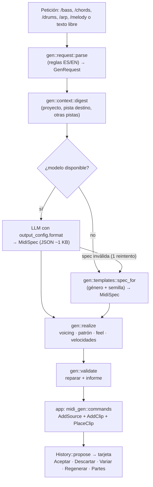

# 22 — Generador especialista de MIDI (asistente de IA)

> Fecha: 15 de noviembre de 2026. Estado: **investigación y diseño, nada implementado**. Este documento está pensado para que otro agente lo ejecute sin volver a investigar.
>
> Convención de evidencia: **[V-código `ruta:línea`]** leído en el repositorio; **[V-web Wn]** leído en la fuente web (lista al final); **[débil Wn]** solo visto en el resumen de un buscador o en un blog comercial; **[S]** supuesto mío (convención musical o decisión de diseño que hay que afinar de oído).

---

## 0. Resumen

- Hoy el asistente solo sabe convertir una respuesta del modelo en una propuesta de **mezcla** (`llm/mix.rs`). No genera notas. Lo más parecido es `crates/ai/src/theory.rs` (progresiones, bajos, arpegios, baterías por reglas), que **ninguna parte de la app usa** [V-código: `grep` de `aitrack_ai::theory` sin resultados fuera del propio módulo] y que suena plano: velocidades fijas, sin swing, sin conciencia del bombo, sin semilla (salvo el arpegio aleatorio).
- Diseño propuesto: el **modelo decide la intención musical y devuelve una "spec" pequeña** (acordes con calidad y extensión, patrones de pasos con clases de acento, contorno de motivo); el **código la convierte en notas** (voicing con conducción de voces, swing, microtiming, velocidades, rangos), la **valida y la repara**, y la ofrece como **propuesta** con la misma maquinaria de `/mix`. Sin modelo, el mismo código parte de **plantillas por género** elegidas con semilla.
- Correcciones a la apuesta del dueño (sección 3.1): (1) la spec no puede ser solo "grados de la escala": los acordes necesitan raíz con alteración + calidad + extensión, y las escalas pentatónicas/blues/cromática no sirven para apilar terceras; (2) "todas las notas en la escala" es un invariante demasiado estricto, hay que permitir excepciones **declaradas** (dominante con sensible en menor, notas de aproximación); (3) el groove no es un parámetro que el modelo deba elegir en números: elige una etiqueta de "feel" y el código aplica tablas por género; (4) la spec debe incluir el *ritmo* (patrón de pasos), porque ahí está la diferencia entre genérico y bueno.

---

## 1. Parte A — Lo que ya existe (verificado en el código)

### 1.1 Asistente y propuestas

| Pieza | Dónde | Qué hace / límite |
|---|---|---|
| Persona y contexto | `crates/ai/src/llm/context.rs:12-15` (`PERSONA`), `:155-199` (`producer_context`) | Texto con nombre, tonalidad (`Key/scale`), tempo, compás, loop, pistas con dispositivos, enrutado y clips; "pista seleccionada"; adjuntos. |
| Qué sabe de las notas | `context.rs:77-93` (`describe_clip`) | De un clip MIDI solo da **número de notas y rango de teclas** (`:80-83`). No da acordes, ritmo, ni dónde cae el bombo. **Es la laguna principal** para que una línea nueva encaje. |
| Cliente | `crates/ai/src/llm/anthropic.rs:40-70` (`body`) | Solo envía `model`, `max_tokens`, `stream`, `messages`, `system` y `fallbacks`. **No envía `output_config`** (salida estructurada). Solo streaming de texto. |
| Modelos | `llm/mod.rs:88-92` | Opus 5.5 (por defecto), Sonnet 5.5, Haiku 5.5. |
| Sin modelo | `llm/mod.rs:95-109` (`Offline`) | Solo responde "No model configured". La lógica offline de `/mix` está en la app, no aquí. |
| Patrón a seguir | `llm/mix.rs:86-91` (`INSTRUCTIONS`), `:94-111` (`parse_reply`: último bloque ```json), `:67-82` (`clamped`), `:159-182` (`heuristic`, plan por reglas sin modelo), `:128` (`role` por nombre de pista) | Texto + un bloque JSON; se recorta todo a rangos válidos; si no hay modelo o no hay plan válido, se cae a reglas. |
| Menú `/` | `crates/app/src/views/ai_panel/slash.rs:41-53` (`Action`), `:68-82` (`ENTRIES`), `:9-16` (`Tab`, existe `Tab::Midi`) | Añadir una acción es una entrada más; `commands_are_unique` (`:175`) obliga a comando único. |
| Ejecución de `/mix` | `ai_panel/state.rs:303` (`run`), `:345` (`A::MixTrack`), `:362` (`mix_track`: con modelo → `send(.. Some(track))`, sin modelo → reglas), `:382` (`propose_mix`), `:655` (`send`; añade `INSTRUCTIONS` al *system* en `:703-707`), `:808-820` (al terminar el stream: `parse_reply` → propuesta, o reglas si no hay plan), `:845` (`visible_reply` oculta el JSON) | El marcador `mix: Option<TrackId>` viaja en `Item::Reply` (`:81`). |
| Propuesta como tarjeta | `ai_panel/mix.rs:40-78` (plan → `Vec<Command>`), `:81-104` (`summary`); `workspace.rs:241-248` (`ChatEntry::Proposal`), `:234-238` (`ProposalStatus`), `:1986-2000` (`resolve_proposal`), `:2851-2865` (`proposal_entry`); `ai_panel/mod.rs:569-607` (tarjeta con solo **Accept / Discard**) | No hay "escuchar", ni "variar", ni partes. |
| Historia | `crates/model/src/history.rs:34-39` (`Proposal`), `:43-47` (`preview` sobre un clon), `:256` (`propose` valida contra un clon), `:269` (`accept` = un paso de deshacer), `:276` (`discard`) | Un `Origin::Feature("…")` o `Agent(..)` por propuesta. `apply` borra la pila de rehacer (`:189`). |
| Audio→MIDI como propuesta | `workspace.rs:2345-2366` (`MidiReady` → `midi_track_commands` + `PlaceClip` → `propose`) | Ejemplo exacto de "notas → pista nueva + clip + colocación" ya aceptado por el dueño. |
| Ayudante de pista MIDI | `crates/app/src/state.rs:2449-2477` (`midi_track_commands`) | Toma tuplas `(key, start, len, vel)`: **no puede llevar `slide`, `probability`, escala de clip**; fija un Wavetable. Para el generador hace falta uno propio. |
| Detección de pista de batería | `state.rs:2483` (`is_drum_track`), `:2490` (`drum_pads`: nombre, color, nota de cada pad) | Permite mapear "bombo/caja/hat" a la nota real del rack. El kit de ejemplo usa 36/38/39/42/46/37/45/51 (`demo.rs:125-134`). |

### 1.2 Modelo del proyecto

- `Note` (`crates/model/src/project.rs:553-`): `key u8`, `start`/`length` en ticks, `velocity f32 0..1`, `release`, `probability`, `pan`, `fine_pitch`, `slide`, `muted`. `NoteSource.notes` va ordenado por inicio y tecla (`:541`).
- `PPQ = 960` (`time.rs:8`): corchea 480, semicorchea 240, tresillo de corchea 320, fusa 120. `TimeSignature::bar_ticks` en `time.rs:27`.
- `Clip` (`project.rs:387`): `offset`, `length`, `looping`, `scale: Option<Scale>` (escala propia del clip) y fades. **El piano roll ignora `offset`: los clips de notas deben guardar las notas desde el tick 0** (memoria del proyecto "piano-roll-ignores-offset").
- Comandos (`command.rs`): `AddSource` (`:133`, aplica `:369`), `AddClip` (`:138`, `:395`), `PlaceClip` (`:142`, `:415`), `AddNotes` (`:147`, `:464`), `UpdateNotes`, `RemoveNotes`, `SetSessionSlot` (`:145`), `Batch` (`:194`). Todos invertibles.
- `Scale` (`model/src/scale.rs`): 13 `ScaleKind` (`:43-57`), `mask` (`:126`), `contains` (`:133`), `snap` al más cercano **prefiriendo bajar** en empates (`:138`), `degree_to_note` (`:147`). Hay **7 escalas de 7 notas, 3 pentatónicas/blues y la cromática**: apilar terceras con `degree + 2k` solo tiene sentido en las de 7 notas (ver 1.3).
- **No existe groove/swing en el modelo ni en el motor**: el swing de los dispositivos MIDI (`stock/src/midi/arp.rs`, `echo.rs`, `stutter`) es por dispositivo. Por tanto el swing de lo generado **tiene que ir horneado en los ticks** [V-código: `grep -i swing` en `crates/model` y `crates/engine` sin resultados relevantes].
- El motor respeta `Note.probability` (`crates/engine/src/clip.rs:647`, RNG propio) y **no usa `Note.slide`** (sin coincidencias en `crates/engine`): la bandera `slide` que pone `theory.rs:287` (Trap808) hoy no suena distinto.

### 1.3 Motor de teoría actual (`crates/ai/src/theory.rs`) y sus carencias

- `Degree { degree, size }` (`:13`): acorde apilado por terceras **dentro de la escala**. En `MinorPentatonic` (`[0,3,5,7,10]`) el "tríada" de grado 0 da 0,5,10 semitonos: no es una tríada. Para armonía hace falta una **escala-padre de 7 notas**.
- Solo calidades diatónicas (3, 4 o 5 notas por terceras). No hay `min9`, `add9`, `maj9`, `sus`, `m6`, dominante con sensible en menor, ni alteraciones (♭II frigio, ♭VI prestado…). `ChordQuality` (`chords.rs:14-25`) tiene 9 calidades sin novenas; sirve como base de nombres/intervalos.
- `voice_lead` (`:163-191`): elige la inversión cuyo **centro de gravedad** esté más cerca del acorde anterior. No mira el salto de la voz superior, no evita paralelas, no respeta rango. El test solo exige `span <= 14` (`:296-299`).
- `progression` (`:194`): bloques, velocidad fija 0.75, todas las notas con la misma duración. `bassline` (`:232`): 5 estilos con velocidades fijas (0.8/0.85/0.9/0.95), `Offbeat` en corcheas de contratiempo (`:264`), sin saber dónde está el bombo. `arp` (`:316`): acento cada 4 notas (0.85 / 0.7), el único con semilla (`ArpPattern::Random`, xorshift).
- `drum_pattern` (`:409`): 4 estilos, 4/4 fijo con 16 pasos, velocidades constantes por instrumento (p. ej. hats 0.45 en pasos impares), longitud `s/2` para todo, sin swing ni variación por compás salvo el golpe de crash y el redoble del trap.
- `all_in_scale` (`:503`) es el único validador y no mira rangos, solapes ni límites del clip.
- `Scale::snap` prefiere bajar en empates: para reparar un bajo conviene preferir el **tono de acorde** más cercano, no el de escala.

### 1.4 Otras piezas reutilizables

- `crates/ai/src/midi/mod.rs:97` `events_to_notes` ya sabe cuantizar y ajustar a escala/rango; `midi/drums.rs:9-12` define las notas GM usadas (36/38/42/46).
- `key.rs` (Krumhansl-Kessler + Temperley) y `analysis.rs` dan la tonalidad de audio; `AudioSource.key` (`project.rs`) la guarda por fuente. Útil cuando el proyecto no tiene `scale`.
- `crates/stock/src/midi/*` (`arp`, `chord`, `scale`, `random`, `velocity`, `echo`, `length`, `pitch`) son **dispositivos** MIDI en tiempo real; no se tocan.
- Render sin conexión para escuchar comparativas: `crates/engine/src/export.rs:310` (`render_clips`) usa el mismo grafo que la reproducción.
- El servidor MCP (`create_midi_clip`, etc.) **no está hecho**: `docs/PENDING.md` §2 lo lista como pendiente. Los comentarios de `theory.rs:1-3` que hablan de "MCP tools" son aspiracionales.

### 1.5 Lo que NO está verificado

- Que `instrument.acid303` interprete notas solapadas como *slide* (su parámetro `SLIDE` existe, `stock/src/instrument/acid303.rs:273`, pero no he leído cómo decide el legato). Comprobar antes de generar notas solapadas para ese instrumento.
- Si hay forma de reproducir un proyecto "de prueba" en el motor sin tocar el proyecto activo (ver 6.4: se propone aplicar-y-deshacer).
- Cómo se comporta `History::undo` si el usuario edita entre medias (ver 6.4: se protege por revisión).

---

## 2. Parte B — Qué hace que un MIDI generado suene bien

Notas de método: muchas fuentes de producción son blogs; los números son **puntos de partida para afinar de oído**, no estándares. Lo marcado [S] es convención mía.

### 2.1 Armonía

Reglas aplicables:

1. **Acordes de séptima como mínimo en house/deep/tech/pop electrónico.** Los acordes típicos de deep house son 7.ª construidos con fundamental, 3.ª, 5.ª y 7.ª, y se añaden 9.ª y 11.ª como extensión habitual [V-web W1]. En el módulo menor, `m7` es el mínimo y `m9` da brillo [débil W12]. Techno y trance suelen usar tríadas, un solo acorde o un vaivén de dos acordes [S].
2. **Bucle de ejemplo verificable por teoría, no por autoridad:** Am7 – Dmaj7 – E9 – Am7 (i7 – IVmaj7 – V9 – i7, con IV mayor de dórica y V con sensible) [débil W12]. Implica que el generador necesita *alteraciones por acorde* (la 3.ª mayor del V en menor) y no solo grados diatónicos.
3. **Conducción de voces (algoritmo de coste, sección 5.3):**
   - conservar las **notas comunes** en la misma voz (p. ej. D de Dm7 a G7) y mover el resto por grado conjunto o el semitono más cercano [V-web W1, débil W11];
   - la voz **más aguda es la que más se oye** como melodía: debe moverse por grado conjunto o salto pequeño [V-web W1];
   - **evitar quintas y octavas paralelas**, sobre todo entre bajo y voz superior; entre voces interiores y con séptimas en música electrónica es tolerable [débil W11 para la regla clásica; la relajación es [S]];
   - acordes con **voicings compactos** (la 7.ª bajada una octava mantiene el acorde compacto) y quitar notas (la 5.ª) antes que perder la 7.ª [V-web W1];
   - movimiento contrario respecto al bajo cuando no hay notas comunes [débil W11].
4. **Relación con la tonalidad y el modo:** los acordes se construyen sobre la **escala-padre de 7 notas** de la escala del proyecto (menor natural, dórica, frigia, mayor, lidia, mixolidia, menor armónica/melódica; para pentatónicas/blues se usa la menor/mayor natural como padre; cromática obliga a elegir una) [S]. Las notas ajenas a la escala son legales solo si el acorde las declara (sensible del V, ♭II frigio, ♭VI/♭VII prestados) [S].
5. **Notas a evitar:** 11.ª natural sobre acorde mayor (choca con la 3.ª; usar #11 o `sus`), dos segundas menores seguidas en el registro grave (< C3) [S].

Progresiones por género (**[S]**, salvo las dos presets ya presentes en `theory.rs:70-87`). Notación en menor; el generador las expresa como grado + alteración + calidad:

| Género | Bucles típicos | Ritmo armónico |
|---|---|---|
| Deep house | i7 – iv7 – ♭VII7 – ♭IIImaj7 · i9 – ♭VImaj7 – ♭VII9 – i9 · i7 – IVmaj7(dórica) – V9 – i7 | 1 acorde por compás o 2 compases; stabs sincopados |
| House (piano/clásico) | I – V – vi – IV · vi – IV – I – V · i – ♭VI – ♭III – ♭VII | 1 compás |
| Tech house / techno | 1 acorde (i7) o vaivén i7 – ♭VII; frigio i – ♭II | 2–4 compases |
| Trance / progresivo | i – ♭VI – ♭III – ♭VII (`EpicMinor`, `theory.rs:93`) | 1 compás |
| Pop electrónico | I – V – vi – IV · vi – IV – I – V | 1 compás |
| Trap / drill | i – ♭VI – ♭VII – i (`theory.rs:104`) | 1–2 compases |

### 2.2 Ritmo y groove

**Rejilla en ticks (PPQ 960):** semicorchea 240, corchea 480, 1/32 = 120, tresillo de corchea 320. 1 ms = `bpm × 0,016` ticks (a 124 BPM, 1 ms ≈ 2 ticks; una semicorchea ≈ 121 ms).

**Swing.** Convención Linn/MPC/Logic/Reason: 50 % recto; el porcentaje es la parte del par (dos semicorcheas) que ocupa la primera; 66 % es tresillo; Logic nombra 16A–F como 50, 54, 58, 62, 66 y 71 %; Cubase y FL usan 0–100 % donde 100 % ≈ 66,6 % Linn; Ableton mezcla ambas en su Groove Pool [V-web W2]. Por eso **el generador usa siempre la convención Linn** y guarda el valor así.
Retraso de la segunda semicorchea del par: `delay = (swing − 0,5) × span_del_par`, con `span = 480` ticks para swing de semicorcheas y `960` para swing de corcheas. Con 960 PPQ: 54 % → 19 ticks, 58 % → 38, 62 % → 58, 66 % → 77 (a 124 BPM, 54 % ≈ 9,7 ms).
Cantidades por género [V-web W4, débil W13]: techno ninguno o casi; house 52–56 % (deep house más que tech house); lo-fi/hip-hop 55–60 %; DnB poco swing global; trap mínimo en el patrón principal y variación de tiempo en los redobles. Hay discrepancia entre fuentes (52–56 vs 55–60 para house/deep): se usa 54 % de partida. **Se hace swing a hats, shakers y percusión; bombo y caja/clap quedan rectos**; el bajo recto salvo que la fuente lo pida [débil W13; las fuentes no coinciden sobre swinguear el bajo, por defecto no].

**Microtiming (valores [S], a afinar).** Una fuente da desplazamientos en "ticks" sin decir el PPQ, así que solo sirve el orden de magnitud: bombo ligeramente adelantado en techno, caja/clap ligeramente atrasada en hip-hop/downtempo, deriva aleatoria pequeña en hats [V-web W4]. Valores propuestos en ms (el código los convierte con el tempo del proyecto):

| Papel | Desplazamiento | Jitter aleatorio |
|---|---|---|
| Bombo | 0 (techno: −2 ms) | ±1 ms |
| Caja / clap | 0 (hip-hop, downtempo: +4…+8 ms) | ±1,5 ms |
| Hats cerrados / shaker | 0 | ±4 ms |
| Percusión | 0 | ±3 ms |
| Bajo | 0 respecto al bombo | ±1 ms |
| Acordes | strum bajo→alto 0–10 ms entre voces si el estilo lo pide (pads/pianos) | ±2 ms |

Un dataset para calibrarlo con datos reales: **Groove MIDI Dataset** (13,6 h, 1.150 ficheros, 22 000+ compases, 10 baterías, Roland TD-11, **CC BY 4.0**, alineado a 2 ms) [V-web W7]. Es de rock/jazz/funk, no de electrónica, así que no es plantilla de género, pero sirve de referencia de dispersión de timing y de velocidad. Es una mejora opcional (fase 2).

**Qué se cuantiza y qué no.** Lo generado nace en la rejilla; después se aplica swing + microtiming **solo** a los papeles sueltos. Como el piano roll cuantiza a rejilla, hay que ofrecer **"Humanizar: sí/no"** para regenerar sin desplazamientos [S]. Una fuente propone cuantizar bombo y caja al ~100 % y hats/percusión al 50–75 % en material grabado [V-web W4]: el equivalente en generación es "recto" para los primeros y "jitter" para los segundos.

**Posiciones por género** (pasos de 0 a 15 por compás en 4/4; **[S]** salvo donde se cita):

| Género (BPM) | Bombo | Caja / clap | Hats y percusión |
|---|---|---|---|
| House (120–126) | 0,4,8,12 [V-web W4] | clap 4,12 [V-web W4] | cerrados en contratiempos 2,6,10,14; abierto en el "y" de 2 y 4 (6 y 14) [V-web W4]; semicorcheas flojas entre medias |
| Tech house (124–128) | 4×4 | clap 4,12 + rim sincopado | 16avas con swing 54 %, shaker; bajo "rodante" de 3 notas [débil W13] |
| Techno (128–135) | 4×4, algo adelantado [V-web W4] | rim/tom en 2 y 4 en lugar de clap [V-web W4] | 16avas muy bajas con acentos en contratiempos, ride en corcheas [V-web W4]; sin swing |
| Trance / progresivo (126–138) | 4×4 | clap 4,12 | hats abiertos en contratiempo, bajo en contratiempos |
| DnB (170–176) | 0 y 10 (el texto de la fuente dice "paso 10" pero su numeración parece 1-based; se usa 0 y 10, que coincide con la plantilla `Breakbeat` de `theory.rs:226`) | 4 y 12, fantasmas en 2,6,10,14 [V-web W4, interpretación [S]] | 16avas continuas con variación de velocidad [V-web W4] |
| Dubstep / half-time (140) | 0 | 8 | hats 8avas |
| Trap (130–160, medio tiempo) | 0, 7, 10 (variable) | clap+caja 8 | 16avas con redobles de 1/32 y rampas de velocidad; 808 melódico [V-web W4] |
| UK garage 2-step (130–135) | 0 y 10 (las fuentes dudan entre 10 y 11 y un tercero en 14) | 4,12 | 16avas con swing; la discrepancia es real, ver W14 |
| Dembow / reggaeton | 0,4,8,12 | caja 3,6,11,14 (`theory.rs:164`) | corcheas |

### 2.3 Velocidades y acentos

Escala MIDI 0–127 (`Note.velocity` 0..1 = valor/127). Tramos usados por fuentes de programación de baterías [V-web W4]: pulsos principales de hat 110–127, contratiempos de corchea 70–90, semicorcheas intermedias 40–60, **fantasmas 15–35**, bombo y caja a velocidad casi llena, variación aleatoria de hat 10–20 %, redobles de trap con acentos llenos y el resto al 30–50 %.

El generador no deja que el modelo elija números: el modelo marca un **acento 0–4** por golpe y el código lo traduce con tablas por papel/género y jitter [S]:

| Acento | Nombre | Velocidad (de 127) | Uso |
|---|---|---|---|
| 0 | fantasma | 18–35 | caja fantasma, hat de relleno |
| 1 | flojo | 42–62 | semicorchea intermedia |
| 2 | normal | 70–90 | contratiempos, notas de bajo normales |
| 3 | acento | 98–115 | tiempos fuertes, entrada de frase |
| 4 | pico | 118–127 | bombo, golpe de crash, nota de entrada del bajo |

Jitter: hats ±10–20 % del valor [V-web W4]; resto ±3–6 % [S]; bombo casi constante (σ ≤ 0,03).

### 2.4 Líneas de bajo

- **Hueco con el bombo.** Para bajo "rodante" de semicorcheas: **dejar libre la primera semicorchea de cada tiempo** (pasos 0, 4, 8, 12) y llenar casi todo el resto con la fundamental, con notas ocasionales distintas [V-web W5]. El bajo en contratiempo (pasos 2, 6, 10, 14) es la relación más sencilla [débil W13]. En trap/808 el bajo **sustituye** al bombo y se bloquea con él a propósito [S].
- **Sidechain** como complemento, no sustituto: liberación 50–100 ms para ducking transparente y 150–300 ms para bombeo [V-web W6]. Es mezcla, no MIDI, pero afecta a la longitud: **notas cortas sobre los pasos del bombo y largas en los contratiempos** [débil W13].
- **Notas:** fundamentales y quintas funcionan mejor, terceras con cuidado, **evitar segundas menores y tritonos en el sub** (< ~80 Hz ≈ MIDI 39) [V-web W6]. Octavas saltando en corcheas es un recurso típico de bajo pop/EDM [S]. Notas de paso por grado conjunto, solo en pasos débiles y hacia el siguiente acorde (aproximación cromática de un semitono, declarada) [S].
- **Registro:** la fundamental del ejemplo de bajo rodante es G2 (≈ 98 Hz, MIDI 43) [V-web W5]; sub entre E1 (28) y ~E2 (40); bajo melódico E1–G3 (28–55) [S].
- **Longitud y legato:** puerta del 60–90 % del paso en bajo rodante; 808 con nota completa hasta la siguiente; sub con liberación corta de 50–100 ms para evitar chasquidos [V-web W6]; monofónico **sin solapes** salvo glide declarado (el motor no usa `slide`, 1.2).

### 2.5 Melodía y arpegios

Reglas con respaldo débil (blogs y divulgación) [débil W10] más convención [S]:

- **Rango estrecho** (en torno a una octava, hasta 9.ª) y **movimiento mayoritariamente por grados conjuntos**; los saltos grandes son raros y se resuelven en sentido contrario [débil W10, S].
- **Repetición con variación:** un motivo de 2–4 notas se repite en el compás 2 y se cambia **una cosa** (la última nota o el ritmo) en el 3 o 4 [débil W10].
- **Contorno** reconocible (arco, ascendente, descendente, ola) porque se recuerda la forma más que los intervalos exactos [débil W10].
- **Ritmo:** la síncopa y el contratiempo hacen gancho; un patrón rítmico puede ser el gancho por sí solo [débil W10]. En electrónica es normal repetir la misma nota.
- **Tensión y resolución:** tiempos fuertes sobre notas del acorde, tensiones (9.ª, 11.ª, 13.ª) en tiempos débiles, frase que termina en 1, 3 o 5 (cierre) o en 2 o 5 (pregunta) [S].
- **Arpegios:** orden por altura (arriba, abajo, ida y vuelta, "random" con semilla), paso 1/16 o 1/8, puerta 50–80 %, 1–2 octavas, **acentos agrupados 3-3-2** o en el primer paso de cada tiempo en lugar de velocidad constante [S]. Evitar el arpegio "perfecto" sin una nota omitida o una octava cambiada cada 2 compases.

### 2.6 Rangos y realismo (todo [S], convención)

| Papel | Rango MIDI | Polifonía | Duración mínima |
|---|---|---|---|
| Sub / 808 | 24–48 | 1 | 1/32 (120 ticks) |
| Bajo | 28–55 | 1 (sin solapes) | 1/32 |
| Acordes / pad / piano | 48–79 (voz superior ≤ 76) | 3–5 (4 por defecto) | 1/16 |
| Lead / melodía | 60–88 | 1 | 1/32 |
| Arpegio / pluck | 55–91 | 1 (secuencial) | 1/32 |
| Batería | notas del rack (`drum_pads`) o GM | 1 golpe por pad y paso | 1/32; el hat abierto necesita longitud para su choke |

Un compás de 4/4 con semicorcheas completas llega a 16 golpes por papel; densidades razonables por compás: bajo 4–16, acordes 3–20, batería 20–60 notas en total [S].

### 2.7 Cómo lo resuelven otras herramientas y qué NO hacer

| Herramienta | Qué hace | Críticas / lección | Fuente |
|---|---|---|---|
| **Live 12** (Rhythm, Seed, Shape, Stacks, Euclidean) | Rellena todo el clip con notas; casi todo es pseudoaleatorio ("no AI"); Seed respeta la escala del clip y tiene voz, rango y polifonía; Stacks es determinista (raíz, inversión, 15 tipos, hasta 4 acordes); Rhythm tiene "split %" para variar | Al cambiar parámetros **se apilan notas nuevas sobre las anteriores**; las notas siguen seleccionadas al cambiar de tambor; Euclidean comparte parámetros entre notas; nombres de acordes en letra minúscula | [V-web W3] |
| **Captain Plugins** (Mixed In Key) | Acordes, melodía, bajo, batería y arpegio coordinados | Melodías flojas, pocas progresiones de fábrica, a veces pierde los acordes usados y se desincroniza; falta editar nota a nota dentro de la herramienta | [débil W15] |
| **Scaler 3** | Biblioteca enorme de teoría, sugerencias "seguras" vs "experimentales" por color | Las sugerencias **cambian al editar un acorde** y se pierden las ideas; arrastrar es incómodo; críticas de estabilidad | [débil W15] |
| **Orb Producer / Orb Composer** | Acordes, melodía y bajo con control de densidad | Una reseña de Orb Composer 1.5 dice que la salida puede ser muy aleatoria y que encaja mal en pop/house; sin reseñas sólidas de Producer Suite | [débil W15] |
| **InstaChord** | — | No encontré fuente fiable: **sin verificar** | — |
| **Magenta** (GrooVAE, GMD) | Un modelo añade timing y velocidad a una batería cuantizada, entrenado con 13 h de baterías humanas | Es humanización, no composición; el dataset no es de electrónica | [V-web W7] |
| **LLMs con MIDI crudo** | — | Los modelos de lenguaje tienen problemas de estructura y simetría con secuencias MIDI largas y rinden mejor con notación compacta (ABC) | [débil W9] |

**Qué NO hacer** (derivado): no apilar notas nuevas sobre las viejas al variar; no cambiar partes que el usuario quiere conservar cuando se regenera otra; no presentar azar como inteligencia; no escribir ticks ni MIDI crudo desde el modelo; no esconder el nombre del acorde ni la razón; no generar sin mirar lo que ya suena.

---

## 3. Parte C — Diseño

### 3.1 Reparto modelo / código (evaluación de la apuesta)

**Veredicto: la apuesta es correcta en lo esencial, con cuatro correcciones.**

| Decide el modelo (intención y "composición simbólica pequeña") | Decide el código (ejecución y garantías) |
|---|---|
| Género, carácter, densidad, energía, longitud en compases | Rejilla, ticks, tempo, compás |
| Secuencia de acordes: raíz (grado + alteración), calidad, extensión, duración | Escala-padre, voicing, inversiones, conducción de voces, rango |
| Ritmo: patrón de pasos con clases de acento 0–4 (o nombre de un patrón del catálogo) | Velocidad real, swing, microtiming, duración de puerta, fantasmas |
| Motivo de melodía/bajo: grados relativos al acorde o a la escala, contorno, dónde descansa | Octavas, notas de paso, solapes, monofonía, ajuste a escala y rango |
| Una frase corta de justificación para mostrar | Validación, reparación, semilla, comandos, deshacer |

Correcciones:

1. **La spec no es solo grados de escala.** Hace falta `raíz = grado + alteración (−1/0/+1)`, `calidad` y `extensiones`, para poder expresar V9 con sensible en menor, ♭II frigio o ♭VI prestado (2.1). Para escalas de 5-6 notas y la cromática el código usa una escala-padre de 7 notas (1.3).
2. **Invariante de escala con excepciones declaradas.** "Todas las notas en la escala" como regla dura rompería el V de menor armónica y las notas de aproximación. Regla: toda nota está en la escala **o** está declarada (tono de un acorde con alteración, aproximación cromática, nota de blues) y las declaradas no superan un tope (≤ 10 % de las notas del papel, nunca en tiempo fuerte salvo tono de acorde).
3. **El modelo no pone números de groove.** Elige `feel` entre `straight | light_swing | swing | shuffle | loose` y el código aplica las tablas por género y tempo (2.2, 2.3). Así no depende de que el modelo acierte con porcentajes ni ticks, y todo el groove es reajustable con un interruptor.
4. **La spec incluye el ritmo.** Es lo que separa un resultado genérico de uno bueno (2.2, 2.4). Se pide como cadena de pasos o nombre de patrón, no como ticks.

Otras decisiones:

- **Salida estructurada de la API.** `output_config.format` con `type: json_schema` está estable y también funciona con streaming (hay que acumular la respuesta completa antes de parsear); no admite `minimum/maximum/minLength/maxLength`, ni esquemas recursivos, ni `minItems` > 1, y `additionalProperties` debe ser `false` [V-web W8]. Consecuencia: el esquema solo declara tipos y `enum`; **los límites (longitudes, rangos) se aplican en `clamped()`**, como ya hace `mix.rs:67-82`. Si la API devuelve 400 por esquema, se reintenta una vez con la instrucción en texto y bloque ```json (el camino de `mix.rs:94`).
- **Modelo por defecto para esta función:** Sonnet 5.5 o Haiku 5.5 bastan para una spec de ~1 KB; Opus (`llm/mod.rs:88`) es más lento y caro [S]. Se añade un campo de preferencia o se usa el modelo elegido por el usuario.
- **Un reintento máximo** al modelo, solo si la spec no parsea o no tiene contenido útil. Los fallos musicales (fuera de escala, solapes…) los repara el código, no el modelo: es más rápido y determinista.
- **Ubicación del código:** módulo nuevo `crates/ai/src/gen/` (junto a `theory.rs` y `llm/mix.rs`, solo depende de `aitrack-model`, `serde`, `serde_json`). `theory.rs` se mantiene un tiempo y luego se reduce a envoltorios de `gen` (no lo usa la app, 1.0). Si el tiempo de compilación de los tests molesta, se extrae a `crates/compose` más adelante.
- **PRNG:** a mano (splitmix64 para derivar semillas + xoshiro/xorshift para el flujo); el repo no depende de `rand` (`crates/ai/Cargo.toml`) y `theory.rs:71-76` ya usa xorshift.

### 3.2 Flujo



Una única función `realize(spec, ctx, seed)` es el corazón; modelo y plantillas solo producen la `spec`. Eso garantiza que **lo que suena offline y online pasa por las mismas garantías**.

### 3.3 Peticiones del usuario

`GenRequest { kind, genre, bars, key: Option<Scale>, density: 0..1, energy: 0..1, feel, humanize: bool, target: TargetHint, seed: Option<u64>, free_text }`.
`kind ∈ {chords, bass, drums, arp, melody, perc}`.

Formas reconocidas por `parse` (reglas por palabras clave en español e inglés, con sinónimos; si hay modelo, el texto completo viaja también al modelo):

- "un bajo rodante en La menor de 2 compases" → `bass, techno/tech house, rolling, A minor, 2 bars`.
- "acordes para el drop" → `chords`, `energy` alta, 4 compases, `genre` desde el proyecto o pregunta por defecto.
- "un patrón de hats con swing" → `drums` solo capa hats, `feel = swing`.
- "un arpegio ida y vuelta de 1/16 sobre estos acordes" → `arp`, patrón, fuente de acordes = pista adjunta.
- Palabras de densidad ("más denso", "más aireado"), "más oscuro/brillante" (modo: frigio/dórico, registro), "con síncopa", "sin swing" (`humanize=false`).

Devolver siempre una línea visible de interpretación: *"Bajo · tech house · La menor · 2 compases · rodante"*, editable al regenerar.

Entradas de menú (en `slash.rs`, `Tab::Midi`): `Action::Generate(GenKind)` con comandos `chords`, `bass`, `drums`, `arp`, `melody` (únicos, test `commands_are_unique` `slash.rs:175`). Con texto después del comando se usa como petición; sin texto se usa la pista seleccionada y los valores del proyecto. Las palabras clave incluyen español ("bajo", "acordes", "batería", "arpegio").

### 3.4 Qué ve el usuario

Una **tarjeta de propuesta** nueva (`ChatEntry::MidiProposal`, variante de `ChatEntry::Proposal`, `workspace.rs:243`) con:

- título "Bass · tech house · A minor · 2 bars", origen ("Claude Sonnet 5.5" o "Plantilla"), tamaño ("18 notas · rango A1–E2 · swing 54 %");
- miniatura de piano roll (barras `div` con colores del tema `theme.rs`, sin `rgb()` sueltos, espaciado múltiplo de 4);
- hasta 2 líneas de razón ("evita los pasos del bombo; fundamental con quinta en el paso 14");
- **botones:** Escuchar (6.4), Aceptar, Variar (misma spec, semilla nueva), Regenerar (llamada nueva al modelo con la spec anterior como "evitar repetir"), Descartar; **candados por parte** (capa/compás) para "quedarme con esta";
- chips editables de la interpretación (género, compases, tonalidad, densidad, humanizar).

Aceptar produce **un paso de deshacer** (`History::accept`, `history.rs:269`). Variar y Regenerar descartan la propuesta pendiente y crean otra; las partes con candado conservan sus notas idénticas porque cada parte deriva su propia semilla (3.6).

### 3.5 Contexto para el modelo (bloque `# MIDI context`)

Nueva función `gen::context::digest(project, target, region) -> ProjectDigest` + `fn to_prompt(&ProjectDigest) -> String` (≤ ~1,5 KB, máx. 6 pistas) añadida a `producer_context` solo en peticiones de generación:

- Tonalidad: nombre **y** clases de altura de la escala (`Scale::mask`, `scale.rs:126`). Si `project.scale` es `None`: intentar `Clip.scale`, luego `AudioSource.key` de clips de audio (`project.rs`), y si no, decirlo y dejar que el modelo elija; el clip generado lleva `Clip.scale = Some(..)` (no se cambia la escala del proyecto) [S].
- Tempo inicial, cambios de tempo (si los hay), compás, longitud pedida en compases y región destino (compás de inicio).
- **Pista destino:** nombre, tipo (`TrackKind`), papel (reutilizar `mix::role`, `mix.rs:128`, y mirar dispositivos: rack de batería → `drum_pads`; `instrument.acid303`/`kick808` → bajo; `instrument.wavetable`/`vault`/`sampler` → según nombre), mapa de pads si es batería.
- **Otras pistas que suenan en la región:** por pista, papel, nº de notas, rango, polifonía, clases de altura, **acorde por compás** (coincidencia de clases de altura con `ChordQuality::intervals`, `chords.rs:39`, ampliado) y **ocupación rítmica en cuadrícula de 16 pasos** (`x...x...x...x...`) — de ahí salen los pasos del bombo para el bajo y la armonía para el lead.
- Los nombres de pista y de clip son **datos, no instrucciones** (igual que `mix.rs`); el prompt lo dice explícitamente.

### 3.6 Determinismo y variación

- `GenSeed(u64)`, `GENERATOR_VERSION: u32`. Resultado = f(spec, digest, seed, versión).
- Semillas por parte: `sub = splitmix64(seed ^ hash(role_id, bar, layer))`; editar o bloquear una capa no desplaza el azar de las demás.
- **Variar** = semilla nueva, misma spec: cambia voicing entre candidatos casi óptimos, fantasmas, adornos, redoble final, octavas del bajo.
- **Regenerar** = spec nueva (modelo) o plantilla distinta (offline), manteniendo candados.
- La API del cliente no envía parámetros de muestreo (`anthropic.rs:40-70`): el modelo no es reproducible; por eso se **guarda la spec JSON** junto con la semilla en la tarjeta (sesión de chat). Persistir en el proyecto exigiría metadatos de clip (no existen); fuera de alcance (fase 2).

### 3.7 Sin conexión

Funciona **todo** lo que tenga plantilla: acordes (≥ 6 bucles por género en 6 géneros), bajos (8 estilos), baterías (9 géneros), arpegios (6 patrones), melodías (generador de motivo por contorno). Se entra por la misma tarjeta; el origen dice "Plantilla" (igual que "Rules" en `/mix`, `state.rs:372-376`). Lo que no hace sin modelo: interpretar peticiones libres complejas ("algo que recuerde a…") y coordinar con descripciones textuales; el `parse` por reglas cubre las peticiones habituales.

### 3.8 Formato de la spec (esquema)

Sin recursión, sin `min/max` (3.8). Todos los campos con valores por defecto en `serde` para tolerar omisiones. Esquema lógico:

```json
{
  "kind": "bass | chords | drums | arp | melody | perc",
  "genre": "house | deep_house | tech_house | techno | trance | dnb | dubstep | trap | uk_garage | reggaeton | pop | other",
  "bars": 2,
  "feel": "straight | light_swing | swing | shuffle | loose",
  "energy": "low | mid | high",
  "chords": [
    { "bar": 0, "beat": 0, "beats": 4, "root": 0, "alter": 0, "quality": "min7",
      "ext": ["9"], "bass": null }
  ],
  "layers": [
    { "role": "bass | chord | arp | lead | kick | snare | clap | hat | open_hat | perc | crash",
      "pattern": "rolling | offbeat | octaves | root_fifth | stabs_offbeat | sync_332 | whole | custom",
      "steps": "x.1..2.x..3.x...",
      "accents": "3.1.2.1.3.1.2.1.",
      "pitches": ["r","r","5","8"],
      "contour": "arch | rise | fall | wave | flat",
      "motif": [0, 2, 1, -1],
      "gate": "short | mid | long",
      "octave": 0,
      "locked": false }
  ],
  "notes": ["razón corta 1", "razón corta 2"]
}
```

Notas de formato:

- `steps`/`accents`: **16 caracteres por compás** (pasos de 1/16 en 4/4; en otros compases el número de pasos = numerador × 16 / denominador); `.` = silencio, dígito 0–4 = acento (2.3). Más compactos y fiables para un LLM que listas de ticks [S; apoyo débil en W9].
- `pitches` relativos al acorde (`r` fundamental, `3`, `5`, `7`, `8` octava, `a` aproximación cromática de 1 semitono al siguiente acorde); `motif` en grados de escala relativos (para melodía).
- `chords[].root` = grado 0–6 de la escala-padre; `alter` −1/0/+1 en semitonos; `quality ∈ {maj, min, dim, aug, sus2, sus4, maj7, min7, dom7, min9, maj9, dom9, add9, min6, min11, dim7, m7b5}`; `ext ⊂ {"9","11","13","b9","#11"}` (el código decide si la extensión choca y la omite).
- El modelo **no escribe** velocidades, ticks, notas MIDI, swing en %, ni rangos.
- Límites aplicados en `clamped()`: `bars` 1–16 (32 con confirmación), ≤ 16 acordes, ≤ 8 capas, `steps` ≤ `bars × 16` caracteres, `motif` ≤ 16 valores, `notes` ≤ 3 de ≤ 140 caracteres. Enumeraciones desconocidas → valor por defecto, nunca error.

Instrucciones al modelo (en inglés, como `mix::INSTRUCTIONS`, `mix.rs:86-91`): rol, "responde con la spec", catálogo de nombres de patrón con una línea cada uno, 2 ejemplos mínimos (bajo y acordes), reglas de oro (2.1-2.4 resumidas en ~10 líneas), idioma del texto de las razones = idioma del usuario.

---

## 4. Validador y reparador (`gen::validate`)

Función `validate(draft: &mut Draft, ctx: &GenContext) -> Report`. `Draft` = notas con rol, capa, compás y marca `declared` (excepción de escala). El orden importa: cada paso asume el anterior.

**Invariantes duros (se reparan siempre; cada reparación se anota en `Report.fixes`):**

| # | Invariante | Reparación |
|---|---|---|
| 1 | `key` 0–127; `velocity` en [0,02; 1,0]; `length ≥ min_len(rol)` | recortar / subir |
| 2 | `0 ≤ start` y `start + length ≤ clip.length`; inicio < `clip.length` | desplazamiento negativo → 0; recortar fin; descartar si empieza fuera |
| 3 | Dentro de la tesitura del rol (2.6) | plegar por octavas hacia la tesitura; si no cabe, descartar |
| 4 | Escala: toda nota ∈ escala del clip **o** `declared`; declaradas ≤ 10 % por rol | ajustar al tono más cercano: bajo/acordes → **tono de acorde** más cercano; melodía → `Scale::snap` (`scale.rs:138`, desempate hacia abajo) |
| 5 | Polifonía ≤ máximo del rol (2.6) en cualquier instante | quitar voces interiores primero; conservar bajo y voz superior |
| 6 | Monofónico (bajo, lead, arp): sin solapes | recortar la anterior a `siguiente.start − 30 ticks` (hueco de 30 ticks, unos 15 ms a 124 BPM); el glide solo si está declarado y el instrumento lo soporta |
| 7 | Misma tecla: sin duplicados ni solapes; en batería ≥ 1/32 entre golpes del mismo pad | fusionar o quitar |
| 8 | Batería: tecla ∈ pads del rack (`drum_pads`) o GM si no hay rack | remapear por nombre de pad; si falta el instrumento, omitir esa capa y avisar |
| 9 | Colisión con el bombo (política por género: `Avoid`, `Lock`, `Free`) | `Avoid`: el bajo no inicia en pasos de bombo (quitar o mover a paso libre); `Lock`: el bajo debe coincidir con bombo o iniciarse después; `Free`: nada |
| 10 | IDs únicos y notas ordenadas por inicio y tecla (`NoteSource::sort`, `project.rs:541`) | asignar IDs con `Project::alloc_note_id` en la app |
| 11 | Sin notas duplicadas entre capas del mismo rol | quitar |

**Controles suaves (no reparan; alimentan `Report.warnings` y los tests de calidad):**

- densidad por compás dentro del rango del género y rol;
- desviación típica de velocidades > umbral (no plano) y bombo casi constante;
- salto máximo de la voz superior en acordes (> 5 semitonos = aviso, > 7 = recomponer el voicing), paralelas de 5.ª/8.ª entre bajo y voz superior;
- proporción de grados conjuntos en melodía (≥ 60 %), rango ≤ 14 semitonos, notas repetidas seguidas ≤ 3 salvo estilo;
- repetición: Hamming entre compases del mismo patrón no es 0 en la parte "variada" (2.5);
- sincopación mínima por género (p. ej. techno rodante ≥ 50 % de los golpes fuera de tiempo fuerte).

`Report { fixes: Vec<Fix>, warnings: Vec<String>, stats: Stats }`. Si `fixes.len()` supera un umbral (p. ej. > 25 % de las notas tocadas), la spec era mala: se reintenta una vez con otra semilla/plantilla antes de ofrecer la propuesta.

---

## 5. Núcleo de realización (`gen::realize`)

### 5.1 Tiempo y rejilla
`Grid { bar_ticks, step_ticks (1/16 en 4/4; para 6/8, 12/8 etc. se usa step = corchea/… ver 5.1), steps_per_bar }` sale de `TimeSignature::bar_ticks` (`time.rs:27`). Compases irregulares (7/8, 5/4): solo plantillas de acordes/bajo/arpegio y batería "recta"; los patrones de batería por género sí exigen 4/4 y el generador lo dice si el compás no lo es.

### 5.2 Armonía
1. Escala-padre de 7 notas a partir de `Scale` (pentatónicas → mayor/menor natural; blues → menor natural; cromática → mayor/menor según la calidad del primer acorde).
2. `Chord { root_pc, quality, ext }` → clases de altura. Extensiones que chocan se omiten (11.ª natural sobre mayor; 9.ª bemol sobre menor no dominante).
3. **Candidatos de voicing:** todas las inversiones y desplazamientos de octava con voz superior ≤ 76, notas ≥ C3 (48), separación entre voces adyacentes superiores ≤ 12 semitonos y sin segundas menores bajo C3; 3 a 5 voces según género.

### 5.3 Conducción de voces (programación dinámica)
Minimizar la suma sobre los acordes de `coste(voicing_i, voicing_{i−1})` con ~30 candidatos por acorde (Viterbi, trivial en tiempo):

```
coste = 1.0 · Σ |movimiento por voz|                       (emparejamiento óptimo de voces)
      + 3.0 · max(0, salto_voz_superior − 2)                (el salto de la voz superior duele)
      + 20  · [salto_voz_superior > 7]
      − 2.0 · (notas comunes mantenidas en la misma voz)
      + 12  · [quinta u octava paralela bajo↔superior]
      + 4   · [quinta u octava paralela entre voces interiores]   (más tolerante)
      + 1.0 · |centro_de_gravedad − 62|/12                  (mantener registro)
      + 0.5 · estrechez/apertura fuera del estilo           (compacto en house, abierto en pads)
      + jitter(seed) ∈ [0, 0.3]                             (desempata: "Variar")
```
Pesos **[S]**, afinar con los tests de la sección 7. El primer acorde minimiza la distancia al centro 62 y a la nota objetivo de la voz superior si el modelo la dio (`top_target`).

### 5.4 Patrones y capas
- **Acordes:** ritmo = `pattern` (`whole`, `stabs_offbeat` pasos 2,6,10,14, `sync_332` pasos 0,3,6 / 8,11,14, `charleston` 0 y 6, `pump_8ths`, `custom` por `steps`). Puerta por patrón (`long` ≈ 95 %, `mid` ≈ 60 %, `short` ≈ 35 % del hueco hasta el siguiente golpe). Strum de 0–10 ms bajo→alto solo en estilos que lo piden.
- **Bajo:** cada golpe de `steps` toma su altura de `pitches` (relativa al acorde vigente); `rolling` rellena con la fundamental los pasos sin bombo y alterna 1 nota distinta cada 2-4 golpes (semilla); `offbeat` 2,6,10,14; `octaves` alterna r/8; `root_fifth`; `808` una nota larga por golpe de bombo + 1-2 sincopas, con `slide` solo si el instrumento lo usa.
- **Arpegio:** orden por patrón sobre las notas del acorde vigente en 1-2 octavas; paso por `rate`; acentos 3-3-2; cada 2 compases se cambia una nota u octava (variación por semilla).
- **Melodía/lead:** `motif` en grados de la escala, rotado/transpuesto con la armonía: tiempo fuerte = tono de acorde más cercano; repetir el motivo en compás 2; variación (última nota o ritmo) en 3-4; cierre según `ends: question|answer`.
- **Batería:** capas independientes (kick, snare/clap, hat, open_hat, perc, crash), cada una con `steps`/`accents` de plantilla o de la spec; relleno en el último paso del último compás cada 4 compases (semilla, parametrizado por `energy`); hat abierto con longitud hasta el siguiente golpe del mismo grupo de choke.

### 5.5 Feel
Orden fijo: `swing → microtiming → velocidad → puerta`. Swing solo a los papeles marcados por género (hat, shaker, perc; bajo/acordes solo si `feel` lo pide), en convención Linn (2.2). Microtiming en ms según tempo (`ticks = ms × bpm × 0,016`). Velocidad por tabla (2.3) con jitter. `humanize=false` omite microtiming (no el swing, que es parte del estilo).

---

## 6. Integración en la app

### 6.1 Comandos (nada muta el `Project` directamente)
Archivo nuevo `crates/app/src/views/ai_panel/midi_gen.rs` (modelo: `ai_panel/mix.rs`). `commands(p: &mut Project, target: Target, notes: Vec<Draft>, meta) -> Vec<Command>`:

- **Pista MIDI existente (por defecto):** `AddSource { id, Source::Notes(NoteSource{notes}) }` + `AddClip { id, Clip { offset: 0, length: bars × bar_ticks, scale: Some(..) si el proyecto no tiene, nombre "Bass · tech house" } }` + `PlaceClip { track, Placement{ start, lane: 0 } }` (`command.rs:133,138,142`). Las notas van **desde el tick 0 del clip** (restricción del piano roll, 1.2). IDs con `alloc_source_id/alloc_clip_id/alloc_placement_id/alloc_note_id`.
- **Dónde colocar:** inicio de la región de loop si existe, si no el compás del cursor; si solapa otro clip de la misma pista, primer compás libre posterior; el resumen lo dice ("colocado en el compás 9").
- **Sin pista MIDI adecuada:** pista nueva como `midi_track_commands` (`state.rs:2449`) pero eligiendo dispositivo por tipo (bajo → `instrument.acid303` o Wavetable; batería → rack de batería con kit; hoy ese montaje vive solo en `demo.rs:63-81`, hay que extraerlo a una función compartida). Fase 2.
- **Sustituir notas de un clip existente:** `RemoveNotes` + `AddNotes` marcada `destructive` (la tarjeta ya avisa, `ai_panel/mod.rs:595`). Fase 2.
- Se propone con `ws.s.propose(label, Origin::Agent(modelo) | Origin::Feature("midi-gen"), cmds)` (`state.rs:2427`); `Proposal::preview` (`history.rs:43`) valida sobre un clon antes de mostrarla.

### 6.2 Estado y flujo (`ai_panel/state.rs`)
- `Item::Reply` gana `gen: Option<GenTarget>` como `mix` (`state.rs:81`); `send` añade las instrucciones y el digest (`:703-707`); al terminar el stream (`:808-820`) se parsea la spec y se llama a `realize` → `propose_gen`. Sin modelo o sin spec válida: plantilla (mismo patrón que `:372-376` y `:813-819`).
- `realize` y `validate` son síncronos y rápidos (<10 ms): se pueden llamar en el hilo de UI; la llamada al modelo ya va en el hilo `aitrack-llm` (`llm/mod.rs:129`).
- La semilla inicial = hash de (hora, contador). Se muestra "Semilla 4821" en la tarjeta y en el tooltip de Variar.

### 6.3 Tarjeta
`ChatEntry::MidiProposal { id, label, origin, summary, spec_json, seed, parts, status }` en `workspace.rs:241`. Reutiliza `ProposalStatus`, `resolve_proposal` (`:1986`) y añade `vary_proposal(id)`, `regen_proposal(id)`, `toggle_lock(id, part)`. Iconos ya existentes en `crates/app/src/icons.rs`: `Dice` (Variar), `Refresh` (Regenerar), `Wand`, `Drum`, `Shuffle`. Colores de `theme.rs`, tiempos de `motion.rs`.

### 6.4 Escuchar antes de aceptar
`History::propose` solo valida contra un clon (`history.rs:256`); el motor se sincroniza con el proyecto vivo (`state.rs:620-647`), así que **una propuesta pendiente no suena**. Dos opciones:

- **(A, recomendada, M) "Probar" = aplicar como paso normal y poder revertir.** `AppState::try_proposal(id)`: aplica los comandos con `Origin::Feature("midi-gen")`, añade `SetLoop` al tramo del clip dentro del mismo lote y arranca la reproducción; la tarjeta pasa a "Probando · Mantener | Deshacer". Se guarda la `revision()` tras aplicar; **Deshacer/Variar/Regenerar/Descartar** solo hacen `history.undo` si la revisión no ha cambiado (si el usuario editó, se avisa y no se toca nada). Se comprueba la revisión en cada pintado por si el usuario pulsa Cmd+Z. Coste: marca el proyecto como modificado (`is_dirty`).
- **(B, L) Proyecto de vista previa en el motor.** `sync_engine` enviaría un clon con la propuesta aplicada. Limpio para el usuario, pero toca `state.rs`/`bridge.rs` y los caminos de edición rápida (`FastLog`). Posponer.

Fase 1 sin escuchar: Aceptar es un paso de deshacer y el usuario puede deshacer (como `/mix`). Escuchar llega después.

### 6.5 Detalles de interfaz
- Si no hay pista destino válida: nota breve ("Selecciona una pista MIDI o adjunta una y vuelve a ejecutar /bass"), igual que `mix_track` (`state.rs:364`).
- Teclas: no se añaden atajos globales (si se añadiera uno hay que registrar la entrada en `keys.rs` TABLE; memoria "keys-table-mirrors-actions").
- Strings de interfaz en inglés como el resto de la app (`slash.rs`), razones del modelo en el idioma del usuario.

---

## 7. Calidad: pruebas y escucha

### 7.1 Pruebas automáticas (junto al código, `#[cfg(test)] mod tests`)
Bucles de propiedades sobre **semillas 0..200 × géneros × 12 tónicas × las 7 escalas de 7 notas + menor pentatónica** (funciones puras: milisegundos).

| Prueba | Criterio |
|---|---|
| `notes_in_scale_or_declared` | 100 % de las notas ∈ escala o `declared`; declaradas ≤ 10 % por rol |
| `inside_the_clip` | `0 ≤ start`, `start + length ≤ clip.length`, ninguna nota empieza en `clip.length` |
| `within_register_by_role` | todas dentro de la tesitura (2.6) |
| `mono_roles_do_not_overlap` | bajo, lead, arp: `end ≤ next.start − 30` |
| `polyphony_cap` | nunca > máximo del rol en ningún tick |
| `min_lengths` | respeta la duración mínima |
| `kick_bass_clash` | con política `Avoid`: 0 inicios de bajo en pasos de bombo; con `Lock`: ≥ 80 % de golpes de bajo coinciden con bombo |
| `velocity_not_flat` | hats: ≥ 4 velocidades distintas por compás y σ ≥ 0,08; bombo σ ≤ 0,04; fantasmas < 0,3 en géneros que los usan |
| `accent_pattern_by_genre` | house: velocidad media del contratiempo > velocidad media de semicorcheas intermedias |
| `seeds_differ` | para cada género, 20 pares de semillas: distancia de Hamming de la rejilla ≥ umbral **o** voicing/aleatorios distintos; nunca idénticos en ≥ 90 % de pares |
| `same_seed_same_notes` | mismo (spec, digest, semilla, versión) → notas idénticas (byte a byte) |
| `locked_part_survives_vary` | variar con una parte bloqueada deja esa parte idéntica |
| `swing_matches_formula` | segundas semicorcheas retrasadas `round((s−0,5)×480)` ticks en la capa swingueada; bombo/clap sin cambio |
| `microtiming_bounded` | desplazamientos dentro de la tabla de 2.2, convertidos con el tempo (probar 80, 124, 174 BPM) |
| `voice_leading_smooth` | salto de la voz superior ≤ 5 semitonos en ≥ 90 % de las transiciones, nunca > 7; 0 paralelas bajo↔superior |
| `common_tones_kept` | si dos acordes comparten clases de altura, ≥ 1 se mantiene en la misma voz |
| `arp_not_identical_every_bar` | en 4 compases, al menos 2 compases difieren |
| `melody_stepwise` | ≥ 60 % de intervalos ≤ 2 semitonosy rango ≤ 14 semitonos |
| `parse_spec_robust` | respuestas del modelo mal formadas, esquemas extra, enum desconocida, 1000 acordes, `steps` de 10 000 caracteres → recorta o cae a plantilla, sin pánico |
| `proposal_roundtrip` | `propose → accept → undo` deja el proyecto igual (como `mix.rs:134-151`); la vista previa no cambia el proyecto |
| `no_alloc_panics_on_empty` | proyecto vacío, sin escala, sin pistas: el generador responde con valores por defecto |
| `tempo_variants` | 60, 90, 124, 140, 174 BPM y compases 3/4, 6/8, 7/8: sin notas fuera del clip |
| `drum_pad_mapping` | con un rack cuyos pads se llaman "BD", "SD", "CH"… se mapea por `mix::role`-like; con pads faltantes omite la capa |

### 7.2 Escucha comparada
- `crates/engine/examples/midi_gen_audit.rs` (dev-dependency `aitrack-ai` ya compatible: `aitrack-ai` solo depende de `model`): construye un proyecto con kit y sintes de fábrica y usa `export::render_clips` (`export.rs:310`) para volcar a WAV, por género y semilla, en un directorio bajo `target/`: `baseline_theory/…` (el `theory.rs` actual) frente a `gen/…` (semillas 1-4). Nombres con prefijo aleatorio y un fichero `key.txt` para escucha a ciegas.
- Dentro de la app: Variar x4 y Escuchar (6.4) bastan para la comparación en vivo.
- Lista de "señales de alarma" al escuchar: bombo y bajo pisándose, hats metronómicos, acorde que salta en la voz superior, bajo que no resuelve al siguiente acorde, arpegio idéntico cada compás.

### 7.3 Criterio de aceptación humana
Pasar un panel de 5-8 patrones por género en escucha a ciegas contra el `theory.rs` actual; el dueño elige. Lo medimos como "¿lo dejarías en el proyecto sin tocarlo?" por patrón.

---

## 8. Plan de implementación (paso a paso)

Reglas para quien ejecute (de `CLAUDE.md` y de la memoria del proyecto):

- **Nunca `cargo fmt`** (el repo está formateado a mano). Tests junto al código. Antes de cerrar cada paso: `cargo check --workspace`, `cargo test -p aitrack-ai` (y `-p aitrack-app` si tocas la app), `cargo clippy -p <crate>`.
- Toda edición del proyecto es un `Command`; la UI usa colores de `theme.rs`, tiempos de `motion.rs`, iconos de `icons.rs`, espaciado en múltiplos de 4 px. Sin dependencias GPL/LGPL/AGPL (`deny.toml`); **no se añade ninguna dependencia nueva** (PRNG propio).
- **No lanzar la app ni cerrar la que el dueño tiene abierta**; no hay que ejecutar nada gráfico para este trabajo (todo es testeable con funciones puras). Si se necesita una captura, ver la receta de la memoria "app-screenshot-recipe" con la app de pruebas del agente, no la del dueño.
- Trabajar en carriles por fichero: pasos 1-5 solo tocan `crates/ai/src/gen/**` (se pueden repartir); 6-8 tocan `crates/ai/src/llm/**`; 9-11 tocan `crates/app/**`.

| # | Paso | Esfuerzo | Ficheros | Hecho cuando |
|---|---|---|---|---|
| 1 | **Esqueleto y tipos.** `gen/mod.rs` (reexporta), `gen/rng.rs` (splitmix64 + xoshiro, semillas por parte), `gen/grid.rs` (ticks, `ms_to_ticks`, `Grid`), `gen/spec.rs` (`GenRequest`, `MidiSpec`, `Layer`, enums con `#[serde(default)]` y `#[serde(other)]`, `clamped()`), `gen/draft.rs` (`Draft`, `Role`). Registrar `pub mod gen;` en `lib.rs`. | S | `crates/ai/src/gen/*`, `lib.rs` | Tests de parseo robusto (`parse_spec_robust`) y de reproducibilidad del PRNG pasan. |
| 2 | **Armonía.** `gen/harmony.rs`: vocabulario de acordes (17 calidades de 3.8), escala-padre, resolución de `root+alter`, extensiones que chocan, candidatos de voicing y DP de 5.3, `top_target`. | M | `gen/harmony.rs` | `voice_leading_smooth`, `common_tones_kept`, ejemplos Am7–Dmaj7–E9–Am7 y i–♭VI–♭III–♭VII dan voicings compactos. |
| 3 | **Feel y velocidad.** `gen/feel.rs`: tablas por género/papel (2.2, 2.3), swing Linn, microtiming en ms, acentos → velocidad, `humanize`. | M | `gen/feel.rs` | `swing_matches_formula`, `microtiming_bounded`, `velocity_not_flat`. |
| 4 | **Catálogo de patrones y plantillas** (offline completo). `gen/patterns.rs` (catálogo con nombre → `steps`/`accents`), `gen/templates.rs` (`spec_for(req, seed)`: bucles de 2.1, bajos de 2.4, baterías de 2.2, arpegios, motivos de melodía por contorno). 9 baterías, 8 bajos, 6 ritmos de acordes, 6 arpegios, ≥ 6 bucles por género principal. Los números de 2.2 son un punto de partida **[S]**: afinar de oído. | L | `gen/patterns.rs`, `gen/templates.rs` | Cada género produce spec válida; `seeds_differ`. |
| 5 | **`realize` y `validate`.** `gen/realize.rs` (5.2-5.5: acordes, bajo, arpegio, melodía, batería con `PadMap`), `gen/validate.rs` (4: invariantes + `Report`), `gen/digest.rs` solo con los tipos (`ProjectDigest`: escala, tempo, compás, pista destino, kick por paso, acorde por compás). | L | `gen/realize.rs`, `gen/validate.rs`, `gen/digest.rs` | Todos los tests de 7.1 salvo los de app; el bucle de propiedades no tiene fallos en 200 semillas. |
| 6 | **Contexto desde el proyecto.** `gen/context.rs`: `digest(&Project, target, region)` (pistas, acordes por compás por coincidencia de clases de altura con `ChordQuality::intervals`, ocupación de 16 pasos, rack → `PadMap` replicando `state.rs:2490` sin depender de `aitrack-app`: leer `DeviceKind::Rack`), `to_prompt`. Ampliar `llm/context.rs` solo si hace falta (`describe_clip`, `:77`, deja de ser la única vía). | M | `gen/context.rs`, `llm/context.rs` | Test con proyecto de `context.rs` (`:206`) más un clip de acordes y otro de bombo: el texto contiene los pasos del bombo y el acorde del compás. |
| 7 | **Parte LLM.** `llm/midigen.rs`: `INSTRUCTIONS`, `SCHEMA` (`serde_json::Value`, sin `min/max`), `parse_reply(text) -> Option<MidiSpec>` (último JSON; igual que `mix.rs:94`). `Request` gana `schema: Option<serde_json::Value>`; `anthropic::body` emite `output_config.format = {type: json_schema, schema}` cuando existe (`anthropic.rs:40`); si la API responde 400 por esquema, reintento una vez sin `output_config` y con instrucción en texto. | M | `llm/midigen.rs`, `llm/mod.rs`, `llm/anthropic.rs` | Pruebas con respuestas enlatadas (buenas, mal formadas, con prosa, con JSON dentro de bloque) y prueba de que `body` emite el campo y que los tests de streaming existentes pasan. |
| 8 | **Petición en lenguaje natural.** `gen/request.rs`: `parse(text, &ProjectDigest) -> GenRequest` por palabras clave ES/EN (tipo, género, compases, tonalidad "La menor"/"A minor"/"Am", densidad, swing, humanizar). | M | `gen/request.rs` | Las tres frases del dueño ("un bajo rodante en La menor de 2 compases", "acordes para el drop", "un patrón de hats con swing") dan la interpretación esperada. |
| 9 | **Comandos y propuesta en la app (primera entrega usable, sin LLM).** `slash.rs`: `Action::Generate(GenKind)` + 5 entradas (`chords`, `bass`, `drums`, `arp`, `melody`) en `Tab::Midi`; `ai_panel/midi_gen.rs` (`commands`, `summary`); `state.rs`: `generate(ws, kind, text, cx)` → plantilla → `realize` → `validate` → `ws.s.propose`; `ChatEntry::Proposal` normal (Accept/Discard) en esta fase. | M | `slash.rs`, `ai_panel/midi_gen.rs`, `ai_panel/state.rs`, `ai_panel/mod.rs` | Ejecutar `/bass` con una pista MIDI seleccionada crea una propuesta; aceptar = un paso de deshacer; test `proposal_roundtrip`. |
| 10 | **Conectar el modelo.** `Item::Reply.gen`, instrucciones + digest en el *system* (`state.rs:703`), tratamiento de fin de stream (`:808`), `visible_reply` oculta el JSON, caída a plantilla si no hay spec. Modelo por defecto de la función: el elegido; sugerir Sonnet. | M | `ai_panel/state.rs` | Con clave de API: `/bass` y texto libre producen propuesta con origen del modelo; sin clave sigue funcionando. |
| 11 | **Tarjeta rica.** `ChatEntry::MidiProposal` con miniatura, razones, **Variar**, **Regenerar**, candados por parte, chips editables; `vary_proposal`, `regen_proposal`, `toggle_lock` en `workspace.rs`. | M | `workspace.rs`, `ai_panel/mod.rs` | `locked_part_survives_vary`, `same_seed_same_notes`; Variar x4 produce 4 resultados distintos. |
| 12 | **Escuchar (6.4-A).** `AppState::try_proposal` / `revert_trial`, estado "Probando", `SetLoop` incluido en el lote, protección por revisión. | M | `state.rs`, `workspace.rs`, `ai_panel/mod.rs` | Probar → Deshacer deja el proyecto idéntico; con edición intermedia no toca nada y avisa. |
| 13 | **Herramienta de escucha y documentación.** `crates/engine/examples/midi_gen_audit.rs` (7.2); actualizar `crates/ai/README.md` (tabla "Public API"), `docs/PENDING.md`, y en `CLAUDE.md` solo si cambia el mapa. Sustituir `theory.rs` por envoltorios finos de `gen` (o marcar como obsoleto) cuando la app ya use `gen`. | S | `crates/engine/examples/*`, READMEs | `cargo run -p aitrack-engine --example midi_gen_audit` genera WAV comparables en `target/`. |
| 14 | **Fase 2 (opcional).** Sustituir notas de un clip existente; crear la pista con el dispositivo correcto (rack de batería compartido); guardar la spec en el proyecto (metadatos de clip, comando nuevo); exponer `generate_midi` por MCP cuando exista el servidor (`PENDING.md` §2); calibrar microtiming con GMD (CC BY 4.0, atribución en `NOTICE`); opción B de escucha (6.4). | L | varios | — |

**Orden recomendado:** 1 → (2, 3 y 4 en paralelo por carril) → 5 → 6 → 8 → **9 (entrega usable offline)** → 7 → 10 → 11 → 12 → 13 → 14. Motivo: la parte offline aporta valor desde el primer día y es la más testeable; el LLM es solo otra fuente de `MidiSpec` que atraviesa exactamente el mismo `realize`/`validate`.

Estimación gruesa: pasos 1-5 son el grueso (≈ 60 % del trabajo); 6-8 ≈ 15 %; 9-13 ≈ 25 %.

---

## 9. Riesgos y preguntas abiertas

1. **Los números de groove y velocidad son [S]/blogs.** Se afinan de oído con la herramienta del paso 13; mantenerlos en tablas de datos, no en lógica.
2. **El motor no usa `Note.slide`** (1.2): el 808 con glide no sonará distinto hasta que el motor lo implemente. No generar solapes de glide para instrumentos que no lo interpreten (verificar `acid303`).
3. **Swing horneado** (no hay groove en el modelo): hay que explicarlo en la tarjeta y mantener el interruptor "Humanizar".
4. **Latencia y coste del modelo:** una spec de ~1 KB es barata; el digest crece con proyectos grandes: tope duro de 1,5 KB.
5. **Prompt injection por nombres de pista/clip:** el digest se declara como datos y la spec solo puede producir notas dentro de un clip nuevo; no hay comandos fuera de `AddSource/AddClip/PlaceClip/AddNotes`. Un test lo cubre.
6. **Compases no 4/4:** el catálogo de batería asume 4/4; documentar y degradar (5.1).
7. **Pregunta para el dueño:** ¿modelo por defecto de esta función Sonnet (rápido) o el que esté elegido (Opus)? ¿se acepta que "Escuchar" marque el proyecto como modificado (opción A)?
8. **InstaChord** no pudo verificarse (2.7).
9. **Licencias:** las referencias GPL (`reference/`) se pueden estudiar pero no copiar; este diseño no depende de ellas. GMD se usaría con atribución CC BY 4.0 solo si se incorporan datos derivados.

---

## 10. Fuentes

- **W1** Attack Magazine, "Deep house chords": https://www.attackmagazine.com/technique/passing-notes/passing-notes-deep-house-chords/ (leída)
- **W2** Attack Magazine, "Swing in DAWs": https://attackmagazine.com/technique/passing-notes/daw-drum-machine-swing/2 (leída)
- **W3** Sound On Sound, "Ableton Live 12 MIDI generators": https://www.soundonsound.com/techniques/ableton-live-12-midi-generators (leída)
- **W4** Beat Kitchen, "Drum programming": https://beatkitchen.io/guides/electronic-music/03-drum-programming/ (leída)
- **W5** Attack Magazine, "Warehouse rolling techno bass": https://www.attackmagazine.com/technique/tutorials/warehouse-rolling-techno-bass/ (leída)
- **W6** Beat Kitchen, "Bass design and the low end": https://beatkitchen.io/guides/electronic-music/04-bass-design/ (leída)
- **W7** Magenta, Groove MIDI Dataset: https://magenta.tensorflow.org/datasets/groove (leída); GrooVAE: https://magenta.tensorflow.org/groovae y arXiv 1905.06118 (solo resultados de búsqueda)
- **W8** Anthropic, salida estructurada: https://platform.claude.com/docs/en/build-with-claude/structured-outputs (leída; 100 000 de 115 115 caracteres)
- **W9** MuPT (arXiv 2404.06393) sobre MIDI frente a ABC en LLMs: solo resumen de búsqueda [débil]
- **W10** Divulgación sobre melodías pegadizas (varios blogs; el estudio de Müllensiefen y Halpern citado de segunda mano): [débil]
- **W11** Reglas de conducción de voces (Iowa State pressbooks, Wikipedia "Voice leading", Beat Kitchen): solo resúmenes de búsqueda [débil]
- **W12** Progresiones de house/deep house (violetrecording.com, dlishdance.com, beatkey.pages.dev, emastered.com): [débil]
- **W13** Kick/bajo y hats (theproducerschool.com, musicradar.com, Attack): [débil]
- **W14** UK garage 2-step (Wikipedia "2-step garage", reasonstudios.com, theproducerschool.com): las fuentes discrepan en la posición del segundo bombo [débil]
- **W15** Reseñas de Captain Plugins (equipboard, sonicscoop), Scaler 3 (forum.scalermusic.com, musictech.com), Orb (vi-control.net): [débil]
